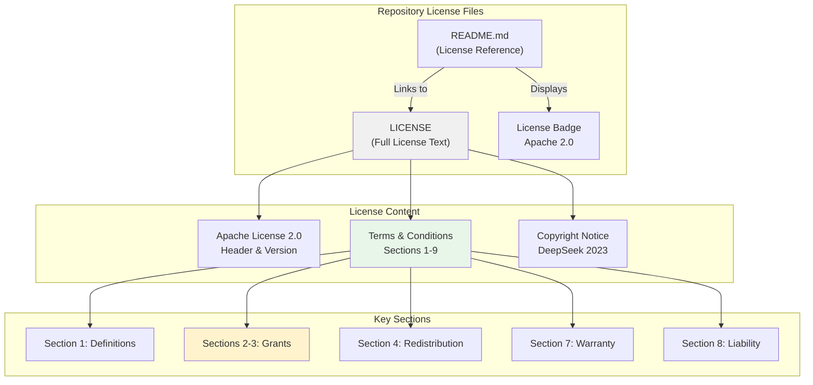
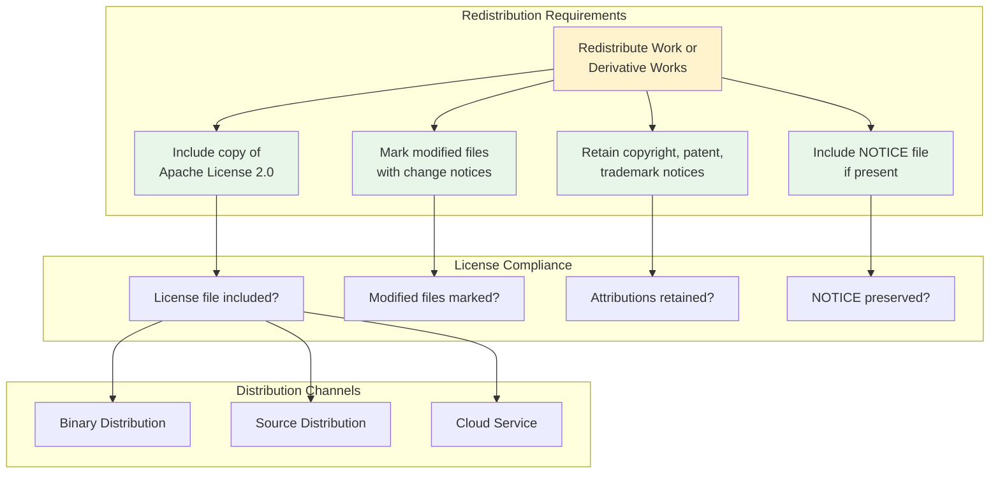
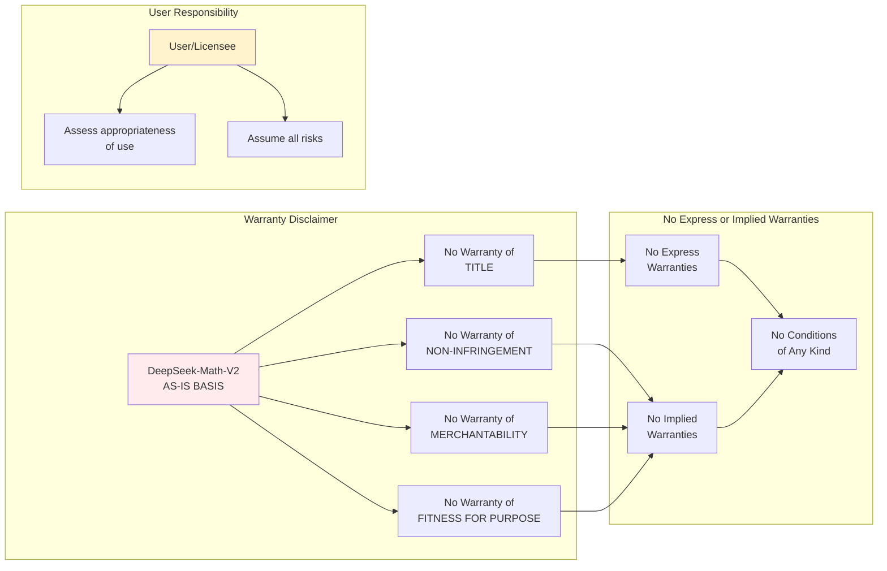
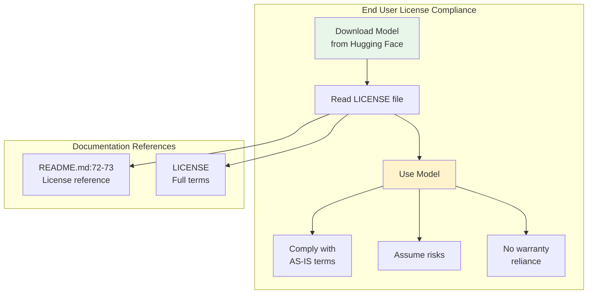
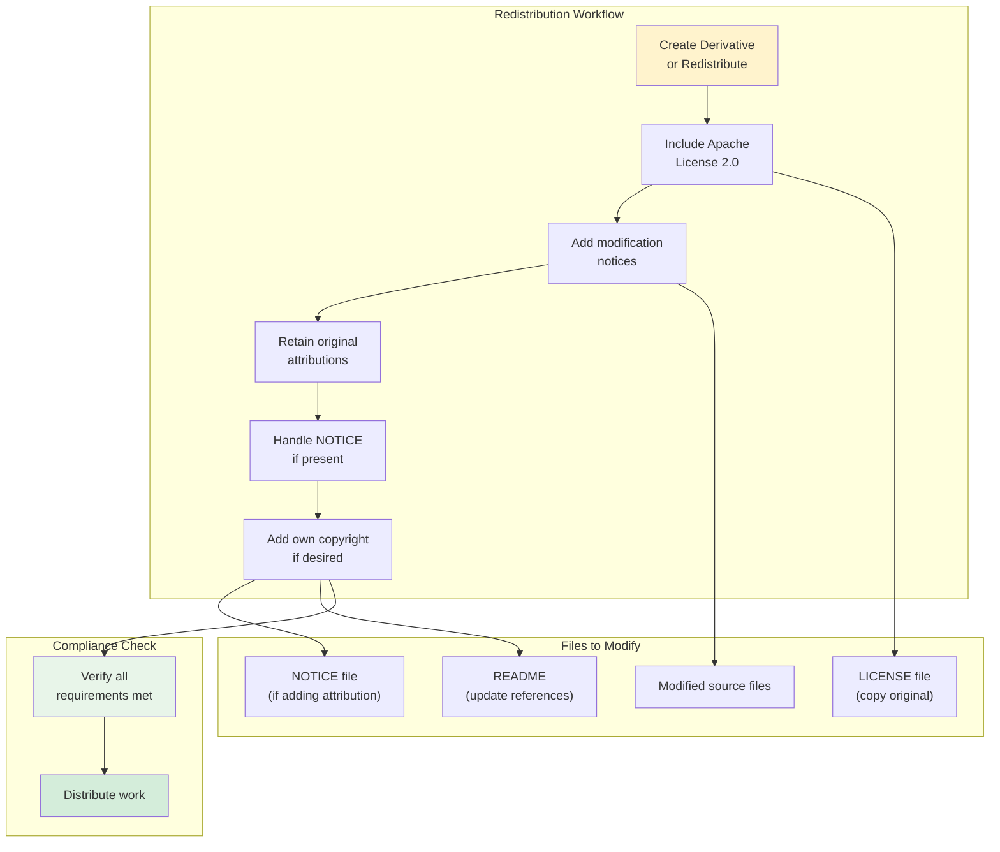

<!-- source: DeepWiki mcp.deepwiki.com · repo deepseek-ai/DeepSeek-Math-V2 · page 7.1 License & Legal · fetched 2026-10-30 -->

# License & Legal

<details>
<summary>Relevant source files</summary>

The following files were used as context for generating this wiki page:

- [LICENSE](LICENSE)
- [README.md](README.md)

</details>


This page documents the legal framework governing the use, distribution, and modification of DeepSeek-Math-V2. It explains the Apache License 2.0 terms, copyright information, and compliance requirements for users and developers working with the model and its outputs.

For information about external dependencies and their licenses, see [External Dependencies](#7.2). For access and usage instructions, see [Getting Started](#5).

---

## Overview

DeepSeek-Math-V2 is released under the **Apache License, Version 2.0** (January 2004), a permissive open-source license that allows broad commercial and non-commercial use. The license grants extensive rights to users while maintaining minimal restrictions and clear liability protections for the copyright holders.

### License File Structure



**Sources:** [README.md:24-26](), [README.md:72-73](), [LICENSE:1-202]()

---

## Copyright and Ownership

The copyright for DeepSeek-Math-V2 is held by **DeepSeek** (copyright year 2023). This copyright applies to:

- The trained model weights and parameters
- The inference code and documentation in this repository
- Model outputs and benchmark results (subject to license terms)

**Copyright Statement:**
```
Copyright (c) 2023 DeepSeek
```

The copyright notice is located at [LICENSE:190]() and applies to all components of the work unless explicitly stated otherwise.

**Sources:** [LICENSE:190]()

---

## Grant of Rights

The Apache License 2.0 grants users two primary types of rights:

### Copyright License

Users receive a **perpetual, worldwide, non-exclusive, no-charge, royalty-free, irrevocable** license to:

| Right | Description | Section Reference |
|-------|-------------|-------------------|
| **Reproduce** | Make copies of the model and code | [LICENSE:67-72]() |
| **Prepare Derivative Works** | Modify, adapt, or build upon the work | [LICENSE:67-72]() |
| **Publicly Display** | Show the work publicly | [LICENSE:67-72]() |
| **Publicly Perform** | Execute or run the work publicly | [LICENSE:67-72]() |
| **Sublicense** | Grant sublicenses to third parties | [LICENSE:67-72]() |
| **Distribute** | Share copies in Source or Object form | [LICENSE:67-72]() |

### Patent License

Users receive a **perpetual, worldwide, non-exclusive, no-charge, royalty-free, irrevocable** patent license to:

- Make, have made, use, offer to sell, sell, import, and transfer the Work
- Exercise patent claims necessarily infringed by contributions to the Work

**Patent Termination Clause:** If you initiate patent litigation alleging that the Work infringes patents, your patent licenses terminate as of the filing date [LICENSE:74-88]().

**Sources:** [LICENSE:67-88]()

---

## User Obligations and Requirements

### Redistribution Conditions

When redistributing the Work or Derivative Works, you **MUST** comply with these requirements:



**Detailed Requirements:**

1. **License Distribution** [LICENSE:95-96]()
   - Must provide a copy of the Apache License 2.0 to all recipients
   - Can be included as a separate `LICENSE` file or embedded in documentation

2. **Modification Notices** [LICENSE:98-99]()
   - Modified files must carry prominent notices stating changes were made
   - Must indicate who made the changes and when

3. **Attribution Retention** [LICENSE:101-106]()
   - Preserve all copyright, patent, trademark, and attribution notices
   - Exclude only notices that don't pertain to distributed Derivative Works

4. **NOTICE File Handling** [LICENSE:107-122]()
   - If the Work includes a `NOTICE` file, Derivative Works must include a readable copy
   - Place in one of: NOTICE file, Source form, documentation, or generated display
   - May add your own attribution notices alongside the original

**Sources:** [LICENSE:90-130]()

---

## Derivative Works and Modifications

Users have flexibility in creating and distributing modified versions:

### Permitted Modifications

You **MAY**:
- Add your own copyright statement to modifications [LICENSE:124]()
- Provide different license terms for your modifications [LICENSE:125-129]()
- Distribute modifications as a whole under different terms [LICENSE:125-129]()

### Required Compliance

You **MUST**:
- Ensure your modifications don't violate the base Apache License [LICENSE:127-129]()
- Maintain the original Work's license terms [LICENSE:127-129]()
- Comply with all conditions stated in the Apache License [LICENSE:127-129]()

### Contribution Submissions

Unless explicitly stated otherwise, any contributions submitted to DeepSeek:
- Are under the Apache License 2.0 terms [LICENSE:131-137]()
- Have no additional terms or conditions [LICENSE:131-137]()
- Do not supersede separate contribution agreements if executed [LICENSE:135-137]()

**Sources:** [LICENSE:124-137]()

---

## Disclaimer of Warranty

The license explicitly **DISCLAIMS ALL WARRANTIES**:



**Key Points:**

- **AS-IS Provision:** The model is provided "AS IS" without warranties [LICENSE:144-152]()
- **User Responsibility:** You are solely responsible for determining appropriateness of use [LICENSE:150-152]()
- **Risk Assumption:** You assume all risks associated with using the Work [LICENSE:150-152]()

**Practical Implications:**
- DeepSeek does not guarantee the model's accuracy, performance, or suitability
- Users must validate the model's outputs for their specific use cases
- No guarantee that the model is free from defects or errors

**Sources:** [LICENSE:144-152]()

---

## Limitation of Liability

The license strictly limits contributor liability:

### Liability Cap

Contributors are **NOT LIABLE** for:

| Damage Type | Coverage |
|-------------|----------|
| **Direct Damages** | Loss of data, business interruption, costs |
| **Indirect Damages** | Consequential losses, downstream effects |
| **Special Damages** | Unique or exceptional losses |
| **Incidental Damages** | Secondary costs and losses |
| **Consequential Damages** | Follow-on effects and impacts |

This limitation applies to:
- Tort claims (including negligence) [LICENSE:154-165]()
- Contract disputes [LICENSE:154-165]()
- Any other legal theory [LICENSE:154-165]()

### Exceptions

Liability may apply only if:
- Required by applicable law (e.g., deliberate acts) [LICENSE:156-157]()
- Agreed to in writing [LICENSE:156-157]()
- Grossly negligent acts were committed [LICENSE:156-157]()

**Sources:** [LICENSE:154-165]()

---

## Trademark Provisions

The license does **NOT** grant permission to use:

- Trade names of DeepSeek
- Trademarks (e.g., "DeepSeek", "DeepSeekMath")
- Service marks
- Product names

**Permitted Use:** Only reasonable and customary use for:
- Describing the origin of the Work [LICENSE:141-142]()
- Reproducing the content of the NOTICE file [LICENSE:141-142]()

**Restrictions:**
- Cannot use "DeepSeek" or related trademarks in product names without permission
- Cannot imply endorsement or sponsorship by DeepSeek
- Cannot use trademarks in misleading or confusing ways

**Sources:** [LICENSE:139-142]()

---

## License Application Workflow

### For End Users



**Sources:** [README.md:72-73](), [LICENSE:1-202]()

### For Redistributors and Derivative Work Creators



**Sources:** [LICENSE:90-130]()

---

## Citation and Attribution Requirements

### Citing DeepSeek-Math-V2

When using DeepSeek-Math-V2 in research or publications, use the following citation format as specified in the README:

```bibtex
@misc{deepseek-math-v2,
  author = {Zhihong Shao, Yuxiang Luo, Chengda Lu, Z.Z. Ren, 
            Jiewen Hu, Tian Ye, Zhibin Gou, Shirong Ma, Xiaokang Zhang},
  title = {DeepSeekMath-V2: Towards Self-Verifiable Mathematical Reasoning},
  year = {2025},
}
```

**Required Attribution Elements:**
- Author list as specified [README.md:79]()
- Full title of the work [README.md:80]()
- Publication year [README.md:81]()

**Sources:** [README.md:77-82]()

### Attribution in Derivative Works

When creating derivative works, you may add attribution notices but:
- Cannot construe them as modifying the License [LICENSE:118-122]()
- Must place them alongside (not replacing) original notices [LICENSE:119-120]()
- Must maintain original NOTICE file content [LICENSE:116-118]()

**Sources:** [LICENSE:118-122]()

---

## Warranty and Liability Acceptance

If you redistribute the Work and choose to offer additional terms:

### Optional Offerings

You **MAY** offer and charge for:
- Acceptance of support [LICENSE:166-175]()
- Warranty coverage [LICENSE:166-175]()
- Indemnity protection [LICENSE:166-175]()
- Other liability obligations [LICENSE:166-175]()

### Your Responsibilities

If you accept such obligations, you **MUST**:
- Act only on your own behalf [LICENSE:170-175]()
- Take sole responsibility [LICENSE:170-175]()
- Not act on behalf of other contributors [LICENSE:170-175]()
- Indemnify and defend each contributor [LICENSE:172-175]()
- Hold contributors harmless from claims [LICENSE:172-175]()

**Sources:** [LICENSE:166-175]()

---

## Accessing the License

### In Repository

The complete license text is available at:
- File: [LICENSE:1-202]()
- License type: Apache License, Version 2.0
- License URL: http://www.apache.org/licenses/LICENSE-2.0 [LICENSE:196]()

### In README

The README contains:
- License badge linking to the LICENSE file [README.md:24-26]()
- Section 6 explicitly stating license applicability [README.md:72-73]()
- Clear statement: "The use of DeepSeekMath-V2 models is subject to [the Model License](LICENSE)" [README.md:73]()

### Online Reference

For the canonical Apache License 2.0 text, refer to:
- Official URL: http://www.apache.org/licenses/ [LICENSE:4]()
- License version: 2.0, January 2004 [LICENSE:3]()

**Sources:** [README.md:24-26](), [README.md:72-73](), [LICENSE:1-4]()

---

## Key Terms and Definitions

The Apache License 2.0 defines several key terms used throughout:

| Term | Definition | Reference |
|------|------------|-----------|
| **License** | Terms and conditions for use, reproduction, and distribution | [LICENSE:10-11]() |
| **Licensor** | Copyright owner or authorized entity granting the License | [LICENSE:13-14]() |
| **Legal Entity** | Acting entity and all controlled entities | [LICENSE:16-22]() |
| **You/Your** | Individual or Legal Entity exercising License permissions | [LICENSE:24-25]() |
| **Source** | Preferred form for modifications (code, docs, configs) | [LICENSE:27-29]() |
| **Object** | Form from mechanical transformation of Source | [LICENSE:31-34]() |
| **Work** | Work of authorship made available under the License | [LICENSE:36-39]() |
| **Derivative Works** | Work based on or derived from the Work | [LICENSE:41-47]() |
| **Contribution** | Work intentionally submitted for inclusion | [LICENSE:49-61]() |
| **Contributor** | Licensor and entities submitting Contributions | [LICENSE:63-66]() |

**Sources:** [LICENSE:8-66]()

---

## Common Use Cases and Compliance

### Academic Research

**Use Case:** Using DeepSeek-Math-V2 for research papers

**Requirements:**
- Include citation as specified in [README.md:77-82]()
- Acknowledge use of the model in your paper
- No need to redistribute license if not distributing model

**Recommended:** Cite the model and acknowledge its use in your methodology section.

### Commercial Applications

**Use Case:** Deploying DeepSeek-Math-V2 in production services

**Requirements:**
- Comply with AS-IS warranty disclaimer [LICENSE:144-152]()
- Assume all risks for production use [LICENSE:150-152]()
- Consider liability limitations [LICENSE:154-165]()
- Do not use DeepSeek trademarks without permission [LICENSE:139-142]()

**Recommended:** Conduct thorough testing and validation before production deployment.

### Model Redistribution

**Use Case:** Hosting model weights on another platform

**Requirements:**
- Include copy of Apache License 2.0 [LICENSE:95-96]()
- Retain copyright notices [LICENSE:101-106]()
- Provide attribution to DeepSeek [LICENSE:101-106]()

**Recommended:** Include clear LICENSE file and attribution in model card.

### Fine-tuning and Derivatives

**Use Case:** Creating fine-tuned versions of DeepSeek-Math-V2

**Requirements:**
- Include original Apache License 2.0 [LICENSE:95-96]()
- Mark modifications clearly [LICENSE:98-99]()
- May add your own copyright for modifications [LICENSE:124]()
- May use different license terms for your additions [LICENSE:125-129]()

**Recommended:** Clearly document what was modified and maintain original attributions.

**Sources:** [README.md:77-82](), [LICENSE:95-130](), [LICENSE:139-152]()

---

## Summary Table

| Aspect | Status | Key Requirements |
|--------|--------|------------------|
| **License Type** | Apache 2.0 | Permissive, open-source |
| **Copyright Holder** | DeepSeek (2023) | Must retain copyright notices |
| **Commercial Use** | ✅ Permitted | No restrictions, royalty-free |
| **Modification** | ✅ Permitted | Must mark changes prominently |
| **Distribution** | ✅ Permitted | Must include license and notices |
| **Patent Grant** | ✅ Included | Terminates if patent litigation filed |
| **Trademark Use** | ❌ Not Granted | Only for attribution purposes |
| **Warranty** | ❌ Disclaimed | AS-IS, no warranties provided |
| **Liability** | ❌ Limited | Contributors not liable for damages |
| **Sublicensing** | ✅ Permitted | May sublicense to third parties |

**Sources:** [LICENSE:1-202](), [README.md:24-26](), [README.md:72-73]()

---

