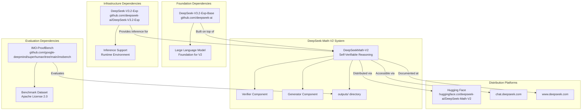
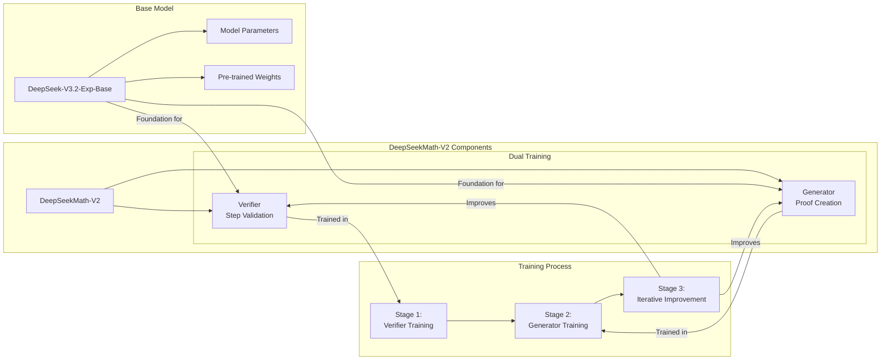
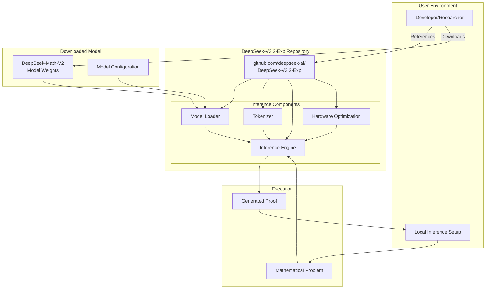
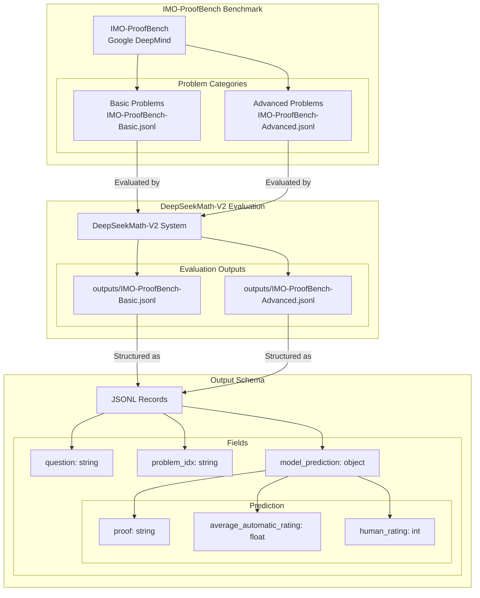
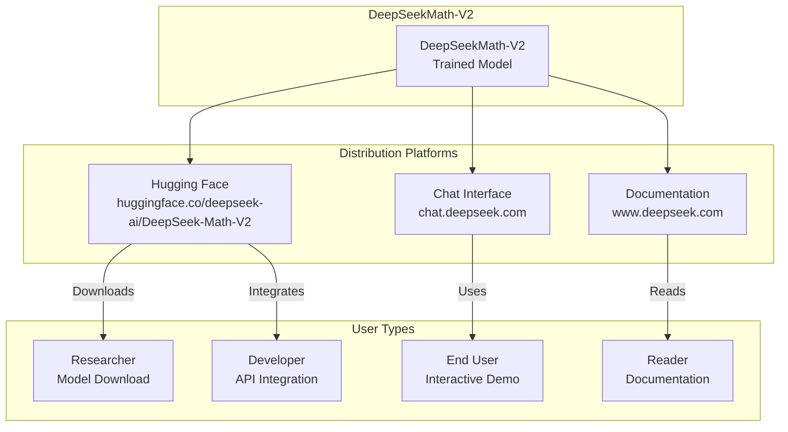
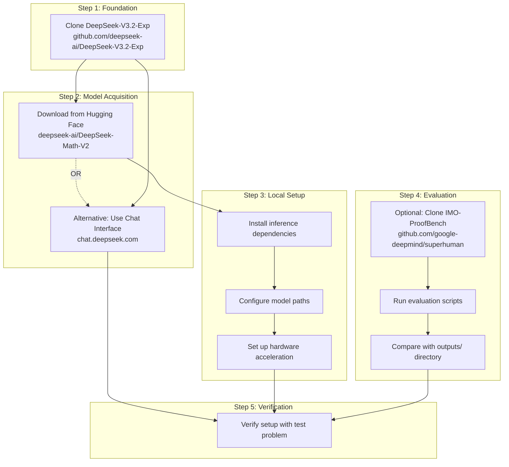

<!-- source: DeepWiki mcp.deepwiki.com · repo deepseek-ai/DeepSeek-Math-V2 · page 7.2 External Dependencies · fetched 2026-10-30 -->

# External Dependencies

<details>
<summary>Relevant source files</summary>

The following files were used as context for generating this wiki page:

- [README.md](README.md)
- [outputs/README.md](outputs/README.md)

</details>


This document identifies and describes all external dependencies required by DeepSeek-Math-V2, including foundation models, inference infrastructure, benchmarking systems, and distribution platforms. Understanding these dependencies is essential for deployment, evaluation, and attribution.

For information about licensing terms and conditions, see [License & Legal](#7.1). For community resources and support channels, see [Community & Support](#7.3).

## Overview

DeepSeek-Math-V2 depends on three primary external components:

| Dependency | Type | Provider | Purpose | License |
|------------|------|----------|---------|---------|
| `DeepSeek-V3.2-Exp-Base` | Foundation Model | DeepSeek AI | Base model for mathematical reasoning | Apache 2.0 |
| `DeepSeek-V3.2-Exp` | Inference Infrastructure | DeepSeek AI (GitHub) | Inference support and runtime | Apache 2.0 |
| `IMO-ProofBench` | Benchmark Dataset | Google DeepMind | Evaluation framework | Apache 2.0 |

Sources: [README.md:69-70](), [outputs/README.md:1]()

## Dependency Architecture



**Dependency Graph**: This diagram shows how DeepSeek-Math-V2 depends on external systems. The foundation model provides the base capabilities, the inference repository enables execution, IMO-ProofBench validates performance, and multiple platforms distribute the system to users.

Sources: [README.md:69-70](), [README.md:49](), [outputs/README.md:1]()

## Foundation Model: DeepSeek-V3.2-Exp-Base

DeepSeekMath-V2 is built on top of `DeepSeek-V3.2-Exp-Base`, which serves as the foundational large language model for both the verifier and generator components.

### Model Specifications

| Property | Value |
|----------|-------|
| **Name** | `DeepSeek-V3.2-Exp-Base` |
| **Repository** | `github.com/deepseek-ai` |
| **Distribution** | Hugging Face: `deepseek-ai/DeepSeek-Math-V2` |
| **Architecture** | Mixture-of-Experts (MoE) |
| **License** | Apache License 2.0 |

### Dependency Relationship



**Foundation Model Integration**: DeepSeek-V3.2-Exp-Base provides the base architecture and pre-trained weights for both the verifier and generator components in DeepSeekMath-V2.

Sources: [README.md:69](), [README.md:30-45]()

### Download Location

The model is available via Hugging Face at:
```
https://huggingface.co/deepseek-ai/DeepSeek-Math-V2
```

Referenced in: [README.md:69]()

## Inference Infrastructure: DeepSeek-V3.2-Exp Repository

The `DeepSeek-V3.2-Exp` GitHub repository provides the inference infrastructure required to run DeepSeekMath-V2 models.

### Repository Details

| Property | Value |
|----------|-------|
| **Repository** | `github.com/deepseek-ai/DeepSeek-V3.2-Exp` |
| **Purpose** | Inference support and runtime environment |
| **Components** | Model loading, tokenization, generation pipelines |
| **License** | Apache License 2.0 |

### Usage Pattern

The inference repository provides:
- **Model Loading**: Utilities for loading DeepSeekMath-V2 weights
- **Tokenization**: Text preprocessing and encoding
- **Generation Pipelines**: Inference execution and decoding
- **Hardware Optimization**: GPU/TPU acceleration support

Users must reference this repository to set up local inference:

Referenced in: [README.md:70]()

### Inference Dependency Flow



**Inference Infrastructure Flow**: Users download model weights and reference the DeepSeek-V3.2-Exp repository to load and execute DeepSeekMath-V2 for local inference.

Sources: [README.md:69-70]()

## Benchmark Dependency: IMO-ProofBench

DeepSeek-Math-V2 uses `IMO-ProofBench` as an evaluation benchmark, which was developed by Google DeepMind.

### Benchmark Details

| Property | Value |
|----------|-------|
| **Name** | IMO-ProofBench |
| **Repository** | `github.com/google-deepmind/superhuman/tree/main/imobench` |
| **Developer** | Google DeepMind (DeepThink IMO-Gold team) |
| **License** | Apache License 2.0 |
| **License URL** | `github.com/google-deepmind/superhuman/blob/main/LICENSE` |

### Attribution Requirement

The repository explicitly acknowledges IMO-ProofBench usage:

Referenced in: [outputs/README.md:1]()

### Benchmark Structure

IMO-ProofBench provides two difficulty levels used in evaluation:



**IMO-ProofBench Evaluation Structure**: The benchmark provides two problem sets that DeepSeekMath-V2 evaluates, producing structured JSONL outputs with proofs and ratings.

Sources: [outputs/README.md:1](), [README.md:49-56]()

### Problem Characteristics

| Category | File | Content |
|----------|------|---------|
| **Basic** | `IMO-ProofBench-Basic.jsonl` | Elementary proof problems with basic verification |
| **Advanced** | `IMO-ProofBench-Advanced.jsonl` | Complex problems requiring formal representations and proof tactics |

Evaluation results are stored in the `outputs/` directory.

Sources: [README.md:50]()

## Distribution Platforms

DeepSeek-Math-V2 is distributed through multiple external platforms for different use cases.

### Platform Matrix



**Distribution Channels**: DeepSeekMath-V2 is accessible through three primary platforms, each serving different user needs.

Sources: [README.md:10-23]()

### Platform Specifications

| Platform | URL | Purpose | Authentication |
|----------|-----|---------|----------------|
| **Hugging Face** | `huggingface.co/deepseek-ai/DeepSeek-Math-V2` | Model download and hosting | Optional (for private models) |
| **Chat Interface** | `chat.deepseek.com` | Interactive problem-solving | Account required |
| **Website** | `www.deepseek.com` | Documentation and information | None |

Referenced in: [README.md:10-15]()

## License Dependencies

All external dependencies use the Apache License 2.0, ensuring compatibility:

| Component | License | License File |
|-----------|---------|--------------|
| `DeepSeek-V3.2-Exp-Base` | Apache License 2.0 | `LICENSE` in repository |
| `DeepSeek-V3.2-Exp` (inference) | Apache License 2.0 | Repository license |
| `IMO-ProofBench` | Apache License 2.0 | `github.com/google-deepmind/superhuman/blob/main/LICENSE` |

### Licensing Implications

The consistent use of Apache License 2.0 across all dependencies means:
- **Redistribution**: Allowed with proper attribution
- **Modification**: Permitted under the same license
- **Commercial Use**: Permitted
- **Patent Grant**: Includes explicit patent license

For detailed license terms and conditions, see [License & Legal](#7.1).

Sources: [README.md:24-26](), [outputs/README.md:1]()

## Dependency Resolution and Setup

### Setup Sequence



**Dependency Setup Workflow**: Complete setup process for using DeepSeekMath-V2 with all dependencies.

Sources: [README.md:67-70]()

### Minimal Setup (Chat Interface Only)

For users who only need interactive access:
1. Navigate to `chat.deepseek.com`
2. Create account (if required)
3. No installation or dependencies needed

Referenced in: [README.md:12-13]()

### Full Setup (Local Inference)

For developers and researchers requiring local inference:

1. **Clone inference repository**:
   ```
   git clone https://github.com/deepseek-ai/DeepSeek-V3.2-Exp
   ```

2. **Download model weights**:
   - Access `huggingface.co/deepseek-ai/DeepSeek-Math-V2`
   - Follow Hugging Face download instructions

3. **Install dependencies** (refer to `DeepSeek-V3.2-Exp` repository)

4. **Configure and run** (refer to inference repository documentation)

Referenced in: [README.md:69-70]()

## Dependency Version Management

### Current Versions

| Component | Version Identifier | Stability |
|-----------|-------------------|-----------|
| `DeepSeek-V3.2-Exp-Base` | v3.2 | Stable |
| `DeepSeek-V3.2-Exp` | Latest (main branch) | Active development |
| `IMO-ProofBench` | Latest (main branch) | Stable |

### Version Compatibility

DeepSeekMath-V2 requires:
- Inference repository compatible with v3.2 architecture
- IMO-ProofBench benchmark format (JSONL schema)
- Apache License 2.0 compliance across all components

Sources: [README.md:69-70]()

## External References and Attribution

### Required Citations

When using DeepSeek-Math-V2, proper attribution must be given to:

1. **DeepSeek-Math-V2 itself**:
   ```
   @misc{deepseek-math-v2,
     author = {Zhihong Shao, Yuxiang Luo, Chengda Lu, Z.Z. Ren, 
               Jiewen Hu, Tian Ye, Zhibin Gou, Shirong Ma, Xiaokang Zhang},
     title = {DeepSeekMath-V2: Towards Self-Verifiable Mathematical Reasoning},
     year = {2025},
   }
   ```

2. **IMO-ProofBench** (when using benchmark results):
   - Repository: `github.com/google-deepmind/superhuman/tree/main/imobench`
   - Developer: Google DeepMind
   - License: Apache License 2.0

Referenced in: [README.md:77-82](), [outputs/README.md:1]()

## Contact and Support

For questions regarding dependencies or setup:
- **Email**: `service@deepseek.com`
- **GitHub Issues**: Repository issue tracker
- **Community**: See [Community & Support](#7.3) for additional channels

Referenced in: [README.md:87]()

---

**Summary**: DeepSeek-Math-V2 depends on three primary external systems—DeepSeek-V3.2-Exp-Base for foundation capabilities, the DeepSeek-V3.2-Exp repository for inference infrastructure, and IMO-ProofBench for evaluation. All dependencies use Apache License 2.0, ensuring open and compatible usage. The system is distributed through Hugging Face for downloads and chat.deepseek.com for interactive access.

Sources: [README.md:1-88](), [outputs/README.md:1]()

---

