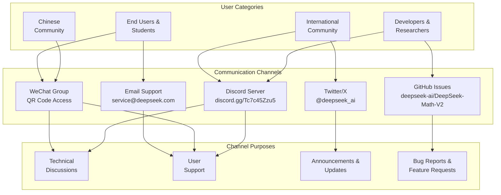
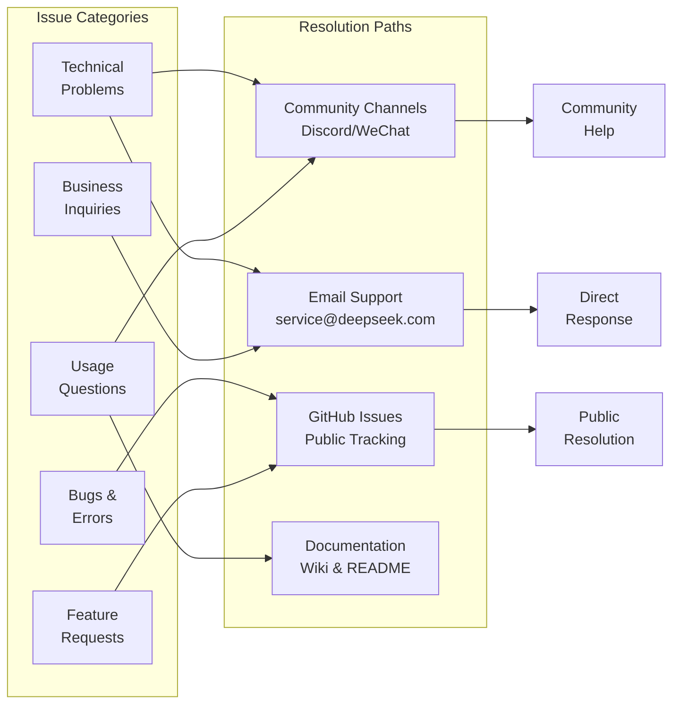
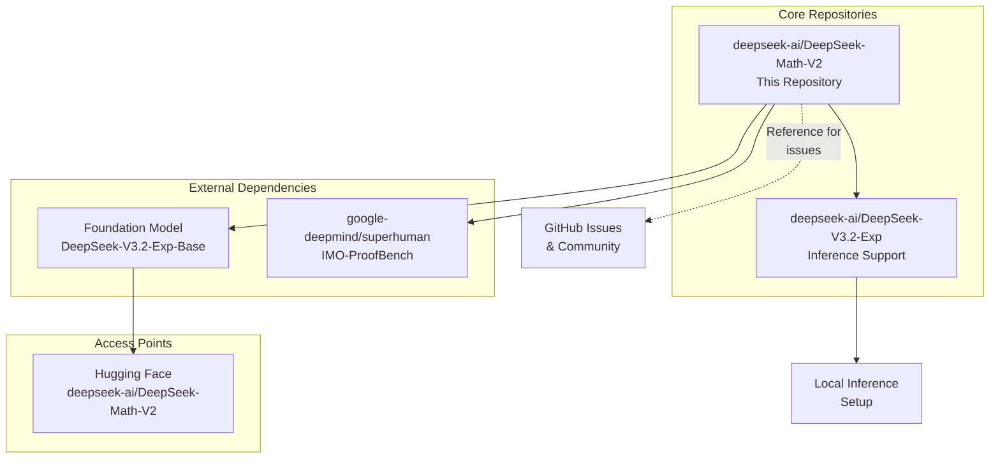

<!-- source: DeepWiki mcp.deepwiki.com · repo deepseek-ai/DeepSeek-Math-V2 · page 7.3 Community & Support · fetched 2026-10-30 -->

# Community & Support

<details>
<summary>Relevant source files</summary>

The following files were used as context for generating this wiki page:

- [README.md](README.md)

</details>


This page documents the community channels and support mechanisms available for DeepSeek-Math-V2. It covers official communication platforms, methods for getting technical assistance, and procedures for reporting issues or contributing feedback. For information about licensing and legal terms, see [License & Legal](#7.1). For details on external system dependencies, see [External Dependencies](#7.2).

## Overview

The DeepSeek-Math-V2 project maintains multiple community channels to serve different user needs, geographical regions, and communication preferences. These channels facilitate technical discussions, provide user support, share announcements, and enable community engagement around mathematical reasoning research.



**Diagram: DeepSeek-Math-V2 Community and Support Ecosystem**

Sources: [README.md:10-28](), [README.md:85-88]()

## Community Channels

The following table lists all official community channels, their primary purposes, and access information:

| Channel | Purpose | Access Method | Language | Primary Use Case |
|---------|---------|---------------|----------|------------------|
| Discord Server | Real-time technical discussions, Q&A, community chat | Join link: `discord.gg/Tc7c45Zzu5` | English | International developer community, technical support |
| WeChat Group | Community discussions, Chinese language support | QR code at `figures/qr.jpeg` | Chinese (中文) | Chinese-speaking users, regional community |
| Twitter/X | Official announcements, research updates, news | Follow `@deepseek_ai` | English | Public announcements, research dissemination |
| GitHub Issues | Bug reports, feature requests, technical issues | Repository issues page | English | Formal issue tracking, development discussions |
| Email Support | Direct support inquiries, business contacts | `service@deepseek.com` | English/Chinese | Individual support cases, partnership inquiries |

Sources: [README.md:17-22](), [README.md:87]()

### Discord Server

The Discord server serves as the primary platform for real-time technical discussions and community engagement for international users.

**Access Information:**
- **Invitation Link:** `discord.gg/Tc7c45Zzu5`
- **Badge Reference:** [README.md:17-18]()

**Typical Use Cases:**
- Asking questions about model usage and inference setup
- Discussing evaluation results and benchmark comparisons
- Sharing research findings and experimental results
- Troubleshooting technical issues with community help
- Networking with other researchers and developers

Sources: [README.md:17-18]()

### WeChat Group

The WeChat group provides community support specifically for Chinese-speaking users (中文社区), enabling discussions in Mandarin and facilitating regional collaboration.

**Access Information:**
- **QR Code Location:** `figures/qr.jpeg` in the repository
- **Badge Reference:** [README.md:19-20]()

**Typical Use Cases:**
- Chinese language technical support
- Regional community discussions
- Localized troubleshooting assistance
- Chinese academic and research collaboration

Sources: [README.md:19-20]()

### Twitter/X

The official Twitter account (`@deepseek_ai`) serves as the primary channel for public announcements, research updates, and news dissemination.

**Access Information:**
- **Handle:** `@deepseek_ai`
- **Badge Reference:** [README.md:21-22]()

**Typical Content:**
- New model releases and updates
- Research paper announcements
- Competition results and achievements
- System capability demonstrations
- Important project milestones

Sources: [README.md:21-22]()

## Support Mechanisms



**Diagram: Support Request Routing**

Sources: [README.md:87]()

### GitHub Issues

For technical issues, bugs, or feature requests related to the DeepSeek-Math-V2 codebase, users should create GitHub issues on the project repository.

**When to Use GitHub Issues:**
- Reproducible bugs in inference or model behavior
- Feature requests for repository functionality
- Documentation improvements
- Issues with output data formats or benchmarks
- Technical problems with model setup

**Issue Creation Process:**
1. Navigate to the repository: `github.com/deepseek-ai/DeepSeek-Math-V2`
2. Click "Issues" tab
3. Search existing issues to avoid duplicates
4. Click "New Issue"
5. Provide detailed description including:
   - Problem description
   - Steps to reproduce
   - Expected vs actual behavior
   - Environment details (hardware, software versions)
   - Relevant log excerpts or error messages

Sources: [README.md:87]()

### Email Support

For direct support inquiries that may involve sensitive information, business discussions, or cases requiring individual attention, contact the support email.

**Contact Information:**
- **Email Address:** `service@deepseek.com`
- **Reference:** [README.md:87]()

**Appropriate Email Topics:**
- Individual technical support cases
- Business partnership inquiries
- Licensing questions beyond standard documentation
- Security or privacy concerns
- Issues requiring confidential discussion

**Response Expectations:**
- Email responses typically provided during business hours (China timezone)
- Complex technical issues may require additional time for investigation
- Users may be redirected to GitHub Issues for publicly-relevant problems

Sources: [README.md:87]()

## Additional Resources

### Official Platforms

The following platforms provide complementary access points to the DeepSeek ecosystem:

| Platform | URL | Purpose |
|----------|-----|---------|
| Homepage | `www.deepseek.com` | Official website, company information, research overview |
| Chat Interface | `chat.deepseek.com` | Interactive demo of DeepSeek-V3 and related models |
| Hugging Face | `huggingface.co/deepseek-ai` | Model downloads, model cards, usage examples |
| GitHub (Main Repo) | `github.com/deepseek-ai/DeepSeek-Math-V2` | Source repository, documentation, outputs |
| GitHub (Inference) | `github.com/deepseek-ai/DeepSeek-V3.2-Exp` | Inference code for foundation model |

Sources: [README.md:10-15](), [README.md:69-70]()

### Documentation Resources

For detailed technical information, users should refer to:
- **Getting Started Guide:** See [Getting Started](#5) for model access and basic usage
- **Inference Setup:** See [Inference Setup](#5.2) for running the model locally
- **Output Formats:** See [Data Formats & Outputs](#4) for understanding model predictions
- **License Terms:** See [License & Legal](#7.1) for usage rights and restrictions

### Related GitHub Repositories



**Diagram: Repository Relationships and Support Context**

Sources: [README.md:69-70]()

## Best Practices for Community Engagement

### Asking Questions Effectively

When seeking help from the community or support channels:

1. **Search First:** Check existing GitHub issues, Discord history, or documentation
2. **Provide Context:** Include model version, inference setup, and environment details
3. **Include Reproducible Examples:** Share code snippets, input data, and error messages
4. **Be Specific:** Clearly describe expected vs actual behavior
5. **Follow Up:** Update threads with solutions or additional findings

### Contributing to the Community

Users can contribute to the DeepSeek-Math-V2 community by:
- **Sharing Results:** Post evaluation results on new problem sets
- **Documenting Solutions:** Help others by documenting solutions to common issues
- **Reporting Bugs:** Create detailed GitHub issues for reproducible problems
- **Providing Feedback:** Share insights on model behavior and capabilities
- **Academic Collaboration:** Cite the work appropriately and share research findings

### Citation Information

When referencing DeepSeek-Math-V2 in academic work, use the citation format provided in [README.md:77-82]():

```bibtex
@misc{deepseek-math-v2,
  author = {Zhihong Shao, Yuxiang Luo, Chengda Lu, Z.Z. Ren, Jiewen Hu, Tian Ye, Zhibin Gou, Shirong Ma, Xiaokang Zhang},
  title = {DeepSeekMath-V2: Towards Self-Verifiable Mathematical Reasoning},
  year = {2025},
}
```

Sources: [README.md:77-82]()

## Communication Guidelines

### Expected Response Times

| Channel | Typical Response Time | Notes |
|---------|----------------------|-------|
| Discord | Minutes to hours | Community-driven, varies by activity level |
| WeChat | Minutes to hours | Community-driven, regional hours |
| Twitter | N/A | Announcement-only, no direct responses |
| GitHub Issues | 1-7 business days | Depends on issue complexity and priority |
| Email | 1-5 business days | Business hours, China timezone |

### Professional Conduct

All community channels follow standard professional conduct expectations:
- Respectful communication with community members and maintainers
- On-topic discussions related to DeepSeek-Math-V2 and mathematical reasoning
- No spam, advertising, or off-topic content
- Adherence to platform-specific community guidelines

Sources: [README.md:85-88]()