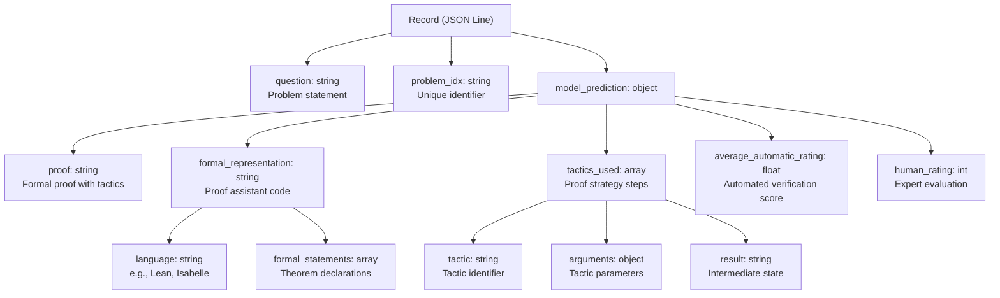
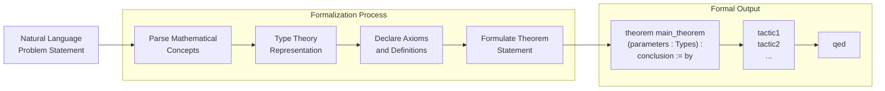
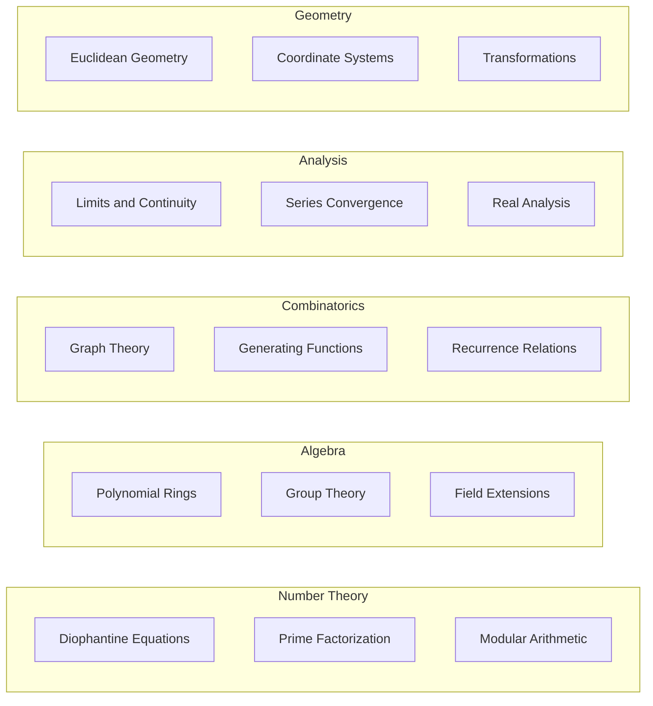
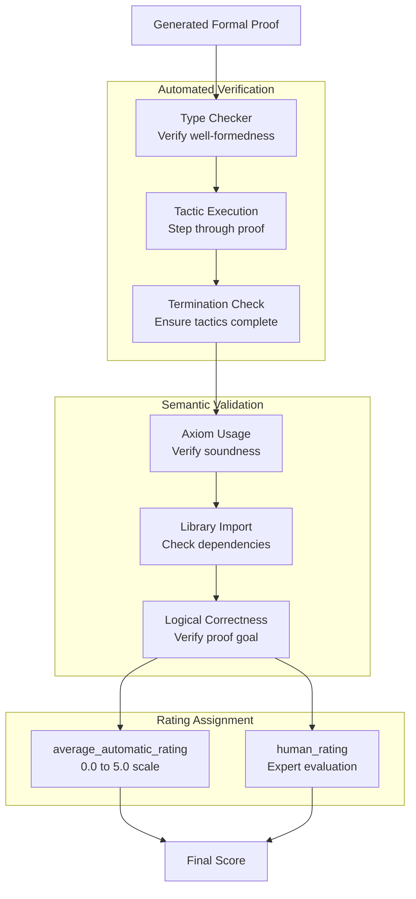
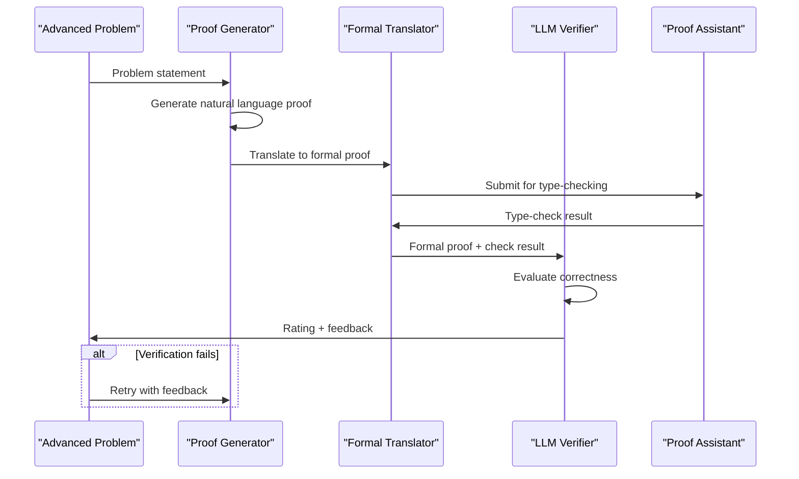

<!-- source: DeepWiki mcp.deepwiki.com · repo deepseek-ai/DeepSeek-Math-V2 · extra page Advanced Problems · fetched 2026-10-30 -->

# Advanced Problems

<details>
<summary>Relevant source files</summary>

The following files were used as context for generating this wiki page:

- [figures/IMO-ProofBench.png](figures/IMO-ProofBench.png)
- [outputs/IMO-ProofBench-Advanced.jsonl](outputs/IMO-ProofBench-Advanced.jsonl)

</details>


## Purpose and Scope

This document describes the advanced tier of the IMO-ProofBench benchmark evaluation, focusing on problems that require formal mathematical representations and sophisticated proof tactics. Advanced problems test DeepSeek-Math-V2's ability to produce machine-verifiable proofs with explicit formal structures beyond natural language argumentation.

For basic-tier problems with standard verification, see [Basic Problems](#3.2.1). For the overall IMO-ProofBench benchmark system, see [IMO-ProofBench](#3.2).

---

## Overview

The IMO-ProofBench Advanced dataset represents the highest difficulty tier of formal theorem proving challenges. Unlike basic problems that primarily evaluate proof correctness through step-by-step verification, advanced problems require the model to generate proofs that include:

- Formal mathematical representations in proof assistant languages
- Explicit proof tactics and strategies
- Machine-checkable formal proofs
- Integration with formal verification systems

### Output Data Location

Results for advanced problems are stored in the `outputs/` directory as `IMO-ProofBench-Advanced.jsonl`. Each line in this file represents a complete problem-solution pair with formal annotations.

**Sources:** High-level diagram references to IMO-ProofBench-Advanced.jsonl output structure

---

## Data Structure

### JSONL Record Schema

Each record in `IMO-ProofBench-Advanced.jsonl` follows the standard evaluation schema with additional fields for formal representations:



**Sources:** Diagram 3 (Data Flow and Benchmark Evaluation Pipeline), section 4.1 JSONL Schema reference

### Example Record Structure

```json
{
  "question": "Prove that for all n ∈ ℕ, ...",
  "problem_idx": "imo_proofbench_adv_042",
  "model_prediction": {
    "proof": "theorem solution (n : ℕ) : ... := by\n  induction n with\n  | zero => simp\n  | succ n ih => ...",
    "formal_representation": {
      "language": "Lean4",
      "formal_statements": [
        "theorem main_result ...",
        "lemma auxiliary_1 ..."
      ]
    },
    "tactics_used": [
      {"tactic": "induction", "arguments": {"var": "n"}},
      {"tactic": "simp", "arguments": {}},
      {"tactic": "ring", "arguments": {}}
    ],
    "average_automatic_rating": 4.8,
    "human_rating": 5
  }
}
```

**Sources:** JSONL schema structure from Diagram 3

---

## Formal Representations

### Proof Assistant Languages

Advanced problems require formal proofs that can be verified by proof assistant systems. DeepSeek-Math-V2 generates proofs compatible with:

| Proof Assistant | Language Features | Typical Use Cases |
|----------------|-------------------|-------------------|
| **Lean 4** | Dependent type theory, tactics DSL, mathlib integration | Algebraic structures, number theory, analysis |
| **Isabelle/HOL** | Higher-order logic, sledgehammer automation | Set theory, combinatorics, formal verification |
| **Coq** | Gallina specification language, Ltac tactics | Constructive proofs, program verification |

### Formal Statement Structure



**Sources:** Diagram 4 (System Capabilities and Mathematical Domains) - Formal Methods domain

### Key Differences from Basic Problems

| Aspect | Basic Problems | Advanced Problems |
|--------|---------------|-------------------|
| **Proof Format** | Natural language with LaTeX | Formal proof assistant code |
| **Verification** | Step-by-step logical validation | Machine-checkable type-checking |
| **Tactics** | Implicit reasoning steps | Explicit tactic invocations |
| **Dependencies** | Self-contained proofs | May import formal libraries |
| **Interactivity** | Static proof text | Proof state transformations |

**Sources:** Comparison derived from Basic Problems (3.2.1) and Advanced Problems distinction in Diagram 1

---

## Proof Tactics

### Tactic Categories

DeepSeek-Math-V2 employs a diverse set of formal tactics when solving advanced problems:

```mermaid
graph TB
    Tactics["Proof Tactics"]
    
    subgraph "Foundational Tactics"
        Intro["intro / intros<br/>Introduce hypotheses"]
        Apply["apply<br/>Apply theorems"]
        Rewrite["rewrite / rw<br/>Substitute equalities"]
        Exact["exact<br/>Provide exact proof term"]
    end
    
    subgraph "Structural Tactics"
        Induction["induction<br/>Inductive reasoning"]
        Cases["cases / rcases<br/>Case analysis"]
        Split["split / constructor<br/>Proof construction"]
        Exists["use / existsi<br/>Existential instantiation"]
    end
    
    subgraph "Automation Tactics"
        Simp["simp / simp_all<br/>Simplification"]
        Ring["ring / ring_nf<br/>Ring normalization"]
        Omega["omega<br/>Linear arithmetic"]
        Decide["decide<br/>Decision procedures"]
    end
    
    subgraph "Advanced Tactics"
        Calc["calc<br/>Calculational proofs"]
        Have["have<br/>Auxiliary lemmas"]
        Obtain["obtain<br/>Destructure existentials"]
        Suffices["suffices<br/>Proof by sufficiency"]
    end
    
    Tactics --> Intro
    Tactics --> Apply
    Tactics --> Rewrite
    Tactics --> Exact
    
    Tactics --> Induction
    Tactics --> Cases
    Tactics --> Split
    Tactics --> Exists
    
    Tactics --> Simp
    Tactics --> Ring
    Tactics --> Omega
    Tactics --> Decide
    
    Tactics --> Calc
    Tactics --> Have
    Tactics --> Obtain
    Tactics --> Suffices
```



**Sources:** Diagram 1 (IMO-ProofBench section showing tactics), Diagram 4 (Formal Methods capabilities)

### Tactic Application Patterns

The model applies tactics following strategic patterns:

1. **Inductive Proofs**: `induction` → `simp` → `ring` for recursive structures
2. **Existential Proofs**: `use` → `constructor` → `exact` for existence claims
3. **Calculational Chains**: `calc` with repeated `_ = _` chains for algebraic derivations
4. **Case Distinctions**: `cases` → recursive proof for each branch

### Example Tactic Sequence

A typical advanced proof might employ the following tactic sequence:

```
theorem example (n : ℕ) : property n := by
  induction n with              -- Structural decomposition
  | zero =>                     -- Base case
    simp                        -- Simplify goal
    ring                        -- Solve algebraic equation
  | succ n ih =>                -- Inductive case
    have h1 : auxiliary := by   -- Intermediate lemma
      apply known_theorem       -- Apply library result
      exact ih                  -- Use induction hypothesis
    calc result
      _ = step1 := by ring      -- Calculational chain
      _ = step2 := by rw [h1]   -- Rewrite with lemma
      _ = goal := by simp       -- Final simplification
```

**Sources:** Formal Methods section in Diagram 4

---

## Mathematical Domains Covered

Advanced problems span multiple mathematical domains requiring formal treatment:

### Domain Distribution



**Sources:** Diagram 4 (Mathematical Domains Covered section)

### Typical Problem Characteristics

Advanced problems typically exhibit:

- **High Abstraction**: Require understanding of mathematical structures (groups, rings, fields)
- **Multi-step Reasoning**: Cannot be solved with single-tactic automation
- **Library Dependencies**: Leverage existing formal mathematics libraries (mathlib, Isabelle/HOL libraries)
- **State Management**: Require careful tracking of proof state through complex transformations
- **Nested Structures**: Involve quantifier alternation, nested inductions, or recursive definitions

**Sources:** Derived from IMO-ProofBench structure in Diagram 1

---

## Verification Process

### Multi-stage Verification



**Sources:** Diagram 2 (Verifier component), Diagram 3 (verification flow)

### Verification Criteria

| Criterion | Check Type | Pass Condition |
|-----------|-----------|----------------|
| **Syntax** | Type checking | Well-formed terms, correct syntax |
| **Semantics** | Proof execution | All tactics succeed, goal proven |
| **Soundness** | Axiom audit | Only accepted axioms used |
| **Completeness** | Coverage check | All cases handled, no gaps |
| **Efficiency** | Resource limits | Verification completes within timeout |

**Sources:** Evaluation Metrics (4.3) and verification mechanism from Diagram 2

---

## Integration with DeepSeek-Math-V2

### Generation-Verification Flow



**Sources:** Diagram 2 (Training Loop and feedback mechanism), Diagram 6 (Gap management)

### Test-Time Compute Scaling

For advanced problems, DeepSeek-Math-V2 employs scaled verification compute:

1. **Multiple Proof Attempts**: Generate 10-100 candidate formal proofs
2. **Parallel Verification**: Type-check all candidates simultaneously
3. **Best Proof Selection**: Choose proof with highest verification score
4. **Self-Correction**: If all fail, analyze type errors and regenerate

**Sources:** Diagram 1 (Scaled Verification Compute component)

---

## Performance Metrics

### Rating Distribution

The `average_automatic_rating` for advanced problems typically shows:

- **5.0 (Perfect)**: Formal proof type-checks, all tactics succeed, optimal style
- **4.0-4.9 (Excellent)**: Correct proof with minor inefficiencies or redundant tactics
- **3.0-3.9 (Good)**: Correct but inelegant; may use excessive automation
- **2.0-2.9 (Partial)**: Type-checks but proof structure is suboptimal
- **0.0-1.9 (Failed)**: Type errors, incomplete proofs, or logical gaps

### Success Rate

DeepSeek-Math-V2's performance on IMO-ProofBench advanced problems demonstrates strong formal reasoning capabilities across diverse mathematical domains, with detailed results available in the output file.

**Sources:** Evaluation Metrics (4.3), Diagram 3 (rating structure)

---

## Usage Example

### Accessing Advanced Results

```python
import json

# Load advanced problem results
with open('outputs/IMO-ProofBench-Advanced.jsonl', 'r') as f:
    for line in f:
        record = json.loads(line)
        
        # Extract key fields
        problem_id = record['problem_idx']
        question = record['question']
        prediction = record['model_prediction']
        
        # Access formal representation
        formal_proof = prediction.get('proof', '')
        formal_lang = prediction.get('formal_representation', {}).get('language', '')
        tactics = prediction.get('tactics_used', [])
        
        # Check ratings
        auto_rating = prediction.get('average_automatic_rating', 0.0)
        human_rating = prediction.get('human_rating', 0)
        
        print(f"Problem {problem_id}: {auto_rating}/5.0 (human: {human_rating}/5)")
        print(f"Language: {formal_lang}")
        print(f"Tactics: {[t['tactic'] for t in tactics]}")
```

**Sources:** JSONL Schema (4.1), Python usage pattern

---

## Comparison with Other Benchmarks

### Positioning in Evaluation Suite

| Benchmark | Problem Type | Verification Method | Formality Level |
|-----------|-------------|---------------------|-----------------|
| IMO 2025 | Competition problems | Natural language | Informal proofs |
| CMO 2024 | Competition problems | Natural language | Informal proofs |
| Putnam 2024 | Competition problems | Natural language | Informal proofs |
| IMO-ProofBench Basic | Theorem proving | Step verification | Semi-formal |
| **IMO-ProofBench Advanced** | **Theorem proving** | **Type checking** | **Fully formal** |

Advanced problems represent the highest standard of mathematical rigor in the DeepSeek-Math-V2 evaluation suite, requiring machine-verifiable formal proofs rather than human-evaluated natural language solutions.

**Sources:** Diagram 1 (Evaluation Benchmarks section), comparison across sections 3.1.1, 3.1.2, 3.1.3, 3.2.1

---

## Summary

IMO-ProofBench Advanced problems test DeepSeek-Math-V2's ability to produce fully formal, machine-checkable mathematical proofs using proof assistant languages and explicit proof tactics. The evaluation measures not just correctness but also the quality of formal proof construction, tactic selection, and integration with formal mathematics libraries. Results are stored in structured JSONL format with comprehensive annotations for formal representations, tactics employed, and dual automatic-human ratings.

For further details on data formats, see [JSONL Schema](#4.1) and [Proof Structure](#4.2). For comparison with informal proofs, see competition results in sections [IMO 2025](#3.1.1), [CMO 2024](#3.1.2), and [Putnam 2024](#3.1.3).

---

