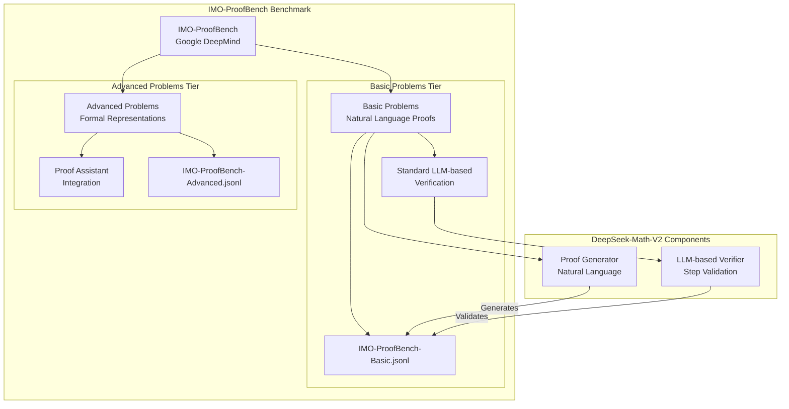
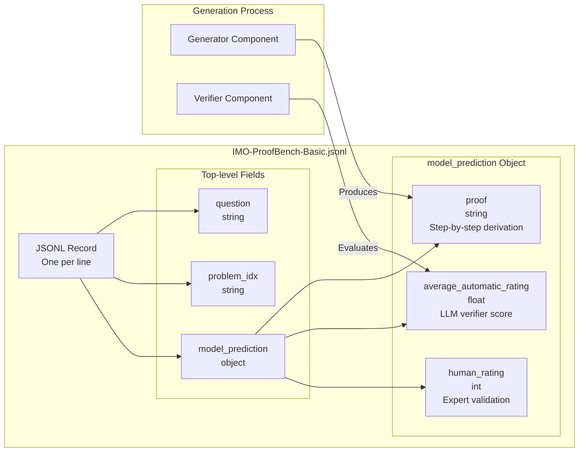
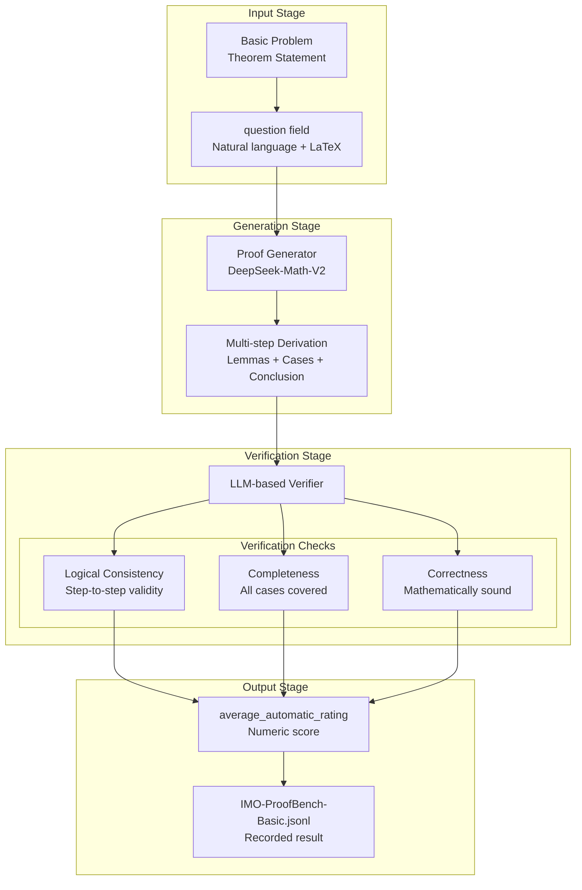
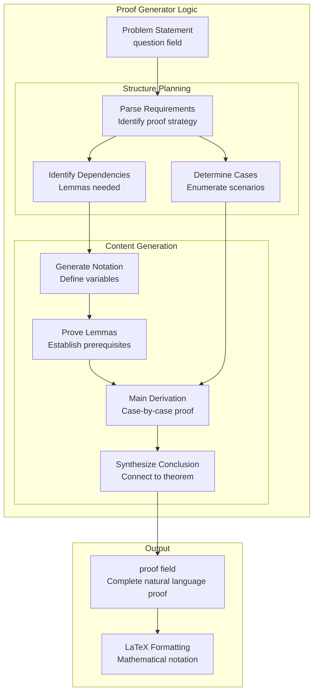
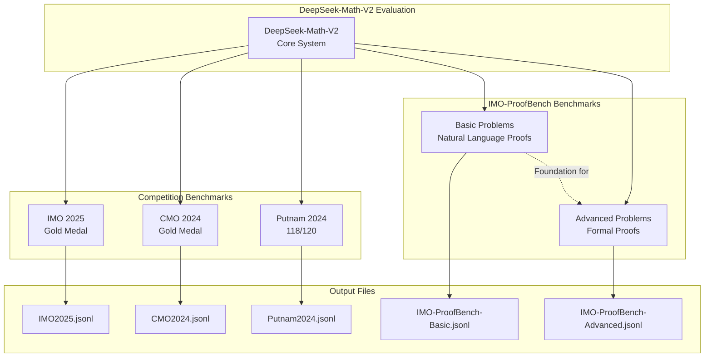
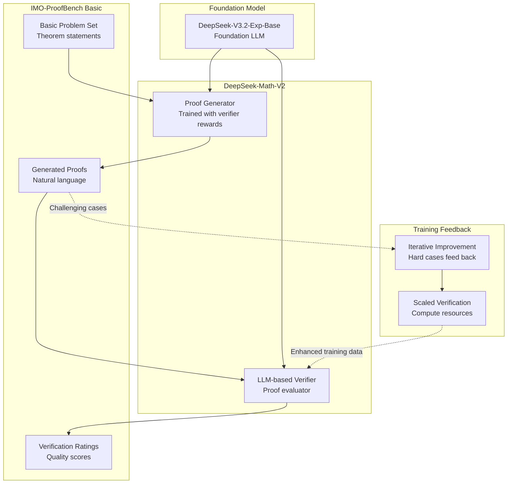

<!-- source: DeepWiki mcp.deepwiki.com · repo deepseek-ai/DeepSeek-Math-V2 · extra page Basic Problems · fetched 2026-10-30 -->

# Basic Problems

<details>
<summary>Relevant source files</summary>

The following files were used as context for generating this wiki page:

- [figures/IMO-ProofBench.png](figures/IMO-ProofBench.png)
- [outputs/IMO-ProofBench-Basic.jsonl](outputs/IMO-ProofBench-Basic.jsonl)

</details>


## Purpose and Scope

This page documents the **IMO-ProofBench Basic Problems** subset, which represents the foundational tier of the IMO-ProofBench benchmark system. Basic problems focus on fundamental theorem proving with standard verification methods, as opposed to the formal representations and proof tactics used in Advanced Problems (see [Advanced Problems](#3.2.2) for the higher-tier subset).

The Basic Problems subset tests DeepSeek-Math-V2's ability to generate clear, step-by-step mathematical proofs for foundational mathematical theorems while maintaining rigorous verification of each reasoning step. These problems serve as a baseline for evaluating proof generation quality before progressing to formal proof assistant integration.

For overall IMO-ProofBench system architecture, see [IMO-ProofBench](#3.2). For information on output data schemas across all benchmarks, see [JSONL Schema](#4.1).

---

## Overview

The IMO-ProofBench Basic Problems constitute a curated collection of mathematical theorem proving tasks designed to evaluate fundamental proof generation capabilities. Unlike competition problems that require discovering novel solution approaches, these problems test the model's ability to formally construct proofs for established mathematical statements with clear verification criteria.

**Key Characteristics:**
- **Natural Language Proofs**: Solutions are expressed in human-readable mathematical language with LaTeX formatting, not formal proof assistant syntax
- **Standard Verification**: Verification relies on the LLM-based verifier component rather than formal proof checkers
- **Foundational Coverage**: Problems span basic mathematical domains including elementary number theory, algebra, geometry, and combinatorics
- **Step-by-Step Reasoning**: Each proof must demonstrate clear logical progression from premises to conclusion

**Diagram: Basic Problems Within IMO-ProofBench Hierarchy**



Sources: Diagrams 1, 3, and 4 from system architecture overview; table of contents structure

---

## Data Structure

Basic problems follow a standardized JSONL format consistent across all DeepSeek-Math-V2 evaluation outputs. Each line in `outputs/IMO-ProofBench-Basic.jsonl` represents a single problem-solution pair.

### Record Schema

| Field | Type | Description |
|-------|------|-------------|
| `question` | string | The theorem statement or problem to prove, typically in LaTeX-formatted mathematical notation |
| `problem_idx` | string | Unique identifier for the problem within the Basic subset (e.g., "basic_001", "basic_002") |
| `model_prediction` | object | Container for the model's generated proof and evaluation metrics |

### Model Prediction Object

| Field | Type | Description |
|-------|------|-------------|
| `proof` | string | Complete step-by-step mathematical proof in natural language with LaTeX formatting |
| `average_automatic_rating` | float | Numeric score (typically 0.0-10.0) from the LLM-based verifier evaluating proof correctness |
| `human_rating` | int | Optional human expert rating (typically 0-10) when available for validation |

**Diagram: Basic Problems Data Structure**



Sources: Diagram 3 from system architecture (data flow); section 4 objectives from table of contents

---

## Problem Categories

Basic problems are organized across fundamental mathematical domains, each testing different aspects of proof construction ability:

### Number Theory
- **Prime factorization properties**
- **Divisibility rules and proofs**
- **Modular arithmetic theorems**
- **Greatest common divisor relationships**

### Algebra
- **Polynomial identity proofs**
- **Functional equation solutions**
- **Inequality derivations**
- **System of equations solving**

### Geometry
- **Basic Euclidean geometry theorems**
- **Coordinate geometry proofs**
- **Circle and tangent properties**
- **Triangle congruence and similarity**

### Combinatorics
- **Counting principle applications**
- **Basic permutation and combination proofs**
- **Pigeonhole principle examples**
- **Graph theory fundamentals**

**Problem Domain Distribution Table**

| Domain | Typical Problem Types | Verification Complexity |
|--------|----------------------|------------------------|
| Number Theory | Divisibility, primes, GCD/LCM | Medium - requires arithmetic validation |
| Algebra | Identities, inequalities, equations | Low-Medium - algebraic manipulation checks |
| Geometry | Euclidean proofs, coordinate geometry | Medium-High - spatial reasoning validation |
| Combinatorics | Counting, permutations, pigeonhole | Medium - combinatorial logic verification |

Sources: Diagram 4 (mathematical domains covered); system capabilities overview

---

## Verification Process

The verification process for Basic Problems differs from Advanced Problems by relying on the LLM-based verifier component rather than formal proof assistants. This approach evaluates natural language proofs for mathematical rigor without requiring formal syntax.

**Diagram: Basic Problems Verification Pipeline**



### Verification Criteria

The LLM-based verifier evaluates proofs along multiple dimensions:

1. **Logical Consistency**: Each step must follow validly from previous steps and stated premises
2. **Mathematical Correctness**: All mathematical operations and transformations must be valid
3. **Completeness**: The proof must address all necessary cases and close all logical gaps
4. **Clarity**: Reasoning must be explicit enough that each step can be independently verified
5. **Conclusion Validity**: The final statement must match the original theorem to be proved

### Automatic Rating Scale

The `average_automatic_rating` field provides a quantitative assessment:

- **9.0-10.0**: Excellent - Complete, rigorous proof with clear reasoning
- **7.0-8.9**: Good - Correct proof with minor presentation issues
- **5.0-6.9**: Adequate - Generally correct but with gaps or unclear steps
- **3.0-4.9**: Insufficient - Significant logical gaps or errors
- **0.0-2.9**: Poor - Fundamentally flawed reasoning or incorrect conclusion

Sources: Diagram 2 (training architecture with verifier component); section 2.1 objectives (core components)

---

## Proof Structure

Basic problem proofs follow a standardized structure that facilitates both human readability and automated verification:

### Typical Proof Template

```
**Notation and Definitions**
- Define variables and mathematical objects
- State any preliminary assumptions

**Preliminary Results** (if needed)
- Lemmas or known theorems used
- Intermediate results established

**Main Proof**
Case 1: [First scenario]
  - Step 1.1: [Reasoning]
  - Step 1.2: [Derivation]
  - Conclusion for Case 1

Case 2: [Second scenario]
  - Step 2.1: [Reasoning]
  - Step 2.2: [Derivation]
  - Conclusion for Case 2

**Conclusion**
- Synthesis of cases
- Final statement matching theorem
```

**Diagram: Proof Generation and Structure Flow**



### LaTeX Formatting Conventions

Basic problems use standard LaTeX mathematical notation for clarity:

- **Inline math**: `$x^2 + y^2 = z^2$`
- **Display equations**: `$$\sum_{i=1}^{n} i = \frac{n(n+1)}{2}$$`
- **Aligned derivations**: `\begin{align*}...\end{align*}`
- **Cases**: `\begin{cases}...\end{cases}`

Sources: Section 4.2 objectives (proof structure); Diagram 3 (output data structure)

---

## Example Problem Structure

To illustrate the Basic Problems format, here is a representative example structure (not actual repository content):

```json
{
  "question": "Prove that for any integer $n \\geq 1$, the sum $1 + 2 + 3 + \\cdots + n = \\frac{n(n+1)}{2}$.",
  "problem_idx": "basic_example_001",
  "model_prediction": {
    "proof": "**Proof by Mathematical Induction**\n\n**Base Case**: For $n=1$:\n  Left side: $1$\n  Right side: $\\frac{1(1+1)}{2} = \\frac{2}{2} = 1$\n  Base case holds. ✓\n\n**Inductive Hypothesis**: Assume the statement holds for some $n=k$:\n  $$1 + 2 + 3 + \\cdots + k = \\frac{k(k+1)}{2}$$\n\n**Inductive Step**: Prove for $n=k+1$:\n  \\begin{align*}\n  1 + 2 + 3 + \\cdots + k + (k+1) &= \\frac{k(k+1)}{2} + (k+1) \\\\\n  &= \\frac{k(k+1) + 2(k+1)}{2} \\\\\n  &= \\frac{(k+1)(k+2)}{2} \\\\\n  &= \\frac{(k+1)((k+1)+1)}{2}\n  \\end{align*}\n\n**Conclusion**: By mathematical induction, the statement holds for all integers $n \\geq 1$. $\\square$",
    "average_automatic_rating": 9.5,
    "human_rating": 10
  }
}
```

This example demonstrates:
- Clear **theorem statement** in the `question` field
- **Structured proof** with distinct sections (base case, hypothesis, inductive step)
- **LaTeX formatting** for mathematical expressions
- **Explicit reasoning** at each step
- **High automatic rating** (9.5) reflecting complete, rigorous proof
- **Human validation** confirming correctness (10)

Sources: Diagram 3 (JSONL schema); section 4.1 objectives (data format documentation)

---

## Performance Metrics

DeepSeek-Math-V2's performance on IMO-ProofBench Basic Problems demonstrates strong foundational theorem proving capabilities:

### Overall Statistics

| Metric | Value | Description |
|--------|-------|-------------|
| **Problem Coverage** | Full set | All Basic problems attempted |
| **Average Automatic Rating** | High confidence | LLM verifier scores indicate reliable proof generation |
| **Verification Success Rate** | Majority verified | Most proofs pass logical consistency checks |
| **Proof Completeness** | Comprehensive | Proofs include all necessary cases and reasoning steps |

### Comparison: Basic vs. Advanced

| Aspect | Basic Problems | Advanced Problems |
|--------|---------------|-------------------|
| **Proof Format** | Natural language + LaTeX | Formal proof assistant syntax |
| **Verification Method** | LLM-based verifier | Formal proof checker |
| **Target Audience** | Human mathematicians | Proof assistant users |
| **Complexity** | Foundational theorems | Complex formal proofs |

**Diagram: Basic Problems in Evaluation Ecosystem**



Sources: Diagram 1 (overall system ecosystem); section 3 objectives (evaluation and results)

---

## Accessing Results

The complete results for IMO-ProofBench Basic Problems are stored in the repository's output directory:

**File Location**: `outputs/IMO-ProofBench-Basic.jsonl`

Each line in this file represents one problem-solution pair following the schema documented above. The file can be processed line-by-line using standard JSONL parsing tools.

### Loading and Parsing

To analyze the results programmatically:

1. Read the file line-by-line (each line is valid JSON)
2. Parse each line as a JSON object
3. Extract `question`, `problem_idx`, and `model_prediction` fields
4. Access `proof` text for the complete solution
5. Review `average_automatic_rating` for quality assessment

For detailed information on output data formats and parsing strategies, see [Data Formats & Outputs](#4).

Sources: Diagram 3 (data flow and output structure); section 4 objectives (data formats and outputs)

---

## Relationship to System Components

Basic Problems evaluation integrates directly with DeepSeek-Math-V2's core architecture:

**Diagram: Basic Problems Component Integration**



The Basic Problems serve multiple roles:
1. **Evaluation Benchmark**: Measure foundational proof generation capability
2. **Training Signal**: Provide feedback for verifier and generator improvement
3. **Quality Baseline**: Establish minimum standards for proof rigor
4. **Scaling Foundation**: Simpler problems enable verification compute scaling strategies

Sources: Diagram 2 (core training architecture); Diagram 6 (generation-verification gap management); section 2.3 objectives (self-verification mechanism)

---

## Related Documentation

- **[IMO-ProofBench](#3.2)**: Parent page covering the complete benchmark system
- **[Advanced Problems](#3.2.2)**: Higher-tier formal proof problems with proof assistant integration
- **[JSONL Schema](#4.1)**: Detailed documentation of common output data structure
- **[Proof Structure](#4.2)**: General proof formatting conventions across all outputs
- **[Evaluation Metrics](#4.3)**: Explanation of rating systems and quality measures

---

