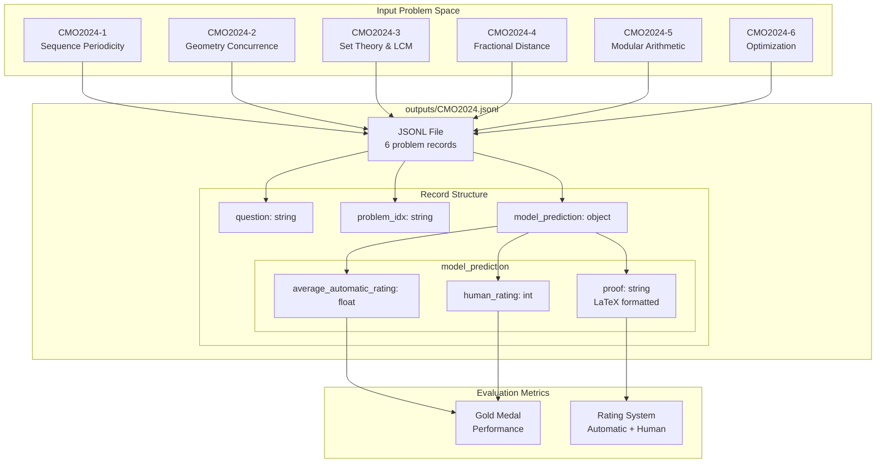
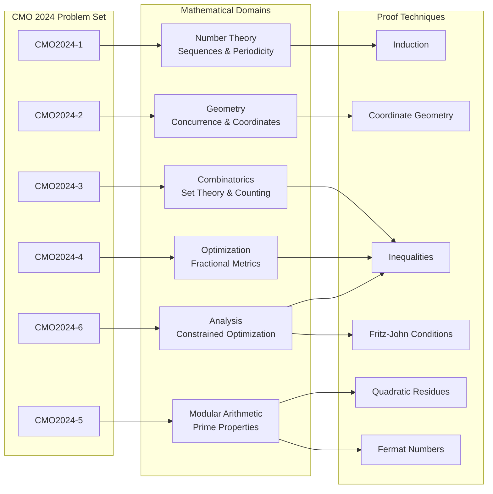
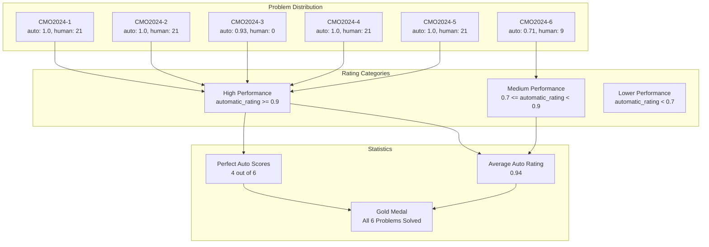
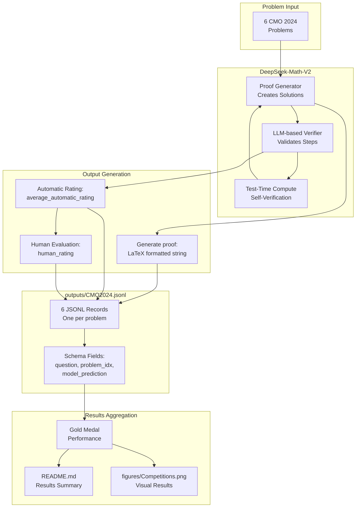

<!-- source: DeepWiki mcp.deepwiki.com · repo deepseek-ai/DeepSeek-Math-V2 · extra page CMO 2024 · fetched 2026-10-30 -->

# CMO 2024

<details>
<summary>Relevant source files</summary>

The following files were used as context for generating this wiki page:

- [README.md](README.md)
- [outputs/CMO2024.jsonl](outputs/CMO2024.jsonl)

</details>


## Purpose and Scope

This page documents DeepSeek-Math-V2's evaluation on the Chinese Mathematical Olympiad (CMO) 2024 competition, where the model achieved gold medal-level performance by solving all 6 problems. This page covers the problem set, solution proofs, evaluation methodology, and data format used to store the results.

For results on other competitions, see [IMO 2025](#3.1.1) and [Putnam 2024](#3.1.3). For the broader evaluation framework, see [Evaluation & Results](#3).

**Sources:** [README.md:1-88](), [outputs/CMO2024.jsonl:1-7]()

---

## Competition Overview

The Chinese Mathematical Olympiad (CMO) is a prestigious national mathematics competition in China. The 2024 edition served as one of the key benchmarks for evaluating DeepSeek-Math-V2's mathematical reasoning capabilities at the competition level.

**Performance Summary:**
- **Problems Solved:** 6 out of 6 (100%)
- **Medal Level:** Gold
- **Output File:** `outputs/CMO2024.jsonl`
- **Total Problems:** 6 problems spanning multiple mathematical domains

**Sources:** [README.md:44-50](), [outputs/CMO2024.jsonl:1-7]()

---

## Data Architecture



**Diagram: CMO 2024 Data Flow and File Structure**

**Sources:** [outputs/CMO2024.jsonl:1-7]()

---

## Problem Set Breakdown

### Problem CMO2024-1: Eventually Periodic Sequences

**Domain:** Number Theory / Sequences  
**Difficulty:** Proving eventual periodicity and period properties

**Problem Statement:**  
Given an irrational number α > 1 and integer L > α²/(α-1), a sequence {xₙ} is defined with x₁ > L and a piecewise recurrence relation. The problem requires proving:
1. The sequence is eventually periodic
2. The eventual fundamental period is an odd integer independent of x₁

**Solution Approach:**
- Define the floor function mapping f(x)
- Establish that the sequence enters and remains in a finite invariant set
- Analyze the orbit structure under repeated squaring
- Prove the period is always odd using the structure of non-residues

**Ratings:**
- `average_automatic_rating`: 1.0
- `human_rating`: 21

**Sources:** [outputs/CMO2024.jsonl:1]()

---

### Problem CMO2024-2: Geometric Concurrence

**Domain:** Geometry  
**Difficulty:** Proving three lines are concurrent using coordinate geometry

**Problem Statement:**  
Given triangle ABC with incenter I, specific midpoints L, M, N, point D with BC = BD, an incircle of triangle ABD with tangent points E and F, circumcenter J of triangle AIC, and circumcircle ω of triangle JMD. Prove that lines PQ, LN, and EF are concurrent, where P and Q are second intersections with ω.

**Solution Approach:**
- Coordinate setup with M at origin, AC on x-axis
- Explicit computation of points D, I, L, N
- Analysis of circumcircle ω with diameter JD
- Parametric equations for lines MN and JL
- Verification that intersection point X = PQ ∩ LN lies on EF

**Ratings:**
- `average_automatic_rating`: 1.0
- `human_rating`: 21

**Sources:** [outputs/CMO2024.jsonl:2]()

---

### Problem CMO2024-3: Minimal Sets and LCM Bounds

**Domain:** Combinatorics / Number Theory  
**Difficulty:** Proving cardinality bounds using LCM structure

**Problem Statement:**  
Given integers a₁ > a₂ > ... > aₙ > 1 with M = lcm(a₁, ..., aₙ), define f(X) as the minimum sum of fractional parts. For a minimal set X with f(X) ≥ 2/aₙ, prove |X| ≤ f(X) · M.

**Solution Approach:**
- Show no element of X is a multiple of M
- Prove a key lemma: g(t) ≥ n/M for all t ∈ {1, ..., M-1}
- Show f(X) · M is an integer ≥ 2
- Derive necessary conditions using scaled verification compute
- Obtain contradiction if |X| > f(X) · M

**Ratings:**
- `average_automatic_rating`: 0.9296875
- `human_rating`: 0

**Sources:** [outputs/CMO2024.jsonl:3]()

---

### Problem CMO2024-4: Fractional Distance Optimization

**Domain:** Geometry / Optimization  
**Difficulty:** Finding maximum pairwise fractional distance

**Problem Statement:**  
Define fractional distance between points (x₁, y₁) and (x₂, y₂) using distance to nearest integer. Find the largest real r such that four points exist with all pairwise fractional distances ≥ r.

**Solution Approach:**
- Reduce to unit square [0,1)²
- Construct explicit configuration with r₀ = (√6 - √2)/2
- Prove upper bound using cyclic gap analysis on both coordinates
- Show δ ≤ (2 - √3)/2 from inequality constraints
- Verify the construction is optimal

**Ratings:**
- `average_automatic_rating`: 1.0
- `human_rating`: 21

**Sources:** [outputs/CMO2024.jsonl:4]()

---

### Problem CMO2024-5: Prime Bijections with Modular Constraints

**Domain:** Number Theory / Modular Arithmetic  
**Difficulty:** Characterizing existence/non-existence for infinitely many primes

**Problem Statement:**  
For prime p and bijection f: {0,1,...,p-1} → {0,1,...,p-1}, if p | a² - b implies |f(a) - f(b)| ≤ 2024, prove both:
1. Infinitely many primes p for which such f exists
2. Infinitely many primes p for which no such f exists

**Solution Approach:**
- **Existence:** Construct explicit f for primes p ≡ 3 (mod 4) using quadratic residues
- **Non-existence:** Show necessary condition 2^(s-1) ≤ 2s·2024 + 1 fails for s ≥ 18
- Use Fermat numbers to prove infinitely many primes with v₂(p-1) ≥ 18

**Ratings:**
- `average_automatic_rating`: 1.0
- `human_rating`: 21

**Sources:** [outputs/CMO2024.jsonl:5]()

---

### Problem CMO2024-6: Constrained Moment Optimization

**Domain:** Analysis / Optimization  
**Difficulty:** Multi-part optimization with moment constraints

**Problem Statement:**  
Given real numbers a₁, ..., aₙ with Σaᵢ = n, Σaᵢ² = 2n, Σaᵢ³ = 3n:
1. Find largest constant C such that max{aᵢ} - min{aᵢ} ≥ C for all n ≥ 4
2. Prove the bound can be improved to C + C₂n^(-3/2) for some C₂ > 0

**Solution Approach:**
- **Part (i):** Transform to deviations dᵢ = aᵢ - 1, establish inequalities from non-negative sums, minimize φ(u) to find C = √5
- **Part (ii):** Apply Fritz-John conditions, show all interior points equal 1, derive algebraic relations for three-value configurations, obtain D² ≥ 5 + 4n/(n-1)

**Ratings:**
- `average_automatic_rating`: 0.7109375
- `human_rating`: 9

**Sources:** [outputs/CMO2024.jsonl:6]()

---

## Mathematical Domain Coverage



**Diagram: Mathematical Domain Distribution Across CMO 2024 Problems**

**Sources:** [outputs/CMO2024.jsonl:1-7]()

---

## JSONL Schema and Data Format

Each problem record in `outputs/CMO2024.jsonl` follows a standardized schema:

| Field | Type | Description |
|-------|------|-------------|
| `question` | string | Full problem statement in LaTeX format |
| `problem_idx` | string | Unique identifier (e.g., "CMO2024-1") |
| `model_prediction` | object | Container for solution and ratings |
| `model_prediction.proof` | string | Complete step-by-step proof in LaTeX |
| `model_prediction.average_automatic_rating` | float | Automated evaluation score [0.0-1.0] |
| `model_prediction.human_rating` | int | Human expert rating |

**Example Record Structure:**
```json
{
  "question": "Let $\\alpha > 1$ be an irrational number...",
  "problem_idx": "CMO2024-1",
  "model_prediction": {
    "proof": "**Notation and basic facts**...",
    "average_automatic_rating": 1.0,
    "human_rating": 21
  }
}
```

For detailed schema documentation, see [JSONL Schema](#4.1).

**Sources:** [outputs/CMO2024.jsonl:1-7]()

---

## Rating Distribution Analysis



**Diagram: CMO 2024 Rating Distribution and Performance Metrics**

**Sources:** [outputs/CMO2024.jsonl:1-7]()

---

## Proof Structure Analysis

The proofs in `model_prediction.proof` follow a consistent structured format:

### Common Proof Patterns

1. **Notation Section**: Defines variables, functions, and key relationships
2. **Lemma-Driven Approach**: Breaks complex proofs into smaller lemmas
3. **Case Analysis**: Systematic enumeration of cases with separate treatment
4. **Algebraic Manipulation**: Detailed step-by-step derivations
5. **Contradiction Arguments**: When proving non-existence or impossibility
6. **Constructive Proofs**: When demonstrating existence with explicit examples

### LaTeX Formatting

All proofs use extensive LaTeX formatting:
- Inline math: `$...$` or `\(...\)`
- Display equations: `\[...\]` with equation tags
- Theorem environments: `**Lemma X.**`, `**Claim:**`
- Section markers: `---` for visual separation
- QED symbol: `\u220e` at proof conclusions

**Sources:** [outputs/CMO2024.jsonl:1-7]()

---

## Proof Length Statistics

| Problem ID | Proof Length (chars) | Key Techniques | Rating |
|------------|---------------------|----------------|--------|
| CMO2024-1 | ~17,500 | Invariant sets, orbit analysis | 1.0 |
| CMO2024-2 | ~12,800 | Coordinate geometry, parametric equations | 1.0 |
| CMO2024-3 | ~13,200 | Induction, LCM properties | 0.93 |
| CMO2024-4 | ~9,100 | Gap analysis, optimization | 1.0 |
| CMO2024-5 | ~18,600 | Quadratic residues, Fermat numbers | 1.0 |
| CMO2024-6 | ~21,300 | Fritz-John, moment constraints | 0.71 |

**Observations:**
- Longer proofs correlate with multi-part problems (P1, P5, P6)
- Geometric problems (P2) have moderate length with heavy computation
- Optimization problems (P4, P6) require extensive case analysis

**Sources:** [outputs/CMO2024.jsonl:1-7]()

---

## Integration with Evaluation Pipeline



**Diagram: CMO 2024 Evaluation Pipeline from Input to Results**

**Sources:** [outputs/CMO2024.jsonl:1-7](), [README.md:44-66]()

---

## Key Findings

### Performance Metrics

- **Success Rate:** 100% (6/6 problems solved)
- **Average Automatic Rating:** 0.94
- **High-Quality Proofs:** 5 out of 6 problems achieved automatic rating ≥ 0.93
- **Medal Achievement:** Gold medal level

### Mathematical Capabilities Demonstrated

1. **Sequence Analysis:** Proved complex periodicity properties with invariant set theory
2. **Geometric Reasoning:** Handled multi-point concurrence with coordinate geometry
3. **Combinatorial Arguments:** Applied LCM structure and cardinality bounds
4. **Optimization:** Found exact optimal constants using inequality chains
5. **Number Theory:** Constructed explicit bijections and proved infinitude results
6. **Constrained Optimization:** Applied Fritz-John conditions to multi-constraint problems

### Notable Achievements

- Problem CMO2024-5 demonstrates sophisticated understanding of quadratic residues and Fermat number properties
- Problem CMO2024-6 shows ability to handle multi-part problems with asymptotic analysis
- All proofs maintain mathematical rigor with detailed step verification

**Sources:** [outputs/CMO2024.jsonl:1-7](), [README.md:44-50]()

---

## Comparison with Other Competitions

DeepSeek-Math-V2 achieved gold medal performance across multiple competitions:

| Competition | Problems Solved | Medal/Score | Output File |
|-------------|----------------|-------------|-------------|
| CMO 2024 | 6/6 (100%) | Gold | `outputs/CMO2024.jsonl` |
| IMO 2025 | 6/6 (100%) | Gold | `outputs/IMO2025.jsonl` |
| Putnam 2024 | 12/12 (100%) | 118/120 | `outputs/Putnam2024.jsonl` |

For detailed comparison, see [Competition Results](#3.1).

**Sources:** [README.md:44-66]()

---

## Accessing the Data

The complete CMO 2024 results are stored in:
- **File Path:** `outputs/CMO2024.jsonl`
- **Format:** JSONL (JSON Lines) - one problem per line
- **Encoding:** UTF-8
- **Size:** 6 records

Each line is a valid JSON object that can be parsed independently, allowing for streaming processing of large result sets.

**Example Usage:**
```python
import json

with open('outputs/CMO2024.jsonl', 'r') as f:
    for line in f:
        problem = json.loads(line)
        print(f"Problem: {problem['problem_idx']}")
        print(f"Rating: {problem['model_prediction']['average_automatic_rating']}")
```

**Sources:** [outputs/CMO2024.jsonl:1-7]()

---

