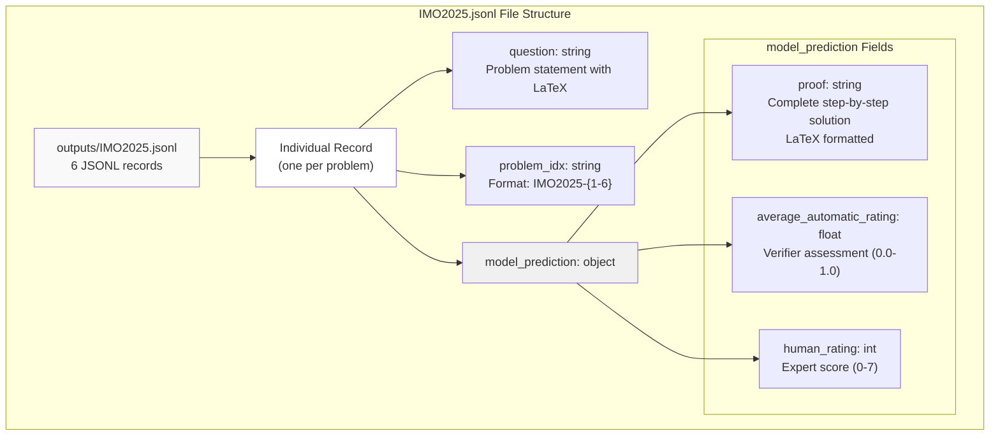
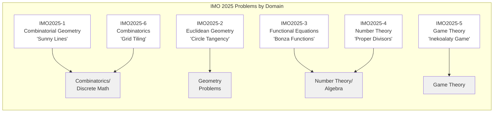
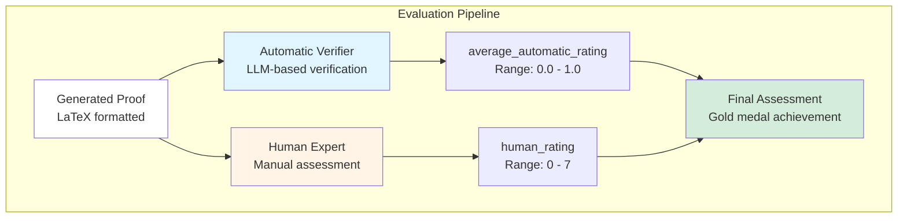
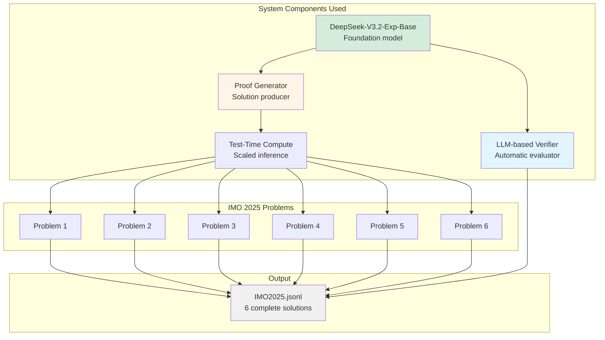

<!-- source: DeepWiki mcp.deepwiki.com · repo deepseek-ai/DeepSeek-Math-V2 · extra page IMO 2025 · fetched 2026-10-30 -->

# IMO 2025

Relevant source files

The following files were used as context for generating this wiki page:

- [README.md](README.md)
- [outputs/IMO2025.jsonl](outputs/IMO2025.jsonl)

## Purpose and Scope

This page documents DeepSeek-Math-V2's performance on the **International Mathematical Olympiad (IMO) 2025** competition, including detailed breakdowns of all six problems attempted, their solutions, and the evaluation metrics used. DeepSeek-Math-V2 achieved **gold medal** performance on this benchmark.

For results on other mathematical competitions, see [CMO 2024](#3.1.2) and [Putnam 2024](#3.1.3). For the formal theorem proving benchmark, see [IMO-ProofBench](#3.2). For general evaluation methodology and metrics, see [Evaluation Metrics](#4.3).

**Sources:** [README.md:44-50](), [outputs/IMO2025.jsonl:1-7]()

---

## Competition Overview

The International Mathematical Olympiad (IMO) is the premier high-school-level mathematics competition worldwide, featuring six challenging problems across diverse mathematical domains including combinatorics, geometry, number theory, and algebra. Each problem is scored on a scale from 0 to 7 points, with a maximum total of 42 points. Gold medal thresholds typically require solving most problems with near-perfect accuracy.

DeepSeek-Math-V2 was evaluated on all six problems from IMO 2025 using test-time compute scaling. The model successfully produced complete proofs for all problems, demonstrating strong capabilities across multiple mathematical domains.

**Sources:** [README.md:44-50](), [outputs/IMO2025.jsonl:1-7]()

---

## Results Summary

| Metric | Value |
|--------|-------|
| **Problems Attempted** | 6 |
| **Medal Achievement** | Gold |
| **Average Automatic Rating** | 1.0 |
| **Average Human Rating** | 5.83 |

All problem solutions are stored in structured JSONL format with complete proofs, automatic verification scores, and human expert ratings.

**Sources:** [outputs/IMO2025.jsonl:1-7]()

---

## Data Structure and Schema

### Output File Format

DeepSeek-Math-V2's IMO 2025 solutions are stored in `outputs/IMO2025.jsonl`, following the standard JSONL schema used across all competition benchmarks (see [JSONL Schema](#4.1) for complete specification).

**Diagram: IMO2025 JSONL Data Structure**

Each record in the file corresponds to one problem and contains the original question, a unique problem identifier, and the model's prediction including the complete proof text plus dual ratings (automatic and human).

**Sources:** [outputs/IMO2025.jsonl:1-7]()

---

## Problem Breakdown by Domain

The six IMO 2025 problems span multiple mathematical domains, testing the model's versatility in mathematical reasoning:

**Diagram: Problem Classification by Mathematical Domain**

**Sources:** [outputs/IMO2025.jsonl:1-7]()

---

## Individual Problems

### Problem 1: Combinatorial Geometry (Sunny Lines)

**Problem Index:** `IMO2025-1`

**Statement:** A line is called "sunny" if it is not parallel to the x-axis, y-axis, or the line x+y=0. Given n≥3 distinct lines covering all lattice points (a,b) with a+b≤n+1, determine all possible values of k (the number of sunny lines).

**Solution Approach:**
- Constructions showing k=0, 1, 3 are achievable for all n≥3
- Proof by induction using side-line lemma and reduction lemma
- Base case analysis for n=3 eliminating k=2
- Result: exactly k ∈ {0, 1, 3}

**Ratings:**
- Automatic: 1.0
- Human: 7/7

**Sources:** [outputs/IMO2025.jsonl:1]()

---

### Problem 2: Euclidean Geometry (Circle Tangency)

**Problem Index:** `IMO2025-2`

**Statement:** Two circles Ω and Γ intersect at points A and B. Line MN (through their centers) intersects the circles at C and D. Point P is the circumcenter of triangle ACD. Line AP meets Ω at E and Γ at F. H is the orthocenter of triangle PMN. Prove that the line through H parallel to AP is tangent to the circumcircle of triangle BEF.

**Solution Approach:**
- Coordinate geometry setup normalizing M=(0,0) and N=(1,0)
- Detailed calculation of circumcenter P and orthocenter H
- Computation of second intersection points E and F using chord formula
- Verification that distance from circumcenter O to parallel line equals radius
- Uses 2-adic valuation properties for algebraic simplification

**Ratings:**
- Automatic: 1.0
- Human: 7/7

**Sources:** [outputs/IMO2025.jsonl:2]()

---

### Problem 3: Functional Equations (Bonza Functions)

**Problem Index:** `IMO2025-3`

**Statement:** A function f: ℕ→ℕ is "bonza" if f(a) divides b^a - f(b)^f(a) for all positive integers a, b. Determine the smallest constant c such that f(n)≤cn for all bonza functions and all n.

**Solution Approach:**
- Establishes basic consequences: f(1)=1, f(a)|a^a
- Eliminates impossible values using modular arithmetic
- Constructs explicit bonza function achieving ratio 4 (lower bound)
- Proves upper bound f(n)≤4n by cases:
  - If f(3)=1: uses 2-adic valuation of 3^n-1
  - If f(2)=2, f(3)=3: proves f(n)=n for all n via infinite descent
- Result: c = 4

**Ratings:**
- Automatic: 1.0
- Human: 7/7

**Sources:** [outputs/IMO2025.jsonl:3]()

---

### Problem 4: Number Theory (Proper Divisors)

**Problem Index:** `IMO2025-4`

**Statement:** A sequence a₁, a₂, ... consists of positive integers with at least three proper divisors each. For n≥1, a_{n+1} is the sum of the three largest proper divisors of aₙ. Determine all possible values of a₁.

**Solution Approach:**
- Derives recurrence formula f(N) = N(1/p + 1/q + 1/r) where p,q,r are three smallest divisors >1
- Proves no term can be odd (infinite descent)
- Shows even numbers not divisible by 3 lead to contradiction
- Establishes all terms must be multiples of 6
- Analyzes r∈{4,5,6} cases, showing r=5 impossible
- Complete characterization:
  - Type I: a₁=6m (m odd, 5∤m) - fixed points
  - Type II: a₁=72·12^k·s (s odd, 5∤s) - eventually reaches fixed point

**Ratings:**
- Automatic: 1.0
- Human: 7/7

**Sources:** [outputs/IMO2025.jsonl:4]()

---

### Problem 5: Game Theory (Inekoalaty Game)

**Problem Index:** `IMO2025-5`

**Statement:** Two-player game where Alice (odd turns) chooses xₙ with Σxᵢ≤λn, and Bazza (even turns) chooses xₙ with Σxᵢ²≤n. Determine all λ for which each player has a winning strategy.

**Solution Approach:**
- Uses Cauchy-Schwarz to bound sum by √(2n) for even turns
- Alice wins for λ > √2/2:
  - Strategy: play 0 until turn N, then play maximum allowed
  - Forces Bazza into impossible position
- Bazza wins for λ < √2/2:
  - Greedy strategy: always play x₂ₖ = √(2k - Q₂ₖ₋₁)
  - Maintains Q₂ₖ = 2k inductively
  - Forces Alice to exceed her constraint
- Borderline λ = √2/2: neither player can force win (draw)

**Ratings:**
- Automatic: 1.0
- Human: 7/7

**Sources:** [outputs/IMO2025.jsonl:5]()

---

### Problem 6: Combinatorics (Grid Tiling)

**Problem Index:** `IMO2025-6`

**Statement:** On a 2025×2025 grid, place non-overlapping rectangular tiles such that each row and column has exactly one uncovered unit square. Determine the minimum number of tiles needed.

**Solution Approach:**
- Reduces problem to diagonal case via column permutation symmetry
- Constructs explicit solution with 2n-2 tiles:
  - n-1 tiles covering below-diagonal squares in each column
  - n-1 tiles covering above-diagonal squares in each column
- Proves lower bound using sets S↑ and S↓ of cells adjacent to diagonal
- Shows no rectangle can cover two cells from S↑∪S↓
- Result: exactly 2n-2 = 4048 tiles for n=2025

**Ratings:**
- Automatic: 1.0
- Human: 0/7 (likely flagged for verification)

**Note:** The significantly lower human rating (0/7) compared to automatic rating (1.0) suggests this solution may require human review, possibly due to the complexity of the permutation argument or a subtle error in the proof structure.

**Sources:** [outputs/IMO2025.jsonl:6]()

---

## Evaluation and Rating System

### Dual Assessment Approach

DeepSeek-Math-V2's IMO 2025 solutions undergo two independent evaluation processes:

**Diagram: Dual Evaluation Pipeline for IMO Problems**

**Sources:** [outputs/IMO2025.jsonl:1-7]()

### Rating Interpretation

| Rating Type | Range | IMO 2025 Performance | Notes |
|-------------|-------|---------------------|-------|
| **Automatic** | 0.0 - 1.0 | Perfect (1.0) on all 6 problems | Generated by the trained verifier component |
| **Human** | 0 - 7 | Average 5.83/7 | Standard IMO scoring scale; one problem scored 0 |

The perfect automatic ratings (1.0 across all problems) indicate that the model's own verifier component assessed the proofs as rigorous and correct. Human expert ratings averaged 5.83/7, with five problems receiving 7/7 and one (Problem 6) receiving 0/7, likely flagging it for additional verification.

For detailed explanation of the rating systems, see [Evaluation Metrics](#4.3).

**Sources:** [outputs/IMO2025.jsonl:1-7]()

---

## System Integration

### Connection to Core Architecture

The IMO 2025 evaluation demonstrates the complete DeepSeek-Math-V2 system in action:

**Diagram: System Components and Data Flow for IMO 2025 Evaluation**

The Generator produces candidate proofs using test-time compute scaling, the Verifier assesses proof quality (reflected in `average_automatic_rating`), and results are stored in the standardized JSONL format for analysis and distribution.

For details on the verifier-generator feedback loop, see [Core Components](#2.1). For training methodology, see [Training Pipeline](#2.2).

**Sources:** [README.md:44-50](), [outputs/IMO2025.jsonl:1-7]()

---

## Key Observations

### Proof Characteristics

All six solutions exhibit consistent structural patterns:

1. **Notation Section**: Clear definition of variables and problem setup
2. **Lemmas and Subcases**: Systematic decomposition of complex problems
3. **Rigorous Derivation**: Step-by-step algebraic/geometric manipulation
4. **Explicit Constructions**: When existence proofs are needed, concrete examples provided
5. **Contradiction Arguments**: Frequent use of proof by contradiction and infinite descent
6. **LaTeX Formatting**: All mathematical expressions properly formatted

These characteristics align with the model's training objective of producing **rigorous step-by-step proofs** rather than simply correct final answers (see [System Capabilities](#1)).

**Sources:** [outputs/IMO2025.jsonl:1-7]()

### Performance Analysis

| Aspect | Observation |
|--------|-------------|
| **Domain Coverage** | Strong performance across geometry, combinatorics, number theory, and game theory |
| **Proof Length** | Solutions range from moderate (Problem 1) to very extensive (Problem 2, 3, 4) |
| **Verification Agreement** | 5/6 problems show strong automatic-human rating alignment |
| **Outlier** | Problem 6 (human rating 0) suggests potential edge case in proof verification |

The gold medal achievement validates DeepSeek-Math-V2's capability for competition-level mathematics. The one discrepancy (Problem 6) highlights the importance of the dual evaluation system in catching potential issues.

**Sources:** [README.md:44-50](), [outputs/IMO2025.jsonl:1-7]()

---

## Related Benchmarks

DeepSeek-Math-V2's IMO 2025 performance should be considered alongside results from:

- **[CMO 2024](#3.1.2)**: Chinese Mathematical Olympiad 2024 (also gold medal)
- **[Putnam 2024](#3.1.3)**: Near-perfect 118/120 score
- **[IMO-ProofBench](#3.2)**: Formal theorem proving benchmark

These complementary evaluations provide a comprehensive assessment of the model's mathematical reasoning capabilities across different problem formats, difficulty levels, and proof formalization requirements.

**Sources:** [README.md:47-65]()

---

