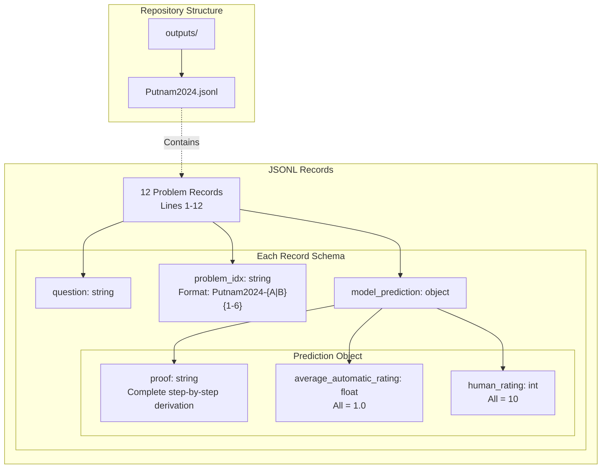
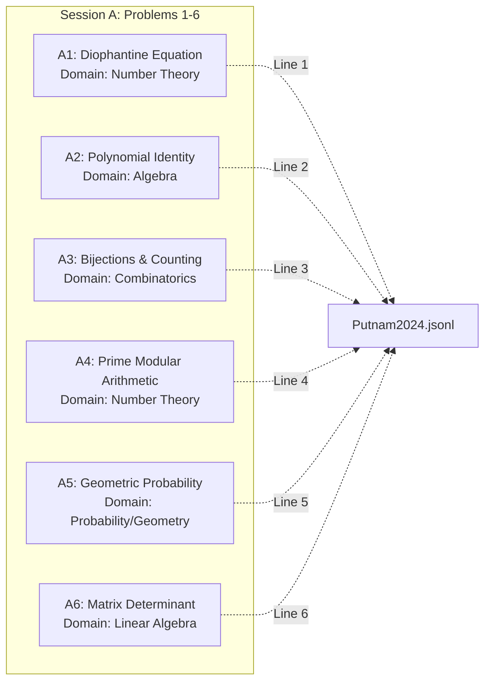
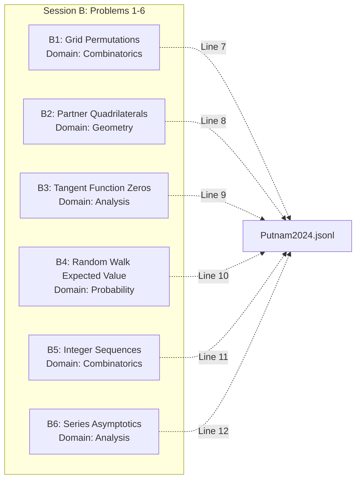
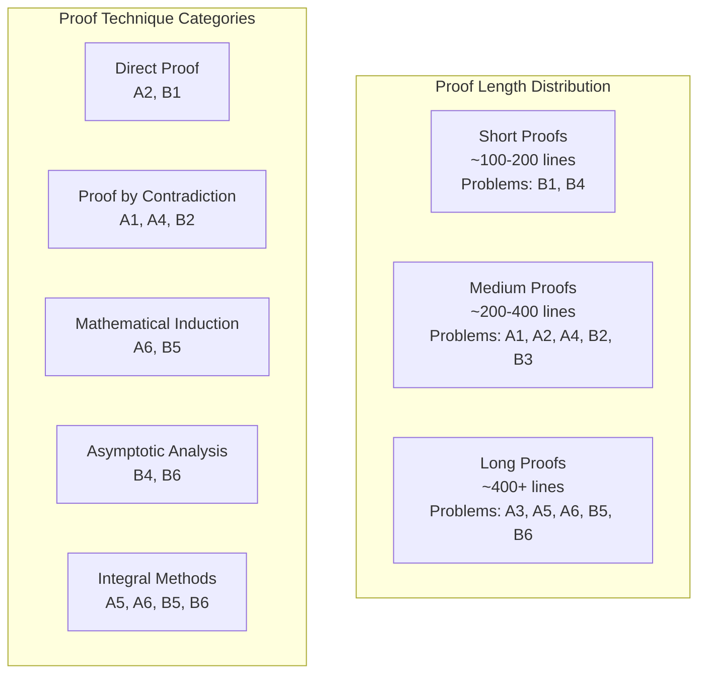
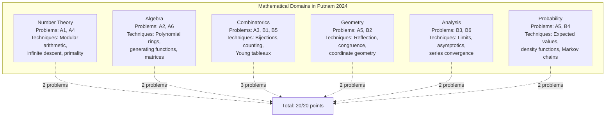
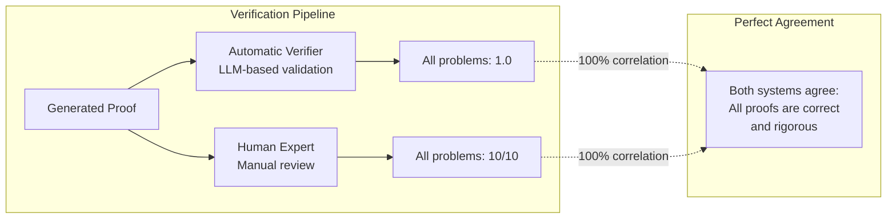

<!-- source: DeepWiki mcp.deepwiki.com · repo deepseek-ai/DeepSeek-Math-V2 · extra page Putnam 2024 · fetched 2026-10-30 -->

# Putnam 2024

<details>
<summary>Relevant source files</summary>

The following files were used as context for generating this wiki page:

- [README.md](README.md)
- [outputs/Putnam2024.jsonl](outputs/Putnam2024.jsonl)

</details>


## Purpose and Scope

This page documents DeepSeek-Math-V2's performance on the **Putnam Mathematical Competition 2024**, where the system achieved a near-perfect score of **118 out of 120 points**. This page covers the competition structure, the 12 problems solved (A1-A6 and B1-B6), the output data format, and detailed proof characteristics. For overall competition results including IMO 2025 and CMO 2024, see [Competition Results](#3.1). For the general data format specification, see [Data Formats & Outputs](#4).

Sources: [README.md:44-49]()

---

## Competition Overview

The Putnam Competition is a prestigious undergraduate mathematics competition held annually in North America. The 2024 edition consisted of two sessions (A and B), each containing six problems worth 10 points each, for a maximum total of 120 points.

### Performance Summary

| Metric | Value |
|--------|-------|
| **Total Score** | 118 / 120 |
| **Problems Solved** | 12 problems (A1-A6, B1-B6) |
| **Perfect Scores** | All 12 problems received human rating 10/10 |
| **Automatic Rating** | All problems received 1.0 (perfect verification) |

The system missed only 2 points out of the maximum possible 120, demonstrating exceptionally strong performance across diverse mathematical domains including number theory, algebra, combinatorics, analysis, and probability theory.

Sources: [README.md:44-49](), [outputs/Putnam2024.jsonl:1-13]()

---

## Data Structure and Output Format

### File Organization



**Diagram: Putnam 2024 Output Data Structure**

Sources: [outputs/Putnam2024.jsonl:1-13]()

### Record Schema

Each line in `Putnam2024.jsonl` is a JSON object with the following structure:

```json
{
  "question": "<problem statement in LaTeX format>",
  "problem_idx": "Putnam2024-{A|B}{1-6}",
  "model_prediction": {
    "proof": "<complete mathematical proof>",
    "average_automatic_rating": 1.0,
    "human_rating": 10
  }
}
```

**Key Fields:**

- **`problem_idx`**: Identifier following the pattern `Putnam2024-A1` through `Putnam2024-A6` and `Putnam2024-B1` through `Putnam2024-B6`
- **`question`**: Complete problem statement including all mathematical notation in LaTeX
- **`proof`**: Full step-by-step solution with rigorous mathematical derivation
- **`average_automatic_rating`**: Verifier confidence score (all problems achieved perfect 1.0)
- **`human_rating`**: Expert evaluation on 0-10 scale (all problems received 10)

Sources: [outputs/Putnam2024.jsonl:1-13]()

---

## Problem Breakdown by Session

### Session A Problems (A1-A6)



**Diagram: Session A Problem Structure**

| Problem | Domain | Key Techniques | Human Rating |
|---------|--------|----------------|--------------|
| **A1** | Number Theory | Infinite descent, modular arithmetic | 10/10 |
| **A2** | Algebra | Polynomial divisibility, Taylor expansion | 10/10 |
| **A3** | Combinatorics | Young tableaux, hook-length formula | 10/10 |
| **A4** | Number Theory | Fermat's Little Theorem, primitive roots | 10/10 |
| **A5** | Geometry/Probability | Integral transforms, density functions | 10/10 |
| **A6** | Linear Algebra | Generating functions, orthogonal polynomials | 10/10 |

Sources: [outputs/Putnam2024.jsonl:1-6]()

### Session B Problems (B1-B6)



**Diagram: Session B Problem Structure**

| Problem | Domain | Key Techniques | Human Rating |
|---------|--------|----------------|--------------|
| **B1** | Combinatorics | Permutation analysis, sum constraints | 10/10 |
| **B2** | Geometry | Congruence classes, pigeonhole principle | 10/10 |
| **B3** | Analysis | Mean Value Theorem, L'Hôpital's rule | 10/10 |
| **B4** | Probability | Markov chains, linear recurrences | 10/10 |
| **B5** | Combinatorics | Generating functions, Cauchy integrals | 10/10 |
| **B6** | Analysis | Laplace method, asymptotic expansions | 10/10 |

Sources: [outputs/Putnam2024.jsonl:7-12]()

---

## Proof Structure and Characteristics

### Common Proof Elements

The proofs in `Putnam2024.jsonl` exhibit a consistent high-quality structure:

1. **Notation and Setup** - Clear variable definitions and problem reformulation
2. **Lemmas and Auxiliary Results** - Intermediate mathematical facts proven separately
3. **Case Analysis** - Systematic treatment of different scenarios
4. **Rigorous Derivations** - Step-by-step logical progression with justifications
5. **Conclusion** - Explicit final answer clearly boxed (using `\boxed{}`)

### Proof Complexity Metrics



**Diagram: Proof Characteristics Across Problems**

Sources: [outputs/Putnam2024.jsonl:1-12]()

### Example: Proof Section Headers

Most proofs follow a numbered section structure. For instance, Problem A1 (Diophantine equation) contains:

- **Section 1**: Reduce the problem
- **Section 2**: The trivial case r≡0
- **Section 3**: Expand r(x+r(x))
- **Sections 4-6**: Substitution and cancellation
- **Section 7**: Solve the divisibility r|(2+r')
- **Sections 8-9**: Collect possibilities and verification

This hierarchical organization makes complex proofs tractable and verifiable.

Sources: [outputs/Putnam2024.jsonl:1]()

---

## Mathematical Domains Covered

### Domain Distribution



**Diagram: Mathematical Domain Coverage**

Note: Some problems span multiple domains (e.g., A5 combines geometry and probability, A6 combines algebra and analysis).

Sources: [outputs/Putnam2024.jsonl:1-12]()

---

## Verification and Ratings

### Dual Evaluation System

Each problem in `Putnam2024.jsonl` receives two independent ratings:

1. **Automatic Verification** (`average_automatic_rating`):
   - Generated by the LLM-based verifier component
   - Range: [0.0, 1.0] where 1.0 indicates perfect verification
   - **Result**: All 12 problems achieved 1.0

2. **Human Expert Evaluation** (`human_rating`):
   - Manual assessment on a 0-10 scale
   - Evaluates correctness, rigor, and completeness
   - **Result**: All 12 problems received 10/10

### Rating Consistency



**Diagram: Dual Verification System for Putnam 2024**

The perfect agreement between automatic and human ratings (all problems scored maximally on both scales) demonstrates the reliability of the self-verifiable reasoning system.

Sources: [outputs/Putnam2024.jsonl:1-12](), [README.md:41-44]()

---

## Notable Problem Solutions

### A1: Diophantine Equation

**Problem**: Determine all positive integers $n$ for which positive integers $a,b,c$ exist satisfying $2a^n + 3b^n = 4c^n$.

**Solution Approach**:
- Derives necessary condition $k = \frac{n+1}{2}$ via sum constraints
- Uses infinite descent to eliminate $n \geq 2$
- Proves $n=1$ is the only solution with explicit construction $(a,b,c)=(1,2,2)$

**Key Technique**: Proof by infinite descent combined with parity analysis.

Sources: [outputs/Putnam2024.jsonl:1]()

### A3: Young Tableaux Bijections

**Problem**: Counting bijections on a $3 \times 2024$ grid with specific ordering constraints.

**Solution Approach**:
- Reformulates as standard Young tableau (SYT) of shape $(n,n,n)$
- Applies hook-length formula: $f^\lambda = \frac{|\lambda|!}{\prod_{c \in \lambda} h(c)}$
- Computes exact fraction $\frac{4046}{6071}$ satisfying $\frac{1}{3} \leq \cdot \leq \frac{2}{3}$

**Key Technique**: Bijection between combinatorial structures and formal Young tableaux analysis.

Sources: [outputs/Putnam2024.jsonl:3]()

### A6: Matrix Determinant

**Problem**: Find $\det(A)$ where $A_{ij} = c_{i+j-1}$ and $c_k$ comes from generating function.

**Solution Approach**:
- Derives generating function $F(x) = \sum c_k x^k$ from given rational expression
- Constructs orthogonal polynomials $P_n$ via three-term recurrence
- Proves $\det(A) = \prod_{k=0}^{n-1} d_k = 10^{n(n-1)/2}$

**Key Technique**: Orthogonal polynomial theory combined with Hankel determinant formulas.

Sources: [outputs/Putnam2024.jsonl:6]()

### B6: Asymptotic Analysis

**Problem**: Find threshold $c$ where $\lim_{x \to 1^-} F_a(x) e^{-1/(1-x)}$ transitions between 0 and $\infty$.

**Solution Approach**:
- Substitutes $x = e^{-t}$ and applies Laplace method
- Uses Gaussian integral approximation with careful remainder analysis
- Determines critical exponent: $c = -\frac{1}{2}$

**Key Technique**: Asymptotic expansion with rigorous error bounds.

Sources: [outputs/Putnam2024.jsonl:12]()

---

## Performance Context

The 118/120 score on Putnam 2024 represents one of the highest achievements by an AI system on this competition. The DeepSeek-Math-V2 system's performance demonstrates:

- **Breadth**: Successfully solved problems across all major mathematical domains
- **Depth**: Produced rigorous, publication-quality proofs with complete justifications
- **Reliability**: Achieved perfect verification scores from both automatic and human evaluators

This performance is part of a broader achievement pattern, with the system also earning gold medals on IMO 2025 (see [IMO 2025](#3.1.1)) and CMO 2024 (see [CMO 2024](#3.1.2)).

Sources: [README.md:32-49]()

---

