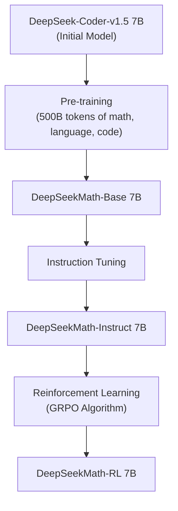
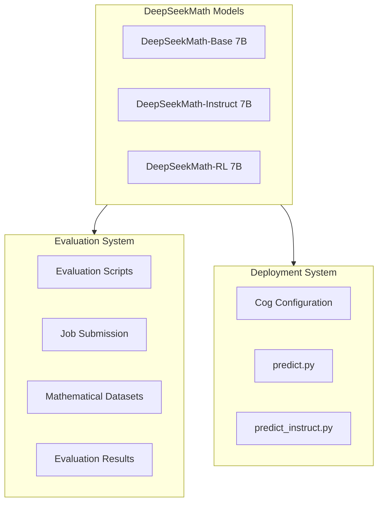
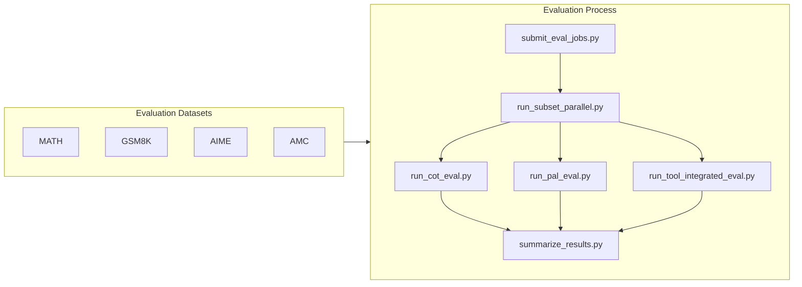
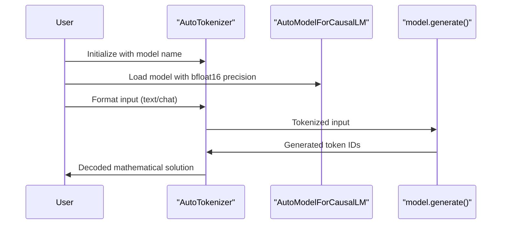
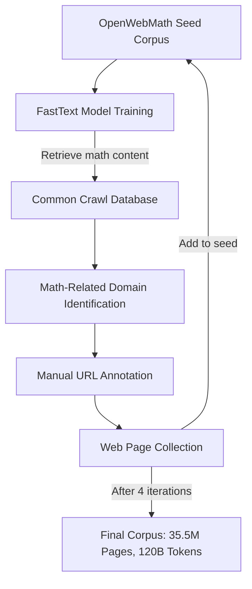

<!-- source: DeepWiki mcp.deepwiki.com · repo deepseek-ai/DeepSeek-Math · page 1 Overview · fetched 2026-10-30 -->

# Overview

<details>
<summary>Relevant source files</summary>

The following files were used as context for generating this wiki page:

- [README.md](README.md)

</details>


This document provides a comprehensive introduction to the DeepSeek-Math project, which features advanced language models specifically designed for mathematical reasoning. This page outlines the project's purpose, key components, and capabilities at a high level.

For detailed information about specific components, please refer to the corresponding wiki pages:
- For specific model details, see [Models](#2)
- For using the models, see [Usage Guide](#3)
- For deployment information, see [Deployment](#4)
- For evaluation methodologies, see [Evaluation System](#5)

## Project Purpose

DeepSeek-Math aims to push the boundaries of mathematical reasoning capabilities in open language models. The project provides a family of 7B-parameter models that achieve impressive performance on competition-level math benchmarks, approaching the capabilities of much larger proprietary models like GPT-4 and Gemini-Ultra.

Sources: [README.md:62-64]()

## Model Development Pipeline

### Model Evolution



DeepSeekMath was initialized with DeepSeek-Coder-v1.5 7B and underwent continued pre-training on 500B tokens of mathematical content, natural language, and code data. The project features three progressively enhanced models:

1. **DeepSeekMath-Base 7B**: The foundation model trained on mathematical content
2. **DeepSeekMath-Instruct 7B**: Fine-tuned with instruction-following capabilities
3. **DeepSeekMath-RL 7B**: Enhanced via reinforcement learning using the Group Relative Policy Optimization (GRPO) algorithm

Sources: [README.md:64](), [README.md:98-100]()

## Key Features and Capabilities

DeepSeekMath models demonstrate several notable capabilities:

1. **Step-by-Step Mathematical Reasoning**: Solving complex mathematical problems through logical step-by-step approaches
2. **Tool Integration**: Effectively using computational tools to solve mathematical problems
3. **Versatility**: Maintaining strong performance in general reasoning and coding tasks
4. **Multi-Lingual Support**: Handling mathematical problems in both English and Chinese

### Evaluation Results

| Benchmark | DeepSeekMath-Base 7B | DeepSeekMath-Instruct 7B | DeepSeekMath-RL 7B |
|-----------|----------------------|--------------------------|-------------------|
| MATH      | 51.7%                | 54.8%                    | 59.7% (with tool use) |
| GSM8K     | Not specified        | 86.5%                    | 88.7% |
| AIME      | Not specified        | 27.2%                    | 32.7% |
| AMC       | Not specified        | 82.5%                    | 86.8% |

A key achievement is the 51.7% accuracy on the competition-level MATH benchmark without external tools, surpassing existing open-source models and approaching the performance of much larger proprietary models.

Sources: [README.md:72-97](), [README.md:102-106]()

## System Architecture



The DeepSeekMath system consists of three primary components:

1. **Model Family**: The three core models with increasing capabilities
2. **Evaluation System**: Tools and scripts for assessing model performance
3. **Deployment System**: Configuration and interfaces for serving the models

Sources: (Based on repository structure analysis)

## Evaluation System



The evaluation system uses three main methodologies:

1. **Chain-of-Thought (CoT)**: Evaluates step-by-step reasoning capability
2. **Program-Aided Language (PAL)**: Tests problem-solving by writing and executing code
3. **Tool-Integrated Evaluation**: Assesses performance with access to external computational tools

The evaluation process is orchestrated through job submission scripts that run evaluations in parallel and compile the results.

Sources: [README.md:70-106]()

## Usage Patterns



DeepSeekMath supports two primary usage patterns:

1. **Text Completion**: Direct generation from mathematical prompts
2. **Chat Completion**: Interactive problem-solving through chat interfaces

### Text Completion Example

```python
import torch
from transformers import AutoTokenizer, AutoModelForCausalLM, GenerationConfig

model_name = "deepseek-ai/deepseek-math-7b-base"
tokenizer = AutoTokenizer.from_pretrained(model_name)
model = AutoModelForCausalLM.from_pretrained(model_name, torch_dtype=torch.bfloat16, device_map="auto")
model.generation_config = GenerationConfig.from_pretrained(model_name)
model.generation_config.pad_token_id = model.generation_config.eos_token_id

text = "The integral of x^2 from 0 to 2 is"
inputs = tokenizer(text, return_tensors="pt")
outputs = model.generate(**inputs.to(model.device), max_new_tokens=100)

result = tokenizer.decode(outputs[0], skip_special_tokens=True)
print(result)
```

For optimal results with DeepSeekMath-Instruct and DeepSeekMath-RL models, chain-of-thought prompting is recommended:
- For English questions: `{question}\nPlease reason step by step, and put your final answer within \boxed{}.`
- For Chinese questions: `{question}\n请通过逐步推理来解答问题，并把最终答案放置于\boxed{}中。`

Sources: [README.md:136-199]()

## Data Collection Process



The training data was collected through an iterative process:

1. Starting with OpenWebMath as an initial seed corpus
2. Training a FastText model to identify mathematical content
3. Using this model to retrieve math-related pages from Common Crawl
4. Identifying potential math domains through statistical analysis
5. Manually annotating URLs within these domains
6. Expanding the corpus through linked pages
7. Repeating the process for four iterations

This process resulted in 35.5 million mathematical web pages totaling 120 billion tokens for training.

Sources: [README.md:109-123]()

## Licensing Information

DeepSeekMath models are available under a custom Model License that permits commercial use, while the repository code is released under the MIT License.

Sources: [README.md:201-204]()

## Conclusion

DeepSeekMath represents a significant advancement in mathematical reasoning capabilities for language models. With state-of-the-art performance on competition-level benchmarks and versatile deployment options, it serves as a valuable resource for both research and practical applications in mathematical problem-solving.

Sources: (Summary based on entire README.md)

---

