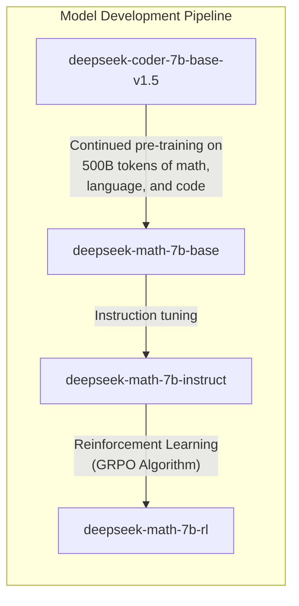
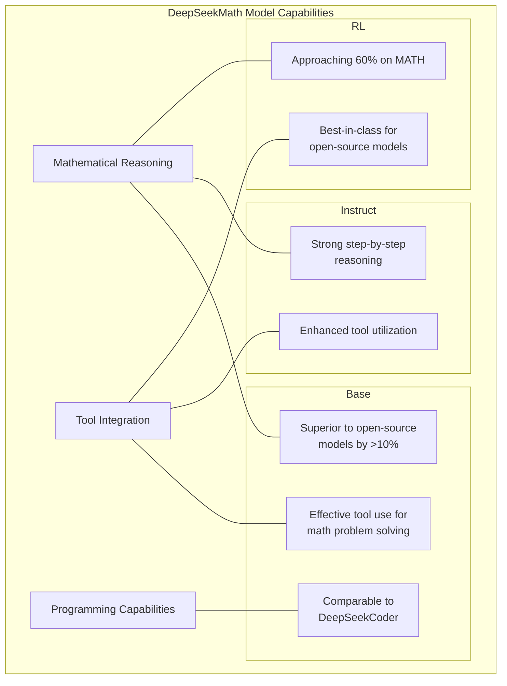

<!-- source: DeepWiki mcp.deepwiki.com · repo deepseek-ai/DeepSeek-Math · page 2 Models · fetched 2026-10-30 -->

# Models

Relevant source files

The following files were used as context for generating this wiki page:

- [README.md](README.md)

This document provides a comprehensive overview of the DeepSeek-Math model family, including their architecture, capabilities, and relationships between different model variants. For detailed information about specific model variants, see [Base Model](#2.2), [Instruct Model](#2.3), and [RL Model](#2.4). For information about the model architecture, see [Model Architecture](#2.1).

## Model Family Overview

DeepSeek-Math consists of three specialized 7B-parameter language models developed for mathematical reasoning:

1. **DeepSeekMath-Base 7B** - A foundational model pre-trained on mathematical content
2. **DeepSeekMath-Instruct 7B** - An instruction-tuned version of the base model
3. **DeepSeekMath-RL 7B** - A reinforcement learning-optimized version using the GRPO algorithm

All models share a context length of 4096 tokens and are built upon the foundation of DeepSeek-Coder-v1.5 7B with additional mathematical training.

Sources: [README.md:126-134](README.md:126-134)

### Model Development Flow

Sources: [README.md:62-64](README.md:62-64), [README.md:100-101](README.md:100-101)

## Key Features and Capabilities

DeepSeekMath models excel in mathematical problem-solving, with the base model achieving a 51.7% score on the MATH benchmark without external tools or voting techniques. This performance approaches that of proprietary models like Gemini-Ultra and GPT-4.

### Mathematical Reasoning Capabilities

| Model | Key Strength | Specialized Capabilities |
|-------|--------------|--------------------------|
| Base | Foundation for mathematical reasoning | Superior mathematical reasoning compared to other open-source base models |
| Instruct | Step-by-step reasoning | Strong performance for guided mathematical problem-solving |
| RL | Advanced tool integration | Enhanced accuracy with tool use, approaching 60% accuracy on MATH |

Sources: [README.md:64](README.md:64), [README.md:93-96](README.md:93-96), [README.md:102-105](README.md:102-105)

### Performance Characteristics

Sources: [README.md:93-96](README.md:93-96), [README.md:102-105](README.md:102-105)

## Model Specifications

All DeepSeekMath models are based on the transformer architecture with the following specifications:

| Model | Parameters | Context Length | Base Architecture |
|-------|------------|----------------|-------------------|
| DeepSeekMath-Base 7B | 7B | 4096 tokens | DeepSeek-Coder-v1.5 7B |
| DeepSeekMath-Instruct 7B | 7B | 4096 tokens | DeepSeekMath-Base 7B |
| DeepSeekMath-RL 7B | 7B | 4096 tokens | DeepSeekMath-Instruct 7B |

Sources: [README.md:126-134](README.md:126-134)

## Training Methodology

DeepSeekMath models were developed through a sequential training approach:

1. **Base Model Training**: Initialized from DeepSeek-Coder-v1.5 7B and continued pre-training on 500B tokens of math-related content from Common Crawl, along with natural language and code data.

2. **Instruct Model Training**: The base model was further fine-tuned with instruction data to improve its ability to follow mathematical instructions and provide step-by-step reasoning.

3. **RL Model Training**: The instruct model was enhanced using the Group Relative Policy Optimization (GRPO) algorithm to optimize its mathematical problem-solving capabilities further.

Sources: [README.md:62-64](README.md:62-64), [README.md:100-101](README.md:100-101), [README.md:109-116](README.md:109-116)

## Usage Paradigms

The DeepSeekMath models support two primary usage paradigms:

1. **Text Completion** - Best suited for the base model when generating continuous mathematical content
2. **Chat Completion** - Optimized for the instruct and RL models when interactive problem-solving is needed

For the instruct and RL models, chain-of-thought prompting is recommended to achieve optimal performance in mathematical reasoning tasks.

Sources: [README.md:140-158](README.md:140-158), [README.md:160-180](README.md:160-180), [README.md:194-198](README.md:194-198)

## Model Licensing and Availability

All DeepSeekMath models are available for both academic and commercial use, subject to the terms outlined in the model license. The models can be accessed via Hugging Face.

For detailed licensing information, see [Model Licensing](#2.5).

Sources: [README.md:126-134](README.md:126-134), [README.md:201-204](README.md:201-204)

---

