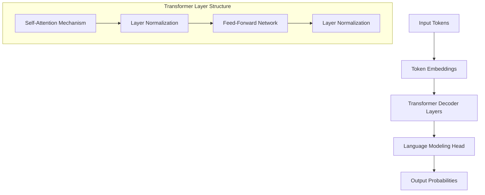
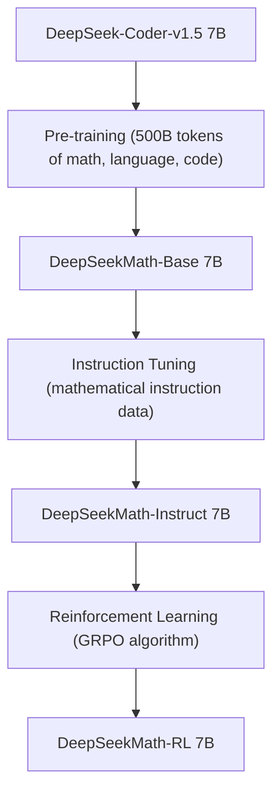
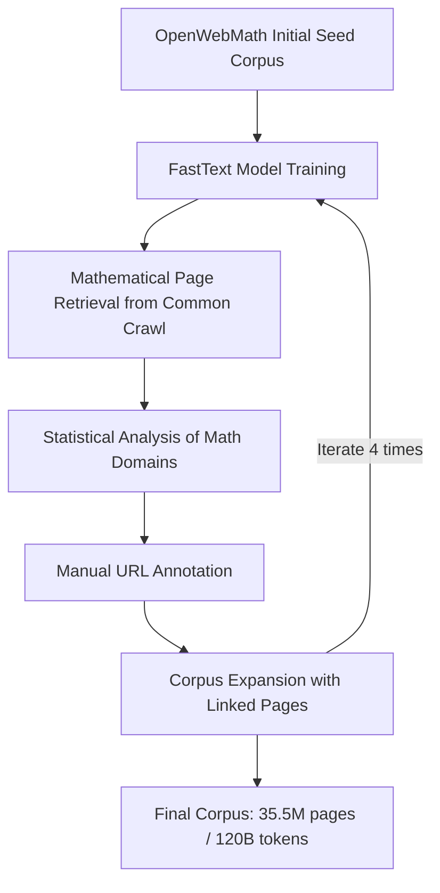
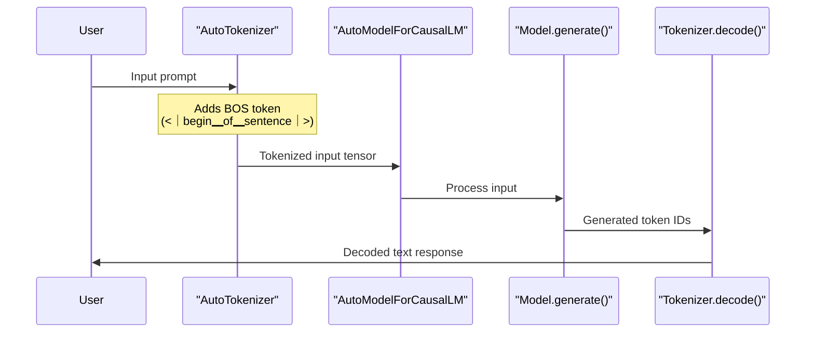

<!-- source: DeepWiki mcp.deepwiki.com · repo deepseek-ai/DeepSeek-Math · page 2.1 Model Architecture · fetched 2026-10-30 -->

# Model Architecture

<details>
<summary>Relevant source files</summary>

The following files were used as context for generating this wiki page:

- [README.md](README.md)

</details>


This page details the technical architecture of the DeepSeekMath model family, including its structure, parameters, training methodology, and development pipeline. For information about specific model variants and their capabilities, see [Base Model](#2.2), [Instruct Model](#2.3), and [RL Model](#2.4).

## Architecture Overview

DeepSeekMath is a family of large language models specifically designed for mathematical reasoning tasks. All models in the family are built upon DeepSeek-Coder-v1.5 7B, with continued pre-training on mathematical content.

Key technical specifications:
- **Parameter count**: 7 billion parameters
- **Context length**: 4096 tokens
- **Architecture type**: Decoder-only transformer
- **Base foundation**: DeepSeek-Coder-v1.5 7B

The DeepSeekMath models inherit the transformer architecture from their foundation model but are specifically adapted for mathematical reasoning through specialized training.

### High-Level Model Architecture



Sources: README.md:62-64, README.md:127-134

## Model Variants and Specifications

The DeepSeekMath family comprises three specialized models, each with identical architectural parameters but different training objectives:

| Model | Parameters | Context Length | Primary Purpose |
|-------|------------|----------------|-----------------|
| DeepSeekMath-Base 7B | 7B | 4096 | Foundation model with strong mathematical capabilities |
| DeepSeekMath-Instruct 7B | 7B | 4096 | Instruction-tuned for step-by-step mathematical reasoning |
| DeepSeekMath-RL 7B | 7B | 4096 | Reinforcement-learned model optimized for advanced problem-solving |

Sources: README.md:127-134

## Development Pipeline

The DeepSeekMath model family follows a progressive development pipeline where each variant builds upon the previous one:



The development process consists of these sequential stages:

1. **Base Model Development**: The foundation model DeepSeek-Coder-v1.5 7B undergoes continued pre-training on 500B tokens of mathematical content, natural language, and code.

2. **Instruction Tuning**: The pre-trained base model is fine-tuned on mathematical instruction data, enhancing its ability to follow directions and perform step-by-step reasoning.

3. **Reinforcement Learning**: The instruction-tuned model is further refined using the Group Relative Policy Optimization (GRPO) algorithm to optimize performance on mathematical tasks.

Sources: README.md:62-64, README.md:98-101

## Training Data Architecture

A critical component of the DeepSeekMath architecture is its specialized training data, collected through an iterative process:



This data collection pipeline resulted in a corpus of 35.5 million mathematical web pages containing approximately 120 billion tokens. These tokens, along with additional natural language and code data, formed the 500 billion token dataset used for training.

Sources: README.md:109-122

## Training Methodology

The training methodology for DeepSeekMath involves three distinct phases, each targeting specific capabilities:

```mermaid
flowchart LR
    subgraph "Pre-training Phase"
        PTStart["DeepSeek-Coder-v1.5 7B"] --> PTProcess["500B tokens of math, language, code"]
        PTProcess --> PTResult["DeepSeekMath-Base 7B"]
    end
    
    subgraph "Instruction Tuning Phase"
        ITStart["DeepSeekMath-Base 7B"] --> ITProcess["Mathematical Instruction Data"]
        ITProcess --> ITResult["DeepSeekMath-Instruct 7B"]
    end
    
    subgraph "Reinforcement Learning Phase"
        RLStart["DeepSeekMath-Instruct 7B"] --> RLProcess["GRPO Algorithm"]
        RLProcess --> RLResult["DeepSeekMath-RL 7B"]
    end
    
    PTResult --> ITStart
    ITResult --> RLStart
```



This progressive approach allows each model to build upon the capabilities of its predecessor, with specialized training techniques tailored to enhance mathematical reasoning.

Sources: README.md:62-64, README.md:98-101

## Implementation and Inference

The DeepSeekMath models are implemented using the Hugging Face Transformers library, providing standardized interfaces for model loading, tokenization, and inference.

### Inference Pipeline



The models support both text completion and chat completion workflows, with specialized templates for chat interactions:

```
User: {message_content}

---

