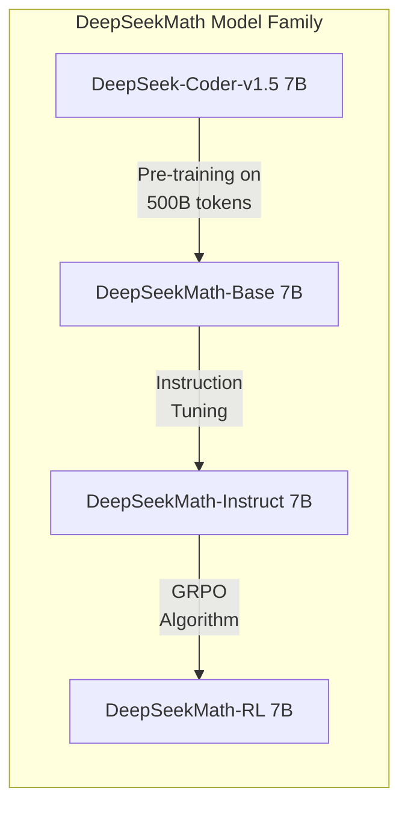
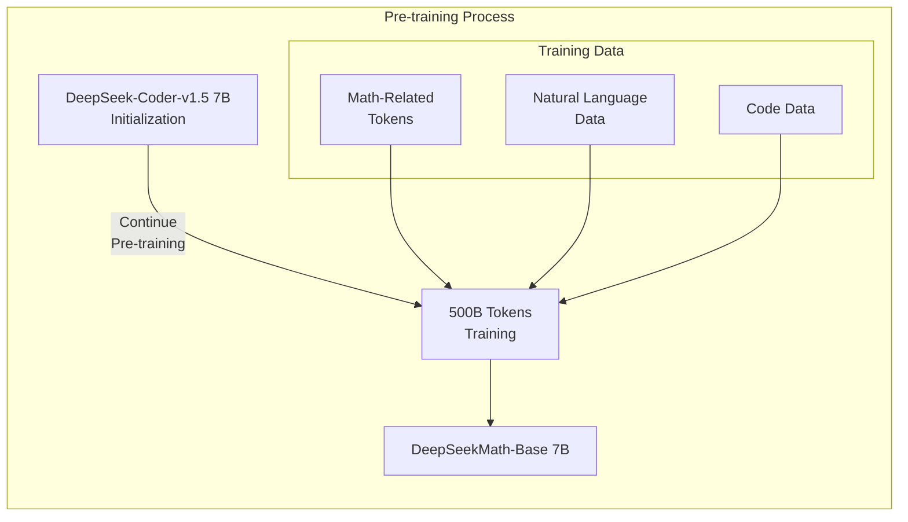
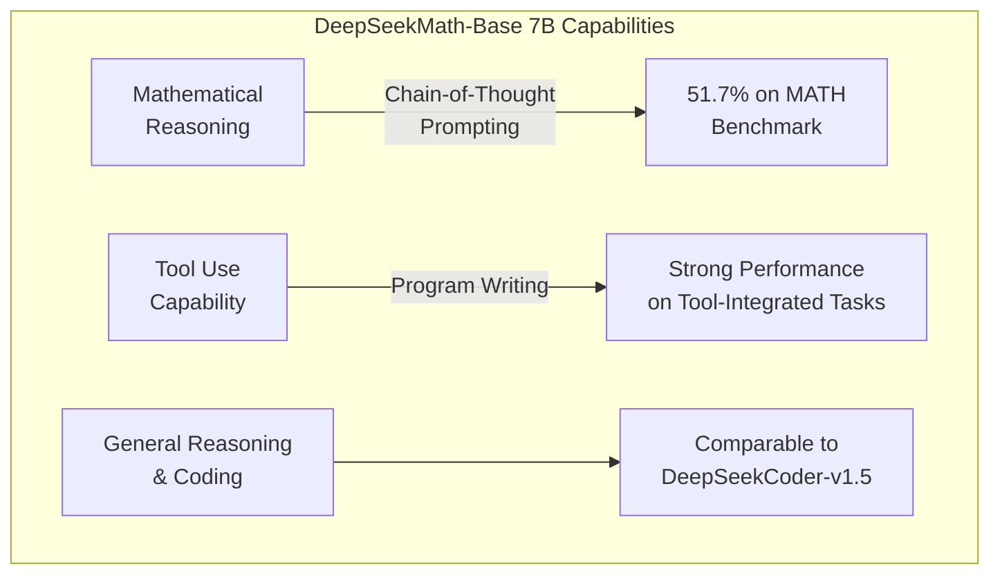
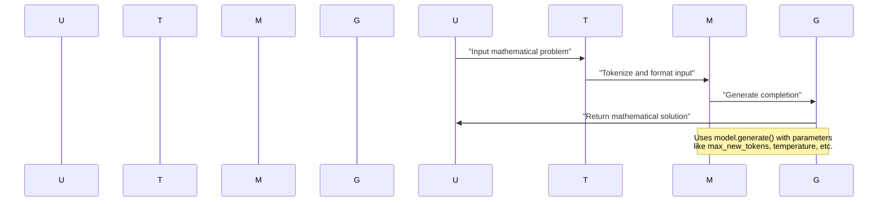
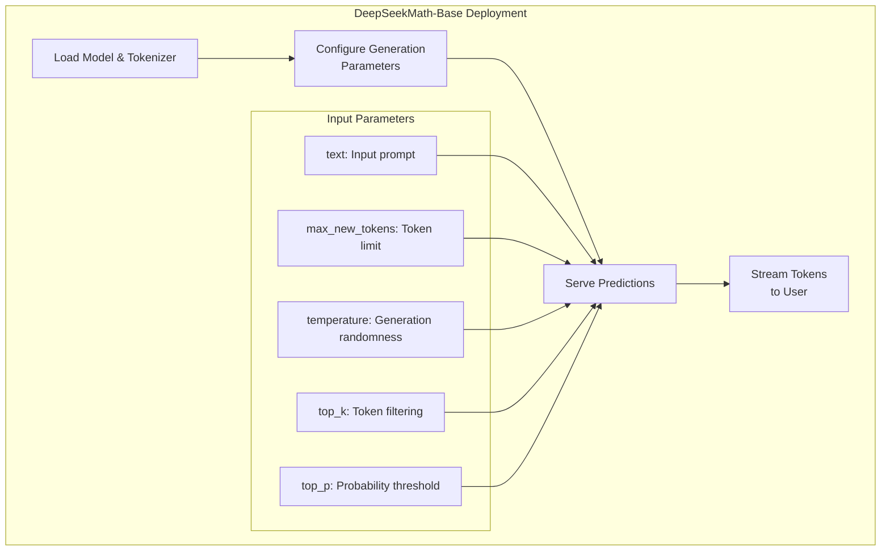

<!-- source: DeepWiki mcp.deepwiki.com · repo deepseek-ai/DeepSeek-Math · page 2.2 Base Model · fetched 2026-10-30 -->

# Base Model

<details>
<summary>Relevant source files</summary>

The following files were used as context for generating this wiki page:

- [README.md](README.md)
- [replicate/predict.py](replicate/predict.py)

</details>


## Purpose and Scope

This document provides detailed information about the DeepSeekMath-Base 7B model, a foundation language model specifically pre-trained for mathematical reasoning capabilities. It covers the model's architecture, technical specifications, training process, performance characteristics, and basic usage patterns. For information about the instruction-tuned version, see [Instruct Model](#2.3), and for the reinforcement learning optimized version, see [RL Model](#2.4).

## Model Overview

DeepSeekMath-Base 7B is the foundational model in the DeepSeekMath family, designed for solving complex mathematical problems through reasoning. It serves as the base model upon which the instruct and RL variants are built. The model demonstrates strong mathematical reasoning abilities without relying on external tools.



**Diagram: DeepSeekMath-Base 7B in the Model Development Pipeline**

Sources: [README.md:63-64]()

## Technical Specifications

The DeepSeekMath-Base 7B model has the following key specifications:

| Specification | Value |
|---------------|-------|
| Parameter Count | 7 billion |
| Context Length | 4096 tokens |
| Model Type | Causal Language Model |
| Architecture | Based on DeepSeek-Coder-v1.5 |
| Format | PyTorch model (transformers compatible) |
| Precision | Supports bfloat16 inference |

Sources: [README.md:64](), [README.md:130-133](), [replicate/predict.py:23-28]()

## Training Process and Data

DeepSeekMath-Base 7B was initialized with the DeepSeek-Coder-v1.5 7B model and then further pre-trained on a specialized dataset.



**Diagram: DeepSeekMath-Base 7B Training Process**

The training data collection for mathematical content followed an iterative approach:

1. Started with OpenWebMath as an initial seed corpus
2. Used FastText model to identify and retrieve math-related content from Common Crawl
3. Identified math-related domains through statistical analysis
4. Manually annotated URLs with mathematical content
5. Added linked pages to the seed corpus and repeated the process for four iterations

This iterative process resulted in 35.5 million mathematical web pages, totaling approximately 120 billion tokens for training.

Sources: [README.md:63-64](), [README.md:109-122]()

## Performance and Capabilities

DeepSeekMath-Base 7B demonstrates exceptional performance in mathematical reasoning tasks, achieving 51.7% accuracy on the competition-level MATH benchmark without relying on external tools or voting techniques.

The model excels in several areas:

1. **Mathematical Reasoning**: Outperforms existing open-source base models by more than 10% in absolute terms on the MATH dataset through few-shot chain-of-thought prompting, surpassing even Minerva 540B.

2. **Tool Use Ability**: Effectively solves and proves mathematical problems by writing programs, leveraging its foundation in the DeepSeekCoder architecture.

3. **General Reasoning and Coding**: Maintains comparable performance in reasoning and coding tasks as its predecessor, DeepSeekCoder-Base-7B-v1.5.



**Diagram: Key Capabilities of DeepSeekMath-Base 7B**

Sources: [README.md:64](), [README.md:72-96]()

## Usage Guide

### Text Completion

The DeepSeekMath-Base 7B model can be used for text completion tasks, including mathematical problem solving, using the Hugging Face Transformers library:

```python
import torch
from transformers import AutoTokenizer, AutoModelForCausalLM, GenerationConfig

model_name = "deepseek-ai/deepseek-math-7b-base"
tokenizer = AutoTokenizer.from_pretrained(model_name)
model = AutoModelForCausalLM.from_pretrained(model_name, torch_dtype=torch.bfloat16, device_map="auto")
model.generation_config = GenerationConfig.from_pretrained(model_name)
model.generation_config.pad_token_id = model.generation_config.eos_token_id

text = "The integral of x^2 from 0 to 2 is"
inputs = tokenizer(text, return_tensors="pt")
outputs = model.generate(**inputs.to(model.device), max_new_tokens=100)

result = tokenizer.decode(outputs[0], skip_special_tokens=True)
print(result)
```



**Diagram: Inference Flow for DeepSeekMath-Base 7B**

Sources: [README.md:140-158](), [replicate/predict.py:36-82]()

### Model Deployment

The model can be deployed using the Cog framework, as demonstrated in the predict.py file in the repository. This allows for easy deployment of the model as an API service.



**Diagram: Cog Deployment Architecture for DeepSeekMath-Base 7B**

Sources: [replicate/predict.py:16-82]()

## Accessing the Model

The DeepSeekMath-Base 7B model is available for download from Hugging Face:

```
https://huggingface.co/deepseek-ai/deepseek-math-7b-base
```

The model supports commercial use under the license terms specified in the repository.

Sources: [README.md:127-134](), [README.md:201-204]()

## Model License

The DeepSeekMath-Base 7B model is available under a specific Model License that supports commercial use. For detailed licensing information, please refer to the [Model Licensing](#2.5) page.

Sources: [README.md:201-204]()

---

