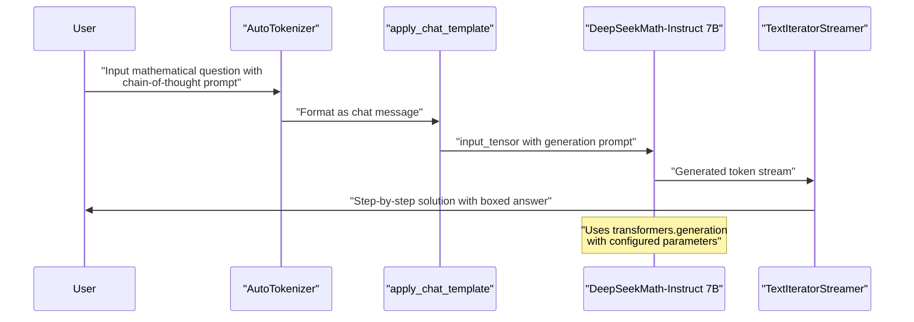
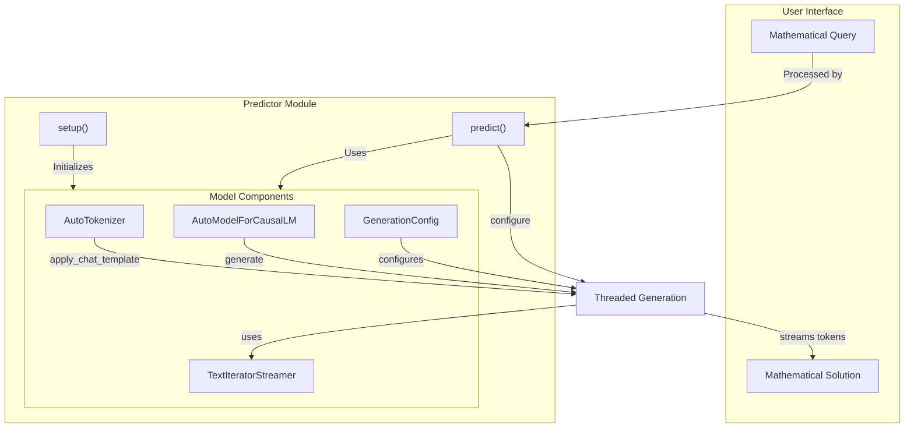

<!-- source: DeepWiki mcp.deepwiki.com · repo deepseek-ai/DeepSeek-Math · page 2.3 Instruct Model · fetched 2026-10-30 -->

# Instruct Model

<details>
<summary>Relevant source files</summary>

The following files were used as context for generating this wiki page:

- [README.md](README.md)
- [replicate/predict_instruct.py](replicate/predict_instruct.py)

</details>


This document provides detailed information about the DeepSeekMath-Instruct 7B model, which is the instruction-tuned variant in the DeepSeekMath family. For information about the Base model, see [Base Model](#2.2), and for information about the Reinforcement Learning model, see [RL Model](#2.4).

## 1. Introduction

DeepSeekMath-Instruct 7B is a specialized mathematical instruction-tuned model derived from DeepSeekMath-Base 7B. It serves as an intermediate step in the DeepSeekMath model development pipeline, positioned between the base pre-trained model and the reinforcement learning optimized model.


**Diagram: DeepSeekMath-Instruct 7B in the model development pipeline**

Sources: [README.md:98-100]()

## 2. Key Capabilities

DeepSeekMath-Instruct 7B is specifically designed to:

- Follow mathematical instructions with high fidelity
- Provide step-by-step reasoning for mathematical problems
- Understand both English and Chinese mathematical queries
- Output solutions with clearly demarcated final answers
- Effectively utilize chain-of-thought prompting patterns

The model demonstrates strong performance on quantitative reasoning benchmarks, particularly excelling at step-by-step reasoning through complex mathematical problems.

Sources: [README.md:98-106]()

## 3. Performance Evaluation

DeepSeekMath-Instruct 7B has been evaluated on multiple mathematical benchmarks, both with and without tool use, in English and Chinese.

| Benchmark | Without Tool Use | With Tool Use |
|-----------|-----------------|--------------|
| MATH      | 51.5%           | 54.2%        |
| GSM8K     | 84.0%           | 89.8%        |
| CMATH     | 51.6%           | 56.7%        |
| CGSM      | 78.7%           | 83.3%        |

*Note: The evaluations for DeepSeekMath-Instruct 7B show particularly strong performance in step-by-step reasoning tasks.*

Sources: [README.md:98-106]()

## 4. Usage Guide

### 4.1 Model Loading

To use DeepSeekMath-Instruct 7B, you can load it using the Hugging Face Transformers library:

```python
import torch
from transformers import AutoTokenizer, AutoModelForCausalLM, GenerationConfig

model_name = "deepseek-ai/deepseek-math-7b-instruct"
tokenizer = AutoTokenizer.from_pretrained(model_name)
model = AutoModelForCausalLM.from_pretrained(
    model_name, 
    torch_dtype=torch.bfloat16, 
    device_map="auto"
)
model.generation_config = GenerationConfig.from_pretrained(model_name)
model.generation_config.pad_token_id = model.generation_config.eos_token_id
```

Sources: [README.md:166-170](), [replicate/predict_instruct.py:21-34]()

### 4.2 Chat Completion

The model is best used with the chat template format:

```python
messages = [
    {"role": "user", "content": "what is the integral of x^2 from 0 to 2?\nPlease reason step by step, and put your final answer within \\boxed{}."}
]
input_tensor = tokenizer.apply_chat_template(messages, add_generation_prompt=True, return_tensors="pt")
outputs = model.generate(input_tensor.to(model.device), max_new_tokens=100)

result = tokenizer.decode(outputs[0][input_tensor.shape[1]:], skip_special_tokens=True)
print(result)
```

Sources: [README.md:172-179]()

### 4.3 Recommended Prompting Strategy

For optimal results with DeepSeekMath-Instruct 7B, chain-of-thought prompting is strongly recommended:

- For English questions: `{question}\nPlease reason step by step, and put your final answer within \boxed{}.`
- For Chinese questions: `{question}\n请通过逐步推理来解答问题，并把最终答案放置于\boxed{}中。`

These prompting patterns encourage the model to think through the problem step-by-step and clearly indicate the final answer.

Sources: [README.md:194-198]()

## 5. Technical Implementation

### 5.1 Inference Process



**Diagram: DeepSeekMath-Instruct 7B inference process**

Sources: [replicate/predict_instruct.py:36-86]()

### 5.2 Model Serving Architecture



**Diagram: DeepSeekMath-Instruct model serving architecture**

Sources: [replicate/predict_instruct.py:1-87]()

### 5.3 Key Configuration Parameters

The DeepSeekMath-Instruct 7B model accepts several parameters that control the generation process:

| Parameter | Description | Default Value |
|-----------|-------------|---------------|
| max_new_tokens | Maximum number of tokens to generate | 100 |
| temperature | Controls randomness in generation | 1.0 |
| top_k | Number of highest probability tokens to keep | 50 |
| top_p | Nucleus sampling threshold | 0.9 |

These parameters can be adjusted to control the length, creativity, and determinism of the model's responses.

Sources: [replicate/predict_instruct.py:42-57]()

## 6. Licensing and Availability

DeepSeekMath-Instruct 7B is available on Hugging Face at `deepseek-ai/deepseek-math-7b-instruct`. The model supports commercial use under the terms outlined in the Model License.

Sources: [README.md:131-134](), [README.md:201-203]()

---

