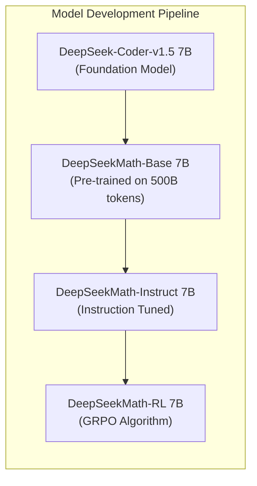
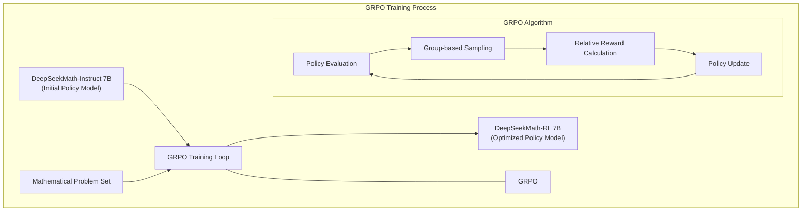
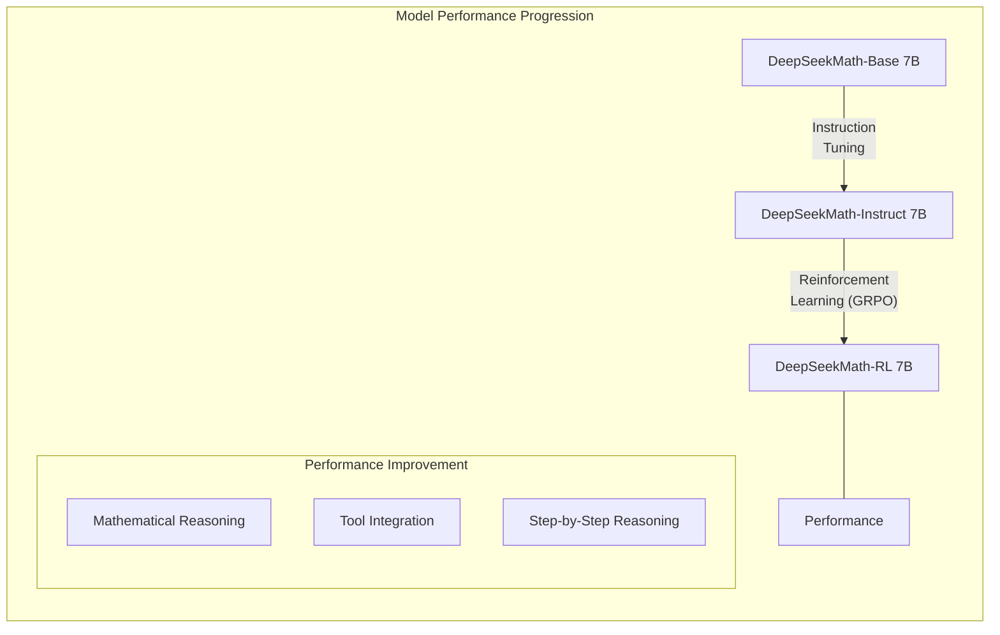
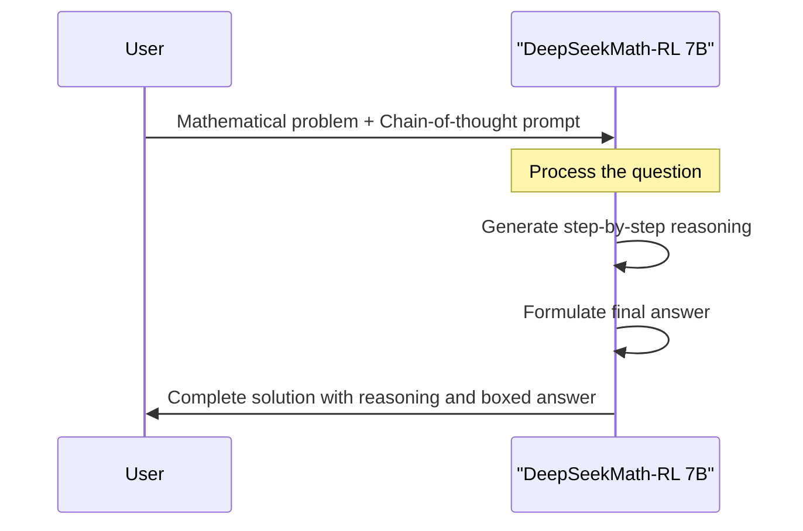
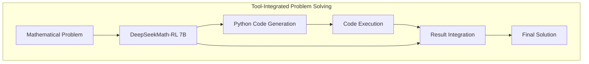

<!-- source: DeepWiki mcp.deepwiki.com · repo deepseek-ai/DeepSeek-Math · page 2.4 RL Model · fetched 2026-10-30 -->

# RL Model

<details>
<summary>Relevant source files</summary>

The following files were used as context for generating this wiki page:

- [README.md](README.md)

</details>


This document provides detailed information about the DeepSeekMath-RL 7B model, which represents the final iteration in the DeepSeekMath model family, trained using reinforcement learning techniques. For information about the base model, see [Base Model](#2.2), and for details on the instruct model, see [Instruct Model](#2.3).

## 1. Overview

DeepSeekMath-RL 7B is a specialized mathematical reasoning model built upon DeepSeekMath-Instruct 7B using reinforcement learning. It achieves state-of-the-art performance among open-source models on various mathematical benchmarks, approaching an accuracy of 60% on the MATH benchmark when combined with tool use capabilities.

The model is trained using a custom reinforcement learning algorithm called Group Relative Policy Optimization (GRPO), designed specifically to improve mathematical reasoning capabilities.



Sources: [README.md:63-64], [README.md:99-102]

## 2. Technical Specifications

The DeepSeekMath-RL 7B model maintains the same architecture as its predecessors while being fine-tuned with reinforcement learning.

| Specification | Value |
|---------------|-------|
| Parameter Count | 7 billion |
| Model Type | Decoder-only transformer |
| Context Length | 4096 tokens |
| Training Method | Group Relative Policy Optimization (GRPO) |
| Base Model | DeepSeekMath-Instruct 7B |
| Hugging Face Repository | deepseek-ai/deepseek-math-7b-rl |

Sources: [README.md:134], [README.md:99-102]

## 3. GRPO Algorithm

The DeepSeekMath-RL 7B model is trained using the Group Relative Policy Optimization (GRPO) algorithm, which is specifically designed to improve mathematical reasoning capabilities through reinforcement learning.



While the exact implementation details of GRPO are not explicitly documented in the repository, the algorithm appears to be a variant of PPO (Proximal Policy Optimization) that uses relative comparisons within groups of responses to guide the policy optimization, rather than absolute reward values.

Sources: [README.md:100-102]

## 4. Performance and Evaluation

The DeepSeekMath-RL 7B model achieves exceptional performance on mathematical reasoning tasks, particularly when combined with tool use capabilities.

### Mathematical Benchmarks Performance

| Benchmark | DeepSeekMath-RL 7B | Notes |
|-----------|--------------|-------|
| MATH | ~60% (with tool use) | Competition-level mathematical problems |
| GSM8K | High performance | Grade school math problems |
| Chinese Math | Strong performance | Mathematical problems in Chinese |

The RL model demonstrably outperforms the previous Instruct model and approaches the performance of much larger closed-source models on mathematical reasoning benchmarks.



Sources: [README.md:102-106]

## 5. Usage Guide

### Loading the Model

DeepSeekMath-RL 7B can be loaded using the Hugging Face Transformers library, similar to the Instruct model:

```python
import torch
from transformers import AutoTokenizer, AutoModelForCausalLM, GenerationConfig

model_name = "deepseek-ai/deepseek-math-7b-rl"
tokenizer = AutoTokenizer.from_pretrained(model_name)
model = AutoModelForCausalLM.from_pretrained(model_name, torch_dtype=torch.bfloat16, device_map="auto")
model.generation_config = GenerationConfig.from_pretrained(model_name)
model.generation_config.pad_token_id = model.generation_config.eos_token_id
```

### Chat Completion

The RL model is designed for chat-based interactions using the following format:

```python
messages = [
    {"role": "user", "content": "what is the integral of x^2 from 0 to 2?\nPlease reason step by step, and put your final answer within \\boxed{}."}
]
input_tensor = tokenizer.apply_chat_template(messages, add_generation_prompt=True, return_tensors="pt")
outputs = model.generate(input_tensor.to(model.device), max_new_tokens=100)

result = tokenizer.decode(outputs[0][input_tensor.shape[1]:], skip_special_tokens=True)
print(result)
```

Sources: [README.md:160-180]

## 6. Prompting Strategies

For optimal performance with the DeepSeekMath-RL model, chain-of-thought prompting is strongly recommended:

### For English Questions:
```
{question}
Please reason step by step, and put your final answer within \boxed{}.
```

### For Chinese Questions:
```
{question}
请通过逐步推理来解答问题，并把最终答案放置于\boxed{}中。
```

This prompting strategy guides the model to provide detailed reasoning steps before arriving at a final answer, leading to higher accuracy on mathematical tasks.



Sources: [README.md:194-198]

## 7. Integration with Tool Use

The DeepSeekMath-RL 7B model demonstrates particularly strong performance when integrated with computational tools. This involves the model generating code (typically Python) to solve mathematical problems and then leveraging the results.

The tool-integrated approach follows this general pattern:
1. The model analyzes the mathematical problem
2. It generates appropriate Python code to solve aspects of the problem
3. The code is executed to obtain computational results
4. These results are incorporated into the final answer

This approach allows the model to handle complex calculations more reliably and achieve higher accuracy on mathematical benchmarks.



Sources: [README.md:102-106], [README.md:82-86]

## 8. License and Availability

The DeepSeekMath-RL 7B model is available under the DeepSeek Model License, which permits commercial use subject to the terms outlined in the license. The model can be downloaded from Hugging Face at [deepseek-ai/deepseek-math-7b-rl](https://huggingface.co/deepseek-ai/deepseek-math-7b-rl).

Sources: [README.md:134], [README.md:201-204]

---

