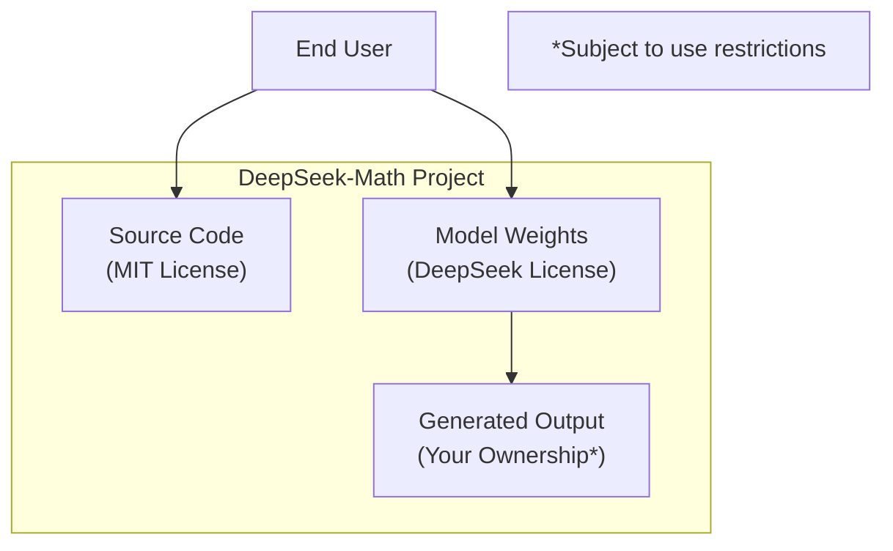
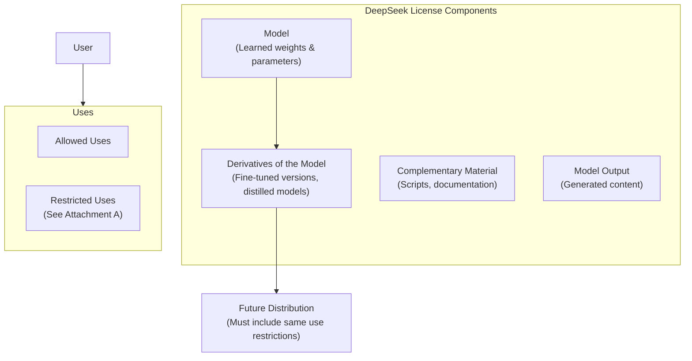
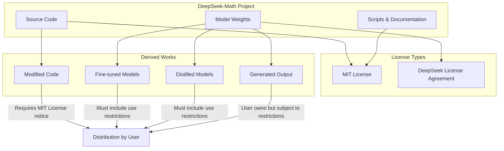

<!-- source: DeepWiki mcp.deepwiki.com · repo deepseek-ai/DeepSeek-Math · page 2.5 Model Licensing · fetched 2026-10-30 -->

# Model Licensing

Relevant source files

The following files were used as context for generating this wiki page:

- [LICENSE-CODE](LICENSE-CODE)
- [LICENSE-MODEL](LICENSE-MODEL)

This page provides detailed information about the licensing terms that govern the use of DeepSeek-Math models and associated code. Understanding these licensing terms is essential for anyone who intends to use, modify, distribute, or build upon the DeepSeek-Math project.

## License Overview

DeepSeek-Math uses a dual-licensing approach, with separate licenses for the code and model weights:

1. **Code License**: The source code is licensed under the MIT License
2. **Model License**: The model weights are licensed under the DeepSeek License Agreement

Sources: [LICENSE-CODE](), [LICENSE-MODEL]()

## Code License (MIT)

The source code of DeepSeek-Math is released under the MIT License, which is a permissive open-source license.

### Key Permissions

- **Use**: Free to use the code for any purpose
- **Modify**: Free to modify the code
- **Distribute**: Free to distribute original or modified versions
- **Commercial Use**: Free to use commercially
- **Sublicense**: Free to incorporate into other software and apply different licensing to your additions

### Obligations

- Include the original copyright notice and MIT License text in all copies or substantial portions of the software

### Limitations

- No warranty or liability: The software is provided "as is" without warranty of any kind

Sources: [LICENSE-CODE]()

## Model License (DeepSeek License Agreement)

The DeepSeek-Math models are governed by the DeepSeek License Agreement (Version 1.0, October 23, 2023), which grants certain rights while imposing specific use restrictions.

Sources: [LICENSE-MODEL]()

### Key Definitions

- **Model**: The machine learning-based assembly consisting of learned weights and parameters
- **Derivatives of the Model**: All modifications to the Model, including fine-tuned versions and distilled models
- **Complementary Material**: The accompanying source code, scripts, documentation, etc.
- **Output**: The results generated by operating the Model

### Permissions

- **Copyright License**: Perpetual, worldwide, non-exclusive, royalty-free rights to reproduce, display, sublicense, and distribute the Model and its derivatives
- **Patent License**: Non-exclusive, royalty-free rights to any patents necessarily infringed by DeepSeek's contribution
- **Output**: DeepSeek claims no rights to the output you generate using the Model (you are accountable for the output and its subsequent uses)

### Use Restrictions

The DeepSeek License prohibits using the Model or Derivatives of the Model for:

| Prohibited Use | Description |
|----------------|-------------|
| Legal Violations | Any way that violates applicable laws or regulations |
| Military Use | Any military applications |
| Harming Minors | Exploiting or harming minors |
| False Information | Generating false information to harm others |
| Inappropriate Content | Generating content prohibited by regulations |
| Personal Data Misuse | Generating personal identifiable information without authorization |
| Defamation | Defaming, disparaging, or harassing others |
| Automated Decision-Making | Fully automated decisions that adversely impact legal rights |
| Discrimination | Uses that discriminate against individuals or groups |
| Exploitation of Vulnerabilities | Exploiting vulnerabilities of specific groups |
| Protected Characteristics | Discrimination based on legally protected characteristics |

Sources: [LICENSE-MODEL:75-91]()

### Distribution Requirements

When distributing the Model or Derivatives of the Model, you must:

1. Include the use-based restrictions in any legal agreement governing the distribution
2. Provide recipients with a copy of the DeepSeek License
3. Mark any modified files with notices stating that you changed them
4. Retain all copyright, patent, trademark, and attribution notices

Sources: [LICENSE-MODEL:44-49]()

## Licensing Structure and Relations

Sources: [LICENSE-CODE](), [LICENSE-MODEL]()

## Important Considerations

### Personal Information and IP Rights

The Model may contain personal information and works with intellectual property rights. When using the Model, you must:

- Comply with applicable laws regarding personal information and IP rights
- Ensure you have a legitimate basis for processing such information
- Assume sole responsibility for any risks arising from handling such content

Sources: [LICENSE-MODEL:58-61]()

### Disclaimer and Liability

- The Model and Complementary Material are provided "AS IS" without warranties
- DeepSeek is not liable for damages arising from the use of the Model
- If you offer warranty or accept additional liability, you do so on your own behalf

Sources: [LICENSE-MODEL:62-67]()

### Governing Law

The DeepSeek License Agreement is governed by:

- PRC laws without regard to choice of law principles
- The courts located in the domicile of Hangzhou DeepSeek Artificial Intelligence Fundamental Technology Research Co., Ltd. have exclusive jurisdiction

Sources: [LICENSE-MODEL:71-71]()

## Practical Implications

Understanding the licensing terms has practical implications for how you can use DeepSeek-Math:

| Use Case | Code (MIT License) | Models (DeepSeek License) |
|----------|-------------------|---------------------------|
| Personal research | Permitted | Permitted with restrictions |
| Commercial applications | Permitted | Permitted with restrictions |
| Modification | Permitted | Permitted with restrictions |
| Distribution | Permitted with notice | Permitted with restrictions |
| Fine-tuning | Permitted | Permitted with restrictions |
| Model merging | Permitted | Permitted with restrictions |
| Redistribution of derivatives | Permitted with notice | Must include use restrictions |

Sources: [LICENSE-CODE](), [LICENSE-MODEL]()

## Summary

The DeepSeek-Math project uses a dual-licensing structure:

1. **MIT License** for code and complementary materials, offering broad permissions with minimal requirements
2. **DeepSeek License Agreement** for model weights, which grants usage rights but includes specific use restrictions

When using DeepSeek-Math, you must adhere to both licenses for their respective components, particularly being mindful of the use restrictions for the model and its derivatives.

Sources: [LICENSE-CODE](), [LICENSE-MODEL]()

---

