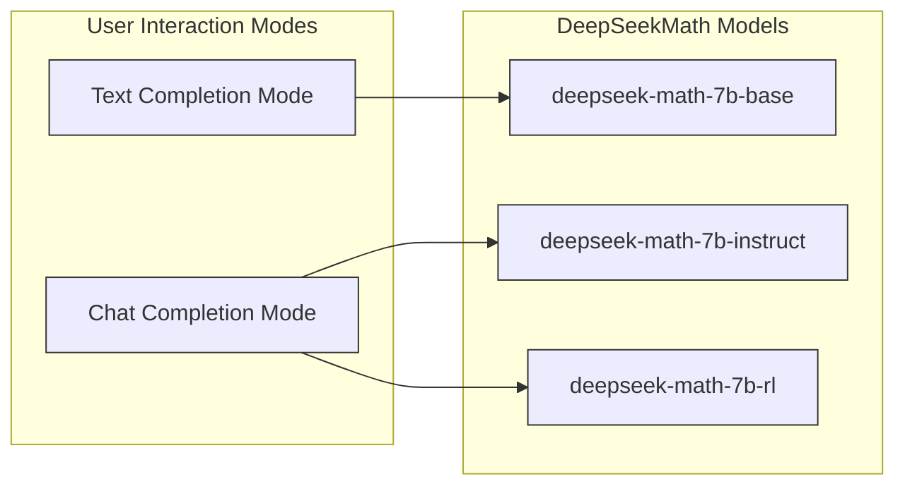
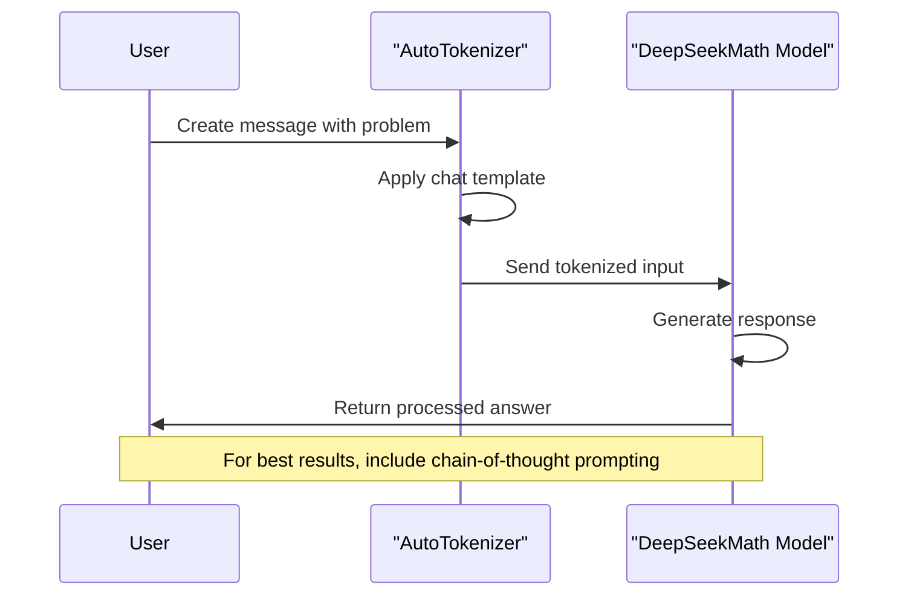

<!-- source: DeepWiki mcp.deepwiki.com · repo deepseek-ai/DeepSeek-Math · page 3 Usage Guide · fetched 2026-10-30 -->

# Usage Guide

<details>
<summary>Relevant source files</summary>

The following files were used as context for generating this wiki page:

- [README.md](README.md)

</details>


This document provides comprehensive instructions for using the DeepSeek-Math models effectively. It covers basic model initialization, inference patterns, and recommended prompting strategies. For model architecture details, see [Models](#2), and for deployment information, see [Deployment](#4).

## Model Overview

DeepSeek-Math is available in three variants, each optimized for different use cases:

| Model | Description | Best Use Cases |
|-------|-------------|----------------|
| DeepSeek-Math Base 7B | Foundation model with strong math capabilities | Research, raw completion tasks |
| DeepSeek-Math Instruct 7B | Fine-tuned for instruction following | Interactive problem-solving, tutoring |
| DeepSeek-Math RL 7B | Further refined with reinforcement learning | Complex problem-solving requiring precision |

All models support a context length of 4096 tokens and are optimized for mathematical reasoning tasks.



Sources: [README.md:125-134]()

## Basic Usage

There are two primary ways to interact with DeepSeek-Math models: text completion and chat completion.

### Text Completion

The text completion mode is suitable for the base model when you want to continue a mathematical text or problem. The model will generate a continuation based on the provided input.

```python
import torch
from transformers import AutoTokenizer, AutoModelForCausalLM, GenerationConfig

model_name = "deepseek-ai/deepseek-math-7b-base"
tokenizer = AutoTokenizer.from_pretrained(model_name)
model = AutoModelForCausalLM.from_pretrained(model_name, torch_dtype=torch.bfloat16, device_map="auto")
model.generation_config = GenerationConfig.from_pretrained(model_name)
model.generation_config.pad_token_id = model.generation_config.eos_token_id

text = "The integral of x^2 from 0 to 2 is"
inputs = tokenizer(text, return_tensors="pt")
outputs = model.generate(**inputs.to(model.device), max_new_tokens=100)

result = tokenizer.decode(outputs[0], skip_special_tokens=True)
print(result)
```

Sources: [README.md:140-158]()

### Chat Completion

The chat completion mode is designed for the instruct and RL variants, allowing for interactive conversations about mathematical topics. This mode uses a specific format for structuring the conversation.

```python
import torch
from transformers import AutoTokenizer, AutoModelForCausalLM, GenerationConfig

model_name = "deepseek-ai/deepseek-math-7b-instruct"  # or "deepseek-ai/deepseek-math-7b-rl"
tokenizer = AutoTokenizer.from_pretrained(model_name)
model = AutoModelForCausalLM.from_pretrained(model_name, torch_dtype=torch.bfloat16, device_map="auto")
model.generation_config = GenerationConfig.from_pretrained(model_name)
model.generation_config.pad_token_id = model.generation_config.eos_token_id

messages = [
    {"role": "user", "content": "what is the integral of x^2 from 0 to 2?\nPlease reason step by step, and put your final answer within \\boxed{}."}
]
input_tensor = tokenizer.apply_chat_template(messages, add_generation_prompt=True, return_tensors="pt")
outputs = model.generate(input_tensor.to(model.device), max_new_tokens=100)

result = tokenizer.decode(outputs[0][input_tensor.shape[1]:], skip_special_tokens=True)
print(result)
```

Sources: [README.md:160-180]()



Sources: [README.md:160-180](), [README.md:194-198]()

## Manual Chat Format

If you prefer not to use the `apply_chat_template` function, you can format your inputs manually using the following template:

```
User: {your_question}

---

