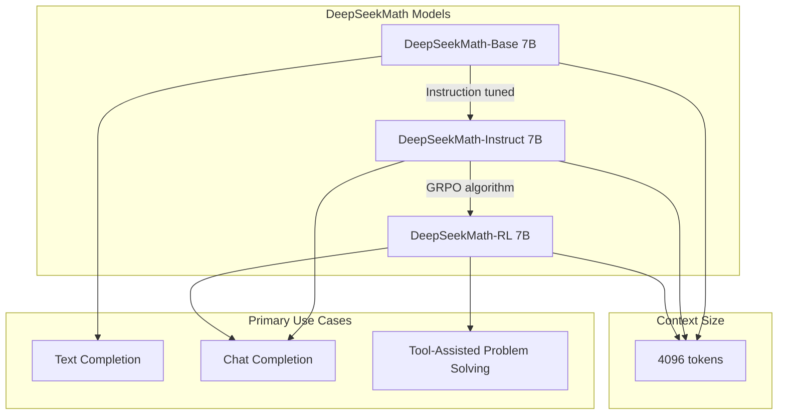
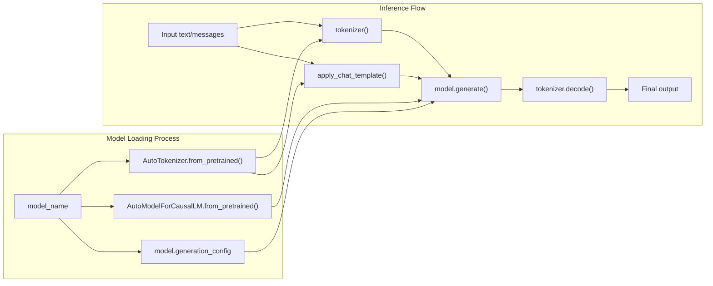

<!-- source: DeepWiki mcp.deepwiki.com · repo deepseek-ai/DeepSeek-Math · page 3.1 Getting Started · fetched 2026-10-30 -->

# Getting Started

<details>
<summary>Relevant source files</summary>

The following files were used as context for generating this wiki page:

- [README.md](README.md)

</details>


This guide provides instructions for downloading and setting up the DeepSeek-Math models for mathematical reasoning tasks. It covers model installation, basic usage patterns, and initial configuration for both text completion and chat completion scenarios. For advanced prompting strategies, see [Prompting Strategies](#3.4), and for deployment options, see [Deployment](#4).

## Model Overview

DeepSeekMath comes in three variants, each with different capabilities and use cases:



Sources: [README.md:125-134]()

## Installation Requirements

Before using the DeepSeekMath models, ensure you have the necessary dependencies installed:

```bash
pip install torch>=2.0.0
pip install transformers>=4.33.0
```

These requirements will provide the foundational libraries needed to load and run the models.

## Downloading the Models

The models are available for download from Hugging Face. You can download them programmatically using the Hugging Face Transformers library.

| Model | Sequence Length | Hugging Face Repository |
|-------|----------------|------------------------|
| DeepSeekMath-Base 7B | 4096 | deepseek-ai/deepseek-math-7b-base |
| DeepSeekMath-Instruct 7B | 4096 | deepseek-ai/deepseek-math-7b-instruct |
| DeepSeekMath-RL 7B | 4096 | deepseek-ai/deepseek-math-7b-rl |

Sources: [README.md:125-134]()

## Basic Usage

### Text Completion with Base Model

The Base model is suitable for text completion tasks where you want to continue a mathematical statement or problem:

```python
import torch
from transformers import AutoTokenizer, AutoModelForCausalLM, GenerationConfig

model_name = "deepseek-ai/deepseek-math-7b-base"
tokenizer = AutoTokenizer.from_pretrained(model_name)
model = AutoModelForCausalLM.from_pretrained(model_name, torch_dtype=torch.bfloat16, device_map="auto")
model.generation_config = GenerationConfig.from_pretrained(model_name)
model.generation_config.pad_token_id = model.generation_config.eos_token_id

text = "The integral of x^2 from 0 to 2 is"
inputs = tokenizer(text, return_tensors="pt")
outputs = model.generate(**inputs.to(model.device), max_new_tokens=100)

result = tokenizer.decode(outputs[0], skip_special_tokens=True)
print(result)
```

Sources: [README.md:142-158]()

### Chat Completion with Instruct/RL Models

The Instruct and RL models are designed for interactive chat-based completion tasks:

```python
import torch
from transformers import AutoTokenizer, AutoModelForCausalLM, GenerationConfig

model_name = "deepseek-ai/deepseek-math-7b-instruct"  # or "deepseek-ai/deepseek-math-7b-rl"
tokenizer = AutoTokenizer.from_pretrained(model_name)
model = AutoModelForCausalLM.from_pretrained(model_name, torch_dtype=torch.bfloat16, device_map="auto")
model.generation_config = GenerationConfig.from_pretrained(model_name)
model.generation_config.pad_token_id = model.generation_config.eos_token_id

messages = [
    {"role": "user", "content": "what is the integral of x^2 from 0 to 2?\nPlease reason step by step, and put your final answer within \\boxed{}."}
]
input_tensor = tokenizer.apply_chat_template(messages, add_generation_prompt=True, return_tensors="pt")
outputs = model.generate(input_tensor.to(model.device), max_new_tokens=100)

result = tokenizer.decode(outputs[0][input_tensor.shape[1]:], skip_special_tokens=True)
print(result)
```

Sources: [README.md:162-180]()

## Model Loading Process

The following diagram illustrates the model loading and inference process:



Sources: [README.md:142-180]()

## Prompting Recommendations

For optimal results, especially with DeepSeekMath-Instruct and DeepSeekMath-RL models, it's recommended to use chain-of-thought prompting:

### For English questions:
```
{question}
Please reason step by step, and put your final answer within \boxed{}.
```

### For Chinese questions:
```
{question}
请通过逐步推理来解答问题，并把最终答案放置于\boxed{}中。
```

Using this prompting format encourages the model to show its reasoning process, which significantly improves the accuracy of mathematical problem-solving.

Sources: [README.md:194-198]()

## Manual Chat Template Format

If you prefer not to use the `apply_chat_template` function, you can format your input following this template:

```
User: {messages[0]['content']}

---

