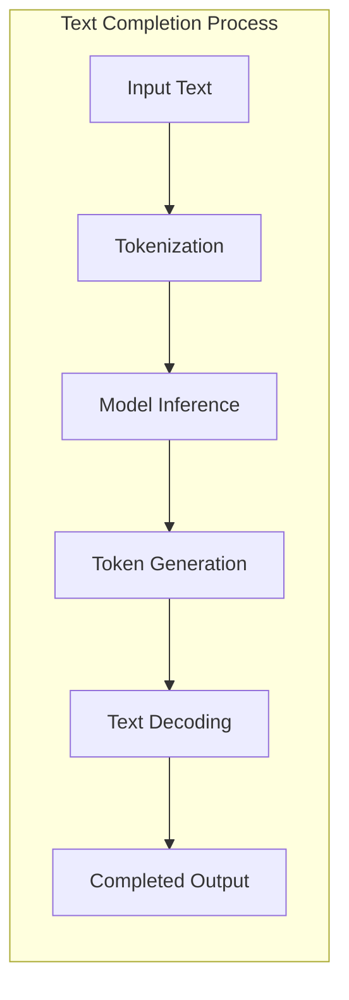
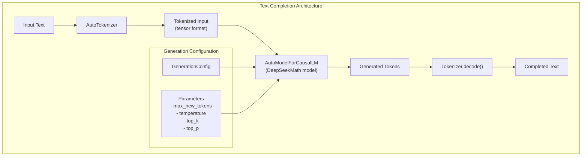
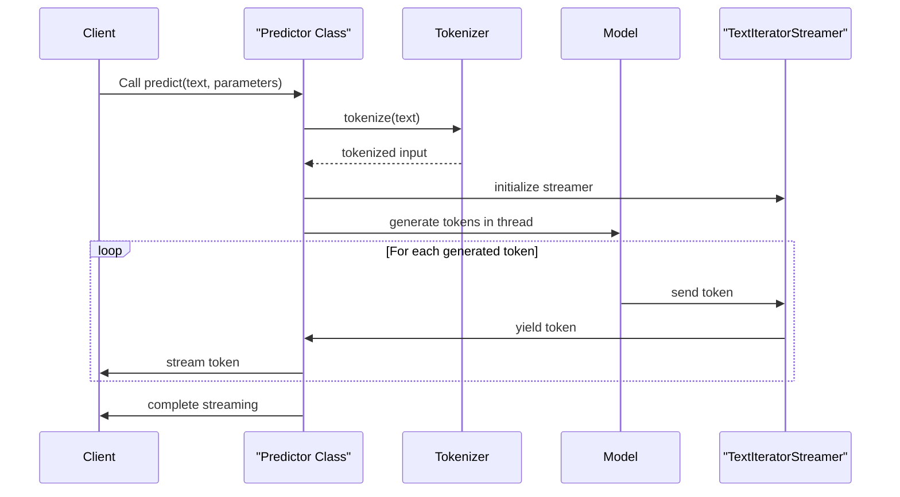

<!-- source: DeepWiki mcp.deepwiki.com · repo deepseek-ai/DeepSeek-Math · page 3.2 Text Completion · fetched 2026-10-30 -->

# Text Completion

<details>
<summary>Relevant source files</summary>

The following files were used as context for generating this wiki page:

- [README.md](README.md)
- [replicate/predict.py](replicate/predict.py)

</details>


This document describes how to use the DeepSeek-Math models for text completion tasks. Text completion refers to the process of generating a continuation of an input text prompt, which is particularly useful for solving mathematical problems. For information about using the models in a conversational format, see [Chat Completion](#3.3).

## Overview of Text Completion

Text completion is the fundamental capability of the DeepSeek-Math models to generate coherent and relevant continuations from a given input prompt. In mathematical contexts, this means providing solutions, proofs, or explanations for mathematical problems presented in the input text.



Sources: [README.md:140-157]()

## Implementation Architecture

The text completion functionality in DeepSeek-Math is built on Hugging Face's Transformers library. The process involves preparing the input, generating tokens, and decoding the output.



Sources: [README.md:140-157](), [replicate/predict.py:17-82]()

## Basic Usage

Here's a basic example of how to use the DeepSeek-Math model for text completion:

```python
import torch
from transformers import AutoTokenizer, AutoModelForCausalLM, GenerationConfig

model_name = "deepseek-ai/deepseek-math-7b-base"
tokenizer = AutoTokenizer.from_pretrained(model_name)
model = AutoModelForCausalLM.from_pretrained(model_name, torch_dtype=torch.bfloat16, device_map="auto")
model.generation_config = GenerationConfig.from_pretrained(model_name)
model.generation_config.pad_token_id = model.generation_config.eos_token_id

text = "The integral of x^2 from 0 to 2 is"
inputs = tokenizer(text, return_tensors="pt")
outputs = model.generate(**inputs.to(model.device), max_new_tokens=100)

result = tokenizer.decode(outputs[0], skip_special_tokens=True)
print(result)
```

This example demonstrates:
1. Loading the tokenizer and model from Hugging Face
2. Setting up the generation configuration
3. Tokenizing the input text
4. Generating a completion with the model
5. Decoding the generated tokens back to text

Sources: [README.md:140-157]()

## Generation Parameters

When performing text completion, several parameters can be adjusted to control the generation process:

| Parameter | Description | Default Value |
|-----------|-------------|---------------|
| `max_new_tokens` | The maximum number of tokens to generate | 100 |
| `temperature` | Controls randomness in generation (higher = more random) | 1.0 |
| `top_k` | Limits token selection to top k most probable tokens | 50 |
| `top_p` | Nucleus sampling threshold (cumulative probability) | 0.9 |

These parameters allow you to balance between deterministic, accurate responses and more creative, diverse outputs:

- Lower `temperature` values (e.g., 0.3-0.7) produce more deterministic, focused outputs
- Higher `temperature` values (e.g., 0.8-1.2) produce more varied, creative outputs
- Setting `top_k` and `top_p` helps filter out low-probability tokens

Sources: [replicate/predict.py:42-57]()

## Streaming Text Completion

For applications that benefit from displaying results as they are generated, DeepSeek-Math supports streaming text completion. This is implemented in the Cog predictor:



The implementation uses a thread to run the model generation while yielding generated tokens via a `TextIteratorStreamer`:

```python
def predict(self, text, max_new_tokens, temperature, top_k, top_p):
    inputs = self.tokenizer(text, return_tensors="pt")
    streamer = TextIteratorStreamer(
        self.tokenizer, skip_prompt=True, skip_special_tokens=True
    )
    
    thread = Thread(
        target=self.model.generate,
        kwargs=dict(
            **inputs.to(self.model.device),
            do_sample=True,
            temperature=temperature,
            top_p=top_p,
            top_k=top_k,
            max_new_tokens=max_new_tokens,
            streamer=streamer,
            use_cache=True
        ),
    )
    thread.start()
    
    for new_token in streamer:
        yield new_token
        
    thread.join()
```

Sources: [replicate/predict.py:36-82]()

## Model Selection for Text Completion

DeepSeek-Math offers three model variants with different characteristics for text completion:

| Model Variant | Best Use Case | Notes |
|---------------|--------------|-------|
| DeepSeekMath-Base | General mathematical text completion | Default model for most use cases |
| DeepSeekMath-Instruct | Step-by-step reasoning | Better with chain-of-thought prompting |
| DeepSeekMath-RL | Complex mathematical problems | Best with tool use and step-by-step prompting |

For text completion of mathematical problems, the Base model provides a good starting point, while the Instruct and RL models benefit from explicit prompting for step-by-step reasoning.

Sources: [README.md:124-135](), [README.md:194-198]()

## Best Practices for Mathematical Text Completion

When using the DeepSeek-Math models for mathematical text completion, consider these best practices:

1. **Be Specific in Prompts**: Provide clear, well-formulated mathematical questions
2. **Request Step-by-Step Reasoning**: For complex problems, explicitly ask the model to show its work
3. **Use Standard Mathematical Notation**: The model works best with standard mathematical notation
4. **Structure Output Format**: For extractable answers, specify a consistent format (e.g., `\boxed{}`)

For the Instruct and RL models, it's recommended to include explicit prompting for chain-of-thought reasoning:

- For English questions: `{question}\nPlease reason step by step, and put your final answer within \boxed{}.`
- For Chinese questions: `{question}\n请通过逐步推理来解答问题，并把最终答案放置于\boxed{}中。`

Sources: [README.md:194-198]()

## Example Usage

Here's an example of using text completion for a mathematical problem:

Input:
```
The integral of x^2 from 0 to 2 is
```

Typical output (from Base model):
```
The integral of x^2 from 0 to 2 is

To compute this integral, I'll use the power rule for integration: ∫x^n dx = (x^(n+1))/(n+1) + C

For x^2, we have n = 2:
∫x^2 dx = (x^3)/3 + C

Now, I need to evaluate this from x = 0 to x = 2.
∫_0^2 x^2 dx = [(x^3)/3]_0^2
                = [(2^3)/3] - [(0^3)/3]
                = [8/3] - [0]
                = 8/3

Therefore, the integral of x^2 from 0 to 2 is 8/3.
```

Sources: [README.md:140-157]()

---

