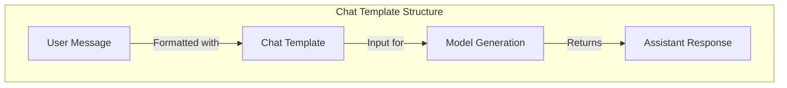

<!-- source: DeepWiki mcp.deepwiki.com · repo deepseek-ai/DeepSeek-Math · page 3.3 Chat Completion · fetched 2026-10-30 -->

# Chat Completion

<details>
<summary>Relevant source files</summary>

The following files were used as context for generating this wiki page:

- [README.md](README.md)
- [replicate/predict_instruct.py](replicate/predict_instruct.py)

</details>


This page documents how to use DeepSeekMath models for chat completion tasks, specifically focusing on the conversational interface provided by the instruct and RL variants of DeepSeekMath. For information about basic text completion without the conversational format, see [Text Completion](#3.2).

## Model Options for Chat

DeepSeekMath offers two model variants specifically tuned for chat completion:

| Model | Description | Best For |
|-------|-------------|----------|
| DeepSeekMath-Instruct 7B | Fine-tuned from base model with instruction tuning | General mathematical discussion and step-by-step reasoning |
| DeepSeekMath-RL 7B | Further trained using Group Relative Policy Optimization (GRPO) | Advanced mathematical reasoning, competition-level problems |

Sources: [README.md:98-106]()

## Chat Message Format

DeepSeekMath uses a specific format for chat interactions. Understanding this format is important for proper model usage.



The chat template follows this structure:

```
User: {messages[0]['content']}

---

