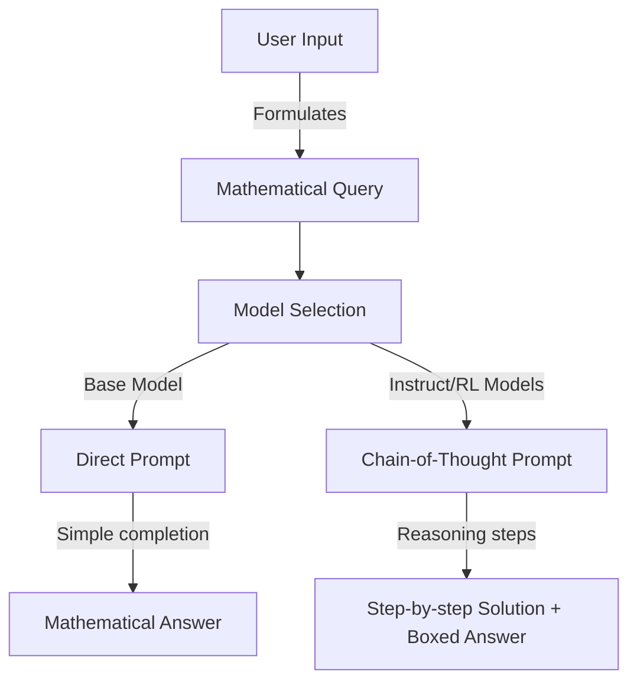
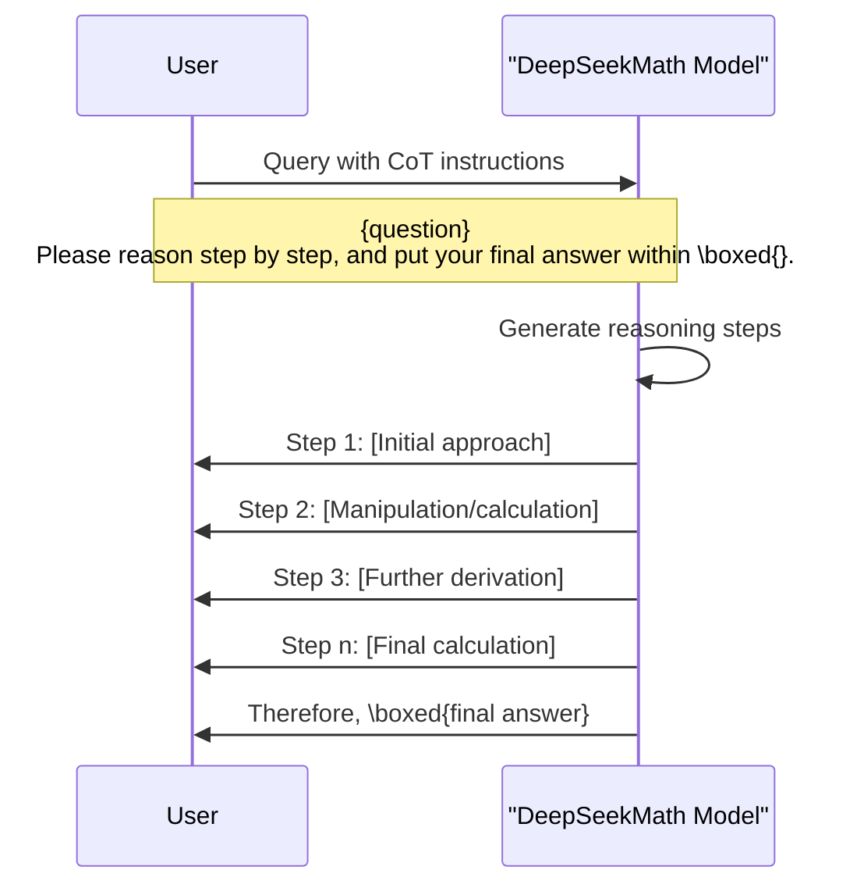
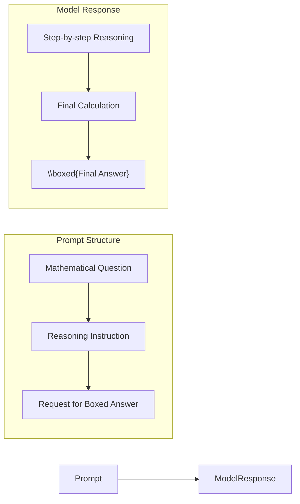

<!-- source: DeepWiki mcp.deepwiki.com · repo deepseek-ai/DeepSeek-Math · page 3.4 Prompting Strategies · fetched 2026-10-30 -->

# Prompting Strategies

<details>
<summary>Relevant source files</summary>

The following files were used as context for generating this wiki page:

- [README.md](README.md)

</details>


This document outlines best practices and effective prompting strategies for the DeepSeekMath model family. It provides guidance on how to construct prompts that yield optimal performance from the models when solving mathematical problems. For information on setting up the models, see [Getting Started](#3.1), and for specific implementation details about text and chat completion, see [Text Completion](#3.2) and [Chat Completion](#3.3).

## Overview of DeepSeekMath Prompting

DeepSeekMath models demonstrate different capabilities and optimal performance depending on the prompting technique used. This section outlines the key strategies that have been found to work well with these models.



Sources: [README.md:140-198]()

## Model-Specific Prompting Approaches

Each model in the DeepSeekMath family has different prompting requirements for optimal performance.

### Base Model Prompting

The DeepSeekMath-Base 7B model works well with direct text completion prompts. For this model, you can simply input the mathematical problem or query without specific formatting.

**Example Base Model Prompt:**
```
The integral of x^2 from 0 to 2 is
```

For the base model, simple text completion without special templates is sufficient for many mathematical tasks.

Sources: [README.md:140-158]()

### Instruct and RL Model Prompting

DeepSeekMath-Instruct 7B and DeepSeekMath-RL 7B models perform best with chain-of-thought prompting that explicitly requests step-by-step reasoning and a boxed final answer.

**Recommended Prompt Formats:**

For English questions:
```
{question}
Please reason step by step, and put your final answer within \boxed{}.
```

For Chinese questions:
```
{question}
请通过逐步推理来解答问题，并把最终答案放置于\boxed{}中。
```

This prompting approach significantly improves the models' performance on complex mathematical reasoning tasks.

Sources: [README.md:194-198]()

## Chain-of-Thought (CoT) Prompting

Chain-of-Thought prompting is a particularly effective technique for the DeepSeekMath models, especially for the Instruct and RL variants. This section details how to implement CoT prompting effectively.



Sources: [README.md:194-198]()

### Benefits of CoT Prompting

Chain-of-Thought prompting provides several advantages when working with DeepSeekMath models:

1. **Improved Accuracy**: By encouraging the model to work through problems step by step, CoT prompting reduces calculation errors and improves overall accuracy.
2. **Better Problem Decomposition**: CoT helps the model break down complex problems into manageable steps.
3. **Transparent Reasoning**: The step-by-step approach provides visibility into the model's reasoning process, making it easier to identify where errors might occur.
4. **Enhanced Performance on Complex Problems**: For difficult mathematical challenges, CoT prompting has shown to substantially boost performance.

According to the evaluation results shared in the README, DeepSeekMath models with CoT prompting achieve impressive performance on challenging mathematical benchmarks, with the RL model approaching 60% accuracy on the MATH dataset when using tools.

Sources: [README.md:94-106]()

## Boxed Answer Format

An important aspect of prompting DeepSeekMath models is requesting the final answer in a boxed format using LaTeX notation `\boxed{}`. This serves several purposes:

1. It clearly delineates the final answer from the reasoning steps
2. It helps with answer extraction for evaluation
3. It encourages the model to provide a concise, definitive answer



Sources: [README.md:194-198]()

## Chat Completion vs. Text Completion

DeepSeekMath models support both text completion and chat completion interfaces, each with different prompting requirements.

### Text Completion Interface

For simple text completion with the base model, you can directly provide the mathematical problem without additional formatting:

```
The integral of x^2 from 0 to 2 is
```

This approach works well for straightforward mathematical queries with the base model.

Sources: [README.md:140-158]()

### Chat Completion Interface

For chat completion, particularly with the Instruct and RL models, use the following template structure:

```
User: {question}
Please reason step by step, and put your final answer within \boxed{}.

---

