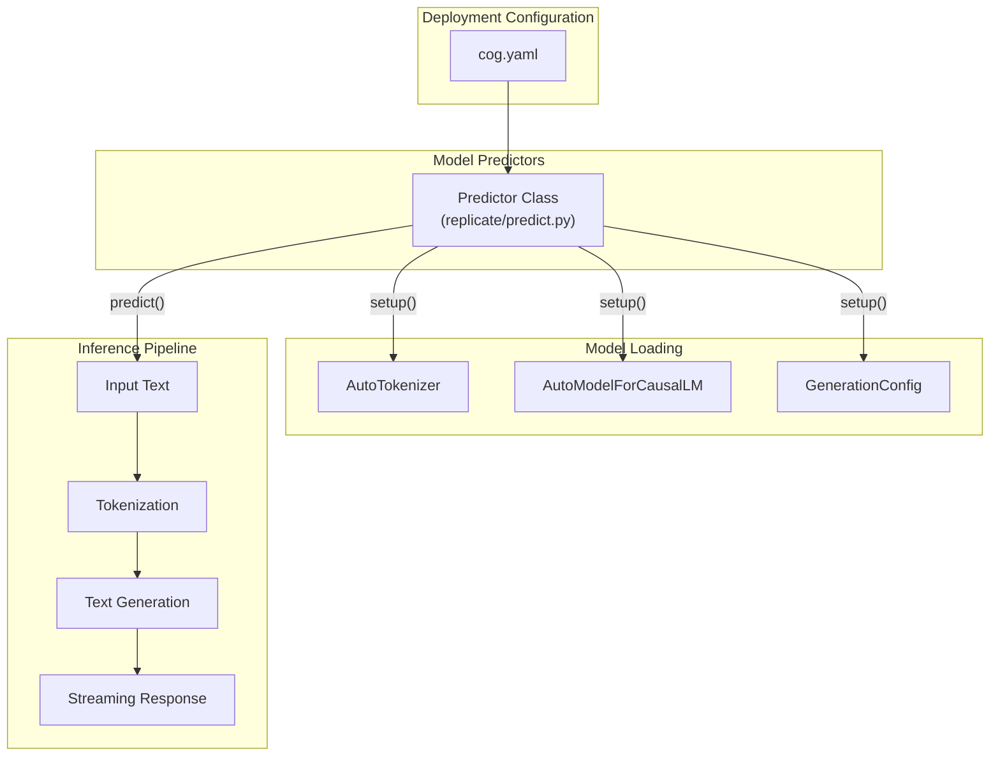
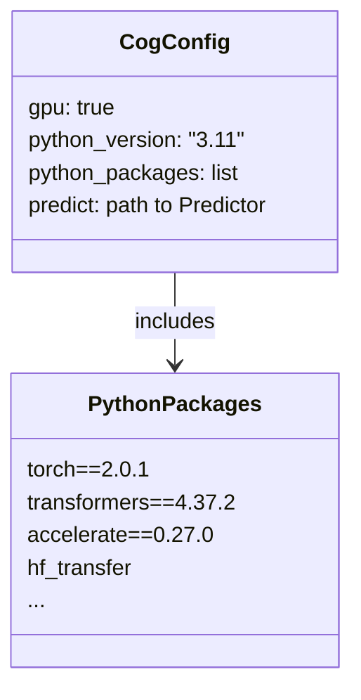
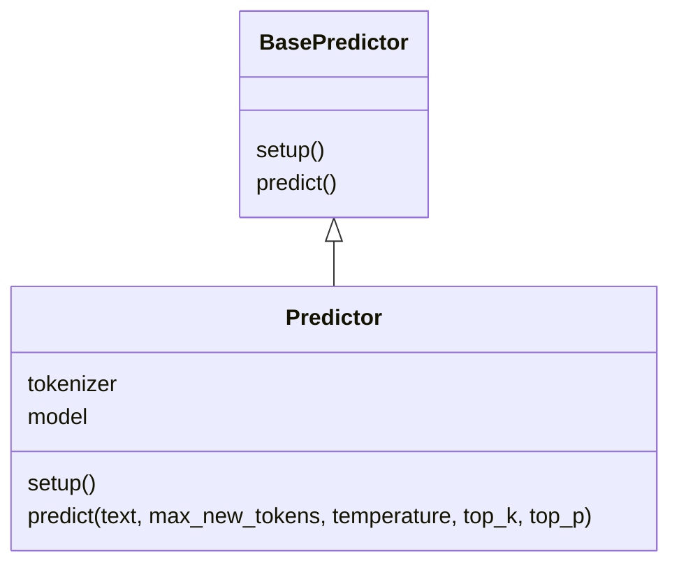
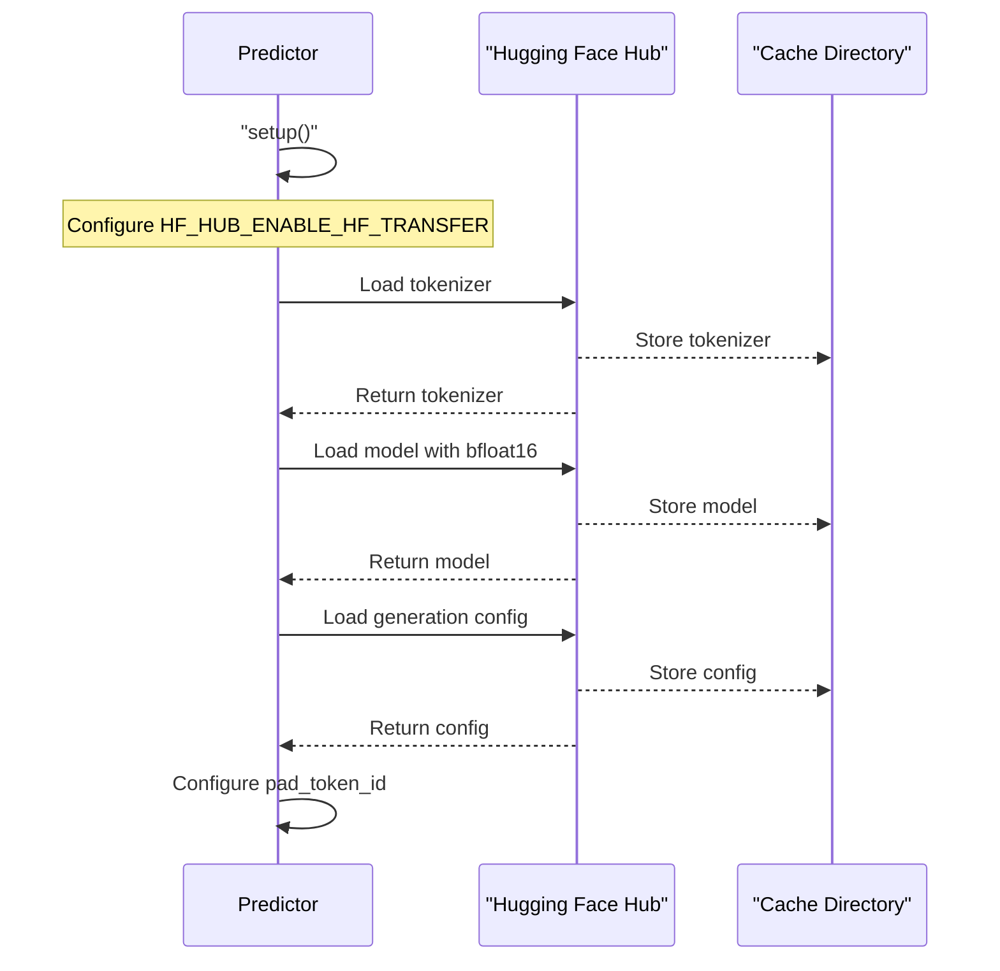
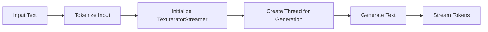
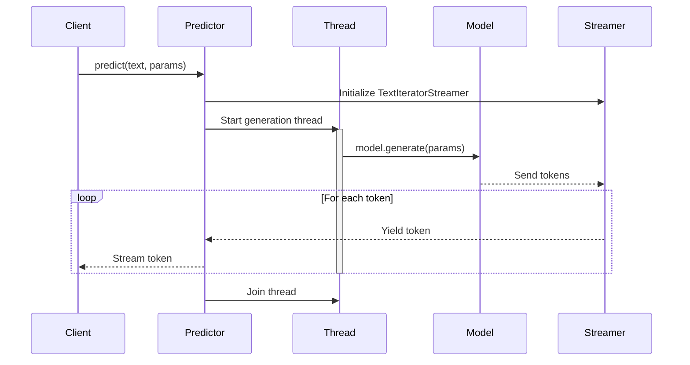
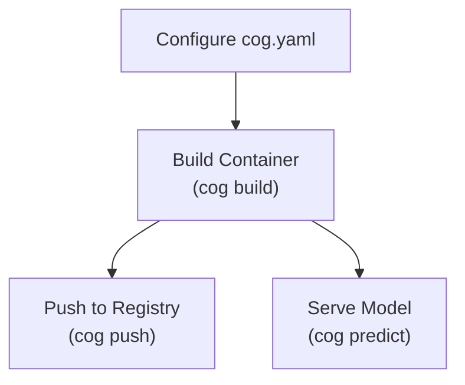

<!-- source: DeepWiki mcp.deepwiki.com · repo deepseek-ai/DeepSeek-Math · page 4 Deployment · fetched 2026-10-30 -->

# Deployment

Relevant source files

The following files were used as context for generating this wiki page:

- [cog.yaml](cog.yaml)
- [replicate/predict.py](replicate/predict.py)

This page provides an overview of the deployment options available for DeepSeek-Math models. It describes the deployment architecture and how to serve the models for inference. For specific deployment implementations, see [Cog Deployment](#4.1) and [Model Serving](#4.2).

## Deployment Architecture

DeepSeek-Math provides a streamlined deployment setup using the Cog framework, which enables easy containerization and deployment of machine learning models. The deployment system is designed to load the DeepSeek-Math models and serve them efficiently for inference requests with support for streaming responses.

Sources: [cog.yaml](), [replicate/predict.py]()

## Cog Configuration

The deployment environment is defined in the Cog configuration file, which specifies the required Python packages, GPU requirements, and the prediction interface.

The configuration includes:
- Python 3.11 runtime
- GPU support
- Essential ML libraries (torch, transformers, accelerate)
- HF transfer for faster model downloads

Sources: [cog.yaml:4-15]()

## Predictor Implementation

The core of the deployment system is the `Predictor` class, which handles model loading and inference:

The `Predictor` class:
1. Inherits from Cog's `BasePredictor`
2. Loads the model during setup
3. Processes input text and streams generated responses

Sources: [replicate/predict.py:17-82]()

## Model Loading Process

During setup, the predictor loads the DeepSeekMath model and tokenizer:

The model loading process includes:
- Setting up a faster download mechanism using `HF_HUB_ENABLE_HF_TRANSFER`
- Loading the tokenizer, model, and generation configuration
- Configuring the model with bfloat16 precision for optimal performance
- Setting up device mapping for optimal GPU utilization

Sources: [replicate/predict.py:17-34]()

## Inference Process

The inference process in the predictor handles text generation and streaming:

Key aspects of the inference process:
1. Input text is tokenized
2. A `TextIteratorStreamer` is initialized for streaming responses
3. Text generation runs in a separate thread to avoid blocking
4. The generated tokens are streamed back to the client

Sources: [replicate/predict.py:36-82]()

## Generation Parameters

The deployment system supports the following parameters for controlling text generation:

| Parameter | Description | Default |
|-----------|-------------|---------|
| `text` | Input text prompt | "The integral of x^2 from 0 to 2 is" |
| `max_new_tokens` | Maximum number of tokens to generate | 100 |
| `temperature` | Controls randomness in generation | 1.0 |
| `top_k` | Number of highest probability tokens to consider | 50 |
| `top_p` | Cumulative probability threshold for token selection | 0.9 |

These parameters allow users to control the trade-off between deterministic and creative responses from the model.

Sources: [replicate/predict.py:36-57]()

## Streaming Implementation

The streaming implementation uses a threaded approach to generate text while simultaneously returning tokens:

The streaming process:
1. Creates a `TextIteratorStreamer` from the tokenizer
2. Starts a separate thread to run model generation
3. Yields new tokens as they become available
4. Joins the thread when generation completes

Sources: [replicate/predict.py:60-82]()

## Deployment Workflow

The complete workflow from configuration to deployment involves:

This workflow enables:
1. Consistent and reproducible deployments
2. Containerized environments that include all dependencies
3. Easy deployment to cloud platforms or local servers

Sources: [cog.yaml]()

## Deployment Options

The DeepSeek-Math models can be deployed in several ways:

1. **Local Deployment**:
   - Use the Cog CLI to run the model locally
   - Suitable for development and testing

2. **Cloud Deployment**:
   - Deploy to platforms like Replicate, Hugging Face, or custom cloud infrastructure
   - Provides scalability and accessibility

3. **Custom Integration**:
   - Extract the prediction logic for integration into existing applications
   - Modify the streaming implementation for specific use cases

For detailed instructions on specific deployment methods, see [Cog Deployment](#4.1) and [Model Serving](#4.2).

Sources: [cog.yaml](), [replicate/predict.py]()

---

