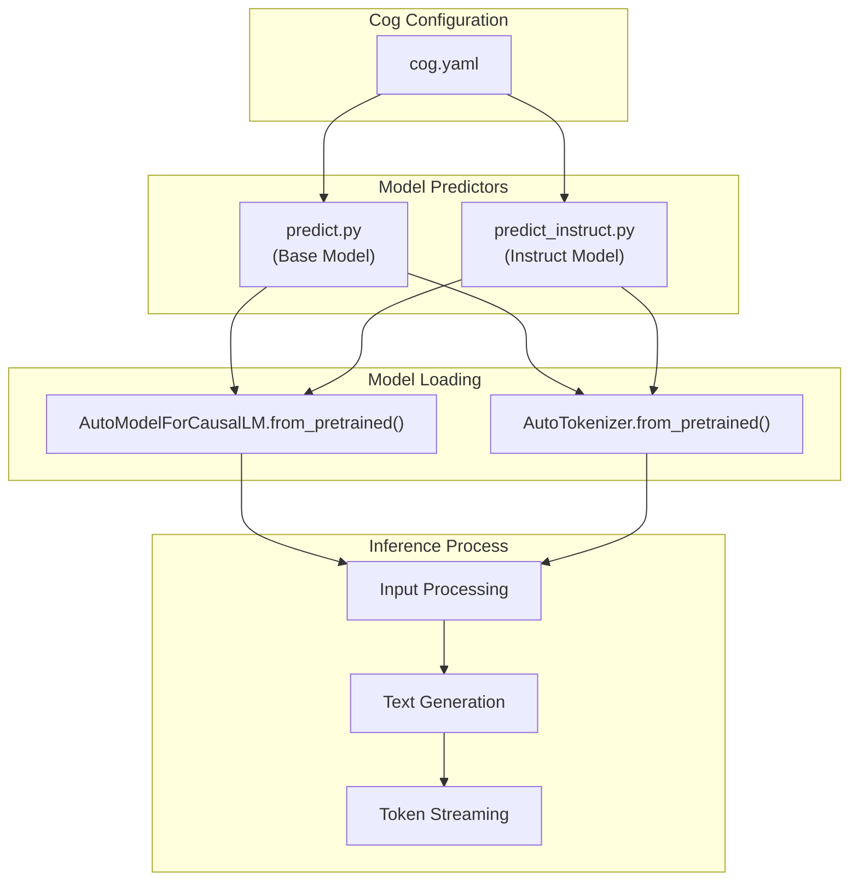
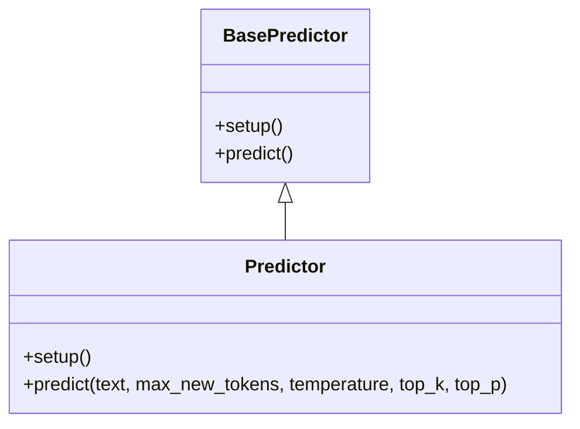
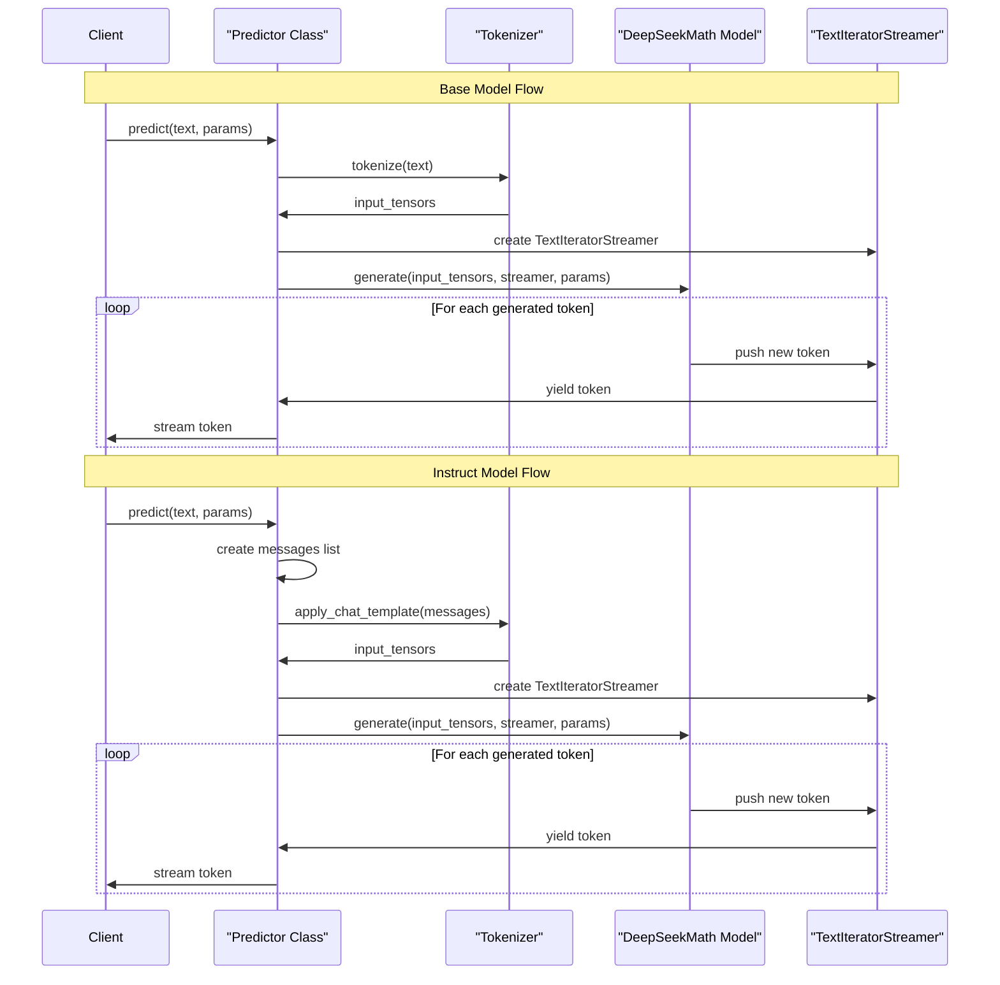
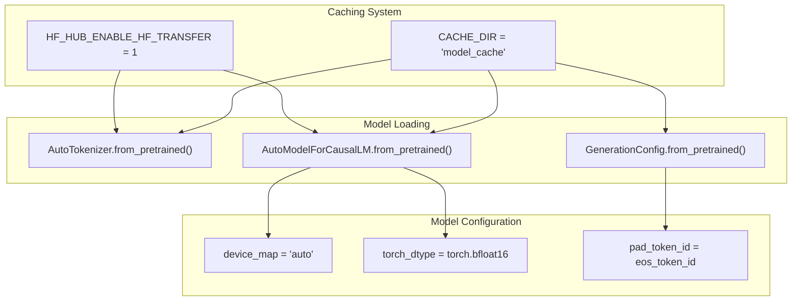
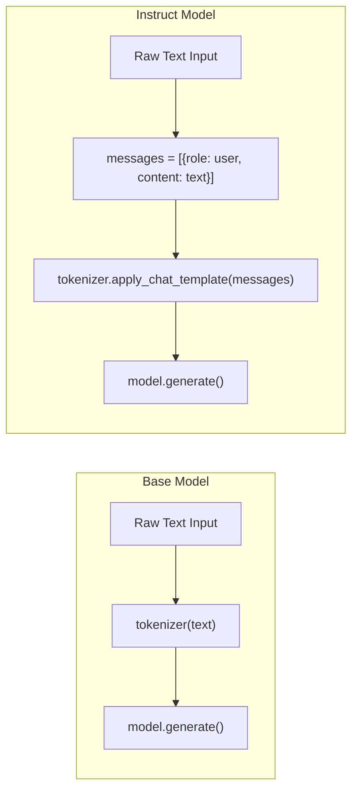
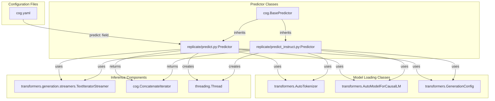

<!-- source: DeepWiki mcp.deepwiki.com · repo deepseek-ai/DeepSeek-Math · page 4.1 Cog Deployment · fetched 2026-10-30 -->

# Cog Deployment

<details>
<summary>Relevant source files</summary>

The following files were used as context for generating this wiki page:

- [cog.yaml](cog.yaml)
- [replicate/predict.py](replicate/predict.py)
- [replicate/predict_instruct.py](replicate/predict_instruct.py)

</details>


This document describes how to deploy DeepSeek-Math models using Cog, a containerization tool that packages machine learning models for production deployment. For information about other deployment options and model serving details, see [Model Serving](#4.2).

## Overview of Cog Deployment

Cog provides a standardized way to package the DeepSeek-Math models for deployment, handling environment setup, dependencies, and inference API creation. The deployment process is configured through a single YAML file and implemented via Python predictor classes.



Sources: [cog.yaml:1-16](), [replicate/predict.py:1-83](), [replicate/predict_instruct.py:1-87]()

## Cog Configuration

The deployment is configured through `cog.yaml`, which specifies the runtime environment, dependencies, and entry point for predictions.

### Environment Configuration

```yaml
build:
  gpu: true
  python_version: "3.11"
  python_packages:
    - torch==2.0.1
    - torchvision==0.15.2
    - transformers==4.37.2
    - accelerate==0.27.0
    - hf_transfer
```

Key components of the configuration:
- GPU support is enabled
- Python 3.11 is used as the runtime
- Specific versions of PyTorch, transformers, and accelerate libraries
- hf_transfer for optimized model downloading

### Prediction Interface

The configuration specifies `replicate/predict.py:Predictor` as the prediction entry point:

```yaml
predict: "replicate/predict.py:Predictor"
```

Sources: [cog.yaml:1-16]()

## Model Predictors

DeepSeek-Math provides two predictor implementations for the base and instruction-tuned models.

### Base Model Predictor

The base model predictor (`predict.py`) implements inference for the DeepSeek-Math-Base 7B model:



Key features:
- Loads the `deepseek-ai/deepseek-math-7b-base` model using HuggingFace Transformers
- Uses bfloat16 precision for efficient inference
- Supports automatic device mapping for multi-GPU environments
- Implements streaming text generation for responsive interfaces
- Accepts parameters for controlling generation (temperature, top_k, top_p)

Sources: [replicate/predict.py:1-83]()

### Instruct Model Predictor

The instruct model predictor (`predict_instruct.py`) implements inference for the DeepSeek-Math-Instruct 7B model:


Key differences from the base predictor:
- Loads the `deepseek-ai/deepseek-math-7b-instruct` model
- Uses chat templating for prompt formatting
- Default example input includes step-by-step reasoning instruction

Sources: [replicate/predict_instruct.py:1-87]()

## Prediction Process Flow

The following diagram illustrates the sequence of operations that occur during a prediction request:



Sources: [replicate/predict.py:36-82](), [replicate/predict_instruct.py:36-86]()

## Model Loading and Caching

Both predictors implement efficient model loading with caching to improve performance:



Key features:
- Uses HF_Transfer for faster model downloading
- Implements a local cache directory to avoid repeatedly downloading models
- Automatic device mapping for optimal GPU utilization
- BFloat16 precision for efficient memory usage and fast inference

Sources: [replicate/predict.py:12-34](), [replicate/predict_instruct.py:12-34]()

## Prediction Parameters

Both predictors accept similar parameters for controlling the generation process:

| Parameter | Type | Default | Description |
|-----------|------|---------|-------------|
| text | string | (example math problem) | Input text to process |
| max_new_tokens | integer | 100 | Maximum number of tokens to generate |
| temperature | float | 1.0 | Controls randomness in generation |
| top_k | integer | 50 | Number of highest probability tokens to keep |
| top_p | float | 0.9 | Cumulative probability threshold for tokens |

Sources: [replicate/predict.py:36-57](), [replicate/predict_instruct.py:36-57]()

## Input Formatting Differences

The base and instruct models handle input formatting differently:



Key differences:
- Base model directly tokenizes the input text
- Instruct model wraps input in a message format and applies a chat template
- Instruct model is designed for conversational/instruction-following contexts
- The default example for the instruct model includes a step-by-step reasoning prompt

Sources: [replicate/predict.py:61-65](), [replicate/predict_instruct.py:61-67]()

## Deploying with Cog

To deploy a DeepSeek-Math model using Cog:

1. Install Cog following the [official documentation](https://github.com/replicate/cog)
2. Clone the DeepSeek-Math repository
3. Choose which model to deploy by modifying the predict entry point in `cog.yaml`
4. Build the container:
   ```bash
   cog build
   ```
5. Test the model locally:
   ```bash
   cog predict -i text="Find the derivative of f(x) = x^2 + 3x + 2"
   ```
6. Deploy to a container registry or Replicate:
   ```bash
   cog push [destination]
   ```

When deploying to production environments, consider:
- GPU requirements for optimal performance
- Memory requirements (models require approximately 14GB VRAM)
- Network bandwidth for downloading model weights

## Code Entity Mapping

The following diagram maps the key code entities in the Cog deployment system:



Sources: [cog.yaml:1-16](), [replicate/predict.py:1-83](), [replicate/predict_instruct.py:1-87]()

---

