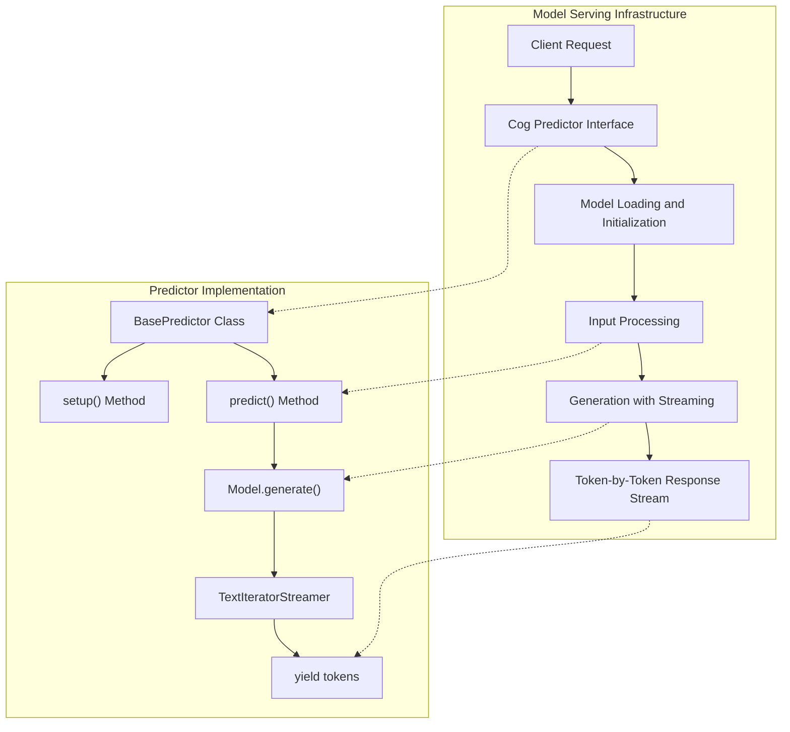
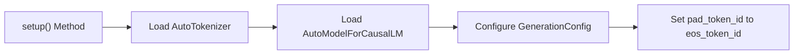
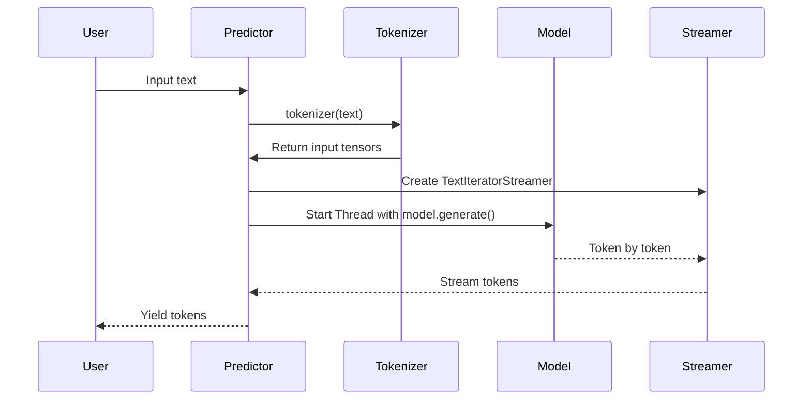
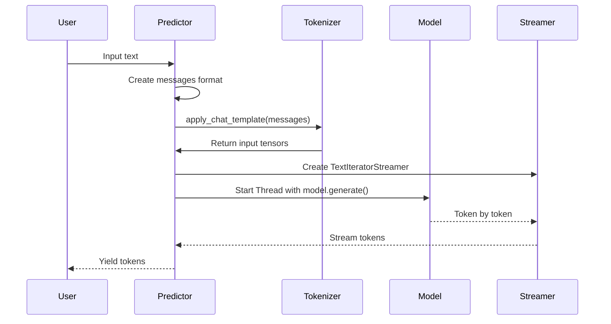
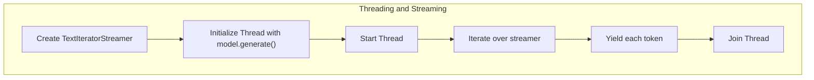

<!-- source: DeepWiki mcp.deepwiki.com · repo deepseek-ai/DeepSeek-Math · page 4.2 Model Serving · fetched 2026-10-30 -->

# Model Serving

<details>
<summary>Relevant source files</summary>

The following files were used as context for generating this wiki page:

- [replicate/predict.py](replicate/predict.py)
- [replicate/predict_instruct.py](replicate/predict_instruct.py)

</details>


This page provides technical details about how DeepSeek-Math models are served for inference, including the architecture, implementation, and usage of the model serving system. The documentation focuses on the infrastructure for handling inference requests and generating responses for both the base and instruction-tuned models.

For information about Cog-specific deployment configurations, see [Cog Deployment](#4.1).

## Serving Architecture

DeepSeek-Math implements a streaming inference system using Cog, a container-based ML model serving toolkit. The model serving architecture is designed to efficiently load models, process user inputs, and stream generated tokens back to users.



The serving system is implemented as Cog predictors that handle different model variants:
- Base model predictor (`predict.py`)
- Instruction-tuned model predictor (`predict_instruct.py`)

Sources: [replicate/predict.py:17-82](), [replicate/predict_instruct.py:17-86]()

## Code Components and Relationships

The following diagram shows the relationship between the main code components involved in model serving:

```mermaid
classDiagram
    class BasePredictor {
        setup()
        predict()
    }
    
    class Predictor {
        tokenizer
        model
        setup()
        predict(text, max_new_tokens, temperature, top_k, top_p)
    }
    
    class TextIteratorStreamer {
        tokenizer
        skip_prompt
        skip_special_tokens
    }
    
    class Thread {
        target
        kwargs
        start()
        join()
    }
    
    BasePredictor <|-- Predictor
    Predictor --> TextIteratorStreamer : creates
    Predictor --> Thread : spawns
    Thread --> "model.generate()" : executes
    TextIteratorStreamer --> "yield new_token" : streams
```

Sources: [replicate/predict.py:17-82](), [replicate/predict_instruct.py:17-86]()

## Model Loading and Initialization

Both predictors follow a similar initialization pattern in their `setup()` method, loading the model and tokenizer using Hugging Face's transformers library.

### Base Model Initialization



The base model is loaded from "deepseek-ai/deepseek-math-7b-base" with bfloat16 precision for efficient inference.

Sources: [replicate/predict.py:18-34]()

### Instruct Model Initialization

The instruction-tuned model follows the same initialization pattern but loads from "deepseek-ai/deepseek-math-7b-instruct".

Sources: [replicate/predict_instruct.py:18-34]()

## Input Processing and Inference

The input processing differs slightly between the base and instruct models:

### Base Model Input Processing



For the base model, the input text is directly tokenized and passed to the model.

Sources: [replicate/predict.py:36-82]()

### Instruct Model Input Processing



For the instruct model, the input is formatted as a chat message and processed using the chat template before tokenization.

Sources: [replicate/predict_instruct.py:36-86]()

## API Parameters

Both model serving implementations expose the same set of parameters to control generation:

| Parameter | Type | Default | Description |
|-----------|------|---------|-------------|
| text | string | (model-specific) | Input text for generation |
| max_new_tokens | integer | 100 | Maximum number of tokens to generate |
| temperature | float | 1.0 | Controls randomness in generation |
| top_k | integer | 50 | Number of highest probability tokens to consider |
| top_p | float | 0.9 | Cumulative probability threshold for token selection |

The default prompt for the base model is "The integral of x^2 from 0 to 2 is", while the instruct model uses a CoT-style prompt: "what is the integral of x^2 from 0 to 2?\nPlease reason step by step, and put your final answer within \boxed{}.".

Sources: [replicate/predict.py:36-57](), [replicate/predict_instruct.py:36-57]()

## Implementation Details

### Generation Configuration

Both predictors use similar generation parameters:

- `do_sample=True`: Enable sampling for diverse outputs
- Token selection controlled by temperature, top_p, and top_k
- Streaming enabled through TextIteratorStreamer
- Threading used to allow non-blocking token streaming

The differences between the base and instruct model predictors are:

1. Model source (`deepseek-math-7b-base` vs `deepseek-math-7b-instruct`)
2. Input formatting (direct tokenization vs chat template)
3. Default example prompts

Sources: [replicate/predict.py:60-82](), [replicate/predict_instruct.py:60-86]()

### Text Streaming Mechanism



The streaming implementation:

1. Creates a `TextIteratorStreamer` with the tokenizer
2. Initializes a `Thread` with the model's generate method
3. Starts the thread for async generation
4. Iterates over the streamer to yield tokens as they're generated
5. Joins the thread after completion

This approach allows for non-blocking token-by-token generation, providing a responsive user experience.

Sources: [replicate/predict.py:62-82](), [replicate/predict_instruct.py:65-86]()

## Performance Considerations

- Models are loaded with `torch.bfloat16` precision to optimize memory usage and inference speed
- `device_map="auto"` enables automatic device selection for optimal performance
- `use_cache=True` enables KV-caching for faster generation
- Threading is used to prevent blocking during token generation
- HuggingFace transfer acceleration is enabled with `HF_HUB_ENABLE_HF_TRANSFER=1`

Sources: [replicate/predict.py:13-28](), [replicate/predict_instruct.py:13-28]()

---

