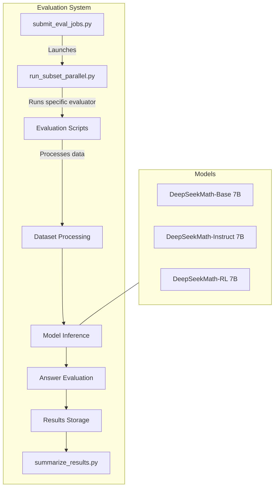
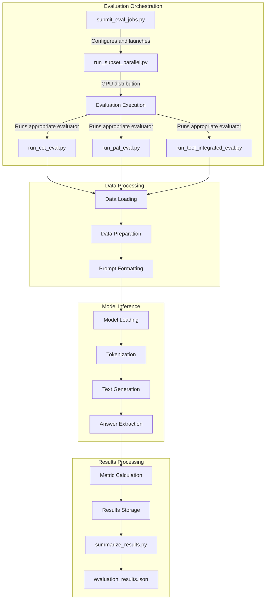
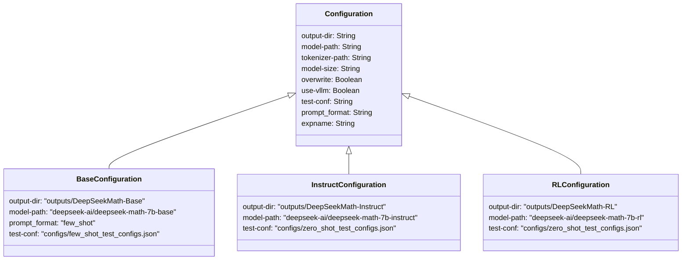
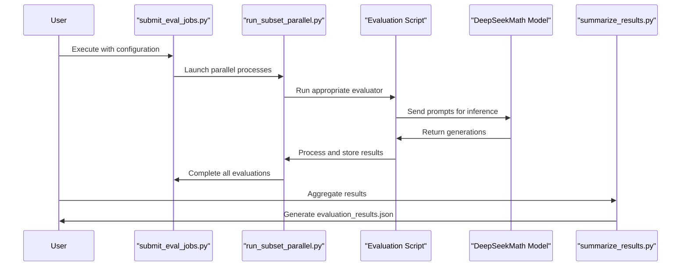
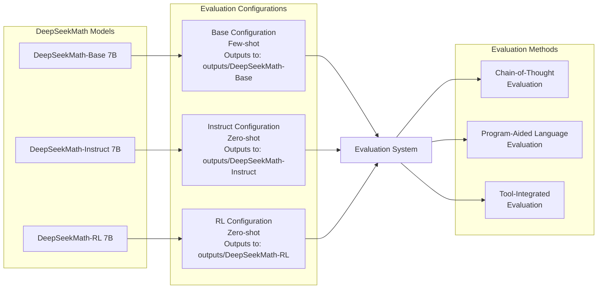

<!-- source: DeepWiki mcp.deepwiki.com · repo deepseek-ai/DeepSeek-Math · page 5 Evaluation System · fetched 2026-10-30 -->

# Evaluation System

<details>
<summary>Relevant source files</summary>

The following files were used as context for generating this wiki page:

- [evaluation/README.md](evaluation/README.md)
- [evaluation/submit_eval_jobs.py](evaluation/submit_eval_jobs.py)

</details>


The Evaluation System in DeepSeek-Math provides comprehensive tools and infrastructure for assessing the mathematical reasoning capabilities of the DeepSeek-Math model family. This system enables evaluation across multiple benchmarks using various reasoning approaches including chain-of-thought, program-aided language evaluation, and tool-integrated reasoning.

For information on specific evaluation methods, see [Chain-of-Thought Evaluation](#5.1), [Program-Aided Language Evaluation](#5.2), and [Tool Integration Evaluation](#5.3). For details about the datasets used, see [Evaluation Datasets](#5.4).

## System Overview

The Evaluation System is designed to provide a systematic and efficient way to evaluate different variants of the DeepSeek-Math models against mathematical benchmarks. It supports both zero-shot and few-shot evaluation approaches and can process questions in multiple languages including English and Chinese.



Sources: [evaluation/README.md:1-42](), [evaluation/submit_eval_jobs.py:1-67]()

## Architecture Components

The evaluation system consists of several interconnected components that work together to process data, run inference, evaluate answers, and aggregate results.



Sources: [evaluation/README.md:12-34](), [evaluation/submit_eval_jobs.py:39-64]()

## Configuration System

The evaluation system uses a configuration-based approach to define evaluation parameters. Each model variant has its own configuration specifying the model path, output directory, and evaluation settings.



Sources: [evaluation/submit_eval_jobs.py:4-37]()

### Configuration Details

The evaluation system uses predefined configurations for each model variant. These configurations specify:

| Parameter | Description |
|-----------|-------------|
| `output-dir` | Directory where evaluation outputs will be stored |
| `model-path` | Path or HuggingFace ID for the model |
| `tokenizer-path` | Path or HuggingFace ID for the tokenizer |
| `model-size` | Size of the model (e.g., "7b") |
| `overwrite` | Whether to overwrite existing results |
| `use-vllm` | Whether to use VLLM for inference |
| `test-conf` | Path to test configuration JSON file |
| `prompt_format` | Format for prompts (e.g., "few_shot" or "zero_shot") |
| `expname` | Name of the experiment |

Sources: [evaluation/submit_eval_jobs.py:4-37]()

## Prompt Processing

The evaluation system processes input questions differently based on the evaluation method and language:

### Chain-of-Thought Prompting

For chain-of-thought evaluation of DeepSeekMath-Instruct and DeepSeekMath-RL:

- **English questions**: Original question followed by `Please reason step by step, and put your final answer within \boxed{}.`
- **Chinese questions**: Original question followed by `请通过逐步推理来解答问题，并把最终答案放置于\boxed{}中。`

### Tool-Integrated Reasoning

For tool-integrated reasoning:

- **English questions**: Original question followed by `Please integrate natural language reasoning with programs to solve the problem above, and put your final answer within \boxed{}.`
- **Chinese questions**: Original question followed by `请结合自然语言和Python程序语言来解答问题，并把最终答案放置于\boxed{}中。`

Sources: [evaluation/README.md:14-20]()

## Evaluation Process

The evaluation process involves multiple steps, from job submission to result aggregation:



Sources: [evaluation/README.md:22-37]()

### Job Submission

The evaluation system uses `submit_eval_jobs.py` to configure and launch evaluation jobs. This script:

1. Selects a model configuration (Base, Instruct, or RL)
2. Constructs a command for `run_subset_parallel.py`
3. Adds command-line arguments based on the configuration
4. Executes the command to start the evaluation process

The script supports parallel processing across multiple GPUs to accelerate evaluations.

Sources: [evaluation/submit_eval_jobs.py:41-63]()

### Result Aggregation

After all evaluation processes complete, the `summarize_results.py` script aggregates results from all processes:

1. Collects outputs from all evaluation runs
2. Calculates aggregate metrics
3. Generates a comprehensive summary in `evaluation_results.json`

For formal theorem proving evaluations (with the `--eval-atp` flag), the system invokes `unsafe_score_minif2f_isabelle.py` to evaluate informal-to-formal proving results using the PISA server.

Sources: [evaluation/README.md:30-37]()

## Running Evaluations

To run evaluations on the DeepSeek-Math models:

1. **Setup the environment**:
   ```bash
   conda env create -f environment.yml
   ```

2. **Launch evaluation jobs**:
   ```bash
   python submit_eval_jobs.py --n-gpus 8
   ```

3. **Aggregate results** after all processes complete:
   ```bash
   python summarize_results.py [--eval-atp]
   ```

The evaluation results will be saved as `evaluation_results.json`.

For custom evaluations, users can modify the configurations in `submit_eval_jobs.py` and the test configurations in `configs/*test_configs.json`.

Sources: [evaluation/README.md:5-37]()

## Integration with Model System

The Evaluation System is designed to work with all three DeepSeek-Math model variants, each with its specific evaluation configuration:



Sources: [evaluation/submit_eval_jobs.py:4-37](), [evaluation/README.md:14-20]()

## Output Structure

The evaluation system stores outputs in the configured output directories. These outputs include the raw model responses, extracted answers, and evaluation metrics. The complete set of model outputs is also available in the `outputs.zip` file provided with the repository.

Sources: [evaluation/README.md:39-42]()

---

