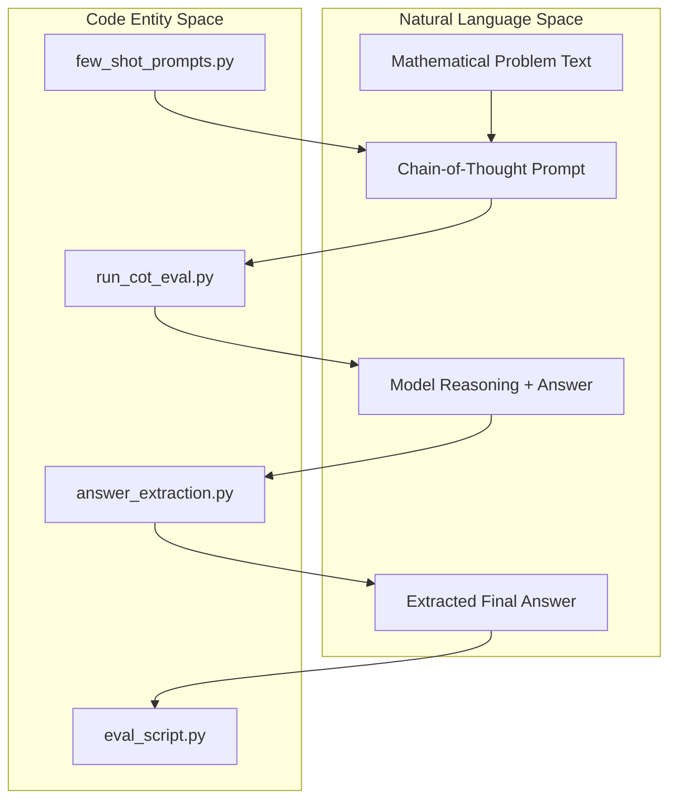
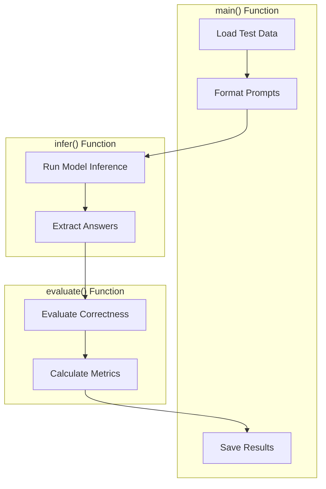
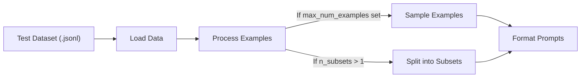
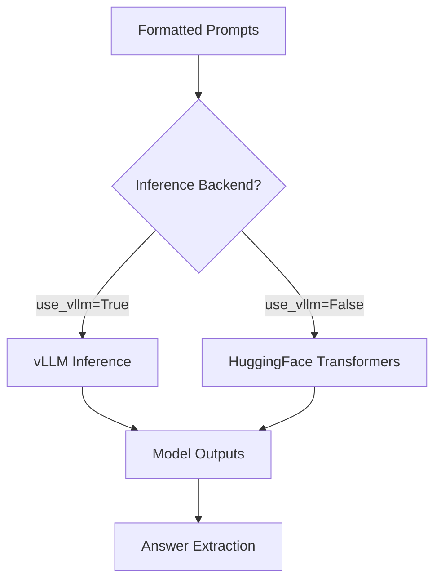
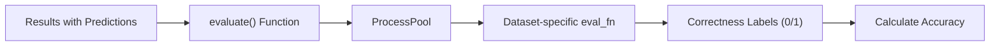
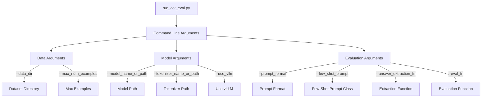
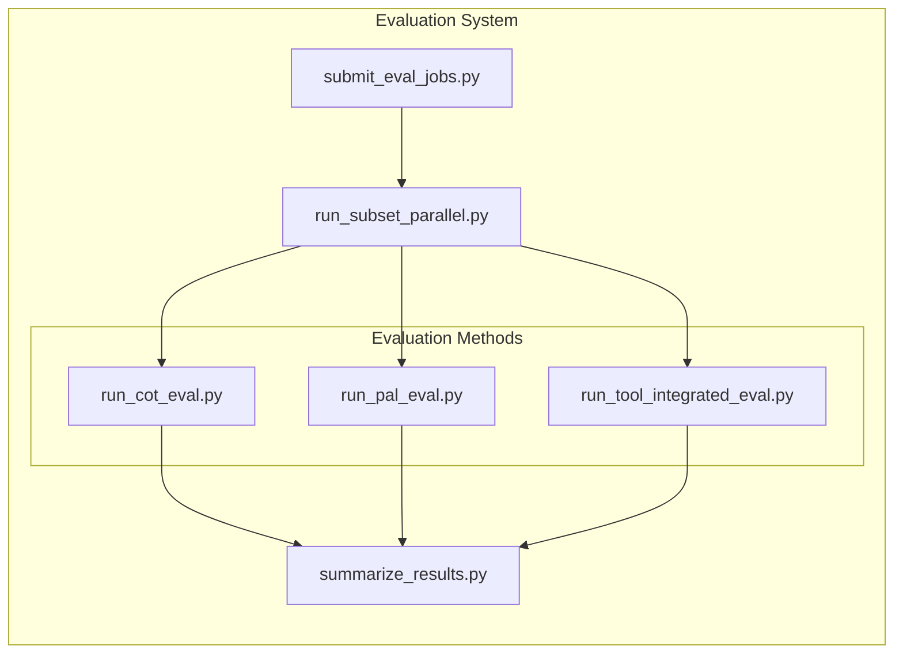

<!-- source: DeepWiki mcp.deepwiki.com · repo deepseek-ai/DeepSeek-Math · page 5.1 Chain-of-Thought Evaluation · fetched 2026-10-30 -->

# Chain-of-Thought Evaluation

<details>
<summary>Relevant source files</summary>

The following files were used as context for generating this wiki page:

- [evaluation/configs/few_shot_test_configs.json](evaluation/configs/few_shot_test_configs.json)
- [evaluation/configs/zero_shot_test_configs.json](evaluation/configs/zero_shot_test_configs.json)
- [evaluation/infer/run_cot_eval.py](evaluation/infer/run_cot_eval.py)

</details>


## Purpose and Scope

This document provides a detailed explanation of the Chain-of-Thought (CoT) evaluation system implemented in the DeepSeek-Math repository. It covers the architecture, workflow, and technical components used to evaluate mathematical reasoning capabilities of language models through their step-by-step reasoning processes. For information about other evaluation approaches like Program-Aided Language (PAL) evaluation, see [Program-Aided Language Evaluation](#5.2), and for information about tool integration evaluation, see [Tool Integration Evaluation](#5.3).

## Overview

Chain-of-Thought (CoT) evaluation assesses a language model's ability to solve mathematical problems by generating and following a clear reasoning path before providing a final answer. Unlike direct answer generation, CoT prompts the model to show its work, making it possible to evaluate both the reasoning process and the final result.



Sources: [evaluation/infer/run_cot_eval.py]()

## Evaluation Pipeline

The CoT evaluation pipeline consists of several sequential stages, from data loading to final accuracy calculation.



Sources: [evaluation/infer/run_cot_eval.py:42-183]()

## Key Components

### Data Processing

Before evaluation, test data is loaded from JSON line files and processed according to the dataset-specific requirements.



Sources: [evaluation/infer/run_cot_eval.py:125-151]()

### Prompt Formatting

The system supports two primary prompt formats:

1. **SFT (Supervised Fine-Tuning) Format**: Structures prompts as user/assistant conversations
2. **Few-Shot Format**: Includes examples of problem-solving before the test question

```
Table: Prompt Format Options

| Format      | Description                                       | Configuration                          |
|-------------|---------------------------------------------------|----------------------------------------|
| SFT         | User/Assistant conversation format                | `--prompt_format sft`                  |
| Few-Shot    | Includes example problems and solutions           | `--prompt_format few_shot --few_shot_prompt <PromptClass>` |
```

Sources: [evaluation/infer/run_cot_eval.py:47-69]()

### Model Inference

The system supports two inference backends:

1. **vLLM**: An optimized inference engine for better throughput
2. **Hugging Face Transformers**: Standard implementation for model inference



Sources: [evaluation/infer/run_cot_eval.py:71-105]()

### Answer Extraction

After generating the model's step-by-step reasoning, the final answer must be extracted for evaluation. This is handled by specialized extraction functions for each dataset type.

```python
# Example answer extraction call from run_cot_eval.py
predictions = [eval(args.answer_extraction_fn)(item['messages'][-2]['content'], output, task='cot') 
              for item, output in tqdm(zip(test_data, model_outputs), 
                                     desc="extract answer", 
                                     total=len(model_outputs))]
```

Sources: [evaluation/infer/run_cot_eval.py:112]()

### Evaluation

The evaluation process compares extracted answers against reference solutions:



Sources: [evaluation/infer/run_cot_eval.py:24-40](), [evaluation/infer/run_cot_eval.py:157-168]()

## Supported Datasets and Configurations

The CoT evaluation system supports multiple mathematical datasets in both English and Chinese languages:

```
Table: Supported Datasets for CoT Evaluation

| Dataset                  | Language | Configuration File                      | Answer Extraction Function              |
|--------------------------|----------|----------------------------------------|----------------------------------------|
| GSM8K                    | English  | few_shot_test_configs.json              | extract_gsm_few_shot_cot_answer        |
| MATH                     | English  | few_shot_test_configs.json              | extract_math_few_shot_cot_answer       |
| MATH SAT                 | English  | few_shot_test_configs.json              | extract_sat_few_shot_answer            |
| OCW Courses              | English  | few_shot_test_configs.json              | extract_ocwcourses_few_shot_answer     |
| MMLU-STEM                | English  | few_shot_test_configs.json              | extract_mmlu_stem                      |
| miniF2F                  | English  | few_shot_test_configs.json              | extract_minif2f_isabelle               |
| CMATH                    | Chinese  | few_shot_test_configs.json              | extract_cmath_few_shot_test            |
| AGIEVAL GaoKao MathCloze | Chinese  | few_shot_test_configs.json              | extract_agieval_gaokao_mathcloze_few_shot_cot_test |
| AGIEVAL GaoKao MathQA    | Chinese  | few_shot_test_configs.json              | extract_agieval_gaokao_mathqa_few_shot_cot_test |
```

Sources: [evaluation/configs/few_shot_test_configs.json](), [evaluation/configs/zero_shot_test_configs.json]()

## Running CoT Evaluations

### Command Line Interface



Sources: [evaluation/infer/run_cot_eval.py:185-211]()

### Example Command

To run a CoT evaluation on the GSM8K dataset:

```bash
python evaluation/infer/run_cot_eval.py \
  --data_dir datasets/gsm8k \
  --save_dir results/gsm8k \
  --model_name_or_path path_to_model \
  --tokenizer_name_or_path path_to_tokenizer \
  --prompt_format few_shot \
  --few_shot_prompt CoTGSMPrompt \
  --answer_extraction_fn extract_gsm_few_shot_cot_answer \
  --eval_fn eval_last_single_answer \
  --use_vllm
```

Sources: [evaluation/infer/run_cot_eval.py:185-211]()

## Results and Metrics

After evaluation, the system saves two types of files:

1. **Prediction File**: Contains detailed results including prompts, model outputs, extracted answers, and accuracy for each example.
2. **Metrics File**: Contains summary statistics including total samples and overall accuracy.

```json
// Example metrics.json
{
  "n_samples": 1319,
  "accuracy": 0.8431
}
```

Sources: [evaluation/infer/run_cot_eval.py:170-183]()

## Integration with Evaluation System

The CoT evaluation is part of the larger evaluation system in the DeepSeek-Math repository, working alongside PAL and Tool Integration evaluation methods.



Sources: [evaluation/infer/run_cot_eval.py]()

---

