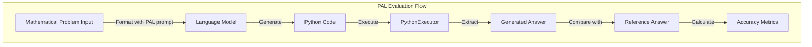
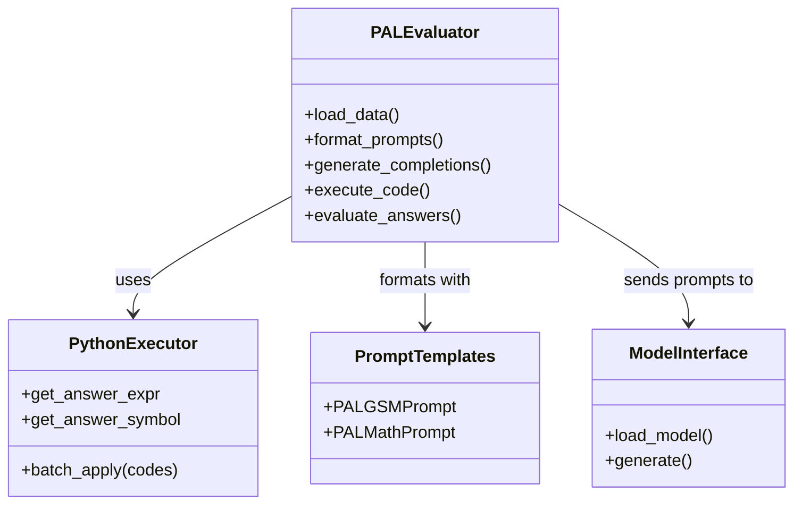
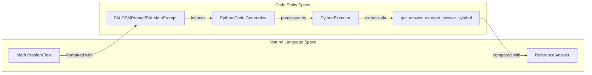
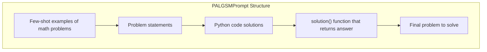
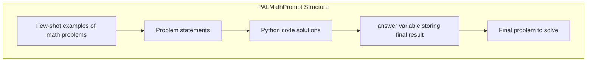
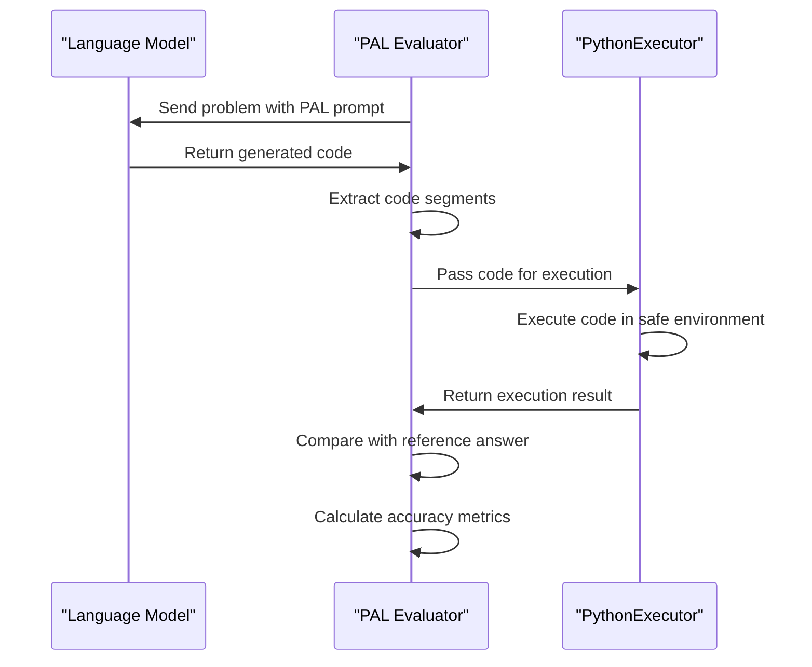
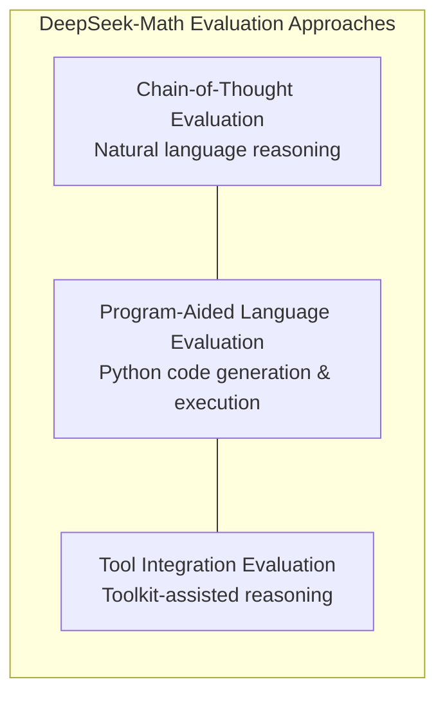

<!-- source: DeepWiki mcp.deepwiki.com · repo deepseek-ai/DeepSeek-Math · page 5.2 Program-Aided Language Evaluation · fetched 2026-10-30 -->

# Program-Aided Language Evaluation

<details>
<summary>Relevant source files</summary>

The following files were used as context for generating this wiki page:

- [evaluation/configs/few_shot_test_configs.json](evaluation/configs/few_shot_test_configs.json)
- [evaluation/configs/zero_shot_test_configs.json](evaluation/configs/zero_shot_test_configs.json)
- [evaluation/infer/run_pal_eval.py](evaluation/infer/run_pal_eval.py)

</details>


## Purpose and Scope

This document explains the Program-Aided Language (PAL) evaluation system used in DeepSeek-Math. PAL evaluation is a technique where models generate executable Python code to solve mathematical problems, instead of producing answers directly in natural language. By evaluating a model's ability to write correct code that computes the right answer when executed, we can assess its mathematical reasoning and problem-solving capabilities from a more structured perspective.

For information about other evaluation approaches, see [Chain-of-Thought Evaluation](#5.1) or [Tool Integration Evaluation](#5.3).

## Overview of PAL Evaluation

Program-Aided Language Evaluation works by prompting the language model to generate Python code that, when executed, solves a given problem. This approach leverages the deterministic execution of programming languages to handle complex mathematical calculations more reliably than natural language reasoning alone.



Sources: [evaluation/infer/run_pal_eval.py:43-197]()

## Architecture and Components

The PAL evaluation system consists of several key components that work together to evaluate the model's code generation capabilities.



Sources: [evaluation/infer/run_pal_eval.py:25-41](), [evaluation/infer/run_pal_eval.py:138-153]()

### Natural Language to Code Space Bridge

The PAL evaluation system bridges the gap between natural language problems and programmatic solutions:



Sources: [evaluation/infer/run_pal_eval.py:138-153]()

## PAL Prompt Types

The evaluation system supports two main types of PAL prompts:

### PALGSMPrompt

Used primarily for GSM8K dataset evaluations, this prompt format encourages the model to structure solutions with a `solution()` function that returns the final answer.



Sources: [evaluation/infer/run_pal_eval.py:138-140](), [evaluation/configs/few_shot_test_configs.json:11-19]()

### PALMathPrompt

Used primarily for MATH dataset evaluations, this prompt format expects the model to store the final answer in an `answer` variable.



Sources: [evaluation/infer/run_pal_eval.py:141-153](), [evaluation/configs/few_shot_test_configs.json:29-37]()

## Execution Process

The PAL evaluation system executes generated code and extracts answers in a structured process:

1. **Code Extraction**: For PALMathPrompt, the system extracts code between two sets of triple backticks
2. **Code Execution**: Uses `PythonExecutor` to safely run the generated Python code
3. **Answer Extraction**: Based on the prompt type, extracts the answer from either:
   - The return value of `solution()` function (PALGSMPrompt)
   - The value of the `answer` variable (PALMathPrompt)



Sources: [evaluation/infer/run_pal_eval.py:138-153](), [evaluation/infer/run_pal_eval.py:155-160]()

## Supported Datasets

The PAL evaluation system currently supports the following datasets:

| Dataset | PAL Prompt Type | Evaluation Function |
|---------|----------------|---------------------|
| GSM8K   | PALGSMPrompt   | eval_last_single_answer |
| MATH    | PALMathPrompt  | eval_math |

Sources: [evaluation/configs/few_shot_test_configs.json:11-19](), [evaluation/configs/few_shot_test_configs.json:29-37]()

## Running PAL Evaluations

To run a PAL evaluation, you use the `run_pal_eval.py` script with appropriate configuration parameters:

```
python evaluation/infer/run_pal_eval.py \
  --data_dir <dataset_directory> \
  --save_dir <results_directory> \
  --model_name_or_path <model_path> \
  --tokenizer_name_or_path <tokenizer_path> \
  --prompt_format few_shot \
  --few_shot_prompt <PALGSMPrompt or PALMathPrompt> \
  --eval_fn <evaluation_function>
```

Key parameters include:
- `data_dir`: Directory containing the dataset
- `save_dir`: Directory to save evaluation results
- `model_name_or_path`: Path to the model to evaluate
- `prompt_format`: Should be "few_shot" for PAL evaluations
- `few_shot_prompt`: Specifies the PAL prompt type
- `eval_fn`: Function to evaluate answers

Sources: [evaluation/infer/run_pal_eval.py:199-227]()

## Implementation Details

### Code Execution and Safety

The `PythonExecutor` class provides a secure environment for executing generated code:

1. Executes code in a controlled context
2. Captures runtime errors and exceptions
3. Extracts answers based on specified variable names or expressions
4. Handles timeouts gracefully

### Error Handling

The evaluation system includes robust error handling:
- Timeout handling for code execution that takes too long
- Error tracking for runtime errors in generated code
- Fallback mechanisms when code structure doesn't match expectations

Sources: [evaluation/infer/run_pal_eval.py:155-160](), [evaluation/infer/run_pal_eval.py:25-41]()

## Integration with Evaluation System

PAL evaluation is one of three main evaluation approaches in DeepSeek-Math:



Sources: [evaluation/configs/few_shot_test_configs.json:1-110](), [evaluation/configs/zero_shot_test_configs.json:1-34]()

The PAL evaluation results contribute to the overall assessment of model mathematical reasoning capabilities, specifically focusing on the model's ability to generate correct algorithmic solutions to math problems.

---

