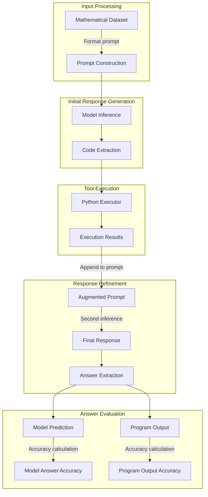
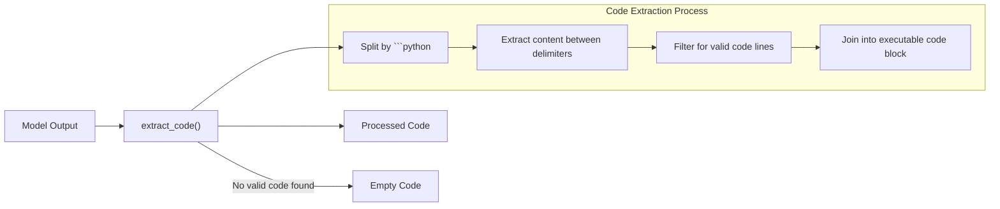
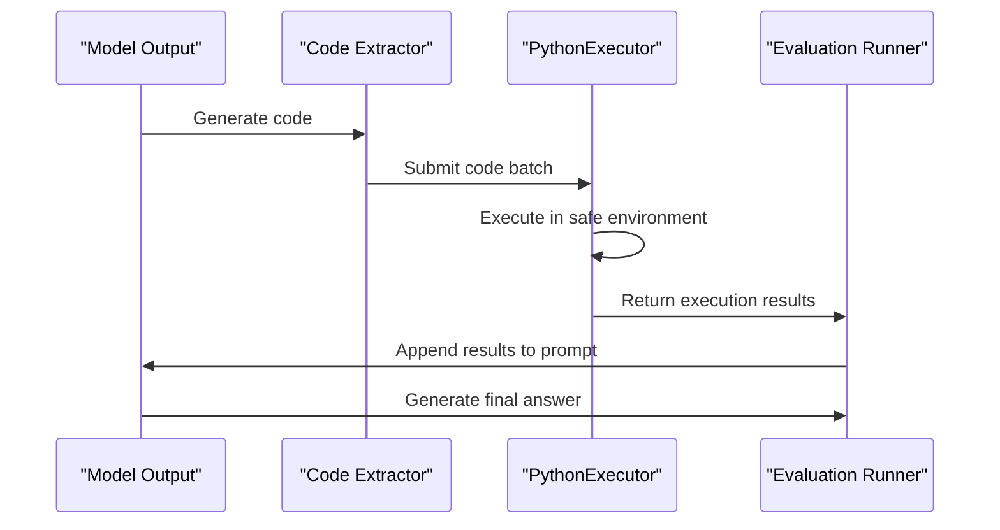
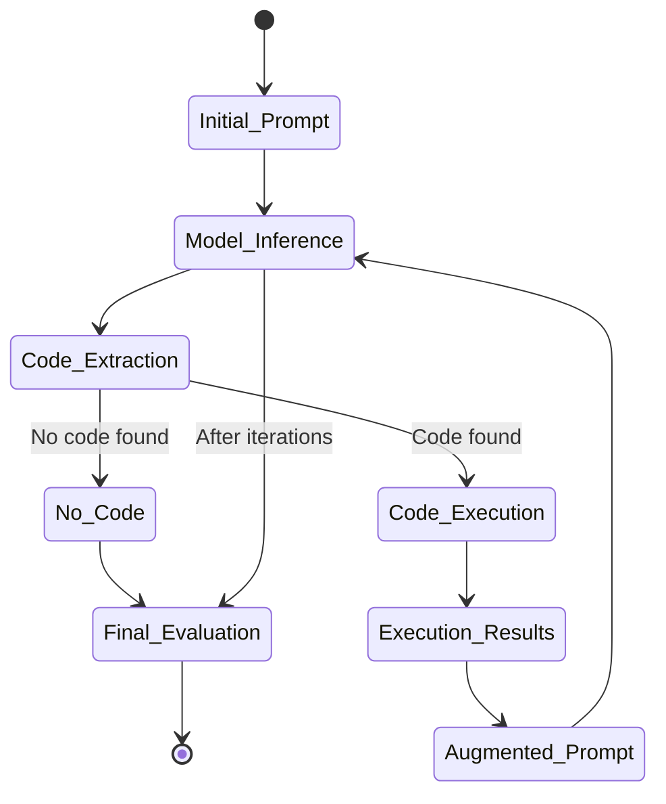
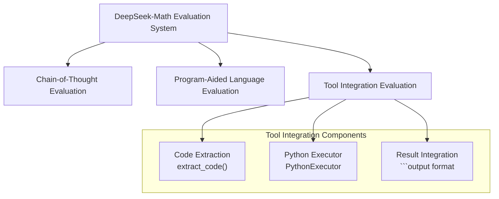
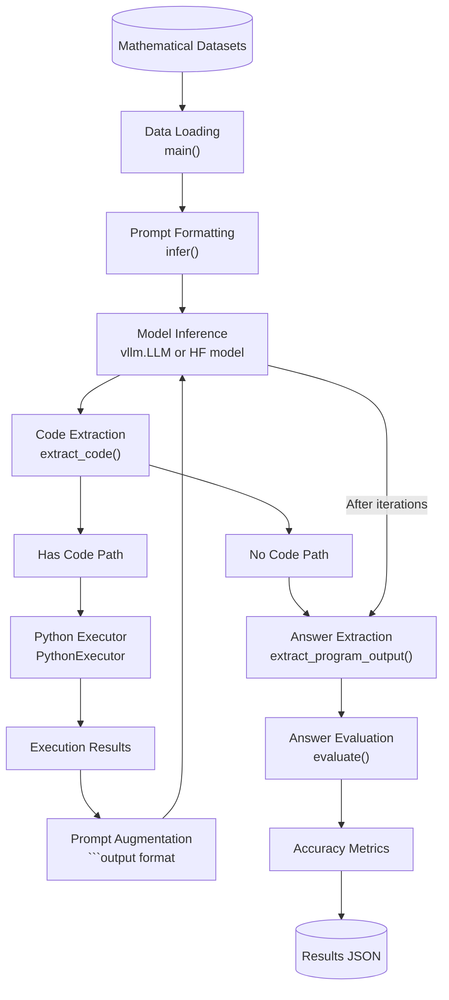

<!-- source: DeepWiki mcp.deepwiki.com · repo deepseek-ai/DeepSeek-Math · page 5.3 Tool Integration Evaluation · fetched 2026-10-30 -->

# Tool Integration Evaluation

<details>
<summary>Relevant source files</summary>

The following files were used as context for generating this wiki page:

- [evaluation/configs/few_shot_test_configs.json](evaluation/configs/few_shot_test_configs.json)
- [evaluation/configs/zero_shot_test_configs.json](evaluation/configs/zero_shot_test_configs.json)
- [evaluation/infer/run_tool_integrated_eval.py](evaluation/infer/run_tool_integrated_eval.py)

</details>


## Purpose and Scope

This document details the Tool Integration Evaluation system in DeepSeek-Math, which assesses how effectively the models can utilize external tools (specifically Python code execution) to solve mathematical problems. Unlike traditional text-only evaluations, tool integration enables models to generate, execute, and refine solutions based on concrete computational feedback.

For information about related evaluation methods, see:
- [Chain-of-Thought Evaluation](#5.1)
- [Program-Aided Language Evaluation](#5.2)

## System Overview

The Tool Integration Evaluation system follows a multi-stage process where the model generates code, the system executes that code, and then feeds execution results back to the model for final answer generation. This "think-execute-refine" loop mimics how humans might use computational tools to solve complex mathematical problems.

### Tool Integration Evaluation Pipeline



Sources: [evaluation/infer/run_tool_integrated_eval.py:67-203]()

## Components and Workflow

### 1. Code Extraction

The system extracts Python code blocks from model outputs using regex pattern matching. The code extractor identifies code blocks enclosed in triple backticks and processes them for execution.



Sources: [evaluation/infer/run_tool_integrated_eval.py:26-43]()

### 2. Python Execution

Extracted code is executed using the `PythonExecutor` which captures both the standard output and any runtime errors.



Sources: [evaluation/infer/run_tool_integrated_eval.py:92-183]()

### 3. Answer Evaluation

The system evaluates both:
1. The final model-generated answer
2. The direct output from the executed program

This dual evaluation approach allows assessment of both the model's reasoning and its ability to correctly implement computational solutions.

## Evaluation Process Details

### Tool Integration Loop

The tool integration pipeline executes in a loop with these key steps:

1. Format mathematical problems into model prompts
2. Generate initial model output
3. Extract code from the output
4. Execute the extracted code
5. Append execution results to the prompt
6. Generate a refined model response
7. Extract final answers and evaluate

The system is configured to run up to two iterations (defined by `n_iters = 2`) to allow the model to refine its solution based on execution feedback.



Sources: [evaluation/infer/run_tool_integrated_eval.py:67-188]()

### Evaluation Metrics

The evaluation calculates two primary metrics:

| Metric | Description | Implementation |
|--------|-------------|----------------|
| Answer Accuracy | Accuracy of the extracted final answer | `acc = sum(item['accuracy'] for item in results) / len(results)` |
| Program Accuracy | Accuracy of the direct output from executed code | `program_acc = sum(item['program_accuracy'] for item in results) / len(results)` |

Sources: [evaluation/infer/run_tool_integrated_eval.py:257-263](), [evaluation/infer/run_tool_integrated_eval.py:276-281]()

## Configuration Options

The Tool Integration Evaluation system offers numerous configuration options to customize the evaluation process:

### Key Parameters

| Parameter | Purpose | Example |
|-----------|---------|---------|
| `data_dir` | Path to evaluation dataset | `--data_dir data/gsm8k` |
| `model_name_or_path` | Model to evaluate | `--model_name_or_path deepseek-ai/deepseek-math-7b-instruct` |
| `answer_extraction_fn` | Function to extract answers | `--answer_extraction_fn extract_last_single_answer` |
| `eval_fn` | Function to evaluate answers | `--eval_fn eval_last_single_answer` |
| `prompt_format` | Format for prompts | `--prompt_format sft` or `--prompt_format few_shot` |
| `use_vllm` | Use VLLM for faster inference | `--use_vllm` |
| `no_execution` | Skip code execution | `--no-execution` |

Sources: [evaluation/infer/run_tool_integrated_eval.py:284-317]()

### Dataset Configuration

Datasets for tool integration evaluation are configured in JSON files that specify processing functions, answer extraction methods, and evaluation functions.

```json
{
  "gsm8k-test": {
    "test_path": "datasets/gsm8k/test.jsonl",
    "language": "en",
    "tasks": ["tool", "cot"],
    "process_fn": "process_gsm8k_test",
    "answer_extraction_fn": "extract_last_single_answer",
    "eval_fn": "eval_last_single_answer"
  }
}
```

Sources: [evaluation/configs/zero_shot_test_configs.json:2-9]()

## Tool Integration in the Evaluation System

Tool integration evaluation is one of three primary evaluation strategies in DeepSeek-Math:



Sources: [evaluation/infer/run_tool_integrated_eval.py:1-331](), [evaluation/configs/zero_shot_test_configs.json:1-34]()

## Data Flow Architecture



Sources: [evaluation/infer/run_tool_integrated_eval.py:67-263]()

## Error Handling and Timeout Management

The system includes robust error handling for code execution, including:

1. Timeout detection for long-running code
2. Graceful handling of runtime errors 
3. Concise error reporting back to the model

All code execution occurs in a sandbox environment through the `PythonExecutor` to ensure evaluation safety.

Sources: [evaluation/infer/run_tool_integrated_eval.py:49-65](), [evaluation/infer/run_tool_integrated_eval.py:161-183]()

---

