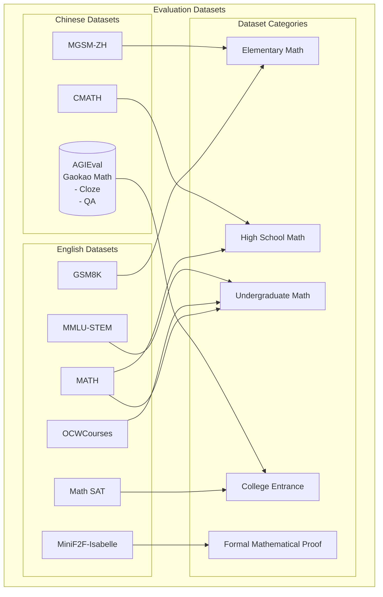
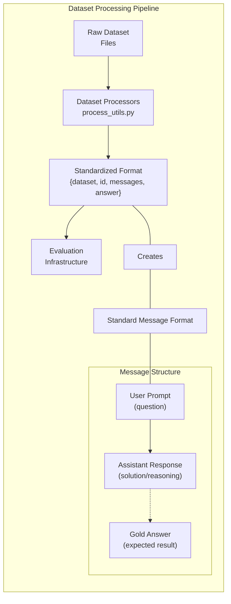
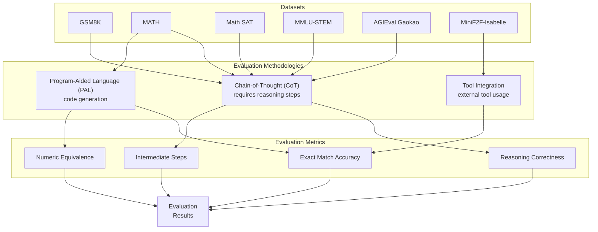

<!-- source: DeepWiki mcp.deepwiki.com · repo deepseek-ai/DeepSeek-Math · page 5.4 Evaluation Datasets · fetched 2026-10-30 -->

# Evaluation Datasets

<details>
<summary>Relevant source files</summary>

The following files were used as context for generating this wiki page:

- [evaluation/data_processing/process_utils.py](evaluation/data_processing/process_utils.py)
- [evaluation/datasets/agieval/gaokao-mathcloze.jsonl](evaluation/datasets/agieval/gaokao-mathcloze.jsonl)
- [evaluation/datasets/agieval/gaokao-mathqa.jsonl](evaluation/datasets/agieval/gaokao-mathqa.jsonl)

</details>


## Purpose and Scope

This document details the mathematical datasets used to evaluate the performance of DeepSeek-Math models. It covers the dataset formats, processing methods, and how they are integrated into the evaluation pipeline. For information about running the evaluation infrastructure, see [Running Evaluations](#5.5).

## Dataset Overview

DeepSeek-Math is evaluated on a diverse set of mathematical datasets spanning different difficulty levels, domains, and languages. These datasets are processed through standardized pipelines to enable consistent performance measurement across different model variants.



Sources: [evaluation/data_processing/process_utils.py:1-170]()

## Key Datasets

### GSM8K (Grade School Math 8K)

A dataset of 8,500 linguistically diverse grade school math word problems, designed to test elementary mathematical reasoning.

**Example:**
```
Question: A toy manufacturer receives an order for 400 toys. 5 workers are available to work on the 
order. Each worker can make 15 toys per hour. How many hours will it take to complete the order?

Answer: We have 5 workers, each making 15 toys per hour. So the total number of toys they can make per hour is 
5 × 15 = 75. To complete the order of 400 toys, it will take 400 ÷ 75 = 5.33 hours, or 5 hours and 20 minutes.
So the answer is 5.33.
```

### MATH

A challenging dataset with 12,500 problems from mathematics competitions, divided by difficulty level and subject area.

**Categories:**
- Algebra
- Number Theory
- Counting & Probability
- Geometry
- Intermediate Algebra
- Prealgebra
- Precalculus

Each problem is accompanied by a step-by-step solution, making it suitable for evaluating both the final answer and reasoning process.

### MMLU-STEM (Massive Multitask Language Understanding - STEM)

A subset of the MMLU benchmark focusing on STEM (Science, Technology, Engineering, Mathematics) topics, structured as multiple-choice questions.

**Processing:**
The dataset is processed to format multiple-choice options in a standardized way, with options labeled (A), (B), (C), (D), and a request to explain the answer.

```python
def process_mmlu_stem(item):
    options = item['options']
    for i, (label, option) in enumerate(zip('ABCD', options)):
        options[i] = f"({label}) {str(option).strip()}"
    options = ", ".join(options)
    question = f"{item['question'].strip()}\nWhat of the following is the right choice? Explain your answer.\n{options}"
    # Rest of processing...
```

Sources: [evaluation/data_processing/process_utils.py:72-89]()

### AGIEval Gaokao Math

A collection of mathematics problems from the Chinese college entrance examination (Gaokao), split into two subtypes:

1. **Gaokao Math Cloze**: Fill-in-the-blank questions requiring precise numerical or symbolic answers
2. **Gaokao Math QA**: Multiple-choice questions with explanations

This dataset represents challenging high-stakes math problems used in actual standardized testing.

**Example from Gaokao Math Cloze:**
```
已知 $a \in \mathrm{R}$, 函数 $f(x)=\left\{\begin{array}{l}x^{2}-4, x>2 \\ |x-3|+a, x \leq 2,\end{array}\right.$ 
若 $f[f(\sqrt{6})]=3$, 则 $a=(\quad)$
```

Sources: [evaluation/datasets/agieval/gaokao-mathcloze.jsonl:1-119]()

### MiniF2F Isabelle

A challenging dataset focused on formal mathematical proofs, containing mathematical statements to be formally proven using the Isabelle theorem prover.

**Processing:**
```python
def process_minif2f_isabelle(item):
    question = f"(*### Problem\n\n{item['informal_statement'].strip()}\n\n### Solution\n\n{item['informal_proof'].strip()} *)\n\nFormal:\n{item['formal_statement'].strip()}"
    # Rest of processing...
```

Sources: [evaluation/data_processing/process_utils.py:158-169]()

## Data Processing Pipeline

The evaluation system processes each dataset through a standardized workflow to ensure consistent formatting and evaluation:



Sources: [evaluation/data_processing/process_utils.py:1-170]()

## Standard Data Format

Despite the diverse origins and structures of the datasets, all are processed into a consistent format for evaluation:

```python
{
    'dataset': 'dataset_name',  # Identifier for the source dataset
    'id': 'unique_id',          # Unique identifier for the problem
    'messages': [               # Conversation format
        {'role': 'user', 'content': 'problem_text'},
        {'role': 'assistant', 'content': 'solution_or_empty'}
    ],
    'answer': 'expected_answer' # Ground truth answer for evaluation
}
```

Some datasets include additional metadata fields like:
- `level`: Difficulty level (MATH dataset)
- `type`/`category`: Problem type classification
- `language`: Language of the problem (e.g., 'en' or 'zh')
- `grade`/`reasoning_step`: Educational grade level or complexity indicator

## Dataset Statistics

| Dataset | Language | Format | Size | Mathematical Domains |
|---------|----------|--------|------|----------------------|
| GSM8K | English | Word problems | ~8,500 | Elementary arithmetic |
| MATH | English | Competition problems | ~12,500 | Various (algebra, geometry, etc.) |
| Math SAT | English | Multiple-choice | ~1,000 | High school mathematics |
| OCWCourses | English | University problems | ~500 | Undergraduate mathematics |
| MMLU-STEM | English | Multiple-choice | ~1,000 | Science and mathematics |
| MGSM-ZH | Chinese | Word problems | ~250 | Elementary arithmetic |
| CMATH | Chinese | Step-by-step problems | ~1,000 | Various |
| AGIEval Gaokao | Chinese | College entrance exam | ~100 | High school mathematics |
| MiniF2F | Isabelle | Formal proofs | ~200 | Mathematical theorems |

## Integration with Evaluation System

The evaluation datasets interface with three primary evaluation methodologies in the DeepSeek-Math project:



Sources: [evaluation/data_processing/process_utils.py:1-170]()

## Dataset-Specific Processing Details

Each dataset requires specialized processing to convert from its native format to the standardized evaluation format:

### GSM8K Processing

```python
def process_gsm8k_test(item):
    sample = {
        'dataset': 'gsm8k-cot',
        'id': item['id'],
        'messages': [
            {'role': 'user', 'content': item['question']},
            {'role': 'assistant', 'content': regex.sub(r"<<[^<>]*>>", "", item['cot']) + 
                                           "\nSo the answer is $\\boxed{" + item['answer'].strip() + "}$."}
        ],
        'answer': item['answer'].replace(',', '')
    }
    yield sample
```

Sources: [evaluation/data_processing/process_utils.py:5-15]()

### MATH Processing

```python
def process_math_test(item):
    question = item["problem"]
    try:
        answer = extract_math_answer(question, item['solution'], task="cot")
    except:
        return
    sample = {
        "dataset": "math-cot",
        "id": item['id'],
        "level": item["level"],
        "type": item["type"],
        "category": item["category"],
        "messages": [
            {"role": "user", "content": question},
            {"role": "assistant", "content": "\n".join(regex.split(r"(?<=\.) (?=[A-Z])", item["solution"]))}
        ],
        "answer": answer
    }
    yield sample
```

Sources: [evaluation/data_processing/process_utils.py:17-35]()

### AGIEval Gaokao Math Processing

```python
def process_agieval_gaokao_mathqa(item):
    question = item['question'].strip()
    options = []
    for option in item['options']:
        option = option.strip()
        assert option[0] == '('
        assert option[2] == ')'
        assert option[1] in 'ABCD'
        option = f"{option[1]}: {option[3:].strip()}"
        options.append(option.strip())
    question = f"{question}\n{options}"
    item = {
        'dataset': 'agieval-gaokao-mathqa',
        'id': item['id'],
        'messages': [
            {'role': 'user', 'content': question},
            {'role': 'assistant', 'content': ''}
        ],
        "answer": item['label']
    }
    yield item
```

Sources: [evaluation/data_processing/process_utils.py:121-141]()

## Conclusion

The evaluation datasets provide a comprehensive benchmark suite for assessing mathematical reasoning capabilities across various domains, difficulty levels, and languages. By standardizing the format of diverse datasets, the evaluation system can consistently measure model performance on tasks ranging from elementary arithmetic to advanced formal proofs.

---

