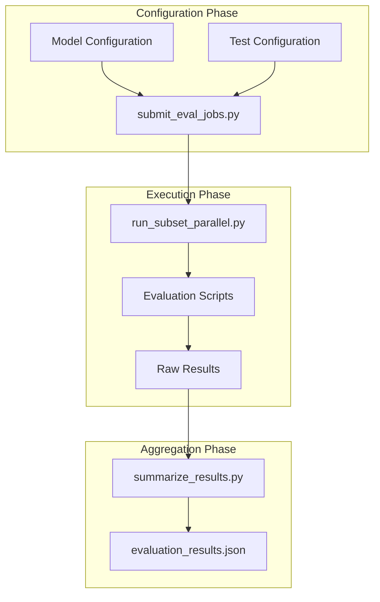
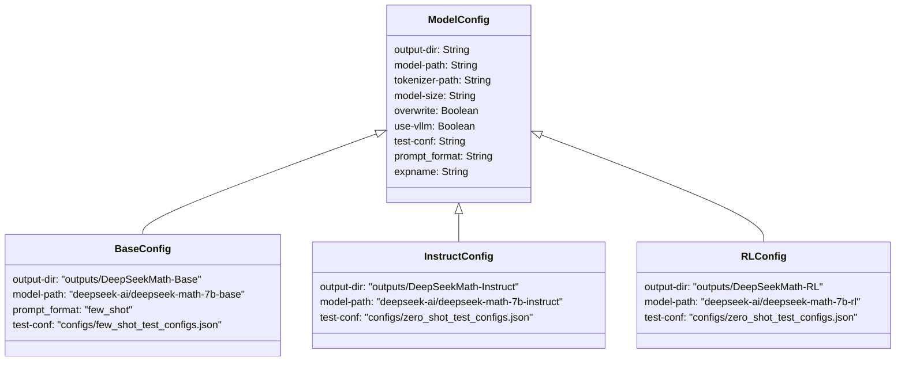
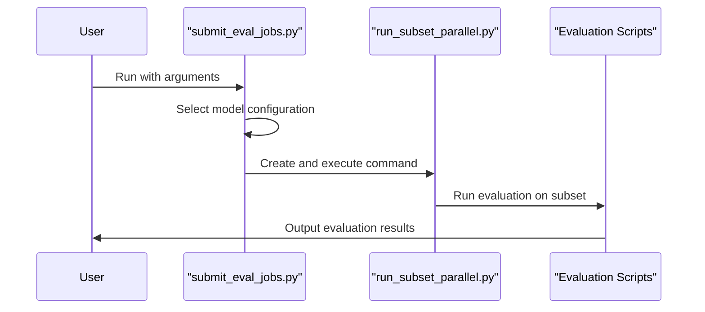
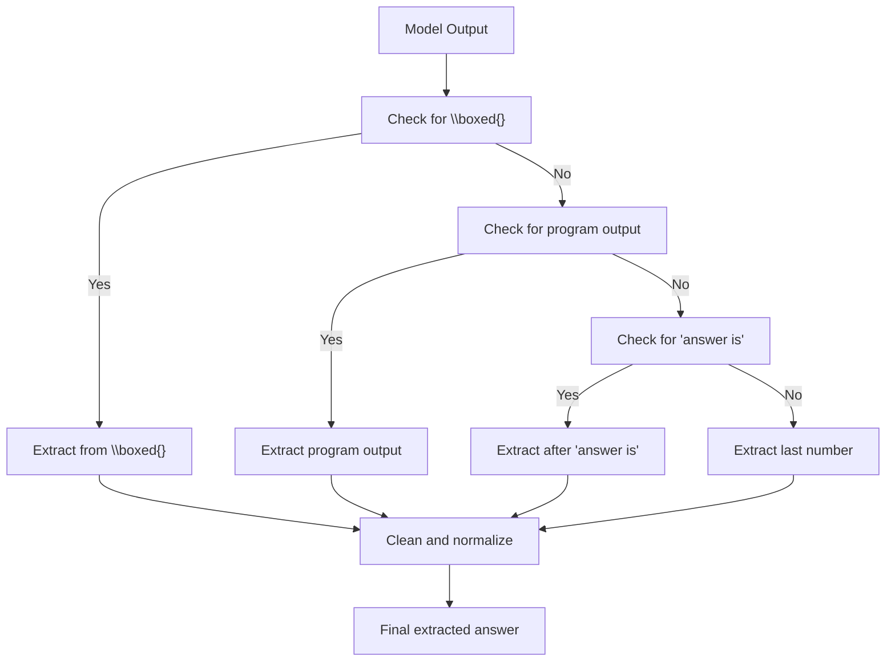

<!-- source: DeepWiki mcp.deepwiki.com · repo deepseek-ai/DeepSeek-Math · page 5.5 Running Evaluations · fetched 2026-10-30 -->

# Running Evaluations

<details>
<summary>Relevant source files</summary>

The following files were used as context for generating this wiki page:

- [evaluation/README.md](evaluation/README.md)
- [evaluation/data_processing/answer_extraction.py](evaluation/data_processing/answer_extraction.py)
- [evaluation/submit_eval_jobs.py](evaluation/submit_eval_jobs.py)

</details>


This page provides detailed instructions for running evaluations on DeepSeek-Math models. It covers the evaluation workflow, configuration setup, job submission, and result aggregation. For information about specific evaluation approaches, see [Chain-of-Thought Evaluation](#5.1), [Program-Aided Language Evaluation](#5.2), and [Tool Integration Evaluation](#5.3). For details about the datasets used in evaluations, see [Evaluation Datasets](#5.4).

## Evaluation System Overview

The DeepSeek-Math evaluation system allows for both zero-shot and few-shot evaluation on mathematical reasoning benchmarks. The system supports parallel processing across multiple GPUs and includes specific workflows for different evaluation approaches.



Sources: [evaluation/submit_eval_jobs.py](), [evaluation/README.md]()

## Configuration Setup

Before running evaluations, you need to configure both the model parameters and test configurations. The `submit_eval_jobs.py` script contains predefined configurations for the three DeepSeek-Math model variants:



Sources: [evaluation/submit_eval_jobs.py:4-37]()

The key configuration parameters include:

| Parameter | Description |
|-----------|-------------|
| `output-dir` | Directory where evaluation results will be stored |
| `model-path` | Path to the model, can be local or from HuggingFace |
| `tokenizer-path` | Path to the tokenizer |
| `model-size` | Size of the model (e.g., "7b") |
| `overwrite` | Whether to overwrite existing results |
| `use-vllm` | Whether to use VLLM for faster inference |
| `test-conf` | Path to the test configuration file |
| `prompt_format` | Format of the prompt (e.g., "few_shot") |
| `expname` | Name of the experiment |

Sources: [evaluation/submit_eval_jobs.py:4-37]()

## Running Evaluations

The evaluation process consists of three main steps:

1. Setting up the environment
2. Submitting evaluation jobs
3. Aggregating results

### Environment Setup

First, configure the `prefix` in `environment.yml` and set up the environment:

```bash
conda env create -f environment.yml
```

Sources: [evaluation/README.md:5-10]()

### Submitting Evaluation Jobs

To run evaluations, use the `submit_eval_jobs.py` script. This script creates commands to run parallel evaluations and executes them. You need to modify the script to select which model configuration to use by changing the `conf = base_conf` line.

```bash
python submit_eval_jobs.py --n-gpus 8 --n-repeats 1 --temperature 0
```

Parameters for job submission:

| Parameter | Description | Default |
|-----------|-------------|---------|
| `--n-repeats` | Number of evaluation repeats | 1 |
| `--temperature` | Sampling temperature | 0 |
| `--n-gpus` | Number of GPUs to use | 8 |

Sources: [evaluation/submit_eval_jobs.py:41-66](), [evaluation/README.md:22-28]()



Sources: [evaluation/submit_eval_jobs.py:41-66]()

### Prompt Processing

During evaluation, questions are processed differently based on the evaluation approach:

For chain-of-thought evaluation:
- English questions: `{question}\nPlease reason step by step, and put your final answer within \boxed{}.`
- Chinese questions: `{question}\n请通过逐步推理来解答问题，并把最终答案放置于\boxed{}中。`

For tool-integrated reasoning:
- English questions: `{question}\nPlease integrate natural language reasoning with programs to solve the problem above, and put your final answer within \boxed{}.`
- Chinese questions: `{question}\n请结合自然语言和Python程序语言来解答问题，并把最终答案放置于\boxed{}中。`

Sources: [evaluation/README.md:14-20]()

## Aggregating Results

After all evaluation processes have finished, run the following command to aggregate results:

```bash
python summarize_results.py [--eval-atp]
```

The `--eval-atp` option will invoke `unsafe_score_minif2f_isabelle.py` to evaluate informal-to-formal proving results. Before using this option, ensure you've set up the [PISA](https://github.com/wellecks/lm-evaluation-harness/blob/minif2f-isabelle/docs/isabelle_setup.md) server.

The aggregated results will be saved as `evaluation_results.json`.

Sources: [evaluation/README.md:30-37]()

## Answer Extraction Process

The evaluation system uses sophisticated answer extraction logic to process model outputs. The extraction process depends on the type of problem and format of the answer.



Sources: [evaluation/data_processing/answer_extraction.py:177-338]()

The answer extraction process handles various formats including:
- LaTeX expressions in `\boxed{}`
- Program outputs between ``````output`` blocks
- Answers following phrases like "the answer is"
- Mathematical expressions requiring normalization

Special extraction functions are provided for different tasks and datasets, including GSM8K, MMLU, MATH, and others.

Sources: [evaluation/data_processing/answer_extraction.py:244-338]()

## Tips for Successful Evaluations

1. **Resource Management**: Ensure you have enough GPU memory available when running evaluations, as large language models require significant resources.

2. **Configuration Selection**: Choose the appropriate configuration based on your evaluation needs:
   - Use `few_shot_test_configs.json` for the Base model
   - Use `zero_shot_test_configs.json` for the Instruct and RL models

3. **Monitoring Progress**: The evaluation process can take a significant amount of time, especially for large datasets. Monitor the output directory for progress.

4. **Checking Model Outputs**: All model outputs are saved in the output directory and can be examined for detailed analysis. A summary is available in the `evaluation_results.json` file after aggregation.

Sources: [evaluation/README.md:39-42]()

---

