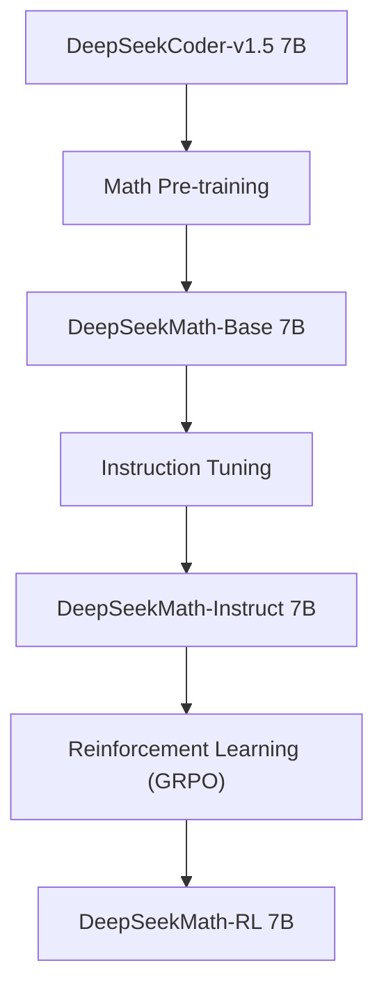
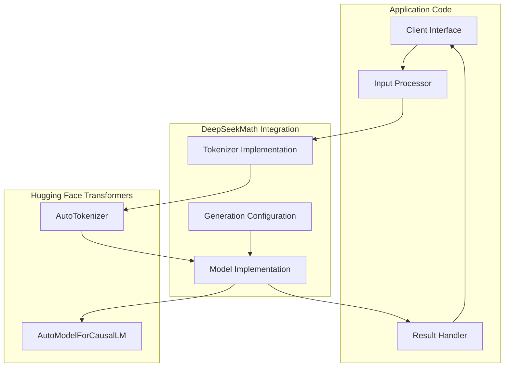
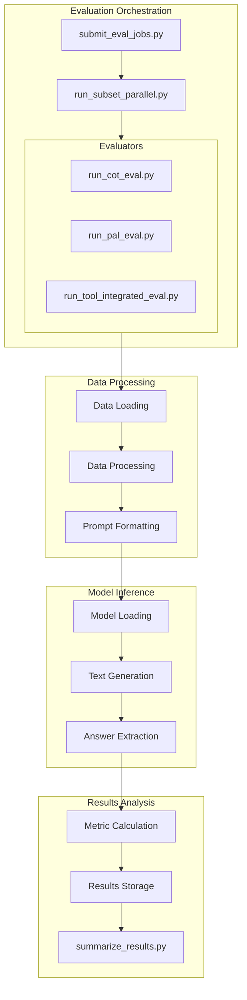
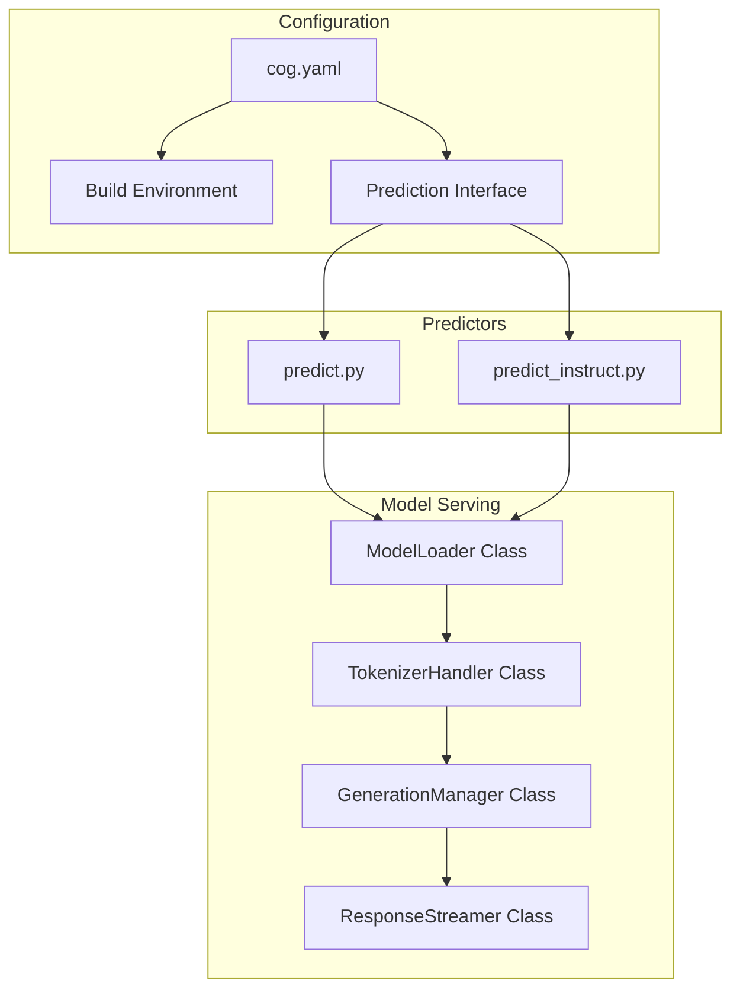

<!-- source: DeepWiki mcp.deepwiki.com · repo deepseek-ai/DeepSeek-Math · page 6 Development Guide · fetched 2026-10-30 -->

# Development Guide

<details>
<summary>Relevant source files</summary>

The following files were used as context for generating this wiki page:

- [.gitignore](.gitignore)
- [README.md](README.md)

</details>


This guide provides essential information for developers working with or extending the DeepSeek-Math codebase. It focuses on development workflows, best practices, and customization approaches for this powerful mathematical language model system.

For information about model architecture and specifications, see [Model Architecture](#2.1).
For information about evaluation methodologies, see [Evaluation System](#5).
For information about deployment options, see [Deployment](#4).

## 1. Development Environment Setup

Setting up your development environment is the first step to working with DeepSeek-Math.


### 1.1 Prerequisites

To work with DeepSeek-Math, you'll need:

- Python 3.8+
- CUDA-capable GPU (recommended for inference and development)
- Git for version control
- Sufficient disk space for model weights (7B+ parameter models)

### 1.2 Installation Steps

1. Clone the repository:
```bash
git clone https://github.com/deepseek-ai/DeepSeek-Math.git
cd DeepSeek-Math
```

2. Install dependencies (a requirements.txt file would be expected in the repo):
```bash
pip install -r requirements.txt
```

3. Set up model access through Hugging Face:
```python
from transformers import AutoTokenizer, AutoModelForCausalLM
model_name = "deepseek-ai/deepseek-math-7b-base"
tokenizer = AutoTokenizer.from_pretrained(model_name)
model = AutoModelForCausalLM.from_pretrained(model_name, torch_dtype=torch.bfloat16, device_map="auto")
```

Sources: [README.md:130-134]()

## 2. Model Development and Customization

The DeepSeek-Math codebase offers three model variants that can be customized and extended.

### 2.1 Model Development Pipeline

The DeepSeekMath models follow this development pipeline:



Understanding this pipeline is crucial when developing custom extensions or fine-tuning the models for specific use cases.

Sources: [README.md:62-64](), [README.md:98-106]()

### 2.2 Model Integration Architecture

When integrating DeepSeekMath models into your applications, follow this architecture:



This architecture demonstrates how the DeepSeekMath models integrate with both your application code and the underlying Hugging Face Transformers library.

Sources: [README.md:142-180]()

### 2.3 Fine-tuning Approach

For fine-tuning DeepSeekMath models on domain-specific mathematical tasks:


This workflow enables you to adapt the models to specific mathematical domains or applications.

## 3. Evaluation System Development

The evaluation system is a critical component for assessing model performance.

### 3.1 Evaluation System Architecture



This diagram shows the evaluation workflow, from job submission through data processing, model inference, to results analysis.

### 3.2 Creating Custom Evaluations

To extend the evaluation system with custom evaluations:

1. Create a new evaluation script based on existing ones (e.g., run_cot_eval.py)
2. Implement your custom dataset loading and processing logic
3. Define evaluation metrics specific to your use case
4. Integrate with the orchestration system (submit_eval_jobs.py)

This approach allows you to evaluate models on specialized mathematical tasks or datasets.

## 4. Deployment System Development

The deployment system uses Cog for containerization and serving.

### 4.1 Deployment System Architecture



This architecture shows how the Cog configuration, predictor implementations, and model serving components work together.

### 4.2 Creating Custom Deployments

To customize the deployment for specific use cases:

1. Modify the cog.yaml file to specify your environment requirements
2. Create a custom predictor implementation based on predict.py or predict_instruct.py
3. Implement specialized handling for your specific mathematical use cases
4. Configure optimized model loading and generation parameters

This approach allows you to create specialized deployments for different use cases.

## 5. Best Practices for Development

### 5.1 Prompting Strategies

For optimal results with DeepSeekMath-Instruct and DeepSeekMath-RL models, use structured prompts:

| Language | Recommended Prompt Template |
|----------|----------------------------|
| English  | `{question}\nPlease reason step by step, and put your final answer within \boxed{}.` |
| Chinese  | `{question}\n请通过逐步推理来解答问题，并把最终答案放置于\boxed{}中。` |

These prompting strategies encourage step-by-step reasoning and clear answer formatting.

Sources: [README.md:194-198]()

### 5.2 Performance Optimization

When working with 7B parameter models, consider these optimization techniques:

| Technique | Implementation | Benefit |
|-----------|---------------|---------|
| Mixed Precision | `torch_dtype=torch.bfloat16` | Reduces memory usage while maintaining accuracy |
| Device Mapping | `device_map="auto"` | Optimizes model placement across available hardware |
| Generation Parameters | `model.generation_config` customization | Balances quality and speed for specific use cases |
| Batched Processing | Process inputs in batches | Increases throughput for multiple requests |

### 5.3 Chat Completion Templates

When not using `apply_chat_template`, format your chat inputs following this structure:

```
User: {messages[0]['content']}