# Page: Overview

# Overview

<details>
<summary>Relevant source files</summary>

The following files were used as context for generating this wiki page:

- [README.md](README.md)

</details>


This document provides a comprehensive introduction to the DeepSeek-Math project, which features advanced language models specifically designed for mathematical reasoning. This page outlines the project's purpose, key components, and capabilities at a high level.

For detailed information about specific components, please refer to the corresponding wiki pages:
- For specific model details, see [Models](#2)
- For using the models, see [Usage Guide](#3)
- For deployment information, see [Deployment](#4)
- For evaluation methodologies, see [Evaluation System](#5)

## Project Purpose

DeepSeek-Math aims to push the boundaries of mathematical reasoning capabilities in open language models. The project provides a family of 7B-parameter models that achieve impressive performance on competition-level math benchmarks, approaching the capabilities of much larger proprietary models like GPT-4 and Gemini-Ultra.

Sources: [README.md:62-64]()

## Model Development Pipeline

### Model Evolution

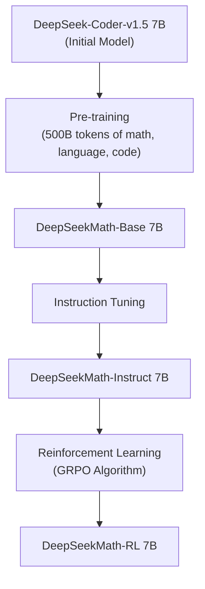

DeepSeekMath was initialized with DeepSeek-Coder-v1.5 7B and underwent continued pre-training on 500B tokens of mathematical content, natural language, and code data. The project features three progressively enhanced models:

1. **DeepSeekMath-Base 7B**: The foundation model trained on mathematical content
2. **DeepSeekMath-Instruct 7B**: Fine-tuned with instruction-following capabilities
3. **DeepSeekMath-RL 7B**: Enhanced via reinforcement learning using the Group Relative Policy Optimization (GRPO) algorithm

Sources: [README.md:64](), [README.md:98-100]()

## Key Features and Capabilities

DeepSeekMath models demonstrate several notable capabilities:

1. **Step-by-Step Mathematical Reasoning**: Solving complex mathematical problems through logical step-by-step approaches
2. **Tool Integration**: Effectively using computational tools to solve mathematical problems
3. **Versatility**: Maintaining strong performance in general reasoning and coding tasks
4. **Multi-Lingual Support**: Handling mathematical problems in both English and Chinese

### Evaluation Results

| Benchmark | DeepSeekMath-Base 7B | DeepSeekMath-Instruct 7B | DeepSeekMath-RL 7B |
|-----------|----------------------|--------------------------|-------------------|
| MATH      | 51.7%                | 54.8%                    | 59.7% (with tool use) |
| GSM8K     | Not specified        | 86.5%                    | 88.7% |
| AIME      | Not specified        | 27.2%                    | 32.7% |
| AMC       | Not specified        | 82.5%                    | 86.8% |

A key achievement is the 51.7% accuracy on the competition-level MATH benchmark without external tools, surpassing existing open-source models and approaching the performance of much larger proprietary models.

Sources: [README.md:72-97](), [README.md:102-106]()

## System Architecture

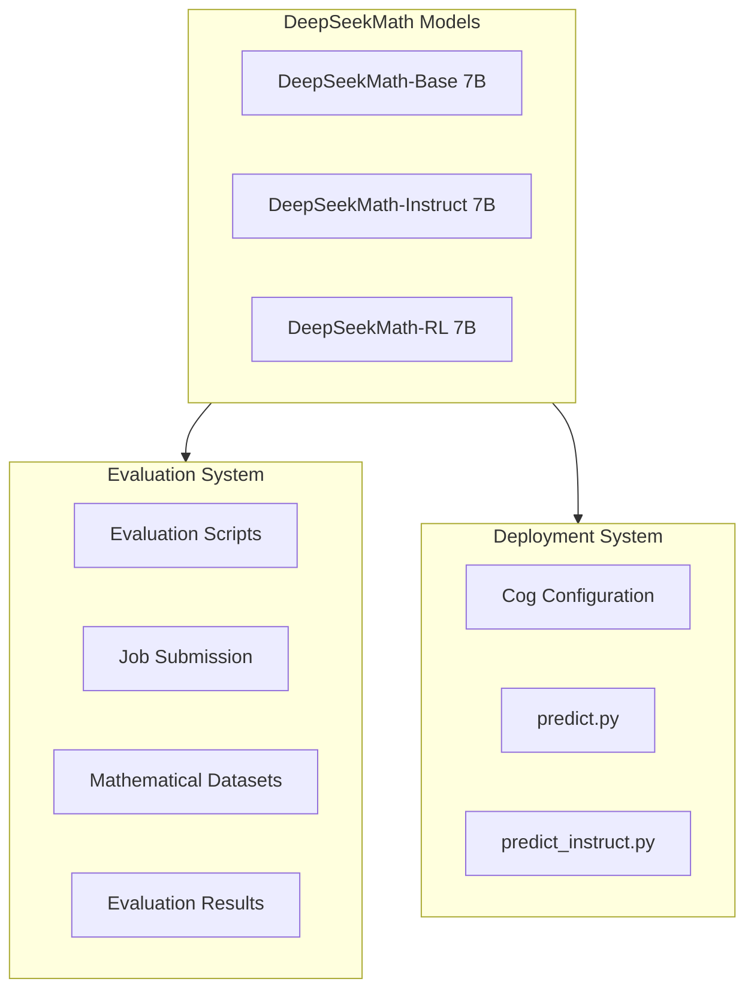

The DeepSeekMath system consists of three primary components:

1. **Model Family**: The three core models with increasing capabilities
2. **Evaluation System**: Tools and scripts for assessing model performance
3. **Deployment System**: Configuration and interfaces for serving the models

Sources: (Based on repository structure analysis)

## Evaluation System

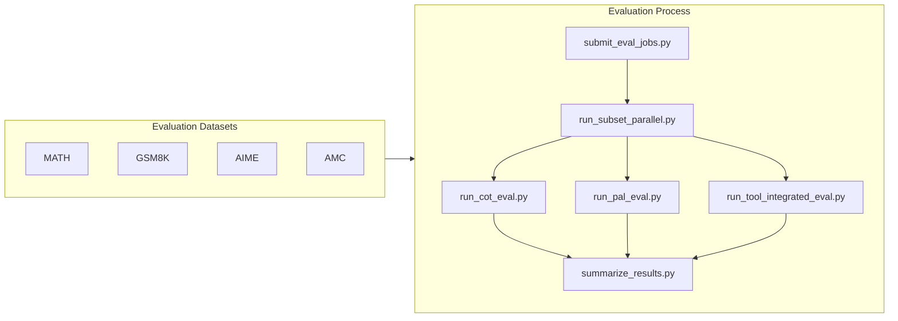

The evaluation system uses three main methodologies:

1. **Chain-of-Thought (CoT)**: Evaluates step-by-step reasoning capability
2. **Program-Aided Language (PAL)**: Tests problem-solving by writing and executing code
3. **Tool-Integrated Evaluation**: Assesses performance with access to external computational tools

The evaluation process is orchestrated through job submission scripts that run evaluations in parallel and compile the results.

Sources: [README.md:70-106]()

## Usage Patterns

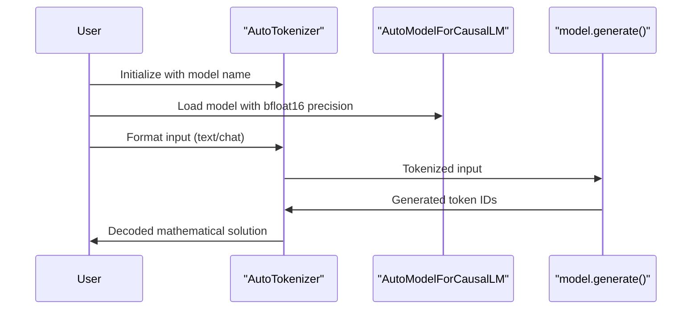

DeepSeekMath supports two primary usage patterns:

1. **Text Completion**: Direct generation from mathematical prompts
2. **Chat Completion**: Interactive problem-solving through chat interfaces

### Text Completion Example

```python
import torch
from transformers import AutoTokenizer, AutoModelForCausalLM, GenerationConfig

model_name = "deepseek-ai/deepseek-math-7b-base"
tokenizer = AutoTokenizer.from_pretrained(model_name)
model = AutoModelForCausalLM.from_pretrained(model_name, torch_dtype=torch.bfloat16, device_map="auto")
model.generation_config = GenerationConfig.from_pretrained(model_name)
model.generation_config.pad_token_id = model.generation_config.eos_token_id

text = "The integral of x^2 from 0 to 2 is"
inputs = tokenizer(text, return_tensors="pt")
outputs = model.generate(**inputs.to(model.device), max_new_tokens=100)

result = tokenizer.decode(outputs[0], skip_special_tokens=True)
print(result)
```

For optimal results with DeepSeekMath-Instruct and DeepSeekMath-RL models, chain-of-thought prompting is recommended:
- For English questions: `{question}\nPlease reason step by step, and put your final answer within \boxed{}.`
- For Chinese questions: `{question}\n请通过逐步推理来解答问题，并把最终答案放置于\boxed{}中。`

Sources: [README.md:136-199]()

## Data Collection Process

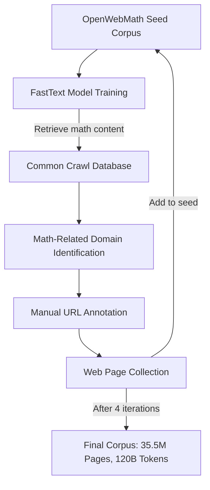

The training data was collected through an iterative process:

1. Starting with OpenWebMath as an initial seed corpus
2. Training a FastText model to identify mathematical content
3. Using this model to retrieve math-related pages from Common Crawl
4. Identifying potential math domains through statistical analysis
5. Manually annotating URLs within these domains
6. Expanding the corpus through linked pages
7. Repeating the process for four iterations

This process resulted in 35.5 million mathematical web pages totaling 120 billion tokens for training.

Sources: [README.md:109-123]()

## Licensing Information

DeepSeekMath models are available under a custom Model License that permits commercial use, while the repository code is released under the MIT License.

Sources: [README.md:201-204]()

## Conclusion

DeepSeekMath represents a significant advancement in mathematical reasoning capabilities for language models. With state-of-the-art performance on competition-level benchmarks and versatile deployment options, it serves as a valuable resource for both research and practical applications in mathematical problem-solving.

Sources: (Summary based on entire README.md)

---

# Page: Models

# Models

<details>
<summary>Relevant source files</summary>

The following files were used as context for generating this wiki page:

- [README.md](README.md)

</details>


This document provides a comprehensive overview of the DeepSeek-Math model family, including their architecture, capabilities, and relationships between different model variants. For detailed information about specific model variants, see [Base Model](#2.2), [Instruct Model](#2.3), and [RL Model](#2.4). For information about the model architecture, see [Model Architecture](#2.1).

## Model Family Overview

DeepSeek-Math consists of three specialized 7B-parameter language models developed for mathematical reasoning:

1. **DeepSeekMath-Base 7B** - A foundational model pre-trained on mathematical content
2. **DeepSeekMath-Instruct 7B** - An instruction-tuned version of the base model
3. **DeepSeekMath-RL 7B** - A reinforcement learning-optimized version using the GRPO algorithm

All models share a context length of 4096 tokens and are built upon the foundation of DeepSeek-Coder-v1.5 7B with additional mathematical training.

Sources: [README.md:126-134](README.md:126-134)

### Model Development Flow

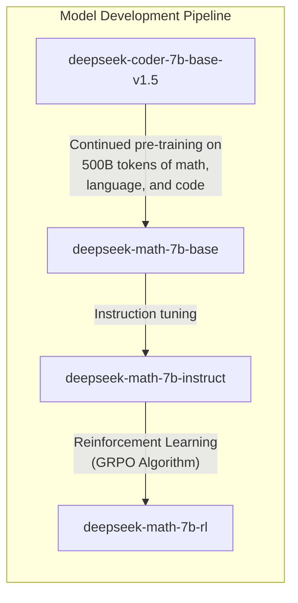

Sources: [README.md:62-64](README.md:62-64), [README.md:100-101](README.md:100-101)

## Key Features and Capabilities

DeepSeekMath models excel in mathematical problem-solving, with the base model achieving a 51.7% score on the MATH benchmark without external tools or voting techniques. This performance approaches that of proprietary models like Gemini-Ultra and GPT-4.

### Mathematical Reasoning Capabilities

| Model | Key Strength | Specialized Capabilities |
|-------|--------------|--------------------------|
| Base | Foundation for mathematical reasoning | Superior mathematical reasoning compared to other open-source base models |
| Instruct | Step-by-step reasoning | Strong performance for guided mathematical problem-solving |
| RL | Advanced tool integration | Enhanced accuracy with tool use, approaching 60% accuracy on MATH |

Sources: [README.md:64](README.md:64), [README.md:93-96](README.md:93-96), [README.md:102-105](README.md:102-105)

### Performance Characteristics

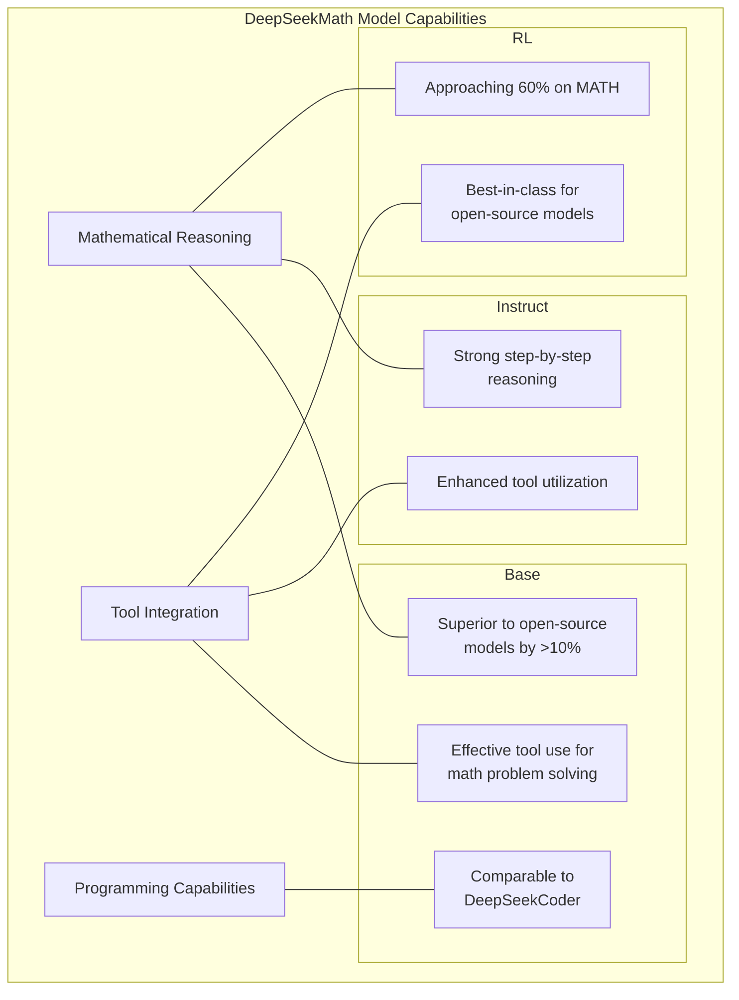

Sources: [README.md:93-96](README.md:93-96), [README.md:102-105](README.md:102-105)

## Model Specifications

All DeepSeekMath models are based on the transformer architecture with the following specifications:

| Model | Parameters | Context Length | Base Architecture |
|-------|------------|----------------|-------------------|
| DeepSeekMath-Base 7B | 7B | 4096 tokens | DeepSeek-Coder-v1.5 7B |
| DeepSeekMath-Instruct 7B | 7B | 4096 tokens | DeepSeekMath-Base 7B |
| DeepSeekMath-RL 7B | 7B | 4096 tokens | DeepSeekMath-Instruct 7B |

Sources: [README.md:126-134](README.md:126-134)

## Training Methodology

DeepSeekMath models were developed through a sequential training approach:

1. **Base Model Training**: Initialized from DeepSeek-Coder-v1.5 7B and continued pre-training on 500B tokens of math-related content from Common Crawl, along with natural language and code data.

2. **Instruct Model Training**: The base model was further fine-tuned with instruction data to improve its ability to follow mathematical instructions and provide step-by-step reasoning.

3. **RL Model Training**: The instruct model was enhanced using the Group Relative Policy Optimization (GRPO) algorithm to optimize its mathematical problem-solving capabilities further.

Sources: [README.md:62-64](README.md:62-64), [README.md:100-101](README.md:100-101), [README.md:109-116](README.md:109-116)

## Usage Paradigms

The DeepSeekMath models support two primary usage paradigms:

1. **Text Completion** - Best suited for the base model when generating continuous mathematical content
2. **Chat Completion** - Optimized for the instruct and RL models when interactive problem-solving is needed

For the instruct and RL models, chain-of-thought prompting is recommended to achieve optimal performance in mathematical reasoning tasks.

Sources: [README.md:140-158](README.md:140-158), [README.md:160-180](README.md:160-180), [README.md:194-198](README.md:194-198)

## Model Licensing and Availability

All DeepSeekMath models are available for both academic and commercial use, subject to the terms outlined in the model license. The models can be accessed via Hugging Face.

For detailed licensing information, see [Model Licensing](#2.5).

Sources: [README.md:126-134](README.md:126-134), [README.md:201-204](README.md:201-204)

---

# Page: Model Architecture

# Model Architecture

<details>
<summary>Relevant source files</summary>

The following files were used as context for generating this wiki page:

- [README.md](README.md)

</details>


This page details the technical architecture of the DeepSeekMath model family, including its structure, parameters, training methodology, and development pipeline. For information about specific model variants and their capabilities, see [Base Model](#2.2), [Instruct Model](#2.3), and [RL Model](#2.4).

## Architecture Overview

DeepSeekMath is a family of large language models specifically designed for mathematical reasoning tasks. All models in the family are built upon DeepSeek-Coder-v1.5 7B, with continued pre-training on mathematical content.

Key technical specifications:
- **Parameter count**: 7 billion parameters
- **Context length**: 4096 tokens
- **Architecture type**: Decoder-only transformer
- **Base foundation**: DeepSeek-Coder-v1.5 7B

The DeepSeekMath models inherit the transformer architecture from their foundation model but are specifically adapted for mathematical reasoning through specialized training.

### High-Level Model Architecture

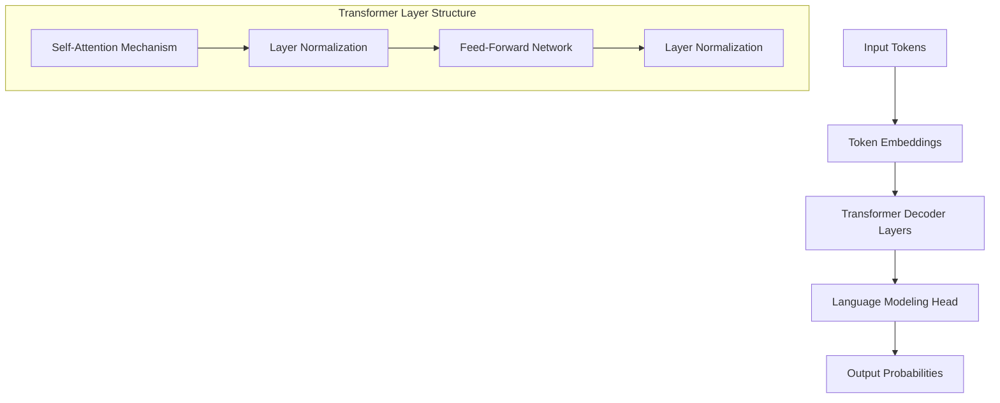

Sources: README.md:62-64, README.md:127-134

## Model Variants and Specifications

The DeepSeekMath family comprises three specialized models, each with identical architectural parameters but different training objectives:

| Model | Parameters | Context Length | Primary Purpose |
|-------|------------|----------------|-----------------|
| DeepSeekMath-Base 7B | 7B | 4096 | Foundation model with strong mathematical capabilities |
| DeepSeekMath-Instruct 7B | 7B | 4096 | Instruction-tuned for step-by-step mathematical reasoning |
| DeepSeekMath-RL 7B | 7B | 4096 | Reinforcement-learned model optimized for advanced problem-solving |

Sources: README.md:127-134

## Development Pipeline

The DeepSeekMath model family follows a progressive development pipeline where each variant builds upon the previous one:

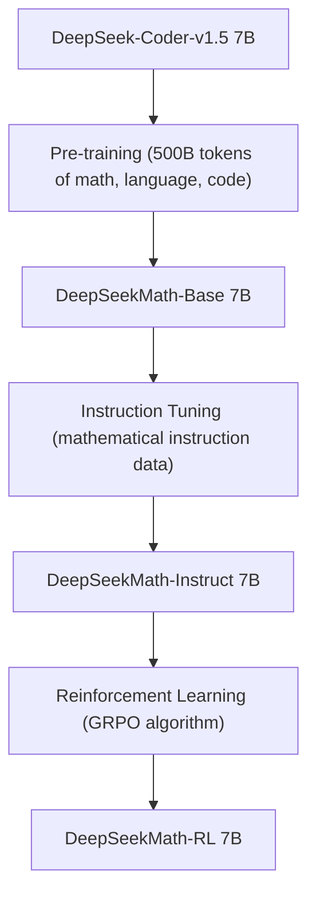

The development process consists of these sequential stages:

1. **Base Model Development**: The foundation model DeepSeek-Coder-v1.5 7B undergoes continued pre-training on 500B tokens of mathematical content, natural language, and code.

2. **Instruction Tuning**: The pre-trained base model is fine-tuned on mathematical instruction data, enhancing its ability to follow directions and perform step-by-step reasoning.

3. **Reinforcement Learning**: The instruction-tuned model is further refined using the Group Relative Policy Optimization (GRPO) algorithm to optimize performance on mathematical tasks.

Sources: README.md:62-64, README.md:98-101

## Training Data Architecture

A critical component of the DeepSeekMath architecture is its specialized training data, collected through an iterative process:

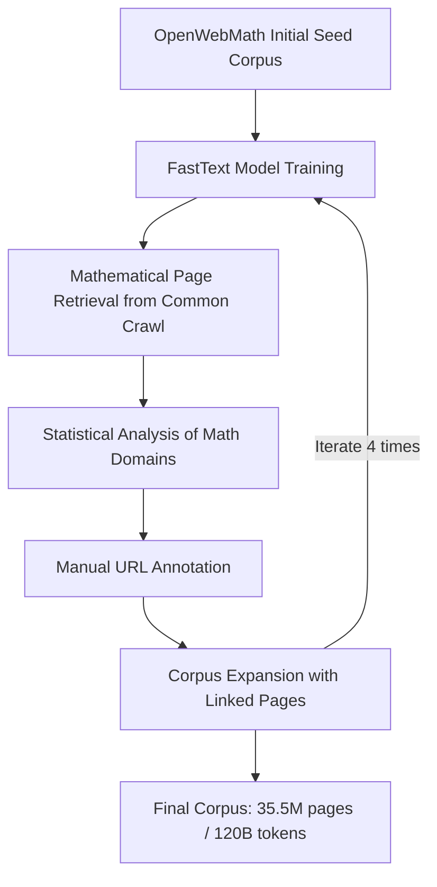

This data collection pipeline resulted in a corpus of 35.5 million mathematical web pages containing approximately 120 billion tokens. These tokens, along with additional natural language and code data, formed the 500 billion token dataset used for training.

Sources: README.md:109-122

## Training Methodology

The training methodology for DeepSeekMath involves three distinct phases, each targeting specific capabilities:

```mermaid
flowchart LR
    subgraph "Pre-training Phase"
        PTStart["DeepSeek-Coder-v1.5 7B"] --> PTProcess["500B tokens of math, language, code"]
        PTProcess --> PTResult["DeepSeekMath-Base 7B"]
    end
    
    subgraph "Instruction Tuning Phase"
        ITStart["DeepSeekMath-Base 7B"] --> ITProcess["Mathematical Instruction Data"]
        ITProcess --> ITResult["DeepSeekMath-Instruct 7B"]
    end
    
    subgraph "Reinforcement Learning Phase"
        RLStart["DeepSeekMath-Instruct 7B"] --> RLProcess["GRPO Algorithm"]
        RLProcess --> RLResult["DeepSeekMath-RL 7B"]
    end
    
    PTResult --> ITStart
    ITResult --> RLStart
```

This progressive approach allows each model to build upon the capabilities of its predecessor, with specialized training techniques tailored to enhance mathematical reasoning.

Sources: README.md:62-64, README.md:98-101

## Implementation and Inference

The DeepSeekMath models are implemented using the Hugging Face Transformers library, providing standardized interfaces for model loading, tokenization, and inference.

### Inference Pipeline

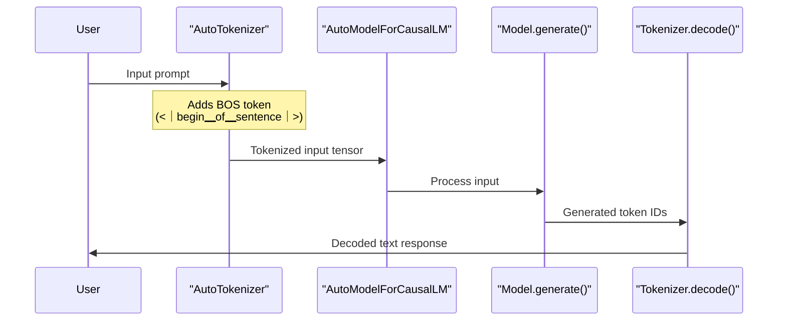

The models support both text completion and chat completion workflows, with specialized templates for chat interactions:

```
User: {message_content}

---

# Page: Base Model

# Base Model

<details>
<summary>Relevant source files</summary>

The following files were used as context for generating this wiki page:

- [README.md](README.md)
- [replicate/predict.py](replicate/predict.py)

</details>


## Purpose and Scope

This document provides detailed information about the DeepSeekMath-Base 7B model, a foundation language model specifically pre-trained for mathematical reasoning capabilities. It covers the model's architecture, technical specifications, training process, performance characteristics, and basic usage patterns. For information about the instruction-tuned version, see [Instruct Model](#2.3), and for the reinforcement learning optimized version, see [RL Model](#2.4).

## Model Overview

DeepSeekMath-Base 7B is the foundational model in the DeepSeekMath family, designed for solving complex mathematical problems through reasoning. It serves as the base model upon which the instruct and RL variants are built. The model demonstrates strong mathematical reasoning abilities without relying on external tools.

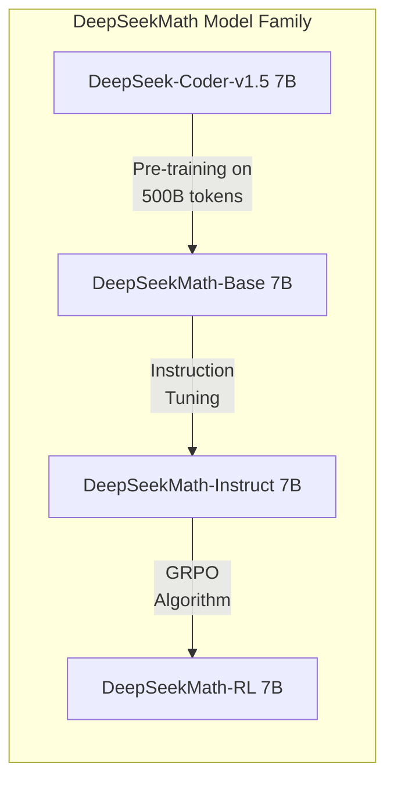

**Diagram: DeepSeekMath-Base 7B in the Model Development Pipeline**

Sources: [README.md:63-64]()

## Technical Specifications

The DeepSeekMath-Base 7B model has the following key specifications:

| Specification | Value |
|---------------|-------|
| Parameter Count | 7 billion |
| Context Length | 4096 tokens |
| Model Type | Causal Language Model |
| Architecture | Based on DeepSeek-Coder-v1.5 |
| Format | PyTorch model (transformers compatible) |
| Precision | Supports bfloat16 inference |

Sources: [README.md:64](), [README.md:130-133](), [replicate/predict.py:23-28]()

## Training Process and Data

DeepSeekMath-Base 7B was initialized with the DeepSeek-Coder-v1.5 7B model and then further pre-trained on a specialized dataset.

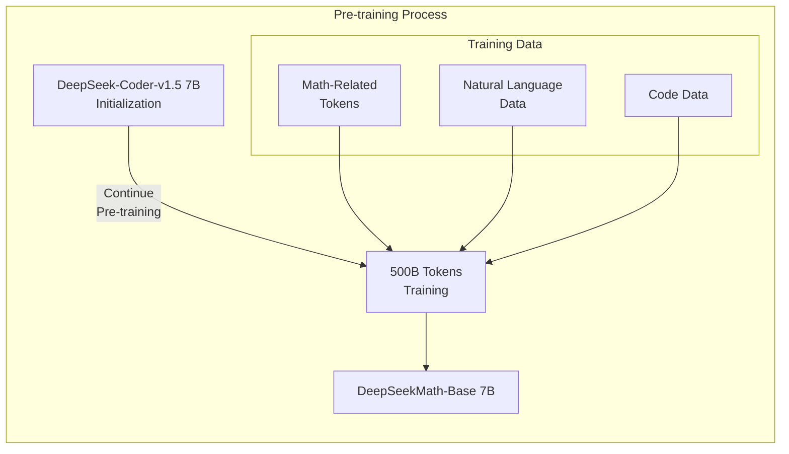

**Diagram: DeepSeekMath-Base 7B Training Process**

The training data collection for mathematical content followed an iterative approach:

1. Started with OpenWebMath as an initial seed corpus
2. Used FastText model to identify and retrieve math-related content from Common Crawl
3. Identified math-related domains through statistical analysis
4. Manually annotated URLs with mathematical content
5. Added linked pages to the seed corpus and repeated the process for four iterations

This iterative process resulted in 35.5 million mathematical web pages, totaling approximately 120 billion tokens for training.

Sources: [README.md:63-64](), [README.md:109-122]()

## Performance and Capabilities

DeepSeekMath-Base 7B demonstrates exceptional performance in mathematical reasoning tasks, achieving 51.7% accuracy on the competition-level MATH benchmark without relying on external tools or voting techniques.

The model excels in several areas:

1. **Mathematical Reasoning**: Outperforms existing open-source base models by more than 10% in absolute terms on the MATH dataset through few-shot chain-of-thought prompting, surpassing even Minerva 540B.

2. **Tool Use Ability**: Effectively solves and proves mathematical problems by writing programs, leveraging its foundation in the DeepSeekCoder architecture.

3. **General Reasoning and Coding**: Maintains comparable performance in reasoning and coding tasks as its predecessor, DeepSeekCoder-Base-7B-v1.5.

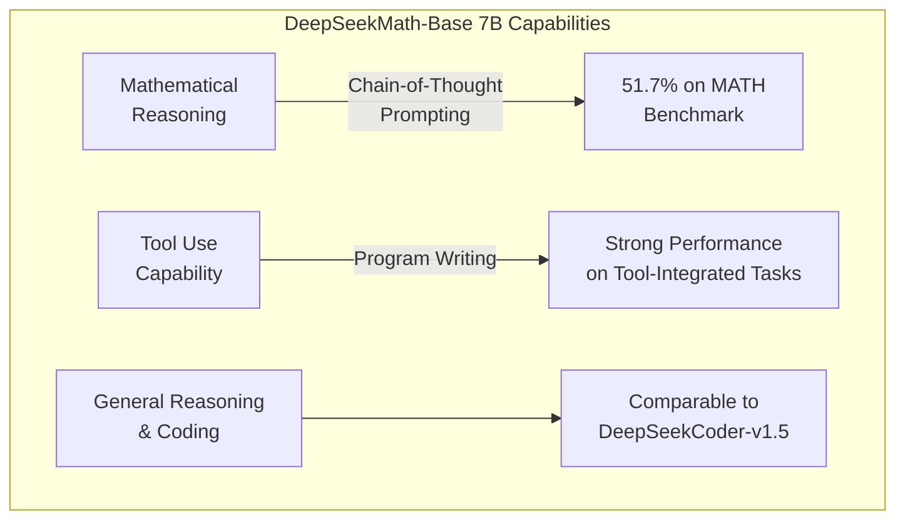

**Diagram: Key Capabilities of DeepSeekMath-Base 7B**

Sources: [README.md:64](), [README.md:72-96]()

## Usage Guide

### Text Completion

The DeepSeekMath-Base 7B model can be used for text completion tasks, including mathematical problem solving, using the Hugging Face Transformers library:

```python
import torch
from transformers import AutoTokenizer, AutoModelForCausalLM, GenerationConfig

model_name = "deepseek-ai/deepseek-math-7b-base"
tokenizer = AutoTokenizer.from_pretrained(model_name)
model = AutoModelForCausalLM.from_pretrained(model_name, torch_dtype=torch.bfloat16, device_map="auto")
model.generation_config = GenerationConfig.from_pretrained(model_name)
model.generation_config.pad_token_id = model.generation_config.eos_token_id

text = "The integral of x^2 from 0 to 2 is"
inputs = tokenizer(text, return_tensors="pt")
outputs = model.generate(**inputs.to(model.device), max_new_tokens=100)

result = tokenizer.decode(outputs[0], skip_special_tokens=True)
print(result)
```

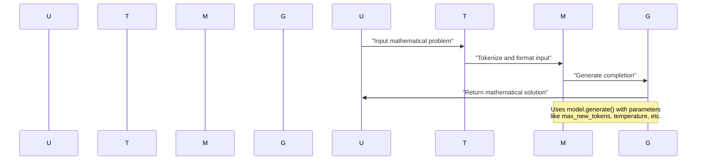

**Diagram: Inference Flow for DeepSeekMath-Base 7B**

Sources: [README.md:140-158](), [replicate/predict.py:36-82]()

### Model Deployment

The model can be deployed using the Cog framework, as demonstrated in the predict.py file in the repository. This allows for easy deployment of the model as an API service.

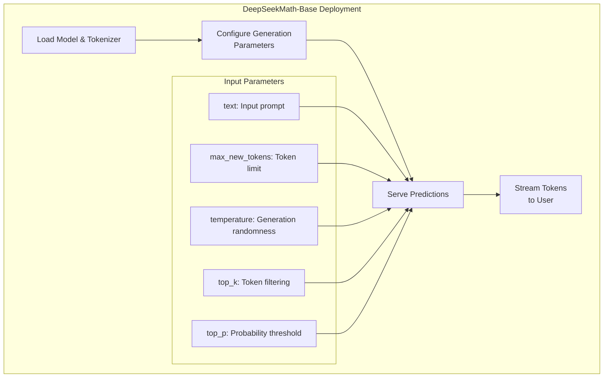

**Diagram: Cog Deployment Architecture for DeepSeekMath-Base 7B**

Sources: [replicate/predict.py:16-82]()

## Accessing the Model

The DeepSeekMath-Base 7B model is available for download from Hugging Face:

```
https://huggingface.co/deepseek-ai/deepseek-math-7b-base
```

The model supports commercial use under the license terms specified in the repository.

Sources: [README.md:127-134](), [README.md:201-204]()

## Model License

The DeepSeekMath-Base 7B model is available under a specific Model License that supports commercial use. For detailed licensing information, please refer to the [Model Licensing](#2.5) page.

Sources: [README.md:201-204]()

---

# Page: Instruct Model

# Instruct Model

<details>
<summary>Relevant source files</summary>

The following files were used as context for generating this wiki page:

- [README.md](README.md)
- [replicate/predict_instruct.py](replicate/predict_instruct.py)

</details>


This document provides detailed information about the DeepSeekMath-Instruct 7B model, which is the instruction-tuned variant in the DeepSeekMath family. For information about the Base model, see [Base Model](#2.2), and for information about the Reinforcement Learning model, see [RL Model](#2.4).

## 1. Introduction

DeepSeekMath-Instruct 7B is a specialized mathematical instruction-tuned model derived from DeepSeekMath-Base 7B. It serves as an intermediate step in the DeepSeekMath model development pipeline, positioned between the base pre-trained model and the reinforcement learning optimized model.


**Diagram: DeepSeekMath-Instruct 7B in the model development pipeline**

Sources: [README.md:98-100]()

## 2. Key Capabilities

DeepSeekMath-Instruct 7B is specifically designed to:

- Follow mathematical instructions with high fidelity
- Provide step-by-step reasoning for mathematical problems
- Understand both English and Chinese mathematical queries
- Output solutions with clearly demarcated final answers
- Effectively utilize chain-of-thought prompting patterns

The model demonstrates strong performance on quantitative reasoning benchmarks, particularly excelling at step-by-step reasoning through complex mathematical problems.

Sources: [README.md:98-106]()

## 3. Performance Evaluation

DeepSeekMath-Instruct 7B has been evaluated on multiple mathematical benchmarks, both with and without tool use, in English and Chinese.

| Benchmark | Without Tool Use | With Tool Use |
|-----------|-----------------|--------------|
| MATH      | 51.5%           | 54.2%        |
| GSM8K     | 84.0%           | 89.8%        |
| CMATH     | 51.6%           | 56.7%        |
| CGSM      | 78.7%           | 83.3%        |

*Note: The evaluations for DeepSeekMath-Instruct 7B show particularly strong performance in step-by-step reasoning tasks.*

Sources: [README.md:98-106]()

## 4. Usage Guide

### 4.1 Model Loading

To use DeepSeekMath-Instruct 7B, you can load it using the Hugging Face Transformers library:

```python
import torch
from transformers import AutoTokenizer, AutoModelForCausalLM, GenerationConfig

model_name = "deepseek-ai/deepseek-math-7b-instruct"
tokenizer = AutoTokenizer.from_pretrained(model_name)
model = AutoModelForCausalLM.from_pretrained(
    model_name, 
    torch_dtype=torch.bfloat16, 
    device_map="auto"
)
model.generation_config = GenerationConfig.from_pretrained(model_name)
model.generation_config.pad_token_id = model.generation_config.eos_token_id
```

Sources: [README.md:166-170](), [replicate/predict_instruct.py:21-34]()

### 4.2 Chat Completion

The model is best used with the chat template format:

```python
messages = [
    {"role": "user", "content": "what is the integral of x^2 from 0 to 2?\nPlease reason step by step, and put your final answer within \\boxed{}."}
]
input_tensor = tokenizer.apply_chat_template(messages, add_generation_prompt=True, return_tensors="pt")
outputs = model.generate(input_tensor.to(model.device), max_new_tokens=100)

result = tokenizer.decode(outputs[0][input_tensor.shape[1]:], skip_special_tokens=True)
print(result)
```

Sources: [README.md:172-179]()

### 4.3 Recommended Prompting Strategy

For optimal results with DeepSeekMath-Instruct 7B, chain-of-thought prompting is strongly recommended:

- For English questions: `{question}\nPlease reason step by step, and put your final answer within \boxed{}.`
- For Chinese questions: `{question}\n请通过逐步推理来解答问题，并把最终答案放置于\boxed{}中。`

These prompting patterns encourage the model to think through the problem step-by-step and clearly indicate the final answer.

Sources: [README.md:194-198]()

## 5. Technical Implementation

### 5.1 Inference Process

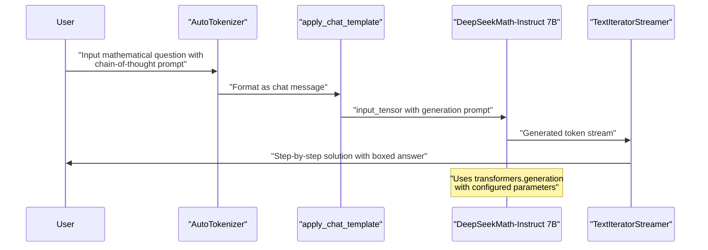

**Diagram: DeepSeekMath-Instruct 7B inference process**

Sources: [replicate/predict_instruct.py:36-86]()

### 5.2 Model Serving Architecture

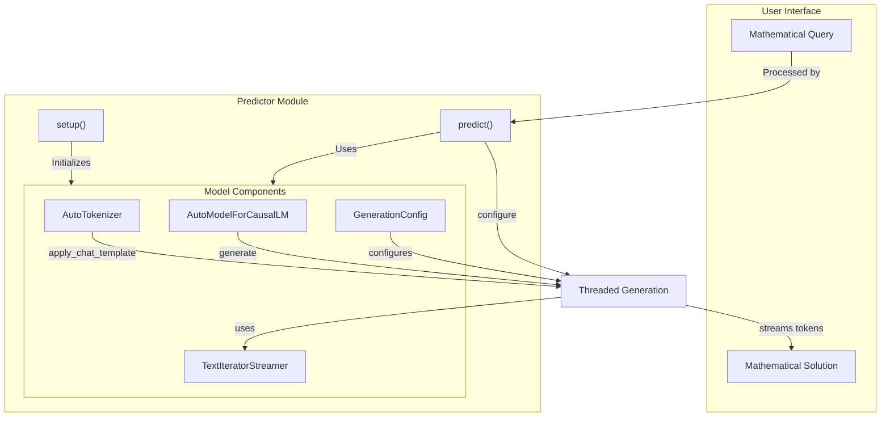

**Diagram: DeepSeekMath-Instruct model serving architecture**

Sources: [replicate/predict_instruct.py:1-87]()

### 5.3 Key Configuration Parameters

The DeepSeekMath-Instruct 7B model accepts several parameters that control the generation process:

| Parameter | Description | Default Value |
|-----------|-------------|---------------|
| max_new_tokens | Maximum number of tokens to generate | 100 |
| temperature | Controls randomness in generation | 1.0 |
| top_k | Number of highest probability tokens to keep | 50 |
| top_p | Nucleus sampling threshold | 0.9 |

These parameters can be adjusted to control the length, creativity, and determinism of the model's responses.

Sources: [replicate/predict_instruct.py:42-57]()

## 6. Licensing and Availability

DeepSeekMath-Instruct 7B is available on Hugging Face at `deepseek-ai/deepseek-math-7b-instruct`. The model supports commercial use under the terms outlined in the Model License.

Sources: [README.md:131-134](), [README.md:201-203]()

---

# Page: RL Model

# RL Model

<details>
<summary>Relevant source files</summary>

The following files were used as context for generating this wiki page:

- [README.md](README.md)

</details>


This document provides detailed information about the DeepSeekMath-RL 7B model, which represents the final iteration in the DeepSeekMath model family, trained using reinforcement learning techniques. For information about the base model, see [Base Model](#2.2), and for details on the instruct model, see [Instruct Model](#2.3).

## 1. Overview

DeepSeekMath-RL 7B is a specialized mathematical reasoning model built upon DeepSeekMath-Instruct 7B using reinforcement learning. It achieves state-of-the-art performance among open-source models on various mathematical benchmarks, approaching an accuracy of 60% on the MATH benchmark when combined with tool use capabilities.

The model is trained using a custom reinforcement learning algorithm called Group Relative Policy Optimization (GRPO), designed specifically to improve mathematical reasoning capabilities.

```mermaid
flowchart LR
    subgraph "Model Development Pipeline"
        DeepSeekCoder["DeepSeek-Coder-v1.5 7B\n(Foundation Model)"]
        BaseModel["DeepSeekMath-Base 7B\n(Pre-trained on 500B tokens)"]
        InstructModel["DeepSeekMath-Instruct 7B\n(Instruction Tuned)"]
        RLModel["DeepSeekMath-RL 7B\n(GRPO Algorithm)"]
        
        DeepSeekCoder --> BaseModel
        BaseModel --> InstructModel
        InstructModel --> RLModel
    end
```

Sources: [README.md:63-64], [README.md:99-102]

## 2. Technical Specifications

The DeepSeekMath-RL 7B model maintains the same architecture as its predecessors while being fine-tuned with reinforcement learning.

| Specification | Value |
|---------------|-------|
| Parameter Count | 7 billion |
| Model Type | Decoder-only transformer |
| Context Length | 4096 tokens |
| Training Method | Group Relative Policy Optimization (GRPO) |
| Base Model | DeepSeekMath-Instruct 7B |
| Hugging Face Repository | deepseek-ai/deepseek-math-7b-rl |

Sources: [README.md:134], [README.md:99-102]

## 3. GRPO Algorithm

The DeepSeekMath-RL 7B model is trained using the Group Relative Policy Optimization (GRPO) algorithm, which is specifically designed to improve mathematical reasoning capabilities through reinforcement learning.

```mermaid
flowchart TD
    subgraph "GRPO Training Process"
        InstructModel["DeepSeekMath-Instruct 7B\n(Initial Policy Model)"]
        MathProblems["Mathematical Problem Set"]
        TrainingLoop["GRPO Training Loop"]
        RLModel["DeepSeekMath-RL 7B\n(Optimized Policy Model)"]
        
        InstructModel --> TrainingLoop
        MathProblems --> TrainingLoop
        TrainingLoop --> RLModel
        
        subgraph "GRPO Algorithm"
            direction LR
            PolicyEval["Policy Evaluation"]
            GroupSampling["Group-based Sampling"]
            RelativeReward["Relative Reward Calculation"]
            PolicyUpdate["Policy Update"]
            
            PolicyEval --> GroupSampling
            GroupSampling --> RelativeReward
            RelativeReward --> PolicyUpdate
            PolicyUpdate --> PolicyEval
        end
        
        TrainingLoop --- GRPO
    end
```

While the exact implementation details of GRPO are not explicitly documented in the repository, the algorithm appears to be a variant of PPO (Proximal Policy Optimization) that uses relative comparisons within groups of responses to guide the policy optimization, rather than absolute reward values.

Sources: [README.md:100-102]

## 4. Performance and Evaluation

The DeepSeekMath-RL 7B model achieves exceptional performance on mathematical reasoning tasks, particularly when combined with tool use capabilities.

### Mathematical Benchmarks Performance

| Benchmark | DeepSeekMath-RL 7B | Notes |
|-----------|--------------|-------|
| MATH | ~60% (with tool use) | Competition-level mathematical problems |
| GSM8K | High performance | Grade school math problems |
| Chinese Math | Strong performance | Mathematical problems in Chinese |

The RL model demonstrably outperforms the previous Instruct model and approaches the performance of much larger closed-source models on mathematical reasoning benchmarks.

```mermaid
flowchart LR
    subgraph "Model Performance Progression"
        Base["DeepSeekMath-Base 7B"]
        Instruct["DeepSeekMath-Instruct 7B"]
        RL["DeepSeekMath-RL 7B"]
        
        Base --> |"Instruction\nTuning"| Instruct
        Instruct --> |"Reinforcement\nLearning (GRPO)"| RL
        
        subgraph "Performance Improvement"
            direction TB
            MathReasoning["Mathematical Reasoning"]
            ToolUse["Tool Integration"]
            StepByStep["Step-by-Step Reasoning"]
            
            MathReasoning
            ToolUse
            StepByStep
        end
        
        RL --- Performance
    end
```

Sources: [README.md:102-106]

## 5. Usage Guide

### Loading the Model

DeepSeekMath-RL 7B can be loaded using the Hugging Face Transformers library, similar to the Instruct model:

```python
import torch
from transformers import AutoTokenizer, AutoModelForCausalLM, GenerationConfig

model_name = "deepseek-ai/deepseek-math-7b-rl"
tokenizer = AutoTokenizer.from_pretrained(model_name)
model = AutoModelForCausalLM.from_pretrained(model_name, torch_dtype=torch.bfloat16, device_map="auto")
model.generation_config = GenerationConfig.from_pretrained(model_name)
model.generation_config.pad_token_id = model.generation_config.eos_token_id
```

### Chat Completion

The RL model is designed for chat-based interactions using the following format:

```python
messages = [
    {"role": "user", "content": "what is the integral of x^2 from 0 to 2?\nPlease reason step by step, and put your final answer within \\boxed{}."}
]
input_tensor = tokenizer.apply_chat_template(messages, add_generation_prompt=True, return_tensors="pt")
outputs = model.generate(input_tensor.to(model.device), max_new_tokens=100)

result = tokenizer.decode(outputs[0][input_tensor.shape[1]:], skip_special_tokens=True)
print(result)
```

Sources: [README.md:160-180]

## 6. Prompting Strategies

For optimal performance with the DeepSeekMath-RL model, chain-of-thought prompting is strongly recommended:

### For English Questions:
```
{question}
Please reason step by step, and put your final answer within \boxed{}.
```

### For Chinese Questions:
```
{question}
请通过逐步推理来解答问题，并把最终答案放置于\boxed{}中。
```

This prompting strategy guides the model to provide detailed reasoning steps before arriving at a final answer, leading to higher accuracy on mathematical tasks.

```mermaid
sequenceDiagram
    participant User
    participant RLModel as "DeepSeekMath-RL 7B"
    
    User->>RLModel: Mathematical problem + Chain-of-thought prompt
    Note over RLModel: Process the question
    RLModel->>RLModel: Generate step-by-step reasoning
    RLModel->>RLModel: Formulate final answer
    RLModel->>User: Complete solution with reasoning and boxed answer
```

Sources: [README.md:194-198]

## 7. Integration with Tool Use

The DeepSeekMath-RL 7B model demonstrates particularly strong performance when integrated with computational tools. This involves the model generating code (typically Python) to solve mathematical problems and then leveraging the results.

The tool-integrated approach follows this general pattern:
1. The model analyzes the mathematical problem
2. It generates appropriate Python code to solve aspects of the problem
3. The code is executed to obtain computational results
4. These results are incorporated into the final answer

This approach allows the model to handle complex calculations more reliably and achieve higher accuracy on mathematical benchmarks.

```mermaid
flowchart TD
    subgraph "Tool-Integrated Problem Solving"
        MathProblem["Mathematical Problem"]
        RLModel["DeepSeekMath-RL 7B"]
        CodeGen["Python Code Generation"]
        Execution["Code Execution"]
        ResultIntegration["Result Integration"]
        Solution["Final Solution"]
        
        MathProblem --> RLModel
        RLModel --> CodeGen
        CodeGen --> Execution
        Execution --> ResultIntegration
        RLModel --> ResultIntegration
        ResultIntegration --> Solution
    end
```

Sources: [README.md:102-106], [README.md:82-86]

## 8. License and Availability

The DeepSeekMath-RL 7B model is available under the DeepSeek Model License, which permits commercial use subject to the terms outlined in the license. The model can be downloaded from Hugging Face at [deepseek-ai/deepseek-math-7b-rl](https://huggingface.co/deepseek-ai/deepseek-math-7b-rl).

Sources: [README.md:134], [README.md:201-204]

---

# Page: Model Licensing

# Model Licensing

<details>
<summary>Relevant source files</summary>

The following files were used as context for generating this wiki page:

- [LICENSE-CODE](LICENSE-CODE)
- [LICENSE-MODEL](LICENSE-MODEL)

</details>


This page provides detailed information about the licensing terms that govern the use of DeepSeek-Math models and associated code. Understanding these licensing terms is essential for anyone who intends to use, modify, distribute, or build upon the DeepSeek-Math project.

## License Overview

DeepSeek-Math uses a dual-licensing approach, with separate licenses for the code and model weights:

1. **Code License**: The source code is licensed under the MIT License
2. **Model License**: The model weights are licensed under the DeepSeek License Agreement

```mermaid
flowchart TD
    subgraph "DeepSeek-Math Project"
        Code["Source Code\n(MIT License)"]
        Models["Model Weights\n(DeepSeek License)"]
        Output["Generated Output\n(Your Ownership*)"]
    end
    
    User["End User"] --> Code
    User --> Models
    Models --> Output
    
    note["*Subject to use restrictions"]
```

Sources: [LICENSE-CODE](), [LICENSE-MODEL]()

## Code License (MIT)

The source code of DeepSeek-Math is released under the MIT License, which is a permissive open-source license.

### Key Permissions

- **Use**: Free to use the code for any purpose
- **Modify**: Free to modify the code
- **Distribute**: Free to distribute original or modified versions
- **Commercial Use**: Free to use commercially
- **Sublicense**: Free to incorporate into other software and apply different licensing to your additions

### Obligations

- Include the original copyright notice and MIT License text in all copies or substantial portions of the software

### Limitations

- No warranty or liability: The software is provided "as is" without warranty of any kind

Sources: [LICENSE-CODE]()

## Model License (DeepSeek License Agreement)

The DeepSeek-Math models are governed by the DeepSeek License Agreement (Version 1.0, October 23, 2023), which grants certain rights while imposing specific use restrictions.

```mermaid
flowchart TD
    subgraph "DeepSeek License Components"
        Model["Model\n(Learned weights & parameters)"]
        Derivatives["Derivatives of the Model\n(Fine-tuned versions, distilled models)"]
        Complementary["Complementary Material\n(Scripts, documentation)"]
        ModelOutput["Model Output\n(Generated content)"]
    end
    
    User["User"] --> Uses
    subgraph "Uses"
        direction LR
        AllowedUses["Allowed Uses"] 
        RestrictedUses["Restricted Uses\n(See Attachment A)"]
    end
    
    Model --> Derivatives
    Derivatives --> FutureLicense["Future Distribution\n(Must include same use restrictions)"]
```

Sources: [LICENSE-MODEL]()

### Key Definitions

- **Model**: The machine learning-based assembly consisting of learned weights and parameters
- **Derivatives of the Model**: All modifications to the Model, including fine-tuned versions and distilled models
- **Complementary Material**: The accompanying source code, scripts, documentation, etc.
- **Output**: The results generated by operating the Model

### Permissions

- **Copyright License**: Perpetual, worldwide, non-exclusive, royalty-free rights to reproduce, display, sublicense, and distribute the Model and its derivatives
- **Patent License**: Non-exclusive, royalty-free rights to any patents necessarily infringed by DeepSeek's contribution
- **Output**: DeepSeek claims no rights to the output you generate using the Model (you are accountable for the output and its subsequent uses)

### Use Restrictions

The DeepSeek License prohibits using the Model or Derivatives of the Model for:

| Prohibited Use | Description |
|----------------|-------------|
| Legal Violations | Any way that violates applicable laws or regulations |
| Military Use | Any military applications |
| Harming Minors | Exploiting or harming minors |
| False Information | Generating false information to harm others |
| Inappropriate Content | Generating content prohibited by regulations |
| Personal Data Misuse | Generating personal identifiable information without authorization |
| Defamation | Defaming, disparaging, or harassing others |
| Automated Decision-Making | Fully automated decisions that adversely impact legal rights |
| Discrimination | Uses that discriminate against individuals or groups |
| Exploitation of Vulnerabilities | Exploiting vulnerabilities of specific groups |
| Protected Characteristics | Discrimination based on legally protected characteristics |

Sources: [LICENSE-MODEL:75-91]()

### Distribution Requirements

When distributing the Model or Derivatives of the Model, you must:

1. Include the use-based restrictions in any legal agreement governing the distribution
2. Provide recipients with a copy of the DeepSeek License
3. Mark any modified files with notices stating that you changed them
4. Retain all copyright, patent, trademark, and attribution notices

Sources: [LICENSE-MODEL:44-49]()

## Licensing Structure and Relations

```mermaid
graph TD
    subgraph "DeepSeek-Math Project"
        Code["Source Code"]
        Models["Model Weights"]
        ComplementaryMaterial["Scripts & Documentation"]
    end
    
    subgraph "License Types"
        MIT["MIT License"]
        DeepSeekLicense["DeepSeek License Agreement"]
    end
    
    subgraph "Derived Works"
        ModifiedCode["Modified Code"]
        FineTunedModels["Fine-tuned Models"]
        DistilledModels["Distilled Models"]
        GeneratedOutput["Generated Output"]
    end
    
    Code --> MIT
    Models --> DeepSeekLicense
    ComplementaryMaterial --> MIT
    
    Code --> ModifiedCode
    Models --> FineTunedModels
    Models --> DistilledModels
    Models --> GeneratedOutput
    
    ModifiedCode --> |"Requires MIT License notice"| UserDistribution["Distribution by User"]
    FineTunedModels --> |"Must include use restrictions"| UserDistribution
    DistilledModels --> |"Must include use restrictions"| UserDistribution
    GeneratedOutput --> |"User owns but subject to restrictions"| UserDistribution
```

Sources: [LICENSE-CODE](), [LICENSE-MODEL]()

## Important Considerations

### Personal Information and IP Rights

The Model may contain personal information and works with intellectual property rights. When using the Model, you must:

- Comply with applicable laws regarding personal information and IP rights
- Ensure you have a legitimate basis for processing such information
- Assume sole responsibility for any risks arising from handling such content

Sources: [LICENSE-MODEL:58-61]()

### Disclaimer and Liability

- The Model and Complementary Material are provided "AS IS" without warranties
- DeepSeek is not liable for damages arising from the use of the Model
- If you offer warranty or accept additional liability, you do so on your own behalf

Sources: [LICENSE-MODEL:62-67]()

### Governing Law

The DeepSeek License Agreement is governed by:

- PRC laws without regard to choice of law principles
- The courts located in the domicile of Hangzhou DeepSeek Artificial Intelligence Fundamental Technology Research Co., Ltd. have exclusive jurisdiction

Sources: [LICENSE-MODEL:71-71]()

## Practical Implications

Understanding the licensing terms has practical implications for how you can use DeepSeek-Math:

| Use Case | Code (MIT License) | Models (DeepSeek License) |
|----------|-------------------|---------------------------|
| Personal research | Permitted | Permitted with restrictions |
| Commercial applications | Permitted | Permitted with restrictions |
| Modification | Permitted | Permitted with restrictions |
| Distribution | Permitted with notice | Permitted with restrictions |
| Fine-tuning | Permitted | Permitted with restrictions |
| Model merging | Permitted | Permitted with restrictions |
| Redistribution of derivatives | Permitted with notice | Must include use restrictions |

Sources: [LICENSE-CODE](), [LICENSE-MODEL]()

## Summary

The DeepSeek-Math project uses a dual-licensing structure:

1. **MIT License** for code and complementary materials, offering broad permissions with minimal requirements
2. **DeepSeek License Agreement** for model weights, which grants usage rights but includes specific use restrictions

When using DeepSeek-Math, you must adhere to both licenses for their respective components, particularly being mindful of the use restrictions for the model and its derivatives.

Sources: [LICENSE-CODE](), [LICENSE-MODEL]()

---

# Page: Usage Guide

# Usage Guide

<details>
<summary>Relevant source files</summary>

The following files were used as context for generating this wiki page:

- [README.md](README.md)

</details>


This document provides comprehensive instructions for using the DeepSeek-Math models effectively. It covers basic model initialization, inference patterns, and recommended prompting strategies. For model architecture details, see [Models](#2), and for deployment information, see [Deployment](#4).

## Model Overview

DeepSeek-Math is available in three variants, each optimized for different use cases:

| Model | Description | Best Use Cases |
|-------|-------------|----------------|
| DeepSeek-Math Base 7B | Foundation model with strong math capabilities | Research, raw completion tasks |
| DeepSeek-Math Instruct 7B | Fine-tuned for instruction following | Interactive problem-solving, tutoring |
| DeepSeek-Math RL 7B | Further refined with reinforcement learning | Complex problem-solving requiring precision |

All models support a context length of 4096 tokens and are optimized for mathematical reasoning tasks.

```mermaid
flowchart LR
    subgraph "User Interaction Modes"
        TC["Text Completion Mode"]
        CC["Chat Completion Mode"]
    end

    subgraph "DeepSeekMath Models"
        Base["deepseek-math-7b-base"]
        Instruct["deepseek-math-7b-instruct"]
        RL["deepseek-math-7b-rl"]
    end

    TC --> Base
    CC --> Instruct
    CC --> RL

    classDef default stroke:#333,stroke-width:1px
```

Sources: [README.md:125-134]()

## Basic Usage

There are two primary ways to interact with DeepSeek-Math models: text completion and chat completion.

### Text Completion

The text completion mode is suitable for the base model when you want to continue a mathematical text or problem. The model will generate a continuation based on the provided input.

```python
import torch
from transformers import AutoTokenizer, AutoModelForCausalLM, GenerationConfig

model_name = "deepseek-ai/deepseek-math-7b-base"
tokenizer = AutoTokenizer.from_pretrained(model_name)
model = AutoModelForCausalLM.from_pretrained(model_name, torch_dtype=torch.bfloat16, device_map="auto")
model.generation_config = GenerationConfig.from_pretrained(model_name)
model.generation_config.pad_token_id = model.generation_config.eos_token_id

text = "The integral of x^2 from 0 to 2 is"
inputs = tokenizer(text, return_tensors="pt")
outputs = model.generate(**inputs.to(model.device), max_new_tokens=100)

result = tokenizer.decode(outputs[0], skip_special_tokens=True)
print(result)
```

Sources: [README.md:140-158]()

### Chat Completion

The chat completion mode is designed for the instruct and RL variants, allowing for interactive conversations about mathematical topics. This mode uses a specific format for structuring the conversation.

```python
import torch
from transformers import AutoTokenizer, AutoModelForCausalLM, GenerationConfig

model_name = "deepseek-ai/deepseek-math-7b-instruct"  # or "deepseek-ai/deepseek-math-7b-rl"
tokenizer = AutoTokenizer.from_pretrained(model_name)
model = AutoModelForCausalLM.from_pretrained(model_name, torch_dtype=torch.bfloat16, device_map="auto")
model.generation_config = GenerationConfig.from_pretrained(model_name)
model.generation_config.pad_token_id = model.generation_config.eos_token_id

messages = [
    {"role": "user", "content": "what is the integral of x^2 from 0 to 2?\nPlease reason step by step, and put your final answer within \\boxed{}."}
]
input_tensor = tokenizer.apply_chat_template(messages, add_generation_prompt=True, return_tensors="pt")
outputs = model.generate(input_tensor.to(model.device), max_new_tokens=100)

result = tokenizer.decode(outputs[0][input_tensor.shape[1]:], skip_special_tokens=True)
print(result)
```

Sources: [README.md:160-180]()

```mermaid
sequenceDiagram
    participant User
    participant Tokenizer as "AutoTokenizer"
    participant Model as "DeepSeekMath Model"
    
    User->>Tokenizer: Create message with problem
    Tokenizer->>Tokenizer: Apply chat template
    Tokenizer->>Model: Send tokenized input
    Model->>Model: Generate response
    Model->>User: Return processed answer
    
    Note over User,Model: For best results, include chain-of-thought prompting
```

Sources: [README.md:160-180](), [README.md:194-198]()

## Manual Chat Format

If you prefer not to use the `apply_chat_template` function, you can format your inputs manually using the following template:

```
User: {your_question}

---

# Page: Getting Started

# Getting Started

<details>
<summary>Relevant source files</summary>

The following files were used as context for generating this wiki page:

- [README.md](README.md)

</details>


This guide provides instructions for downloading and setting up the DeepSeek-Math models for mathematical reasoning tasks. It covers model installation, basic usage patterns, and initial configuration for both text completion and chat completion scenarios. For advanced prompting strategies, see [Prompting Strategies](#3.4), and for deployment options, see [Deployment](#4).

## Model Overview

DeepSeekMath comes in three variants, each with different capabilities and use cases:

```mermaid
flowchart TD
    subgraph "DeepSeekMath Models"
        BaseModel["DeepSeekMath-Base 7B"]
        InstructModel["DeepSeekMath-Instruct 7B"]
        RLModel["DeepSeekMath-RL 7B"]
    end

    BaseModel -->|"Instruction tuned"| InstructModel
    InstructModel -->|"GRPO algorithm"| RLModel

    subgraph "Primary Use Cases"
        TextComp["Text Completion"]
        ChatComp["Chat Completion"]
        ToolUse["Tool-Assisted Problem Solving"]
    end

    BaseModel --> TextComp
    InstructModel --> ChatComp
    RLModel --> ChatComp
    RLModel --> ToolUse

    subgraph "Context Size"
        CS["4096 tokens"]
    end

    BaseModel --> CS
    InstructModel --> CS
    RLModel --> CS
```

Sources: [README.md:125-134]()

## Installation Requirements

Before using the DeepSeekMath models, ensure you have the necessary dependencies installed:

```bash
pip install torch>=2.0.0
pip install transformers>=4.33.0
```

These requirements will provide the foundational libraries needed to load and run the models.

## Downloading the Models

The models are available for download from Hugging Face. You can download them programmatically using the Hugging Face Transformers library.

| Model | Sequence Length | Hugging Face Repository |
|-------|----------------|------------------------|
| DeepSeekMath-Base 7B | 4096 | deepseek-ai/deepseek-math-7b-base |
| DeepSeekMath-Instruct 7B | 4096 | deepseek-ai/deepseek-math-7b-instruct |
| DeepSeekMath-RL 7B | 4096 | deepseek-ai/deepseek-math-7b-rl |

Sources: [README.md:125-134]()

## Basic Usage

### Text Completion with Base Model

The Base model is suitable for text completion tasks where you want to continue a mathematical statement or problem:

```python
import torch
from transformers import AutoTokenizer, AutoModelForCausalLM, GenerationConfig

model_name = "deepseek-ai/deepseek-math-7b-base"
tokenizer = AutoTokenizer.from_pretrained(model_name)
model = AutoModelForCausalLM.from_pretrained(model_name, torch_dtype=torch.bfloat16, device_map="auto")
model.generation_config = GenerationConfig.from_pretrained(model_name)
model.generation_config.pad_token_id = model.generation_config.eos_token_id

text = "The integral of x^2 from 0 to 2 is"
inputs = tokenizer(text, return_tensors="pt")
outputs = model.generate(**inputs.to(model.device), max_new_tokens=100)

result = tokenizer.decode(outputs[0], skip_special_tokens=True)
print(result)
```

Sources: [README.md:142-158]()

### Chat Completion with Instruct/RL Models

The Instruct and RL models are designed for interactive chat-based completion tasks:

```python
import torch
from transformers import AutoTokenizer, AutoModelForCausalLM, GenerationConfig

model_name = "deepseek-ai/deepseek-math-7b-instruct"  # or "deepseek-ai/deepseek-math-7b-rl"
tokenizer = AutoTokenizer.from_pretrained(model_name)
model = AutoModelForCausalLM.from_pretrained(model_name, torch_dtype=torch.bfloat16, device_map="auto")
model.generation_config = GenerationConfig.from_pretrained(model_name)
model.generation_config.pad_token_id = model.generation_config.eos_token_id

messages = [
    {"role": "user", "content": "what is the integral of x^2 from 0 to 2?\nPlease reason step by step, and put your final answer within \\boxed{}."}
]
input_tensor = tokenizer.apply_chat_template(messages, add_generation_prompt=True, return_tensors="pt")
outputs = model.generate(input_tensor.to(model.device), max_new_tokens=100)

result = tokenizer.decode(outputs[0][input_tensor.shape[1]:], skip_special_tokens=True)
print(result)
```

Sources: [README.md:162-180]()

## Model Loading Process

The following diagram illustrates the model loading and inference process:

```mermaid
flowchart LR
    subgraph "Model Loading Process"
        ModelName["model_name"]
        LoadTokenizer["AutoTokenizer.from_pretrained()"]
        LoadModel["AutoModelForCausalLM.from_pretrained()"]
        ConfigGeneration["model.generation_config"]
    end

    ModelName --> LoadTokenizer
    ModelName --> LoadModel
    ModelName --> ConfigGeneration
    
    subgraph "Inference Flow"
        Input["Input text/messages"]
        Tokenize["tokenizer()"]
        ApplyTemplate["apply_chat_template()"]
        Generate["model.generate()"]
        Decode["tokenizer.decode()"]
        Output["Final output"]
    end
    
    Input --> Tokenize
    Input --> ApplyTemplate
    Tokenize --> Generate
    ApplyTemplate --> Generate
    Generate --> Decode
    Decode --> Output
    
    LoadTokenizer --> Tokenize
    LoadTokenizer --> ApplyTemplate
    LoadModel --> Generate
    ConfigGeneration --> Generate
```

Sources: [README.md:142-180]()

## Prompting Recommendations

For optimal results, especially with DeepSeekMath-Instruct and DeepSeekMath-RL models, it's recommended to use chain-of-thought prompting:

### For English questions:
```
{question}
Please reason step by step, and put your final answer within \boxed{}.
```

### For Chinese questions:
```
{question}
请通过逐步推理来解答问题，并把最终答案放置于\boxed{}中。
```

Using this prompting format encourages the model to show its reasoning process, which significantly improves the accuracy of mathematical problem-solving.

Sources: [README.md:194-198]()

## Manual Chat Template Format

If you prefer not to use the `apply_chat_template` function, you can format your input following this template:

```
User: {messages[0]['content']}

---

# Page: Text Completion

# Text Completion

<details>
<summary>Relevant source files</summary>

The following files were used as context for generating this wiki page:

- [README.md](README.md)
- [replicate/predict.py](replicate/predict.py)

</details>


This document describes how to use the DeepSeek-Math models for text completion tasks. Text completion refers to the process of generating a continuation of an input text prompt, which is particularly useful for solving mathematical problems. For information about using the models in a conversational format, see [Chat Completion](#3.3).

## Overview of Text Completion

Text completion is the fundamental capability of the DeepSeek-Math models to generate coherent and relevant continuations from a given input prompt. In mathematical contexts, this means providing solutions, proofs, or explanations for mathematical problems presented in the input text.

```mermaid
flowchart LR
    subgraph "Text Completion Process"
        A["Input Text"] --> B["Tokenization"]
        B --> C["Model Inference"]
        C --> D["Token Generation"]
        D --> E["Text Decoding"]
        E --> F["Completed Output"]
    end
```

Sources: [README.md:140-157]()

## Implementation Architecture

The text completion functionality in DeepSeek-Math is built on Hugging Face's Transformers library. The process involves preparing the input, generating tokens, and decoding the output.

```mermaid
flowchart TD
    subgraph "Text Completion Architecture"
        Input["Input Text"] --> Tokenizer["AutoTokenizer"]
        Tokenizer --> TokenizedInput["Tokenized Input\n(tensor format)"]
        
        TokenizedInput --> Model["AutoModelForCausalLM\n(DeepSeekMath model)"]
        
        subgraph "Generation Configuration"
            GenConfig["GenerationConfig"]
            Params["Parameters\n- max_new_tokens\n- temperature\n- top_k\n- top_p"]
        end
        
        GenConfig --> Model
        Params --> Model
        
        Model --> GeneratedTokens["Generated Tokens"]
        GeneratedTokens --> TokenDecoder["Tokenizer.decode()"]
        TokenDecoder --> Output["Completed Text"]
    end
```

Sources: [README.md:140-157](), [replicate/predict.py:17-82]()

## Basic Usage

Here's a basic example of how to use the DeepSeek-Math model for text completion:

```python
import torch
from transformers import AutoTokenizer, AutoModelForCausalLM, GenerationConfig

model_name = "deepseek-ai/deepseek-math-7b-base"
tokenizer = AutoTokenizer.from_pretrained(model_name)
model = AutoModelForCausalLM.from_pretrained(model_name, torch_dtype=torch.bfloat16, device_map="auto")
model.generation_config = GenerationConfig.from_pretrained(model_name)
model.generation_config.pad_token_id = model.generation_config.eos_token_id

text = "The integral of x^2 from 0 to 2 is"
inputs = tokenizer(text, return_tensors="pt")
outputs = model.generate(**inputs.to(model.device), max_new_tokens=100)

result = tokenizer.decode(outputs[0], skip_special_tokens=True)
print(result)
```

This example demonstrates:
1. Loading the tokenizer and model from Hugging Face
2. Setting up the generation configuration
3. Tokenizing the input text
4. Generating a completion with the model
5. Decoding the generated tokens back to text

Sources: [README.md:140-157]()

## Generation Parameters

When performing text completion, several parameters can be adjusted to control the generation process:

| Parameter | Description | Default Value |
|-----------|-------------|---------------|
| `max_new_tokens` | The maximum number of tokens to generate | 100 |
| `temperature` | Controls randomness in generation (higher = more random) | 1.0 |
| `top_k` | Limits token selection to top k most probable tokens | 50 |
| `top_p` | Nucleus sampling threshold (cumulative probability) | 0.9 |

These parameters allow you to balance between deterministic, accurate responses and more creative, diverse outputs:

- Lower `temperature` values (e.g., 0.3-0.7) produce more deterministic, focused outputs
- Higher `temperature` values (e.g., 0.8-1.2) produce more varied, creative outputs
- Setting `top_k` and `top_p` helps filter out low-probability tokens

Sources: [replicate/predict.py:42-57]()

## Streaming Text Completion

For applications that benefit from displaying results as they are generated, DeepSeek-Math supports streaming text completion. This is implemented in the Cog predictor:

```mermaid
sequenceDiagram
    participant Client
    participant Predictor as "Predictor Class"
    participant Tokenizer
    participant Model
    participant Streamer as "TextIteratorStreamer"
    
    Client->>Predictor: Call predict(text, parameters)
    Predictor->>Tokenizer: tokenize(text)
    Tokenizer-->>Predictor: tokenized input
    
    Predictor->>Streamer: initialize streamer
    Predictor->>Model: generate tokens in thread
    
    loop For each generated token
        Model->>Streamer: send token
        Streamer->>Predictor: yield token
        Predictor->>Client: stream token
    end
    
    Predictor->>Client: complete streaming
```

The implementation uses a thread to run the model generation while yielding generated tokens via a `TextIteratorStreamer`:

```python
def predict(self, text, max_new_tokens, temperature, top_k, top_p):
    inputs = self.tokenizer(text, return_tensors="pt")
    streamer = TextIteratorStreamer(
        self.tokenizer, skip_prompt=True, skip_special_tokens=True
    )
    
    thread = Thread(
        target=self.model.generate,
        kwargs=dict(
            **inputs.to(self.model.device),
            do_sample=True,
            temperature=temperature,
            top_p=top_p,
            top_k=top_k,
            max_new_tokens=max_new_tokens,
            streamer=streamer,
            use_cache=True
        ),
    )
    thread.start()
    
    for new_token in streamer:
        yield new_token
        
    thread.join()
```

Sources: [replicate/predict.py:36-82]()

## Model Selection for Text Completion

DeepSeek-Math offers three model variants with different characteristics for text completion:

| Model Variant | Best Use Case | Notes |
|---------------|--------------|-------|
| DeepSeekMath-Base | General mathematical text completion | Default model for most use cases |
| DeepSeekMath-Instruct | Step-by-step reasoning | Better with chain-of-thought prompting |
| DeepSeekMath-RL | Complex mathematical problems | Best with tool use and step-by-step prompting |

For text completion of mathematical problems, the Base model provides a good starting point, while the Instruct and RL models benefit from explicit prompting for step-by-step reasoning.

Sources: [README.md:124-135](), [README.md:194-198]()

## Best Practices for Mathematical Text Completion

When using the DeepSeek-Math models for mathematical text completion, consider these best practices:

1. **Be Specific in Prompts**: Provide clear, well-formulated mathematical questions
2. **Request Step-by-Step Reasoning**: For complex problems, explicitly ask the model to show its work
3. **Use Standard Mathematical Notation**: The model works best with standard mathematical notation
4. **Structure Output Format**: For extractable answers, specify a consistent format (e.g., `\boxed{}`)

For the Instruct and RL models, it's recommended to include explicit prompting for chain-of-thought reasoning:

- For English questions: `{question}\nPlease reason step by step, and put your final answer within \boxed{}.`
- For Chinese questions: `{question}\n请通过逐步推理来解答问题，并把最终答案放置于\boxed{}中。`

Sources: [README.md:194-198]()

## Example Usage

Here's an example of using text completion for a mathematical problem:

Input:
```
The integral of x^2 from 0 to 2 is
```

Typical output (from Base model):
```
The integral of x^2 from 0 to 2 is

To compute this integral, I'll use the power rule for integration: ∫x^n dx = (x^(n+1))/(n+1) + C

For x^2, we have n = 2:
∫x^2 dx = (x^3)/3 + C

Now, I need to evaluate this from x = 0 to x = 2.
∫_0^2 x^2 dx = [(x^3)/3]_0^2
                = [(2^3)/3] - [(0^3)/3]
                = [8/3] - [0]
                = 8/3

Therefore, the integral of x^2 from 0 to 2 is 8/3.
```

Sources: [README.md:140-157]()

---

# Page: Chat Completion

# Chat Completion

<details>
<summary>Relevant source files</summary>

The following files were used as context for generating this wiki page:

- [README.md](README.md)
- [replicate/predict_instruct.py](replicate/predict_instruct.py)

</details>


This page documents how to use DeepSeekMath models for chat completion tasks, specifically focusing on the conversational interface provided by the instruct and RL variants of DeepSeekMath. For information about basic text completion without the conversational format, see [Text Completion](#3.2).

## Model Options for Chat

DeepSeekMath offers two model variants specifically tuned for chat completion:

| Model | Description | Best For |
|-------|-------------|----------|
| DeepSeekMath-Instruct 7B | Fine-tuned from base model with instruction tuning | General mathematical discussion and step-by-step reasoning |
| DeepSeekMath-RL 7B | Further trained using Group Relative Policy Optimization (GRPO) | Advanced mathematical reasoning, competition-level problems |

Sources: [README.md:98-106]()

## Chat Message Format

DeepSeekMath uses a specific format for chat interactions. Understanding this format is important for proper model usage.

```mermaid
graph TD
    subgraph "Chat Template Structure"
        A["User Message"] -->|Formatted with| B["Chat Template"]
        B -->|Input for| C["Model Generation"]
        C -->|Returns| D["Assistant Response"]
    end
```

The chat template follows this structure:

```
User: {messages[0]['content']}

---

# Page: Prompting Strategies

# Prompting Strategies

<details>
<summary>Relevant source files</summary>

The following files were used as context for generating this wiki page:

- [README.md](README.md)

</details>


This document outlines best practices and effective prompting strategies for the DeepSeekMath model family. It provides guidance on how to construct prompts that yield optimal performance from the models when solving mathematical problems. For information on setting up the models, see [Getting Started](#3.1), and for specific implementation details about text and chat completion, see [Text Completion](#3.2) and [Chat Completion](#3.3).

## Overview of DeepSeekMath Prompting

DeepSeekMath models demonstrate different capabilities and optimal performance depending on the prompting technique used. This section outlines the key strategies that have been found to work well with these models.

```mermaid
flowchart TB
    User["User Input"] --> |"Formulates"| Query["Mathematical Query"]
    Query --> ModelSelection["Model Selection"]
    ModelSelection --> |"Base Model"| BasePrompt["Direct Prompt"]
    ModelSelection --> |"Instruct/RL Models"| CoTPrompt["Chain-of-Thought Prompt"]
    BasePrompt --> |"Simple completion"| Output1["Mathematical Answer"]
    CoTPrompt --> |"Reasoning steps"| Output2["Step-by-step Solution + Boxed Answer"]
    
    class User,Query,ModelSelection,BasePrompt,CoTPrompt,Output1,Output2 emphasis
```

Sources: [README.md:140-198]()

## Model-Specific Prompting Approaches

Each model in the DeepSeekMath family has different prompting requirements for optimal performance.

### Base Model Prompting

The DeepSeekMath-Base 7B model works well with direct text completion prompts. For this model, you can simply input the mathematical problem or query without specific formatting.

**Example Base Model Prompt:**
```
The integral of x^2 from 0 to 2 is
```

For the base model, simple text completion without special templates is sufficient for many mathematical tasks.

Sources: [README.md:140-158]()

### Instruct and RL Model Prompting

DeepSeekMath-Instruct 7B and DeepSeekMath-RL 7B models perform best with chain-of-thought prompting that explicitly requests step-by-step reasoning and a boxed final answer.

**Recommended Prompt Formats:**

For English questions:
```
{question}
Please reason step by step, and put your final answer within \boxed{}.
```

For Chinese questions:
```
{question}
请通过逐步推理来解答问题，并把最终答案放置于\boxed{}中。
```

This prompting approach significantly improves the models' performance on complex mathematical reasoning tasks.

Sources: [README.md:194-198]()

## Chain-of-Thought (CoT) Prompting

Chain-of-Thought prompting is a particularly effective technique for the DeepSeekMath models, especially for the Instruct and RL variants. This section details how to implement CoT prompting effectively.

```mermaid
sequenceDiagram
    participant User
    participant Model as "DeepSeekMath Model"
    
    User->>Model: Query with CoT instructions
    Note over User,Model: {question}<br>Please reason step by step, and put your final answer within \boxed{}.
    
    Model->>Model: Generate reasoning steps
    Model->>User: Step 1: [Initial approach]
    Model->>User: Step 2: [Manipulation/calculation]
    Model->>User: Step 3: [Further derivation]
    Model->>User: Step n: [Final calculation]
    Model->>User: Therefore, \boxed{final answer}
```

Sources: [README.md:194-198]()

### Benefits of CoT Prompting

Chain-of-Thought prompting provides several advantages when working with DeepSeekMath models:

1. **Improved Accuracy**: By encouraging the model to work through problems step by step, CoT prompting reduces calculation errors and improves overall accuracy.
2. **Better Problem Decomposition**: CoT helps the model break down complex problems into manageable steps.
3. **Transparent Reasoning**: The step-by-step approach provides visibility into the model's reasoning process, making it easier to identify where errors might occur.
4. **Enhanced Performance on Complex Problems**: For difficult mathematical challenges, CoT prompting has shown to substantially boost performance.

According to the evaluation results shared in the README, DeepSeekMath models with CoT prompting achieve impressive performance on challenging mathematical benchmarks, with the RL model approaching 60% accuracy on the MATH dataset when using tools.

Sources: [README.md:94-106]()

## Boxed Answer Format

An important aspect of prompting DeepSeekMath models is requesting the final answer in a boxed format using LaTeX notation `\boxed{}`. This serves several purposes:

1. It clearly delineates the final answer from the reasoning steps
2. It helps with answer extraction for evaluation
3. It encourages the model to provide a concise, definitive answer

```mermaid
flowchart LR
    subgraph "Prompt Structure"
        Question["Mathematical Question"] --> Instruction["Reasoning Instruction"]
        Instruction --> BoxRequest["Request for Boxed Answer"]
    end
    
    subgraph "Model Response"
        Steps["Step-by-step Reasoning"] --> FinalCalc["Final Calculation"]
        FinalCalc --> BoxedAnswer["\\boxed{Final Answer}"]
    end
    
    Prompt --> ModelResponse
```

Sources: [README.md:194-198]()

## Chat Completion vs. Text Completion

DeepSeekMath models support both text completion and chat completion interfaces, each with different prompting requirements.

### Text Completion Interface

For simple text completion with the base model, you can directly provide the mathematical problem without additional formatting:

```
The integral of x^2 from 0 to 2 is
```

This approach works well for straightforward mathematical queries with the base model.

Sources: [README.md:140-158]()

### Chat Completion Interface

For chat completion, particularly with the Instruct and RL models, use the following template structure:

```
User: {question}
Please reason step by step, and put your final answer within \boxed{}.

---

# Page: Deployment

# Deployment

<details>
<summary>Relevant source files</summary>

The following files were used as context for generating this wiki page:

- [cog.yaml](cog.yaml)
- [replicate/predict.py](replicate/predict.py)

</details>


This page provides an overview of the deployment options available for DeepSeek-Math models. It describes the deployment architecture and how to serve the models for inference. For specific deployment implementations, see [Cog Deployment](#4.1) and [Model Serving](#4.2).

## Deployment Architecture

DeepSeek-Math provides a streamlined deployment setup using the Cog framework, which enables easy containerization and deployment of machine learning models. The deployment system is designed to load the DeepSeek-Math models and serve them efficiently for inference requests with support for streaming responses.

```mermaid
flowchart TD
    subgraph "Deployment Configuration"
        cog["cog.yaml"]
    end

    subgraph "Model Predictors"
        predictor["Predictor Class\n(replicate/predict.py)"]
    end

    subgraph "Model Loading"
        tokenizer["AutoTokenizer"]
        model["AutoModelForCausalLM"]
        config["GenerationConfig"]
    end

    subgraph "Inference Pipeline"
        input["Input Text"]
        tokenization["Tokenization"]
        generation["Text Generation"]
        streaming["Streaming Response"]
    end

    cog --> predictor
    predictor --> |"setup()"| model
    predictor --> |"setup()"| tokenizer
    predictor --> |"setup()"| config
    predictor --> |"predict()"| input
    input --> tokenization
    tokenization --> generation
    generation --> streaming
```

Sources: [cog.yaml](), [replicate/predict.py]()

## Cog Configuration

The deployment environment is defined in the Cog configuration file, which specifies the required Python packages, GPU requirements, and the prediction interface.

```mermaid
classDiagram
    class CogConfig {
        gpu: true
        python_version: "3.11"
        python_packages: list
        predict: path to Predictor
    }

    class PythonPackages {
        torch==2.0.1
        transformers==4.37.2
        accelerate==0.27.0
        hf_transfer
        ...
    }

    CogConfig --> PythonPackages: includes
```

The configuration includes:
- Python 3.11 runtime
- GPU support
- Essential ML libraries (torch, transformers, accelerate)
- HF transfer for faster model downloads

Sources: [cog.yaml:4-15]()

## Predictor Implementation

The core of the deployment system is the `Predictor` class, which handles model loading and inference:

```mermaid
classDiagram
    class BasePredictor {
        setup()
        predict()
    }
    
    class Predictor {
        tokenizer
        model
        setup()
        predict(text, max_new_tokens, temperature, top_k, top_p)
    }
    
    BasePredictor <|-- Predictor
```

The `Predictor` class:
1. Inherits from Cog's `BasePredictor`
2. Loads the model during setup
3. Processes input text and streams generated responses

Sources: [replicate/predict.py:17-82]()

## Model Loading Process

During setup, the predictor loads the DeepSeekMath model and tokenizer:

```mermaid
sequenceDiagram
    participant Predictor
    participant HuggingFace as "Hugging Face Hub"
    participant Cache as "Cache Directory"
    
    Predictor->>Predictor: "setup()"
    Note over Predictor: Configure HF_HUB_ENABLE_HF_TRANSFER
    Predictor->>HuggingFace: Load tokenizer
    HuggingFace-->>Cache: Store tokenizer
    HuggingFace-->>Predictor: Return tokenizer
    Predictor->>HuggingFace: Load model with bfloat16
    HuggingFace-->>Cache: Store model
    HuggingFace-->>Predictor: Return model
    Predictor->>HuggingFace: Load generation config
    HuggingFace-->>Cache: Store config
    HuggingFace-->>Predictor: Return config
    Predictor->>Predictor: Configure pad_token_id
```

The model loading process includes:
- Setting up a faster download mechanism using `HF_HUB_ENABLE_HF_TRANSFER`
- Loading the tokenizer, model, and generation configuration
- Configuring the model with bfloat16 precision for optimal performance
- Setting up device mapping for optimal GPU utilization

Sources: [replicate/predict.py:17-34]()

## Inference Process

The inference process in the predictor handles text generation and streaming:

```mermaid
flowchart LR
    input["Input Text"]
    tokenize["Tokenize Input"]
    streamer["Initialize TextIteratorStreamer"]
    thread["Create Thread for Generation"]
    generate["Generate Text"]
    stream["Stream Tokens"]
    
    input --> tokenize
    tokenize --> streamer
    streamer --> thread
    thread --> generate
    generate --> stream
```

Key aspects of the inference process:
1. Input text is tokenized
2. A `TextIteratorStreamer` is initialized for streaming responses
3. Text generation runs in a separate thread to avoid blocking
4. The generated tokens are streamed back to the client

Sources: [replicate/predict.py:36-82]()

## Generation Parameters

The deployment system supports the following parameters for controlling text generation:

| Parameter | Description | Default |
|-----------|-------------|---------|
| `text` | Input text prompt | "The integral of x^2 from 0 to 2 is" |
| `max_new_tokens` | Maximum number of tokens to generate | 100 |
| `temperature` | Controls randomness in generation | 1.0 |
| `top_k` | Number of highest probability tokens to consider | 50 |
| `top_p` | Cumulative probability threshold for token selection | 0.9 |

These parameters allow users to control the trade-off between deterministic and creative responses from the model.

Sources: [replicate/predict.py:36-57]()

## Streaming Implementation

The streaming implementation uses a threaded approach to generate text while simultaneously returning tokens:

```mermaid
sequenceDiagram
    participant Client
    participant Predictor
    participant Thread
    participant Model
    participant Streamer
    
    Client->>Predictor: predict(text, params)
    Predictor->>Streamer: Initialize TextIteratorStreamer
    Predictor->>Thread: Start generation thread
    activate Thread
    Thread->>Model: model.generate(params)
    Model-->>Streamer: Send tokens
    loop For each token
        Streamer-->>Predictor: Yield token
        Predictor-->>Client: Stream token
    end
    deactivate Thread
    Predictor->>Thread: Join thread
```

The streaming process:
1. Creates a `TextIteratorStreamer` from the tokenizer
2. Starts a separate thread to run model generation
3. Yields new tokens as they become available
4. Joins the thread when generation completes

Sources: [replicate/predict.py:60-82]()

## Deployment Workflow

The complete workflow from configuration to deployment involves:

```mermaid
flowchart TB
    config["Configure cog.yaml"]
    build["Build Container\n(cog build)"]
    push["Push to Registry\n(cog push)"]
    serve["Serve Model\n(cog predict)"]
    
    config --> build
    build --> push
    build --> serve
```

This workflow enables:
1. Consistent and reproducible deployments
2. Containerized environments that include all dependencies
3. Easy deployment to cloud platforms or local servers

Sources: [cog.yaml]()

## Deployment Options

The DeepSeek-Math models can be deployed in several ways:

1. **Local Deployment**:
   - Use the Cog CLI to run the model locally
   - Suitable for development and testing

2. **Cloud Deployment**:
   - Deploy to platforms like Replicate, Hugging Face, or custom cloud infrastructure
   - Provides scalability and accessibility

3. **Custom Integration**:
   - Extract the prediction logic for integration into existing applications
   - Modify the streaming implementation for specific use cases

For detailed instructions on specific deployment methods, see [Cog Deployment](#4.1) and [Model Serving](#4.2).

Sources: [cog.yaml](), [replicate/predict.py]()

---

# Page: Cog Deployment

# Cog Deployment

<details>
<summary>Relevant source files</summary>

The following files were used as context for generating this wiki page:

- [cog.yaml](cog.yaml)
- [replicate/predict.py](replicate/predict.py)
- [replicate/predict_instruct.py](replicate/predict_instruct.py)

</details>


This document describes how to deploy DeepSeek-Math models using Cog, a containerization tool that packages machine learning models for production deployment. For information about other deployment options and model serving details, see [Model Serving](#4.2).

## Overview of Cog Deployment

Cog provides a standardized way to package the DeepSeek-Math models for deployment, handling environment setup, dependencies, and inference API creation. The deployment process is configured through a single YAML file and implemented via Python predictor classes.

```mermaid
flowchart TD
    subgraph "Cog Configuration"
        CogYaml["cog.yaml"]
    end
    
    subgraph "Model Predictors"
        PredictBase["predict.py\n(Base Model)"]
        PredictInstruct["predict_instruct.py\n(Instruct Model)"]
    end
    
    subgraph "Model Loading"
        ModelLoader["AutoModelForCausalLM.from_pretrained()"]
        Tokenizer["AutoTokenizer.from_pretrained()"]
    end
    
    subgraph "Inference Process"
        InputProcess["Input Processing"]
        Generation["Text Generation"]
        Streaming["Token Streaming"]
    end
    
    CogYaml --> PredictBase
    CogYaml --> PredictInstruct
    PredictBase --> ModelLoader
    PredictInstruct --> ModelLoader
    PredictBase --> Tokenizer
    PredictInstruct --> Tokenizer
    ModelLoader --> InputProcess
    Tokenizer --> InputProcess
    InputProcess --> Generation
    Generation --> Streaming
```

Sources: [cog.yaml:1-16](), [replicate/predict.py:1-83](), [replicate/predict_instruct.py:1-87]()

## Cog Configuration

The deployment is configured through `cog.yaml`, which specifies the runtime environment, dependencies, and entry point for predictions.

### Environment Configuration

```yaml
build:
  gpu: true
  python_version: "3.11"
  python_packages:
    - torch==2.0.1
    - torchvision==0.15.2
    - transformers==4.37.2
    - accelerate==0.27.0
    - hf_transfer
```

Key components of the configuration:
- GPU support is enabled
- Python 3.11 is used as the runtime
- Specific versions of PyTorch, transformers, and accelerate libraries
- hf_transfer for optimized model downloading

### Prediction Interface

The configuration specifies `replicate/predict.py:Predictor` as the prediction entry point:

```yaml
predict: "replicate/predict.py:Predictor"
```

Sources: [cog.yaml:1-16]()

## Model Predictors

DeepSeek-Math provides two predictor implementations for the base and instruction-tuned models.

### Base Model Predictor

The base model predictor (`predict.py`) implements inference for the DeepSeek-Math-Base 7B model:

```mermaid
classDiagram
    class Predictor {
        +setup()
        +predict(text, max_new_tokens, temperature, top_k, top_p)
    }
    
    class BasePredictor {
        +setup()
        +predict()
    }
    
    BasePredictor <|-- Predictor
```

Key features:
- Loads the `deepseek-ai/deepseek-math-7b-base` model using HuggingFace Transformers
- Uses bfloat16 precision for efficient inference
- Supports automatic device mapping for multi-GPU environments
- Implements streaming text generation for responsive interfaces
- Accepts parameters for controlling generation (temperature, top_k, top_p)

Sources: [replicate/predict.py:1-83]()

### Instruct Model Predictor

The instruct model predictor (`predict_instruct.py`) implements inference for the DeepSeek-Math-Instruct 7B model:

```mermaid
classDiagram
    class Predictor {
        +setup()
        +predict(text, max_new_tokens, temperature, top_k, top_p)
    }
    
    class BasePredictor {
        +setup()
        +predict()
    }
    
    BasePredictor <|-- Predictor
```

Key differences from the base predictor:
- Loads the `deepseek-ai/deepseek-math-7b-instruct` model
- Uses chat templating for prompt formatting
- Default example input includes step-by-step reasoning instruction

Sources: [replicate/predict_instruct.py:1-87]()

## Prediction Process Flow

The following diagram illustrates the sequence of operations that occur during a prediction request:

```mermaid
sequenceDiagram
    participant Client
    participant Predictor as "Predictor Class"
    participant Tokenizer as "Tokenizer"
    participant Model as "DeepSeekMath Model"
    participant Streamer as "TextIteratorStreamer"
    
    Note over Client,Streamer: Base Model Flow
    Client->>Predictor: predict(text, params)
    Predictor->>Tokenizer: tokenize(text)
    Tokenizer->>Predictor: input_tensors
    Predictor->>Streamer: create TextIteratorStreamer
    Predictor->>Model: generate(input_tensors, streamer, params)
    loop For each generated token
        Model->>Streamer: push new token
        Streamer->>Predictor: yield token
        Predictor->>Client: stream token
    end
    
    Note over Client,Streamer: Instruct Model Flow
    Client->>Predictor: predict(text, params)
    Predictor->>Predictor: create messages list
    Predictor->>Tokenizer: apply_chat_template(messages)
    Tokenizer->>Predictor: input_tensors
    Predictor->>Streamer: create TextIteratorStreamer
    Predictor->>Model: generate(input_tensors, streamer, params)
    loop For each generated token
        Model->>Streamer: push new token
        Streamer->>Predictor: yield token
        Predictor->>Client: stream token
    end
```

Sources: [replicate/predict.py:36-82](), [replicate/predict_instruct.py:36-86]()

## Model Loading and Caching

Both predictors implement efficient model loading with caching to improve performance:

```mermaid
flowchart TD
    subgraph "Caching System"
        HFTransfer["HF_HUB_ENABLE_HF_TRANSFER = 1"]
        CacheDir["CACHE_DIR = 'model_cache'"]
    end
    
    subgraph "Model Loading"
        LoadTokenizer["AutoTokenizer.from_pretrained()"]
        LoadModel["AutoModelForCausalLM.from_pretrained()"]
        LoadConfig["GenerationConfig.from_pretrained()"]
    end
    
    subgraph "Model Configuration"
        DeviceMap["device_map = 'auto'"]
        Precision["torch_dtype = torch.bfloat16"]
        PadToken["pad_token_id = eos_token_id"]
    end
    
    HFTransfer --> LoadTokenizer
    HFTransfer --> LoadModel
    CacheDir --> LoadTokenizer
    CacheDir --> LoadModel
    CacheDir --> LoadConfig
    LoadModel --> DeviceMap
    LoadModel --> Precision
    LoadConfig --> PadToken
```

Key features:
- Uses HF_Transfer for faster model downloading
- Implements a local cache directory to avoid repeatedly downloading models
- Automatic device mapping for optimal GPU utilization
- BFloat16 precision for efficient memory usage and fast inference

Sources: [replicate/predict.py:12-34](), [replicate/predict_instruct.py:12-34]()

## Prediction Parameters

Both predictors accept similar parameters for controlling the generation process:

| Parameter | Type | Default | Description |
|-----------|------|---------|-------------|
| text | string | (example math problem) | Input text to process |
| max_new_tokens | integer | 100 | Maximum number of tokens to generate |
| temperature | float | 1.0 | Controls randomness in generation |
| top_k | integer | 50 | Number of highest probability tokens to keep |
| top_p | float | 0.9 | Cumulative probability threshold for tokens |

Sources: [replicate/predict.py:36-57](), [replicate/predict_instruct.py:36-57]()

## Input Formatting Differences

The base and instruct models handle input formatting differently:

```mermaid
flowchart LR
    subgraph "Base Model"
        BaseInput["Raw Text Input"] --> BaseTokenize["tokenizer(text)"]
        BaseTokenize --> BaseGenerate["model.generate()"]
    end
    
    subgraph "Instruct Model"
        InstructInput["Raw Text Input"] --> CreateMessages["messages = [{role: user, content: text}]"]
        CreateMessages --> ApplyTemplate["tokenizer.apply_chat_template(messages)"]
        ApplyTemplate --> InstructGenerate["model.generate()"]
    end
```

Key differences:
- Base model directly tokenizes the input text
- Instruct model wraps input in a message format and applies a chat template
- Instruct model is designed for conversational/instruction-following contexts
- The default example for the instruct model includes a step-by-step reasoning prompt

Sources: [replicate/predict.py:61-65](), [replicate/predict_instruct.py:61-67]()

## Deploying with Cog

To deploy a DeepSeek-Math model using Cog:

1. Install Cog following the [official documentation](https://github.com/replicate/cog)
2. Clone the DeepSeek-Math repository
3. Choose which model to deploy by modifying the predict entry point in `cog.yaml`
4. Build the container:
   ```bash
   cog build
   ```
5. Test the model locally:
   ```bash
   cog predict -i text="Find the derivative of f(x) = x^2 + 3x + 2"
   ```
6. Deploy to a container registry or Replicate:
   ```bash
   cog push [destination]
   ```

When deploying to production environments, consider:
- GPU requirements for optimal performance
- Memory requirements (models require approximately 14GB VRAM)
- Network bandwidth for downloading model weights

## Code Entity Mapping

The following diagram maps the key code entities in the Cog deployment system:

```mermaid
flowchart TD
    subgraph "Configuration Files"
        CogYaml["cog.yaml"]
    end
    
    subgraph "Predictor Classes"
        BasePredictor["cog.BasePredictor"]
        PredictorBase["replicate/predict.py:Predictor"]
        PredictorInstruct["replicate/predict_instruct.py:Predictor"]
    end
    
    subgraph "Model Loading Classes"
        AutoTokenizer["transformers.AutoTokenizer"]
        AutoModel["transformers.AutoModelForCausalLM"]
        GenConfig["transformers.GenerationConfig"]
    end
    
    subgraph "Inference Components"
        TextIteratorStreamer["transformers.generation.streamers.TextIteratorStreamer"]
        ConcatenateIterator["cog.ConcatenateIterator"]
        Thread["threading.Thread"]
    end
    
    CogYaml -->|"predict: field"| PredictorBase
    BasePredictor -->|"inherits"| PredictorBase
    BasePredictor -->|"inherits"| PredictorInstruct
    
    PredictorBase -->|"uses"| AutoTokenizer
    PredictorBase -->|"uses"| AutoModel
    PredictorBase -->|"uses"| GenConfig
    PredictorBase -->|"uses"| TextIteratorStreamer
    PredictorBase -->|"returns"| ConcatenateIterator
    PredictorBase -->|"creates"| Thread
    
    PredictorInstruct -->|"uses"| AutoTokenizer
    PredictorInstruct -->|"uses"| AutoModel
    PredictorInstruct -->|"uses"| GenConfig
    PredictorInstruct -->|"uses"| TextIteratorStreamer
    PredictorInstruct -->|"returns"| ConcatenateIterator
    PredictorInstruct -->|"creates"| Thread
```

Sources: [cog.yaml:1-16](), [replicate/predict.py:1-83](), [replicate/predict_instruct.py:1-87]()

---

# Page: Model Serving

# Model Serving

<details>
<summary>Relevant source files</summary>

The following files were used as context for generating this wiki page:

- [replicate/predict.py](replicate/predict.py)
- [replicate/predict_instruct.py](replicate/predict_instruct.py)

</details>


This page provides technical details about how DeepSeek-Math models are served for inference, including the architecture, implementation, and usage of the model serving system. The documentation focuses on the infrastructure for handling inference requests and generating responses for both the base and instruction-tuned models.

For information about Cog-specific deployment configurations, see [Cog Deployment](#4.1).

## Serving Architecture

DeepSeek-Math implements a streaming inference system using Cog, a container-based ML model serving toolkit. The model serving architecture is designed to efficiently load models, process user inputs, and stream generated tokens back to users.

```mermaid
flowchart TD
    subgraph "Model Serving Infrastructure"
        A["Client Request"] --> B["Cog Predictor Interface"]
        B --> C["Model Loading and Initialization"]
        C --> D["Input Processing"]
        D --> E["Generation with Streaming"]
        E --> F["Token-by-Token Response Stream"]
    end

    subgraph "Predictor Implementation" 
        G["BasePredictor Class"] --> H["setup() Method"]
        G --> I["predict() Method"]
        I --> J["Model.generate()"]
        J --> K["TextIteratorStreamer"]
        K --> L["yield tokens"]
    end

    B -.-> G
    D -.-> I
    E -.-> J
    F -.-> L
```

The serving system is implemented as Cog predictors that handle different model variants:
- Base model predictor (`predict.py`)
- Instruction-tuned model predictor (`predict_instruct.py`)

Sources: [replicate/predict.py:17-82](), [replicate/predict_instruct.py:17-86]()

## Code Components and Relationships

The following diagram shows the relationship between the main code components involved in model serving:

```mermaid
classDiagram
    class BasePredictor {
        setup()
        predict()
    }
    
    class Predictor {
        tokenizer
        model
        setup()
        predict(text, max_new_tokens, temperature, top_k, top_p)
    }
    
    class TextIteratorStreamer {
        tokenizer
        skip_prompt
        skip_special_tokens
    }
    
    class Thread {
        target
        kwargs
        start()
        join()
    }
    
    BasePredictor <|-- Predictor
    Predictor --> TextIteratorStreamer : creates
    Predictor --> Thread : spawns
    Thread --> "model.generate()" : executes
    TextIteratorStreamer --> "yield new_token" : streams
```

Sources: [replicate/predict.py:17-82](), [replicate/predict_instruct.py:17-86]()

## Model Loading and Initialization

Both predictors follow a similar initialization pattern in their `setup()` method, loading the model and tokenizer using Hugging Face's transformers library.

### Base Model Initialization

```mermaid
flowchart LR
    A["setup() Method"] --> B["Load AutoTokenizer"]
    B --> C["Load AutoModelForCausalLM"]
    C --> D["Configure GenerationConfig"]
    D --> E["Set pad_token_id to eos_token_id"]
```

The base model is loaded from "deepseek-ai/deepseek-math-7b-base" with bfloat16 precision for efficient inference.

Sources: [replicate/predict.py:18-34]()

### Instruct Model Initialization

The instruction-tuned model follows the same initialization pattern but loads from "deepseek-ai/deepseek-math-7b-instruct".

Sources: [replicate/predict_instruct.py:18-34]()

## Input Processing and Inference

The input processing differs slightly between the base and instruct models:

### Base Model Input Processing

```mermaid
sequenceDiagram
    participant User
    participant Predictor
    participant Tokenizer
    participant Model
    participant Streamer

    User->>Predictor: Input text
    Predictor->>Tokenizer: tokenizer(text)
    Tokenizer->>Predictor: Return input tensors
    Predictor->>Streamer: Create TextIteratorStreamer
    Predictor->>Model: Start Thread with model.generate()
    Model-->>Streamer: Token by token
    Streamer-->>Predictor: Stream tokens
    Predictor-->>User: Yield tokens
```

For the base model, the input text is directly tokenized and passed to the model.

Sources: [replicate/predict.py:36-82]()

### Instruct Model Input Processing

```mermaid
sequenceDiagram
    participant User
    participant Predictor
    participant Tokenizer
    participant Model
    participant Streamer

    User->>Predictor: Input text
    Predictor->>Predictor: Create messages format
    Predictor->>Tokenizer: apply_chat_template(messages)
    Tokenizer->>Predictor: Return input tensors
    Predictor->>Streamer: Create TextIteratorStreamer
    Predictor->>Model: Start Thread with model.generate()
    Model-->>Streamer: Token by token
    Streamer-->>Predictor: Stream tokens
    Predictor-->>User: Yield tokens
```

For the instruct model, the input is formatted as a chat message and processed using the chat template before tokenization.

Sources: [replicate/predict_instruct.py:36-86]()

## API Parameters

Both model serving implementations expose the same set of parameters to control generation:

| Parameter | Type | Default | Description |
|-----------|------|---------|-------------|
| text | string | (model-specific) | Input text for generation |
| max_new_tokens | integer | 100 | Maximum number of tokens to generate |
| temperature | float | 1.0 | Controls randomness in generation |
| top_k | integer | 50 | Number of highest probability tokens to consider |
| top_p | float | 0.9 | Cumulative probability threshold for token selection |

The default prompt for the base model is "The integral of x^2 from 0 to 2 is", while the instruct model uses a CoT-style prompt: "what is the integral of x^2 from 0 to 2?\nPlease reason step by step, and put your final answer within \boxed{}.".

Sources: [replicate/predict.py:36-57](), [replicate/predict_instruct.py:36-57]()

## Implementation Details

### Generation Configuration

Both predictors use similar generation parameters:

- `do_sample=True`: Enable sampling for diverse outputs
- Token selection controlled by temperature, top_p, and top_k
- Streaming enabled through TextIteratorStreamer
- Threading used to allow non-blocking token streaming

The differences between the base and instruct model predictors are:

1. Model source (`deepseek-math-7b-base` vs `deepseek-math-7b-instruct`)
2. Input formatting (direct tokenization vs chat template)
3. Default example prompts

Sources: [replicate/predict.py:60-82](), [replicate/predict_instruct.py:60-86]()

### Text Streaming Mechanism

```mermaid
flowchart TB
    subgraph "Threading and Streaming"
        A["Create TextIteratorStreamer"] --> B["Initialize Thread with model.generate()"]
        B --> C["Start Thread"]
        C --> D["Iterate over streamer"]
        D --> E["Yield each token"]
        E --> F["Join Thread"]
    end
```

The streaming implementation:

1. Creates a `TextIteratorStreamer` with the tokenizer
2. Initializes a `Thread` with the model's generate method
3. Starts the thread for async generation
4. Iterates over the streamer to yield tokens as they're generated
5. Joins the thread after completion

This approach allows for non-blocking token-by-token generation, providing a responsive user experience.

Sources: [replicate/predict.py:62-82](), [replicate/predict_instruct.py:65-86]()

## Performance Considerations

- Models are loaded with `torch.bfloat16` precision to optimize memory usage and inference speed
- `device_map="auto"` enables automatic device selection for optimal performance
- `use_cache=True` enables KV-caching for faster generation
- Threading is used to prevent blocking during token generation
- HuggingFace transfer acceleration is enabled with `HF_HUB_ENABLE_HF_TRANSFER=1`

Sources: [replicate/predict.py:13-28](), [replicate/predict_instruct.py:13-28]()

---

# Page: Evaluation System

# Evaluation System

<details>
<summary>Relevant source files</summary>

The following files were used as context for generating this wiki page:

- [evaluation/README.md](evaluation/README.md)
- [evaluation/submit_eval_jobs.py](evaluation/submit_eval_jobs.py)

</details>


The Evaluation System in DeepSeek-Math provides comprehensive tools and infrastructure for assessing the mathematical reasoning capabilities of the DeepSeek-Math model family. This system enables evaluation across multiple benchmarks using various reasoning approaches including chain-of-thought, program-aided language evaluation, and tool-integrated reasoning.

For information on specific evaluation methods, see [Chain-of-Thought Evaluation](#5.1), [Program-Aided Language Evaluation](#5.2), and [Tool Integration Evaluation](#5.3). For details about the datasets used, see [Evaluation Datasets](#5.4).

## System Overview

The Evaluation System is designed to provide a systematic and efficient way to evaluate different variants of the DeepSeek-Math models against mathematical benchmarks. It supports both zero-shot and few-shot evaluation approaches and can process questions in multiple languages including English and Chinese.

```mermaid
flowchart TD
    subgraph "Evaluation System"
        direction TB
        SubmitJobs["submit_eval_jobs.py"] --> |"Launches"| ParallelRun["run_subset_parallel.py"]
        ParallelRun --> |"Runs specific evaluator"| Evaluators["Evaluation Scripts"]
        Evaluators --> |"Processes data"| Data["Dataset Processing"]
        Data --> ModelInference["Model Inference"]
        ModelInference --> AnswerEval["Answer Evaluation"]
        AnswerEval --> Results["Results Storage"]
        Results --> Summary["summarize_results.py"]
    end
    
    subgraph "Models"
        BaseModel["DeepSeekMath-Base 7B"]
        InstructModel["DeepSeekMath-Instruct 7B"]
        RLModel["DeepSeekMath-RL 7B"]
    end
    
    Models --- ModelInference
```

Sources: [evaluation/README.md:1-42](), [evaluation/submit_eval_jobs.py:1-67]()

## Architecture Components

The evaluation system consists of several interconnected components that work together to process data, run inference, evaluate answers, and aggregate results.

```mermaid
flowchart TD
    subgraph "Data Processing"
        DataLoader["Data Loading"] --> DataPrep["Data Preparation"]
        DataPrep --> PromptFormat["Prompt Formatting"]
    end
    
    subgraph "Evaluation Orchestration"
        SubmitJobs["submit_eval_jobs.py"] -->|"Configures and launches"| ParallelRun["run_subset_parallel.py"]
        ParallelRun -->|"GPU distribution"| EvalExec["Evaluation Execution"]
        EvalExec -->|"Runs appropriate evaluator"| CoTEval["run_cot_eval.py"]
        EvalExec -->|"Runs appropriate evaluator"| PALEval["run_pal_eval.py"]
        EvalExec -->|"Runs appropriate evaluator"| ToolEval["run_tool_integrated_eval.py"]
    end
    
    subgraph "Model Inference"
        ModelLoader["Model Loading"] --> Tokenizer["Tokenization"]
        Tokenizer --> Generation["Text Generation"]
        Generation --> Extraction["Answer Extraction"]
    end
    
    subgraph "Results Processing"
        Metrics["Metric Calculation"] --> ResultsStorage["Results Storage"]
        ResultsStorage --> Summarizer["summarize_results.py"]
        Summarizer --> FinalResults["evaluation_results.json"]
    end
    
    PromptFormat --> ModelLoader
    CoTEval & PALEval & ToolEval --> DataLoader
    Extraction --> Metrics
```

Sources: [evaluation/README.md:12-34](), [evaluation/submit_eval_jobs.py:39-64]()

## Configuration System

The evaluation system uses a configuration-based approach to define evaluation parameters. Each model variant has its own configuration specifying the model path, output directory, and evaluation settings.

```mermaid
classDiagram
    class Configuration {
        output-dir: String
        model-path: String
        tokenizer-path: String
        model-size: String
        overwrite: Boolean
        use-vllm: Boolean
        test-conf: String
        prompt_format: String
        expname: String
    }
    
    class BaseConfiguration {
        output-dir: "outputs/DeepSeekMath-Base"
        model-path: "deepseek-ai/deepseek-math-7b-base"
        prompt_format: "few_shot"
        test-conf: "configs/few_shot_test_configs.json"
    }
    
    class InstructConfiguration {
        output-dir: "outputs/DeepSeekMath-Instruct"
        model-path: "deepseek-ai/deepseek-math-7b-instruct"
        test-conf: "configs/zero_shot_test_configs.json"
    }
    
    class RLConfiguration {
        output-dir: "outputs/DeepSeekMath-RL"
        model-path: "deepseek-ai/deepseek-math-7b-rl"
        test-conf: "configs/zero_shot_test_configs.json"
    }
    
    Configuration <|-- BaseConfiguration
    Configuration <|-- InstructConfiguration
    Configuration <|-- RLConfiguration
```

Sources: [evaluation/submit_eval_jobs.py:4-37]()

### Configuration Details

The evaluation system uses predefined configurations for each model variant. These configurations specify:

| Parameter | Description |
|-----------|-------------|
| `output-dir` | Directory where evaluation outputs will be stored |
| `model-path` | Path or HuggingFace ID for the model |
| `tokenizer-path` | Path or HuggingFace ID for the tokenizer |
| `model-size` | Size of the model (e.g., "7b") |
| `overwrite` | Whether to overwrite existing results |
| `use-vllm` | Whether to use VLLM for inference |
| `test-conf` | Path to test configuration JSON file |
| `prompt_format` | Format for prompts (e.g., "few_shot" or "zero_shot") |
| `expname` | Name of the experiment |

Sources: [evaluation/submit_eval_jobs.py:4-37]()

## Prompt Processing

The evaluation system processes input questions differently based on the evaluation method and language:

### Chain-of-Thought Prompting

For chain-of-thought evaluation of DeepSeekMath-Instruct and DeepSeekMath-RL:

- **English questions**: Original question followed by `Please reason step by step, and put your final answer within \boxed{}.`
- **Chinese questions**: Original question followed by `请通过逐步推理来解答问题，并把最终答案放置于\boxed{}中。`

### Tool-Integrated Reasoning

For tool-integrated reasoning:

- **English questions**: Original question followed by `Please integrate natural language reasoning with programs to solve the problem above, and put your final answer within \boxed{}.`
- **Chinese questions**: Original question followed by `请结合自然语言和Python程序语言来解答问题，并把最终答案放置于\boxed{}中。`

Sources: [evaluation/README.md:14-20]()

## Evaluation Process

The evaluation process involves multiple steps, from job submission to result aggregation:

```mermaid
sequenceDiagram
    participant User
    participant SubmitJobs as "submit_eval_jobs.py"
    participant ParallelRun as "run_subset_parallel.py"
    participant Evaluator as "Evaluation Script"
    participant Model as "DeepSeekMath Model"
    participant Summarizer as "summarize_results.py"
    
    User->>SubmitJobs: Execute with configuration
    SubmitJobs->>ParallelRun: Launch parallel processes
    ParallelRun->>Evaluator: Run appropriate evaluator
    Evaluator->>Model: Send prompts for inference
    Model->>Evaluator: Return generations
    Evaluator->>ParallelRun: Process and store results
    ParallelRun->>SubmitJobs: Complete all evaluations
    User->>Summarizer: Aggregate results
    Summarizer->>User: Generate evaluation_results.json
```

Sources: [evaluation/README.md:22-37]()

### Job Submission

The evaluation system uses `submit_eval_jobs.py` to configure and launch evaluation jobs. This script:

1. Selects a model configuration (Base, Instruct, or RL)
2. Constructs a command for `run_subset_parallel.py`
3. Adds command-line arguments based on the configuration
4. Executes the command to start the evaluation process

The script supports parallel processing across multiple GPUs to accelerate evaluations.

Sources: [evaluation/submit_eval_jobs.py:41-63]()

### Result Aggregation

After all evaluation processes complete, the `summarize_results.py` script aggregates results from all processes:

1. Collects outputs from all evaluation runs
2. Calculates aggregate metrics
3. Generates a comprehensive summary in `evaluation_results.json`

For formal theorem proving evaluations (with the `--eval-atp` flag), the system invokes `unsafe_score_minif2f_isabelle.py` to evaluate informal-to-formal proving results using the PISA server.

Sources: [evaluation/README.md:30-37]()

## Running Evaluations

To run evaluations on the DeepSeek-Math models:

1. **Setup the environment**:
   ```bash
   conda env create -f environment.yml
   ```

2. **Launch evaluation jobs**:
   ```bash
   python submit_eval_jobs.py --n-gpus 8
   ```

3. **Aggregate results** after all processes complete:
   ```bash
   python summarize_results.py [--eval-atp]
   ```

The evaluation results will be saved as `evaluation_results.json`.

For custom evaluations, users can modify the configurations in `submit_eval_jobs.py` and the test configurations in `configs/*test_configs.json`.

Sources: [evaluation/README.md:5-37]()

## Integration with Model System

The Evaluation System is designed to work with all three DeepSeek-Math model variants, each with its specific evaluation configuration:

```mermaid
flowchart LR
    subgraph "DeepSeekMath Models"
        Base["DeepSeekMath-Base 7B"]
        Instruct["DeepSeekMath-Instruct 7B"]
        RL["DeepSeekMath-RL 7B"]
    end
    
    subgraph "Evaluation Configurations"
        BaseConf["Base Configuration\nFew-shot\nOutputs to: outputs/DeepSeekMath-Base"]
        InstructConf["Instruct Configuration\nZero-shot\nOutputs to: outputs/DeepSeekMath-Instruct"]
        RLConf["RL Configuration\nZero-shot\nOutputs to: outputs/DeepSeekMath-RL"]
    end
    
    subgraph "Evaluation Methods"
        CoT["Chain-of-Thought\nEvaluation"]
        PAL["Program-Aided Language\nEvaluation"]
        Tool["Tool-Integrated\nEvaluation"]
    end
    
    Base --> BaseConf
    Instruct --> InstructConf
    RL --> RLConf
    
    BaseConf --> EvalSystem
    InstructConf --> EvalSystem
    RLConf --> EvalSystem
    
    EvalSystem["Evaluation System"] --> CoT & PAL & Tool
```

Sources: [evaluation/submit_eval_jobs.py:4-37](), [evaluation/README.md:14-20]()

## Output Structure

The evaluation system stores outputs in the configured output directories. These outputs include the raw model responses, extracted answers, and evaluation metrics. The complete set of model outputs is also available in the `outputs.zip` file provided with the repository.

Sources: [evaluation/README.md:39-42]()

---

# Page: Chain-of-Thought Evaluation

# Chain-of-Thought Evaluation

<details>
<summary>Relevant source files</summary>

The following files were used as context for generating this wiki page:

- [evaluation/configs/few_shot_test_configs.json](evaluation/configs/few_shot_test_configs.json)
- [evaluation/configs/zero_shot_test_configs.json](evaluation/configs/zero_shot_test_configs.json)
- [evaluation/infer/run_cot_eval.py](evaluation/infer/run_cot_eval.py)

</details>


## Purpose and Scope

This document provides a detailed explanation of the Chain-of-Thought (CoT) evaluation system implemented in the DeepSeek-Math repository. It covers the architecture, workflow, and technical components used to evaluate mathematical reasoning capabilities of language models through their step-by-step reasoning processes. For information about other evaluation approaches like Program-Aided Language (PAL) evaluation, see [Program-Aided Language Evaluation](#5.2), and for information about tool integration evaluation, see [Tool Integration Evaluation](#5.3).

## Overview

Chain-of-Thought (CoT) evaluation assesses a language model's ability to solve mathematical problems by generating and following a clear reasoning path before providing a final answer. Unlike direct answer generation, CoT prompts the model to show its work, making it possible to evaluate both the reasoning process and the final result.

```mermaid
flowchart TD
    subgraph "Natural Language Space"
        MathProblem["Mathematical Problem Text"]
        CoTPrompt["Chain-of-Thought Prompt"]
        ModelOutput["Model Reasoning + Answer"]
        ExtractedAnswer["Extracted Final Answer"]
    end

    subgraph "Code Entity Space"
        RunCotEval["run_cot_eval.py"]
        FewShotPrompts["few_shot_prompts.py"]
        AnswerExtraction["answer_extraction.py"]
        EvalScript["eval_script.py"]
    end

    MathProblem --> CoTPrompt
    CoTPrompt --> RunCotEval
    RunCotEval --> ModelOutput
    ModelOutput --> AnswerExtraction
    AnswerExtraction --> ExtractedAnswer
    ExtractedAnswer --> EvalScript
    FewShotPrompts --> CoTPrompt
```

Sources: [evaluation/infer/run_cot_eval.py]()

## Evaluation Pipeline

The CoT evaluation pipeline consists of several sequential stages, from data loading to final accuracy calculation.

```mermaid
flowchart TB
    LoadData["Load Test Data"]
    FormatPrompts["Format Prompts"]
    RunInference["Run Model Inference"]
    ExtractAnswers["Extract Answers"]
    EvaluateAnswers["Evaluate Correctness"]
    CalculateMetrics["Calculate Metrics"]
    SaveResults["Save Results"]
    
    LoadData --> FormatPrompts
    FormatPrompts --> RunInference
    RunInference --> ExtractAnswers
    ExtractAnswers --> EvaluateAnswers
    EvaluateAnswers --> CalculateMetrics
    CalculateMetrics --> SaveResults
    
    subgraph "main() Function"
        LoadData
        FormatPrompts
        SaveResults
    end
    
    subgraph "infer() Function"
        RunInference
        ExtractAnswers
    end
    
    subgraph "evaluate() Function"
        EvaluateAnswers
        CalculateMetrics
    end
```

Sources: [evaluation/infer/run_cot_eval.py:42-183]()

## Key Components

### Data Processing

Before evaluation, test data is loaded from JSON line files and processed according to the dataset-specific requirements.

```mermaid
flowchart LR
    JsonlFile["Test Dataset (.jsonl)"] --> LoadData["Load Data"]
    LoadData --> ProcessExamples["Process Examples"]
    ProcessExamples --> |"If max_num_examples set"| SampleExamples["Sample Examples"]
    ProcessExamples --> |"If n_subsets > 1"| SplitSubsets["Split into Subsets"]
    SampleExamples --> FormatPrompts["Format Prompts"]
    SplitSubsets --> FormatPrompts
```

Sources: [evaluation/infer/run_cot_eval.py:125-151]()

### Prompt Formatting

The system supports two primary prompt formats:

1. **SFT (Supervised Fine-Tuning) Format**: Structures prompts as user/assistant conversations
2. **Few-Shot Format**: Includes examples of problem-solving before the test question

```
Table: Prompt Format Options

| Format      | Description                                       | Configuration                          |
|-------------|---------------------------------------------------|----------------------------------------|
| SFT         | User/Assistant conversation format                | `--prompt_format sft`                  |
| Few-Shot    | Includes example problems and solutions           | `--prompt_format few_shot --few_shot_prompt <PromptClass>` |
```

Sources: [evaluation/infer/run_cot_eval.py:47-69]()

### Model Inference

The system supports two inference backends:

1. **vLLM**: An optimized inference engine for better throughput
2. **Hugging Face Transformers**: Standard implementation for model inference

```mermaid
flowchart TD
    FormatPrompts["Formatted Prompts"] --> BackendChoice{"Inference Backend?"}
    BackendChoice --> |"use_vllm=True"| VLLM["vLLM Inference"]
    BackendChoice --> |"use_vllm=False"| HFTransformers["HuggingFace Transformers"]
    
    VLLM --> ModelOutput["Model Outputs"]
    HFTransformers --> ModelOutput
    
    ModelOutput --> AnswerExtraction["Answer Extraction"]
```

Sources: [evaluation/infer/run_cot_eval.py:71-105]()

### Answer Extraction

After generating the model's step-by-step reasoning, the final answer must be extracted for evaluation. This is handled by specialized extraction functions for each dataset type.

```python
# Example answer extraction call from run_cot_eval.py
predictions = [eval(args.answer_extraction_fn)(item['messages'][-2]['content'], output, task='cot') 
              for item, output in tqdm(zip(test_data, model_outputs), 
                                     desc="extract answer", 
                                     total=len(model_outputs))]
```

Sources: [evaluation/infer/run_cot_eval.py:112]()

### Evaluation

The evaluation process compares extracted answers against reference solutions:

```mermaid
flowchart LR
    Results["Results with Predictions"] --> EvaluateFunction["evaluate() Function"]
    EvaluateFunction --> ProcessPool["ProcessPool"]
    ProcessPool --> EvalFn["Dataset-specific eval_fn"]
    EvalFn --> Labels["Correctness Labels (0/1)"]
    Labels --> CalculateAccuracy["Calculate Accuracy"]
```

Sources: [evaluation/infer/run_cot_eval.py:24-40](), [evaluation/infer/run_cot_eval.py:157-168]()

## Supported Datasets and Configurations

The CoT evaluation system supports multiple mathematical datasets in both English and Chinese languages:

```
Table: Supported Datasets for CoT Evaluation

| Dataset                  | Language | Configuration File                      | Answer Extraction Function              |
|--------------------------|----------|----------------------------------------|----------------------------------------|
| GSM8K                    | English  | few_shot_test_configs.json              | extract_gsm_few_shot_cot_answer        |
| MATH                     | English  | few_shot_test_configs.json              | extract_math_few_shot_cot_answer       |
| MATH SAT                 | English  | few_shot_test_configs.json              | extract_sat_few_shot_answer            |
| OCW Courses              | English  | few_shot_test_configs.json              | extract_ocwcourses_few_shot_answer     |
| MMLU-STEM                | English  | few_shot_test_configs.json              | extract_mmlu_stem                      |
| miniF2F                  | English  | few_shot_test_configs.json              | extract_minif2f_isabelle               |
| CMATH                    | Chinese  | few_shot_test_configs.json              | extract_cmath_few_shot_test            |
| AGIEVAL GaoKao MathCloze | Chinese  | few_shot_test_configs.json              | extract_agieval_gaokao_mathcloze_few_shot_cot_test |
| AGIEVAL GaoKao MathQA    | Chinese  | few_shot_test_configs.json              | extract_agieval_gaokao_mathqa_few_shot_cot_test |
```

Sources: [evaluation/configs/few_shot_test_configs.json](), [evaluation/configs/zero_shot_test_configs.json]()

## Running CoT Evaluations

### Command Line Interface

```mermaid
flowchart TD
    RunCotEvalPy["run_cot_eval.py"] --> CLIArgs["Command Line Arguments"]
    CLIArgs --> DataArgs["Data Arguments"]
    CLIArgs --> ModelArgs["Model Arguments"]
    CLIArgs --> EvalArgs["Evaluation Arguments"]
    
    DataArgs --> |"--data_dir"| DataDir["Dataset Directory"]
    DataArgs --> |"--max_num_examples"| MaxExamples["Max Examples"]
    
    ModelArgs --> |"--model_name_or_path"| ModelPath["Model Path"]
    ModelArgs --> |"--tokenizer_name_or_path"| TokenizerPath["Tokenizer Path"]
    ModelArgs --> |"--use_vllm"| UseVLLM["Use vLLM"]
    
    EvalArgs --> |"--prompt_format"| PromptFormat["Prompt Format"]
    EvalArgs --> |"--few_shot_prompt"| FewShotPrompt["Few-Shot Prompt Class"]
    EvalArgs --> |"--answer_extraction_fn"| ExtractionFn["Extraction Function"]
    EvalArgs --> |"--eval_fn"| EvalFn["Evaluation Function"]
```

Sources: [evaluation/infer/run_cot_eval.py:185-211]()

### Example Command

To run a CoT evaluation on the GSM8K dataset:

```bash
python evaluation/infer/run_cot_eval.py \
  --data_dir datasets/gsm8k \
  --save_dir results/gsm8k \
  --model_name_or_path path_to_model \
  --tokenizer_name_or_path path_to_tokenizer \
  --prompt_format few_shot \
  --few_shot_prompt CoTGSMPrompt \
  --answer_extraction_fn extract_gsm_few_shot_cot_answer \
  --eval_fn eval_last_single_answer \
  --use_vllm
```

Sources: [evaluation/infer/run_cot_eval.py:185-211]()

## Results and Metrics

After evaluation, the system saves two types of files:

1. **Prediction File**: Contains detailed results including prompts, model outputs, extracted answers, and accuracy for each example.
2. **Metrics File**: Contains summary statistics including total samples and overall accuracy.

```json
// Example metrics.json
{
  "n_samples": 1319,
  "accuracy": 0.8431
}
```

Sources: [evaluation/infer/run_cot_eval.py:170-183]()

## Integration with Evaluation System

The CoT evaluation is part of the larger evaluation system in the DeepSeek-Math repository, working alongside PAL and Tool Integration evaluation methods.

```mermaid
flowchart TD
    subgraph "Evaluation System"
        direction TB
        SubmitEvalJobs["submit_eval_jobs.py"]
        RunParallel["run_subset_parallel.py"]
        
        subgraph "Evaluation Methods"
            CoT["run_cot_eval.py"]
            PAL["run_pal_eval.py"]
            ToolIntegrated["run_tool_integrated_eval.py"]
        end
        
        SummarizeResults["summarize_results.py"]
    end
    
    SubmitEvalJobs --> RunParallel
    RunParallel --> CoT
    RunParallel --> PAL
    RunParallel --> ToolIntegrated
    CoT --> SummarizeResults
    PAL --> SummarizeResults
    ToolIntegrated --> SummarizeResults
```

Sources: [evaluation/infer/run_cot_eval.py]()

---

# Page: Program-Aided Language Evaluation

# Program-Aided Language Evaluation

<details>
<summary>Relevant source files</summary>

The following files were used as context for generating this wiki page:

- [evaluation/configs/few_shot_test_configs.json](evaluation/configs/few_shot_test_configs.json)
- [evaluation/configs/zero_shot_test_configs.json](evaluation/configs/zero_shot_test_configs.json)
- [evaluation/infer/run_pal_eval.py](evaluation/infer/run_pal_eval.py)

</details>


## Purpose and Scope

This document explains the Program-Aided Language (PAL) evaluation system used in DeepSeek-Math. PAL evaluation is a technique where models generate executable Python code to solve mathematical problems, instead of producing answers directly in natural language. By evaluating a model's ability to write correct code that computes the right answer when executed, we can assess its mathematical reasoning and problem-solving capabilities from a more structured perspective.

For information about other evaluation approaches, see [Chain-of-Thought Evaluation](#5.1) or [Tool Integration Evaluation](#5.3).

## Overview of PAL Evaluation

Program-Aided Language Evaluation works by prompting the language model to generate Python code that, when executed, solves a given problem. This approach leverages the deterministic execution of programming languages to handle complex mathematical calculations more reliably than natural language reasoning alone.

```mermaid
flowchart TD
    subgraph "PAL Evaluation Flow"
        A["Mathematical Problem Input"] -->|"Format with PAL prompt"| B["Language Model"]
        B -->|"Generate"| C["Python Code"]
        C -->|"Execute"| D["PythonExecutor"]
        D -->|"Extract"| E["Generated Answer"]
        E -->|"Compare with"| F["Reference Answer"]
        F -->|"Calculate"| G["Accuracy Metrics"]
    end
```

Sources: [evaluation/infer/run_pal_eval.py:43-197]()

## Architecture and Components

The PAL evaluation system consists of several key components that work together to evaluate the model's code generation capabilities.

```mermaid
classDiagram
    class PythonExecutor {
        +batch_apply(codes)
        +get_answer_expr
        +get_answer_symbol
    }
    
    class PALEvaluator {
        +load_data()
        +format_prompts()
        +generate_completions()
        +execute_code()
        +evaluate_answers()
    }
    
    class PromptTemplates {
        +PALGSMPrompt
        +PALMathPrompt
    }
    
    class ModelInterface {
        +load_model()
        +generate()
    }
    
    PALEvaluator --> PythonExecutor: uses
    PALEvaluator --> PromptTemplates: formats with
    PALEvaluator --> ModelInterface: sends prompts to
```

Sources: [evaluation/infer/run_pal_eval.py:25-41](), [evaluation/infer/run_pal_eval.py:138-153]()

### Natural Language to Code Space Bridge

The PAL evaluation system bridges the gap between natural language problems and programmatic solutions:

```mermaid
flowchart LR
    subgraph "Natural Language Space"
        Problem["Math Problem Text"]
        Reference["Reference Answer"]
    end
    
    subgraph "Code Entity Space"
        PALPrompt["PALGSMPrompt/PALMathPrompt"]
        GeneratedCode["Python Code Generation"]
        Executor["PythonExecutor"]
        ExtractionMethod["get_answer_expr/get_answer_symbol"]
    end
    
    Problem -->|"formatted with"| PALPrompt
    PALPrompt -->|"induces"| GeneratedCode
    GeneratedCode -->|"processed by"| Executor
    Executor -->|"extracts via"| ExtractionMethod
    ExtractionMethod -->|"compared with"| Reference
```

Sources: [evaluation/infer/run_pal_eval.py:138-153]()

## PAL Prompt Types

The evaluation system supports two main types of PAL prompts:

### PALGSMPrompt

Used primarily for GSM8K dataset evaluations, this prompt format encourages the model to structure solutions with a `solution()` function that returns the final answer.

```mermaid
flowchart TD
    subgraph "PALGSMPrompt Structure"
        A["Few-shot examples of math problems"] --> B["Problem statements"]
        B --> C["Python code solutions"]
        C --> D["solution() function that returns answer"]
        D --> E["Final problem to solve"]
    end
```

Sources: [evaluation/infer/run_pal_eval.py:138-140](), [evaluation/configs/few_shot_test_configs.json:11-19]()

### PALMathPrompt

Used primarily for MATH dataset evaluations, this prompt format expects the model to store the final answer in an `answer` variable.

```mermaid
flowchart TD
    subgraph "PALMathPrompt Structure"
        A["Few-shot examples of math problems"] --> B["Problem statements"]
        B --> C["Python code solutions"]
        C --> D["answer variable storing final result"]
        D --> E["Final problem to solve"]
    end
```

Sources: [evaluation/infer/run_pal_eval.py:141-153](), [evaluation/configs/few_shot_test_configs.json:29-37]()

## Execution Process

The PAL evaluation system executes generated code and extracts answers in a structured process:

1. **Code Extraction**: For PALMathPrompt, the system extracts code between two sets of triple backticks
2. **Code Execution**: Uses `PythonExecutor` to safely run the generated Python code
3. **Answer Extraction**: Based on the prompt type, extracts the answer from either:
   - The return value of `solution()` function (PALGSMPrompt)
   - The value of the `answer` variable (PALMathPrompt)

```mermaid
sequenceDiagram
    participant Model as "Language Model"
    participant PALEval as "PAL Evaluator"
    participant Executor as "PythonExecutor"
    
    PALEval->>Model: Send problem with PAL prompt
    Model->>PALEval: Return generated code
    PALEval->>PALEval: Extract code segments
    PALEval->>Executor: Pass code for execution
    Executor->>Executor: Execute code in safe environment
    Executor->>PALEval: Return execution result
    PALEval->>PALEval: Compare with reference answer
    PALEval->>PALEval: Calculate accuracy metrics
```

Sources: [evaluation/infer/run_pal_eval.py:138-153](), [evaluation/infer/run_pal_eval.py:155-160]()

## Supported Datasets

The PAL evaluation system currently supports the following datasets:

| Dataset | PAL Prompt Type | Evaluation Function |
|---------|----------------|---------------------|
| GSM8K   | PALGSMPrompt   | eval_last_single_answer |
| MATH    | PALMathPrompt  | eval_math |

Sources: [evaluation/configs/few_shot_test_configs.json:11-19](), [evaluation/configs/few_shot_test_configs.json:29-37]()

## Running PAL Evaluations

To run a PAL evaluation, you use the `run_pal_eval.py` script with appropriate configuration parameters:

```
python evaluation/infer/run_pal_eval.py \
  --data_dir <dataset_directory> \
  --save_dir <results_directory> \
  --model_name_or_path <model_path> \
  --tokenizer_name_or_path <tokenizer_path> \
  --prompt_format few_shot \
  --few_shot_prompt <PALGSMPrompt or PALMathPrompt> \
  --eval_fn <evaluation_function>
```

Key parameters include:
- `data_dir`: Directory containing the dataset
- `save_dir`: Directory to save evaluation results
- `model_name_or_path`: Path to the model to evaluate
- `prompt_format`: Should be "few_shot" for PAL evaluations
- `few_shot_prompt`: Specifies the PAL prompt type
- `eval_fn`: Function to evaluate answers

Sources: [evaluation/infer/run_pal_eval.py:199-227]()

## Implementation Details

### Code Execution and Safety

The `PythonExecutor` class provides a secure environment for executing generated code:

1. Executes code in a controlled context
2. Captures runtime errors and exceptions
3. Extracts answers based on specified variable names or expressions
4. Handles timeouts gracefully

### Error Handling

The evaluation system includes robust error handling:
- Timeout handling for code execution that takes too long
- Error tracking for runtime errors in generated code
- Fallback mechanisms when code structure doesn't match expectations

Sources: [evaluation/infer/run_pal_eval.py:155-160](), [evaluation/infer/run_pal_eval.py:25-41]()

## Integration with Evaluation System

PAL evaluation is one of three main evaluation approaches in DeepSeek-Math:

```mermaid
flowchart LR
    subgraph "DeepSeek-Math Evaluation Approaches"
        CoT["Chain-of-Thought Evaluation\nNatural language reasoning"]
        PAL["Program-Aided Language Evaluation\nPython code generation & execution"]
        Tool["Tool Integration Evaluation\nToolkit-assisted reasoning"]
    end
    
    CoT --- PAL
    PAL --- Tool
```

Sources: [evaluation/configs/few_shot_test_configs.json:1-110](), [evaluation/configs/zero_shot_test_configs.json:1-34]()

The PAL evaluation results contribute to the overall assessment of model mathematical reasoning capabilities, specifically focusing on the model's ability to generate correct algorithmic solutions to math problems.

---

# Page: Tool Integration Evaluation

# Tool Integration Evaluation

<details>
<summary>Relevant source files</summary>

The following files were used as context for generating this wiki page:

- [evaluation/configs/few_shot_test_configs.json](evaluation/configs/few_shot_test_configs.json)
- [evaluation/configs/zero_shot_test_configs.json](evaluation/configs/zero_shot_test_configs.json)
- [evaluation/infer/run_tool_integrated_eval.py](evaluation/infer/run_tool_integrated_eval.py)

</details>


## Purpose and Scope

This document details the Tool Integration Evaluation system in DeepSeek-Math, which assesses how effectively the models can utilize external tools (specifically Python code execution) to solve mathematical problems. Unlike traditional text-only evaluations, tool integration enables models to generate, execute, and refine solutions based on concrete computational feedback.

For information about related evaluation methods, see:
- [Chain-of-Thought Evaluation](#5.1)
- [Program-Aided Language Evaluation](#5.2)

## System Overview

The Tool Integration Evaluation system follows a multi-stage process where the model generates code, the system executes that code, and then feeds execution results back to the model for final answer generation. This "think-execute-refine" loop mimics how humans might use computational tools to solve complex mathematical problems.

### Tool Integration Evaluation Pipeline

```mermaid
flowchart TD
    subgraph Input["Input Processing"]
        D["Mathematical Dataset"] -->|Format prompt| P["Prompt Construction"]
    end

    subgraph Generation["Initial Response Generation"]
        P --> M["Model Inference"]
        M --> C["Code Extraction"]
    end

    subgraph Execution["Tool Execution"]
        C --> E["Python Executor"]
        E --> R["Execution Results"]
    end

    subgraph Refinement["Response Refinement"]
        R --> |"Append to prompt"| A["Augmented Prompt"]
        A --> |"Second inference"| F["Final Response"]
        F --> X["Answer Extraction"]
    end

    subgraph Evaluation["Answer Evaluation"]
        X --> MP["Model Prediction"]
        X --> PP["Program Output"]
        MP --> |"Accuracy calculation"| ACC["Model Answer Accuracy"]
        PP --> |"Accuracy calculation"| PACC["Program Output Accuracy"]
    end

    style Input stroke-width:2px
    style Generation stroke-width:2px
    style Execution stroke-width:2px
    style Refinement stroke-width:2px
    style Evaluation stroke-width:2px
```

Sources: [evaluation/infer/run_tool_integrated_eval.py:67-203]()

## Components and Workflow

### 1. Code Extraction

The system extracts Python code blocks from model outputs using regex pattern matching. The code extractor identifies code blocks enclosed in triple backticks and processes them for execution.

```mermaid
flowchart LR
    MO["Model Output"] --> CE["extract_code()"]
    CE --> PC["Processed Code"]
    CE --> |"No valid code found"| EC["Empty Code"]
    
    subgraph "Code Extraction Process"
        S1["Split by ```python"]
        S2["Extract content between delimiters"]
        S3["Filter for valid code lines"]
        S4["Join into executable code block"]
    end
    
    CE --> S1 --> S2 --> S3 --> S4
```

Sources: [evaluation/infer/run_tool_integrated_eval.py:26-43]()

### 2. Python Execution

Extracted code is executed using the `PythonExecutor` which captures both the standard output and any runtime errors.

```mermaid
sequenceDiagram
    participant Model as "Model Output"
    participant Extractor as "Code Extractor"
    participant Executor as "PythonExecutor"
    participant Runner as "Evaluation Runner"
    
    Model->>Extractor: Generate code
    Extractor->>Executor: Submit code batch
    Executor->>Executor: Execute in safe environment
    Executor->>Runner: Return execution results
    Runner->>Model: Append results to prompt
    Model->>Runner: Generate final answer
```

Sources: [evaluation/infer/run_tool_integrated_eval.py:92-183]()

### 3. Answer Evaluation

The system evaluates both:
1. The final model-generated answer
2. The direct output from the executed program

This dual evaluation approach allows assessment of both the model's reasoning and its ability to correctly implement computational solutions.

## Evaluation Process Details

### Tool Integration Loop

The tool integration pipeline executes in a loop with these key steps:

1. Format mathematical problems into model prompts
2. Generate initial model output
3. Extract code from the output
4. Execute the extracted code
5. Append execution results to the prompt
6. Generate a refined model response
7. Extract final answers and evaluate

The system is configured to run up to two iterations (defined by `n_iters = 2`) to allow the model to refine its solution based on execution feedback.

```mermaid
stateDiagram-v2
    [*] --> Initial_Prompt
    Initial_Prompt --> Model_Inference
    Model_Inference --> Code_Extraction
    Code_Extraction --> No_Code: No code found
    Code_Extraction --> Code_Execution: Code found
    Code_Execution --> Execution_Results
    Execution_Results --> Augmented_Prompt
    Augmented_Prompt --> Model_Inference
    No_Code --> Final_Evaluation
    Model_Inference --> Final_Evaluation: After iterations
    Final_Evaluation --> [*]
```

Sources: [evaluation/infer/run_tool_integrated_eval.py:67-188]()

### Evaluation Metrics

The evaluation calculates two primary metrics:

| Metric | Description | Implementation |
|--------|-------------|----------------|
| Answer Accuracy | Accuracy of the extracted final answer | `acc = sum(item['accuracy'] for item in results) / len(results)` |
| Program Accuracy | Accuracy of the direct output from executed code | `program_acc = sum(item['program_accuracy'] for item in results) / len(results)` |

Sources: [evaluation/infer/run_tool_integrated_eval.py:257-263](), [evaluation/infer/run_tool_integrated_eval.py:276-281]()

## Configuration Options

The Tool Integration Evaluation system offers numerous configuration options to customize the evaluation process:

### Key Parameters

| Parameter | Purpose | Example |
|-----------|---------|---------|
| `data_dir` | Path to evaluation dataset | `--data_dir data/gsm8k` |
| `model_name_or_path` | Model to evaluate | `--model_name_or_path deepseek-ai/deepseek-math-7b-instruct` |
| `answer_extraction_fn` | Function to extract answers | `--answer_extraction_fn extract_last_single_answer` |
| `eval_fn` | Function to evaluate answers | `--eval_fn eval_last_single_answer` |
| `prompt_format` | Format for prompts | `--prompt_format sft` or `--prompt_format few_shot` |
| `use_vllm` | Use VLLM for faster inference | `--use_vllm` |
| `no_execution` | Skip code execution | `--no-execution` |

Sources: [evaluation/infer/run_tool_integrated_eval.py:284-317]()

### Dataset Configuration

Datasets for tool integration evaluation are configured in JSON files that specify processing functions, answer extraction methods, and evaluation functions.

```json
{
  "gsm8k-test": {
    "test_path": "datasets/gsm8k/test.jsonl",
    "language": "en",
    "tasks": ["tool", "cot"],
    "process_fn": "process_gsm8k_test",
    "answer_extraction_fn": "extract_last_single_answer",
    "eval_fn": "eval_last_single_answer"
  }
}
```

Sources: [evaluation/configs/zero_shot_test_configs.json:2-9]()

## Tool Integration in the Evaluation System

Tool integration evaluation is one of three primary evaluation strategies in DeepSeek-Math:

```mermaid
flowchart TD
    EvalSystem["DeepSeek-Math Evaluation System"]
    CoT["Chain-of-Thought Evaluation"]
    PAL["Program-Aided Language Evaluation"]
    Tool["Tool Integration Evaluation"]
    
    EvalSystem --> CoT
    EvalSystem --> PAL
    EvalSystem --> Tool
    
    subgraph "Tool Integration Components"
        CodeExtract["Code Extraction\nextract_code()"]
        Executor["Python Executor\nPythonExecutor"]
        Results["Result Integration\n```output format"]
    end
    
    Tool --> CodeExtract
    Tool --> Executor
    Tool --> Results
```

Sources: [evaluation/infer/run_tool_integrated_eval.py:1-331](), [evaluation/configs/zero_shot_test_configs.json:1-34]()

## Data Flow Architecture

```mermaid
flowchart TB
    Dataset[(Mathematical Datasets)] --> DataLoader["Data Loading\nmain()"]
    DataLoader --> Prompts["Prompt Formatting\ninfer()"]
    Prompts --> ModelInference["Model Inference\nvllm.LLM or HF model"]
    ModelInference --> CodeExtr["Code Extraction\nextract_code()"]
    
    CodeExtr --> NoCode["No Code Path"]
    CodeExtr --> HasCode["Has Code Path"]
    
    HasCode --> PyExec["Python Executor\nPythonExecutor"]
    PyExec --> ExecResults["Execution Results"]
    ExecResults --> PromptAug["Prompt Augmentation\n```output format"]
    PromptAug --> ModelInference
    
    NoCode --> AnsExt["Answer Extraction\nextract_program_output()"]
    ModelInference --> |"After iterations"| AnsExt
    
    AnsExt --> Evaluation["Answer Evaluation\nevaluate()"]
    Evaluation --> Metrics["Accuracy Metrics"]
    Metrics --> Results[(Results JSON)]
```

Sources: [evaluation/infer/run_tool_integrated_eval.py:67-263]()

## Error Handling and Timeout Management

The system includes robust error handling for code execution, including:

1. Timeout detection for long-running code
2. Graceful handling of runtime errors 
3. Concise error reporting back to the model

All code execution occurs in a sandbox environment through the `PythonExecutor` to ensure evaluation safety.

Sources: [evaluation/infer/run_tool_integrated_eval.py:49-65](), [evaluation/infer/run_tool_integrated_eval.py:161-183]()

---

# Page: Evaluation Datasets

# Evaluation Datasets

<details>
<summary>Relevant source files</summary>

The following files were used as context for generating this wiki page:

- [evaluation/data_processing/process_utils.py](evaluation/data_processing/process_utils.py)
- [evaluation/datasets/agieval/gaokao-mathcloze.jsonl](evaluation/datasets/agieval/gaokao-mathcloze.jsonl)
- [evaluation/datasets/agieval/gaokao-mathqa.jsonl](evaluation/datasets/agieval/gaokao-mathqa.jsonl)

</details>


## Purpose and Scope

This document details the mathematical datasets used to evaluate the performance of DeepSeek-Math models. It covers the dataset formats, processing methods, and how they are integrated into the evaluation pipeline. For information about running the evaluation infrastructure, see [Running Evaluations](#5.5).

## Dataset Overview

DeepSeek-Math is evaluated on a diverse set of mathematical datasets spanning different difficulty levels, domains, and languages. These datasets are processed through standardized pipelines to enable consistent performance measurement across different model variants.

```mermaid
flowchart TD
    subgraph "Evaluation Datasets"
        direction LR
        
        subgraph "English Datasets"
            GSM8K["GSM8K"]
            MATH["MATH"]
            MathSAT["Math SAT"]
            OCWCourses["OCWCourses"]
            MMLU["MMLU-STEM"]
            MiniF2F["MiniF2F-Isabelle"]
        end
        
        subgraph "Chinese Datasets"
            MGSM["MGSM-ZH"]
            CMATH["CMATH"]
            Gaokao[("AGIEval\nGaokao Math\n- Cloze\n- QA")]
        end
        
        subgraph "Dataset Categories"
            Elementary["Elementary Math"]
            HighSchool["High School Math"]
            CollegeEntrance["College Entrance"]
            Undergraduate["Undergraduate Math"]
            FormalProof["Formal Mathematical Proof"]
        end
        
        GSM8K --> Elementary
        MATH --> HighSchool & Undergraduate
        MathSAT --> CollegeEntrance
        OCWCourses --> Undergraduate
        MMLU --> Undergraduate
        MiniF2F --> FormalProof
        MGSM --> Elementary
        CMATH --> HighSchool
        Gaokao --> CollegeEntrance
    end
```

Sources: [evaluation/data_processing/process_utils.py:1-170]()

## Key Datasets

### GSM8K (Grade School Math 8K)

A dataset of 8,500 linguistically diverse grade school math word problems, designed to test elementary mathematical reasoning.

**Example:**
```
Question: A toy manufacturer receives an order for 400 toys. 5 workers are available to work on the 
order. Each worker can make 15 toys per hour. How many hours will it take to complete the order?

Answer: We have 5 workers, each making 15 toys per hour. So the total number of toys they can make per hour is 
5 × 15 = 75. To complete the order of 400 toys, it will take 400 ÷ 75 = 5.33 hours, or 5 hours and 20 minutes.
So the answer is 5.33.
```

### MATH

A challenging dataset with 12,500 problems from mathematics competitions, divided by difficulty level and subject area.

**Categories:**
- Algebra
- Number Theory
- Counting & Probability
- Geometry
- Intermediate Algebra
- Prealgebra
- Precalculus

Each problem is accompanied by a step-by-step solution, making it suitable for evaluating both the final answer and reasoning process.

### MMLU-STEM (Massive Multitask Language Understanding - STEM)

A subset of the MMLU benchmark focusing on STEM (Science, Technology, Engineering, Mathematics) topics, structured as multiple-choice questions.

**Processing:**
The dataset is processed to format multiple-choice options in a standardized way, with options labeled (A), (B), (C), (D), and a request to explain the answer.

```python
def process_mmlu_stem(item):
    options = item['options']
    for i, (label, option) in enumerate(zip('ABCD', options)):
        options[i] = f"({label}) {str(option).strip()}"
    options = ", ".join(options)
    question = f"{item['question'].strip()}\nWhat of the following is the right choice? Explain your answer.\n{options}"
    # Rest of processing...
```

Sources: [evaluation/data_processing/process_utils.py:72-89]()

### AGIEval Gaokao Math

A collection of mathematics problems from the Chinese college entrance examination (Gaokao), split into two subtypes:

1. **Gaokao Math Cloze**: Fill-in-the-blank questions requiring precise numerical or symbolic answers
2. **Gaokao Math QA**: Multiple-choice questions with explanations

This dataset represents challenging high-stakes math problems used in actual standardized testing.

**Example from Gaokao Math Cloze:**
```
已知 $a \in \mathrm{R}$, 函数 $f(x)=\left\{\begin{array}{l}x^{2}-4, x>2 \\ |x-3|+a, x \leq 2,\end{array}\right.$ 
若 $f[f(\sqrt{6})]=3$, 则 $a=(\quad)$
```

Sources: [evaluation/datasets/agieval/gaokao-mathcloze.jsonl:1-119]()

### MiniF2F Isabelle

A challenging dataset focused on formal mathematical proofs, containing mathematical statements to be formally proven using the Isabelle theorem prover.

**Processing:**
```python
def process_minif2f_isabelle(item):
    question = f"(*### Problem\n\n{item['informal_statement'].strip()}\n\n### Solution\n\n{item['informal_proof'].strip()} *)\n\nFormal:\n{item['formal_statement'].strip()}"
    # Rest of processing...
```

Sources: [evaluation/data_processing/process_utils.py:158-169]()

## Data Processing Pipeline

The evaluation system processes each dataset through a standardized workflow to ensure consistent formatting and evaluation:

```mermaid
flowchart LR
    subgraph "Dataset Processing Pipeline"
        Raw["Raw Dataset\nFiles"] --> 
        Processor["Dataset Processors\nprocess_utils.py"] --> 
        Formatted["Standardized Format\n{dataset, id, messages, answer}"] --> 
        Eval["Evaluation\nInfrastructure"]
        
        subgraph "Message Structure"
            UserPrompt["User Prompt\n(question)"]
            AssistantResponse["Assistant Response\n(solution/reasoning)"]
            GoldAnswer["Gold Answer\n(expected result)"]
            
            UserPrompt --> AssistantResponse
            AssistantResponse -.-> GoldAnswer
        end
        
        Formatted --- MessageStructure["Creates"]
        MessageStructure --- Message["Standard Message Format"]
        Message --- UserPrompt
    end
```

Sources: [evaluation/data_processing/process_utils.py:1-170]()

## Standard Data Format

Despite the diverse origins and structures of the datasets, all are processed into a consistent format for evaluation:

```python
{
    'dataset': 'dataset_name',  # Identifier for the source dataset
    'id': 'unique_id',          # Unique identifier for the problem
    'messages': [               # Conversation format
        {'role': 'user', 'content': 'problem_text'},
        {'role': 'assistant', 'content': 'solution_or_empty'}
    ],
    'answer': 'expected_answer' # Ground truth answer for evaluation
}
```

Some datasets include additional metadata fields like:
- `level`: Difficulty level (MATH dataset)
- `type`/`category`: Problem type classification
- `language`: Language of the problem (e.g., 'en' or 'zh')
- `grade`/`reasoning_step`: Educational grade level or complexity indicator

## Dataset Statistics

| Dataset | Language | Format | Size | Mathematical Domains |
|---------|----------|--------|------|----------------------|
| GSM8K | English | Word problems | ~8,500 | Elementary arithmetic |
| MATH | English | Competition problems | ~12,500 | Various (algebra, geometry, etc.) |
| Math SAT | English | Multiple-choice | ~1,000 | High school mathematics |
| OCWCourses | English | University problems | ~500 | Undergraduate mathematics |
| MMLU-STEM | English | Multiple-choice | ~1,000 | Science and mathematics |
| MGSM-ZH | Chinese | Word problems | ~250 | Elementary arithmetic |
| CMATH | Chinese | Step-by-step problems | ~1,000 | Various |
| AGIEval Gaokao | Chinese | College entrance exam | ~100 | High school mathematics |
| MiniF2F | Isabelle | Formal proofs | ~200 | Mathematical theorems |

## Integration with Evaluation System

The evaluation datasets interface with three primary evaluation methodologies in the DeepSeek-Math project:

```mermaid
flowchart TD
    subgraph "Evaluation Methodologies"
        CoT["Chain-of-Thought (CoT)\nrequires reasoning steps"]
        PAL["Program-Aided Language (PAL)\ncode generation"]
        ToolInt["Tool Integration\nexternal tool usage"]
    end
    
    subgraph "Datasets"
        GSM8K["GSM8K"] --> CoT
        MATH["MATH"] --> CoT & PAL
        MathSAT["Math SAT"] --> CoT
        MMLU["MMLU-STEM"] --> CoT
        Gaokao["AGIEval Gaokao"] --> CoT
        MiniF2F["MiniF2F-Isabelle"] --> ToolInt
    end
    
    subgraph "Evaluation Metrics"
        ExactMatch["Exact Match Accuracy"]
        NumericEquivalence["Numeric Equivalence"]
        ReasoningCorrectness["Reasoning Correctness"]
        StepsCorrectness["Intermediate Steps"]
    end
    
    CoT --> ReasoningCorrectness & StepsCorrectness
    PAL --> ExactMatch & NumericEquivalence
    ToolInt --> ExactMatch

    ReasoningCorrectness --> Results["Evaluation\nResults"]
    StepsCorrectness --> Results
    ExactMatch --> Results
    NumericEquivalence --> Results
```

Sources: [evaluation/data_processing/process_utils.py:1-170]()

## Dataset-Specific Processing Details

Each dataset requires specialized processing to convert from its native format to the standardized evaluation format:

### GSM8K Processing

```python
def process_gsm8k_test(item):
    sample = {
        'dataset': 'gsm8k-cot',
        'id': item['id'],
        'messages': [
            {'role': 'user', 'content': item['question']},
            {'role': 'assistant', 'content': regex.sub(r"<<[^<>]*>>", "", item['cot']) + 
                                           "\nSo the answer is $\\boxed{" + item['answer'].strip() + "}$."}
        ],
        'answer': item['answer'].replace(',', '')
    }
    yield sample
```

Sources: [evaluation/data_processing/process_utils.py:5-15]()

### MATH Processing

```python
def process_math_test(item):
    question = item["problem"]
    try:
        answer = extract_math_answer(question, item['solution'], task="cot")
    except:
        return
    sample = {
        "dataset": "math-cot",
        "id": item['id'],
        "level": item["level"],
        "type": item["type"],
        "category": item["category"],
        "messages": [
            {"role": "user", "content": question},
            {"role": "assistant", "content": "\n".join(regex.split(r"(?<=\.) (?=[A-Z])", item["solution"]))}
        ],
        "answer": answer
    }
    yield sample
```

Sources: [evaluation/data_processing/process_utils.py:17-35]()

### AGIEval Gaokao Math Processing

```python
def process_agieval_gaokao_mathqa(item):
    question = item['question'].strip()
    options = []
    for option in item['options']:
        option = option.strip()
        assert option[0] == '('
        assert option[2] == ')'
        assert option[1] in 'ABCD'
        option = f"{option[1]}: {option[3:].strip()}"
        options.append(option.strip())
    question = f"{question}\n{options}"
    item = {
        'dataset': 'agieval-gaokao-mathqa',
        'id': item['id'],
        'messages': [
            {'role': 'user', 'content': question},
            {'role': 'assistant', 'content': ''}
        ],
        "answer": item['label']
    }
    yield item
```

Sources: [evaluation/data_processing/process_utils.py:121-141]()

## Conclusion

The evaluation datasets provide a comprehensive benchmark suite for assessing mathematical reasoning capabilities across various domains, difficulty levels, and languages. By standardizing the format of diverse datasets, the evaluation system can consistently measure model performance on tasks ranging from elementary arithmetic to advanced formal proofs.

---

# Page: Running Evaluations

# Running Evaluations

<details>
<summary>Relevant source files</summary>

The following files were used as context for generating this wiki page:

- [evaluation/README.md](evaluation/README.md)
- [evaluation/data_processing/answer_extraction.py](evaluation/data_processing/answer_extraction.py)
- [evaluation/submit_eval_jobs.py](evaluation/submit_eval_jobs.py)

</details>


This page provides detailed instructions for running evaluations on DeepSeek-Math models. It covers the evaluation workflow, configuration setup, job submission, and result aggregation. For information about specific evaluation approaches, see [Chain-of-Thought Evaluation](#5.1), [Program-Aided Language Evaluation](#5.2), and [Tool Integration Evaluation](#5.3). For details about the datasets used in evaluations, see [Evaluation Datasets](#5.4).

## Evaluation System Overview

The DeepSeek-Math evaluation system allows for both zero-shot and few-shot evaluation on mathematical reasoning benchmarks. The system supports parallel processing across multiple GPUs and includes specific workflows for different evaluation approaches.

```mermaid
flowchart TD
    subgraph "Configuration Phase"
        ModelConfig["Model Configuration"]
        TestConfig["Test Configuration"]
        ModelConfig --> SubmitJobs["submit_eval_jobs.py"]
        TestConfig --> SubmitJobs
    end
    
    subgraph "Execution Phase"
        SubmitJobs --> ParallelExec["run_subset_parallel.py"]
        ParallelExec --> EvalScripts["Evaluation Scripts"]
        EvalScripts --> ResultOutput["Raw Results"]
    end
    
    subgraph "Aggregation Phase"
        ResultOutput --> SummarizeResults["summarize_results.py"]
        SummarizeResults --> FinalResults["evaluation_results.json"]
    end
```

Sources: [evaluation/submit_eval_jobs.py](), [evaluation/README.md]()

## Configuration Setup

Before running evaluations, you need to configure both the model parameters and test configurations. The `submit_eval_jobs.py` script contains predefined configurations for the three DeepSeek-Math model variants:

```mermaid
classDiagram
    class ModelConfig {
        output-dir: String
        model-path: String
        tokenizer-path: String
        model-size: String
        overwrite: Boolean
        use-vllm: Boolean
        test-conf: String
        prompt_format: String
        expname: String
    }
    
    class BaseConfig {
        output-dir: "outputs/DeepSeekMath-Base"
        model-path: "deepseek-ai/deepseek-math-7b-base"
        prompt_format: "few_shot"
        test-conf: "configs/few_shot_test_configs.json"
    }
    
    class InstructConfig {
        output-dir: "outputs/DeepSeekMath-Instruct"
        model-path: "deepseek-ai/deepseek-math-7b-instruct"
        test-conf: "configs/zero_shot_test_configs.json"
    }
    
    class RLConfig {
        output-dir: "outputs/DeepSeekMath-RL"
        model-path: "deepseek-ai/deepseek-math-7b-rl"
        test-conf: "configs/zero_shot_test_configs.json"
    }
    
    ModelConfig <|-- BaseConfig
    ModelConfig <|-- InstructConfig
    ModelConfig <|-- RLConfig
```

Sources: [evaluation/submit_eval_jobs.py:4-37]()

The key configuration parameters include:

| Parameter | Description |
|-----------|-------------|
| `output-dir` | Directory where evaluation results will be stored |
| `model-path` | Path to the model, can be local or from HuggingFace |
| `tokenizer-path` | Path to the tokenizer |
| `model-size` | Size of the model (e.g., "7b") |
| `overwrite` | Whether to overwrite existing results |
| `use-vllm` | Whether to use VLLM for faster inference |
| `test-conf` | Path to the test configuration file |
| `prompt_format` | Format of the prompt (e.g., "few_shot") |
| `expname` | Name of the experiment |

Sources: [evaluation/submit_eval_jobs.py:4-37]()

## Running Evaluations

The evaluation process consists of three main steps:

1. Setting up the environment
2. Submitting evaluation jobs
3. Aggregating results

### Environment Setup

First, configure the `prefix` in `environment.yml` and set up the environment:

```bash
conda env create -f environment.yml
```

Sources: [evaluation/README.md:5-10]()

### Submitting Evaluation Jobs

To run evaluations, use the `submit_eval_jobs.py` script. This script creates commands to run parallel evaluations and executes them. You need to modify the script to select which model configuration to use by changing the `conf = base_conf` line.

```bash
python submit_eval_jobs.py --n-gpus 8 --n-repeats 1 --temperature 0
```

Parameters for job submission:

| Parameter | Description | Default |
|-----------|-------------|---------|
| `--n-repeats` | Number of evaluation repeats | 1 |
| `--temperature` | Sampling temperature | 0 |
| `--n-gpus` | Number of GPUs to use | 8 |

Sources: [evaluation/submit_eval_jobs.py:41-66](), [evaluation/README.md:22-28]()

```mermaid
sequenceDiagram
    participant User
    participant SubmitJobs as "submit_eval_jobs.py"
    participant RunParallel as "run_subset_parallel.py"
    participant EvalScripts as "Evaluation Scripts"
    
    User->>SubmitJobs: Run with arguments
    SubmitJobs->>SubmitJobs: Select model configuration
    SubmitJobs->>RunParallel: Create and execute command
    RunParallel->>EvalScripts: Run evaluation on subset
    EvalScripts->>User: Output evaluation results
```

Sources: [evaluation/submit_eval_jobs.py:41-66]()

### Prompt Processing

During evaluation, questions are processed differently based on the evaluation approach:

For chain-of-thought evaluation:
- English questions: `{question}\nPlease reason step by step, and put your final answer within \boxed{}.`
- Chinese questions: `{question}\n请通过逐步推理来解答问题，并把最终答案放置于\boxed{}中。`

For tool-integrated reasoning:
- English questions: `{question}\nPlease integrate natural language reasoning with programs to solve the problem above, and put your final answer within \boxed{}.`
- Chinese questions: `{question}\n请结合自然语言和Python程序语言来解答问题，并把最终答案放置于\boxed{}中。`

Sources: [evaluation/README.md:14-20]()

## Aggregating Results

After all evaluation processes have finished, run the following command to aggregate results:

```bash
python summarize_results.py [--eval-atp]
```

The `--eval-atp` option will invoke `unsafe_score_minif2f_isabelle.py` to evaluate informal-to-formal proving results. Before using this option, ensure you've set up the [PISA](https://github.com/wellecks/lm-evaluation-harness/blob/minif2f-isabelle/docs/isabelle_setup.md) server.

The aggregated results will be saved as `evaluation_results.json`.

Sources: [evaluation/README.md:30-37]()

## Answer Extraction Process

The evaluation system uses sophisticated answer extraction logic to process model outputs. The extraction process depends on the type of problem and format of the answer.

```mermaid
flowchart TD
    ModelOutput["Model Output"] --> BoxedCheck["Check for \\boxed{}"]
    BoxedCheck -->|"Yes"| ExtractBoxed["Extract from \\boxed{}"]
    BoxedCheck -->|"No"| CheckProgramOutput["Check for program output"]
    
    CheckProgramOutput -->|"Yes"| ExtractProgram["Extract program output"]
    CheckProgramOutput -->|"No"| CheckAnswer["Check for 'answer is'"]
    
    CheckAnswer -->|"Yes"| ExtractAnswerPhrase["Extract after 'answer is'"]
    CheckAnswer -->|"No"| ExtractLastNumber["Extract last number"]
    
    ExtractBoxed --> Clean["Clean and normalize"]
    ExtractProgram --> Clean
    ExtractAnswerPhrase --> Clean
    ExtractLastNumber --> Clean
    
    Clean --> FinalAnswer["Final extracted answer"]
```

Sources: [evaluation/data_processing/answer_extraction.py:177-338]()

The answer extraction process handles various formats including:
- LaTeX expressions in `\boxed{}`
- Program outputs between ``````output`` blocks
- Answers following phrases like "the answer is"
- Mathematical expressions requiring normalization

Special extraction functions are provided for different tasks and datasets, including GSM8K, MMLU, MATH, and others.

Sources: [evaluation/data_processing/answer_extraction.py:244-338]()

## Tips for Successful Evaluations

1. **Resource Management**: Ensure you have enough GPU memory available when running evaluations, as large language models require significant resources.

2. **Configuration Selection**: Choose the appropriate configuration based on your evaluation needs:
   - Use `few_shot_test_configs.json` for the Base model
   - Use `zero_shot_test_configs.json` for the Instruct and RL models

3. **Monitoring Progress**: The evaluation process can take a significant amount of time, especially for large datasets. Monitor the output directory for progress.

4. **Checking Model Outputs**: All model outputs are saved in the output directory and can be examined for detailed analysis. A summary is available in the `evaluation_results.json` file after aggregation.

Sources: [evaluation/README.md:39-42]()

---

# Page: Development Guide

# Development Guide

<details>
<summary>Relevant source files</summary>

The following files were used as context for generating this wiki page:

- [.gitignore](.gitignore)
- [README.md](README.md)

</details>


This guide provides essential information for developers working with or extending the DeepSeek-Math codebase. It focuses on development workflows, best practices, and customization approaches for this powerful mathematical language model system.

For information about model architecture and specifications, see [Model Architecture](#2.1).
For information about evaluation methodologies, see [Evaluation System](#5).
For information about deployment options, see [Deployment](#4).

## 1. Development Environment Setup

Setting up your development environment is the first step to working with DeepSeek-Math.

```mermaid
flowchart LR
    A["Clone Repository"] --> B["Install Dependencies"]
    B --> C["Download Models"]
    C --> D["Setup Evaluation Environment"]
    D --> E["Setup Deployment Environment"]
```

### 1.1 Prerequisites

To work with DeepSeek-Math, you'll need:

- Python 3.8+
- CUDA-capable GPU (recommended for inference and development)
- Git for version control
- Sufficient disk space for model weights (7B+ parameter models)

### 1.2 Installation Steps

1. Clone the repository:
```bash
git clone https://github.com/deepseek-ai/DeepSeek-Math.git
cd DeepSeek-Math
```

2. Install dependencies (a requirements.txt file would be expected in the repo):
```bash
pip install -r requirements.txt
```

3. Set up model access through Hugging Face:
```python
from transformers import AutoTokenizer, AutoModelForCausalLM
model_name = "deepseek-ai/deepseek-math-7b-base"
tokenizer = AutoTokenizer.from_pretrained(model_name)
model = AutoModelForCausalLM.from_pretrained(model_name, torch_dtype=torch.bfloat16, device_map="auto")
```

Sources: [README.md:130-134]()

## 2. Model Development and Customization

The DeepSeek-Math codebase offers three model variants that can be customized and extended.

### 2.1 Model Development Pipeline

The DeepSeekMath models follow this development pipeline:

```mermaid
flowchart TB
    DeepSeekCoder["DeepSeekCoder-v1.5 7B"] --> PreTraining
    PreTraining["Math Pre-training"] --> BaseModel
    BaseModel["DeepSeekMath-Base 7B"] --> InstructTuning
    InstructTuning["Instruction Tuning"] --> InstructModel
    InstructModel["DeepSeekMath-Instruct 7B"] --> RLTraining
    RLTraining["Reinforcement Learning (GRPO)"] --> RLModel
    RLModel["DeepSeekMath-RL 7B"]
```

Understanding this pipeline is crucial when developing custom extensions or fine-tuning the models for specific use cases.

Sources: [README.md:62-64](), [README.md:98-106]()

### 2.2 Model Integration Architecture

When integrating DeepSeekMath models into your applications, follow this architecture:

```mermaid
flowchart TD
    subgraph "Application Code"
        Client["Client Interface"]
        Processor["Input Processor"]
        ResultHandler["Result Handler"]
    end
    
    subgraph "DeepSeekMath Integration"
        TokenizerWrapper["Tokenizer Implementation"]
        ModelWrapper["Model Implementation"]
        GenerationConfig["Generation Configuration"]
    end
    
    subgraph "Hugging Face Transformers"
        AutoTokenizer["AutoTokenizer"]
        AutoModelForCausalLM["AutoModelForCausalLM"]
    end
    
    Client --> Processor
    Processor --> TokenizerWrapper
    TokenizerWrapper --> AutoTokenizer
    ModelWrapper --> AutoModelForCausalLM
    AutoTokenizer --> ModelWrapper
    ModelWrapper --> ResultHandler
    GenerationConfig --> ModelWrapper
    ResultHandler --> Client
```

This architecture demonstrates how the DeepSeekMath models integrate with both your application code and the underlying Hugging Face Transformers library.

Sources: [README.md:142-180]()

### 2.3 Fine-tuning Approach

For fine-tuning DeepSeekMath models on domain-specific mathematical tasks:

```mermaid
flowchart LR
    A["Prepare Math Dataset"] --> B["Load Pre-trained Model"]
    B --> C["Configure Training Parameters"]
    C --> D["Fine-tune Model"]
    D --> E["Evaluate Performance"]
    E --> F["Export Fine-tuned Model"]
```

This workflow enables you to adapt the models to specific mathematical domains or applications.

## 3. Evaluation System Development

The evaluation system is a critical component for assessing model performance.

### 3.1 Evaluation System Architecture

```mermaid
flowchart TD
    subgraph "Evaluation Orchestration"
        SubmitJobs["submit_eval_jobs.py"] --> ParallelRun["run_subset_parallel.py"]
        ParallelRun --> Evaluators
    end
    
    subgraph "Evaluators"
        CoT["run_cot_eval.py"]
        PAL["run_pal_eval.py"]
        ToolIntegrated["run_tool_integrated_eval.py"]
    end
    
    subgraph "Data Processing"
        DataLoader["Data Loading"]
        Processing["Data Processing"]
        PromptFormat["Prompt Formatting"]
    end
    
    subgraph "Model Inference"
        ModelLoader["Model Loading"]
        Generation["Text Generation"]
        Extraction["Answer Extraction"]
    end
    
    subgraph "Results Analysis"
        Metrics["Metric Calculation"]
        Storage["Results Storage"]
        Summary["summarize_results.py"]
    end
    
    Evaluators --> DataLoader
    DataLoader --> Processing
    Processing --> PromptFormat
    PromptFormat --> ModelLoader
    ModelLoader --> Generation
    Generation --> Extraction
    Extraction --> Metrics
    Metrics --> Storage
    Storage --> Summary
```

This diagram shows the evaluation workflow, from job submission through data processing, model inference, to results analysis.

### 3.2 Creating Custom Evaluations

To extend the evaluation system with custom evaluations:

1. Create a new evaluation script based on existing ones (e.g., run_cot_eval.py)
2. Implement your custom dataset loading and processing logic
3. Define evaluation metrics specific to your use case
4. Integrate with the orchestration system (submit_eval_jobs.py)

This approach allows you to evaluate models on specialized mathematical tasks or datasets.

## 4. Deployment System Development

The deployment system uses Cog for containerization and serving.

### 4.1 Deployment System Architecture

```mermaid
flowchart TD
    subgraph "Configuration"
        CogYaml["cog.yaml"] --> BuildEnv["Build Environment"]
        CogYaml --> PredictInterface["Prediction Interface"]
    end
    
    subgraph "Predictors"
        PredictBase["predict.py"]
        PredictInstruct["predict_instruct.py"]
    end
    
    subgraph "Model Serving"
        ModelLoader["ModelLoader Class"]
        Tokenization["TokenizerHandler Class"]
        Generation["GenerationManager Class"]
        Streaming["ResponseStreamer Class"]
    end
    
    PredictInterface --> PredictBase
    PredictInterface --> PredictInstruct
    PredictBase --> ModelLoader
    PredictInstruct --> ModelLoader
    ModelLoader --> Tokenization
    Tokenization --> Generation
    Generation --> Streaming
```

This architecture shows how the Cog configuration, predictor implementations, and model serving components work together.

### 4.2 Creating Custom Deployments

To customize the deployment for specific use cases:

1. Modify the cog.yaml file to specify your environment requirements
2. Create a custom predictor implementation based on predict.py or predict_instruct.py
3. Implement specialized handling for your specific mathematical use cases
4. Configure optimized model loading and generation parameters

This approach allows you to create specialized deployments for different use cases.

## 5. Best Practices for Development

### 5.1 Prompting Strategies

For optimal results with DeepSeekMath-Instruct and DeepSeekMath-RL models, use structured prompts:

| Language | Recommended Prompt Template |
|----------|----------------------------|
| English  | `{question}\nPlease reason step by step, and put your final answer within \boxed{}.` |
| Chinese  | `{question}\n请通过逐步推理来解答问题，并把最终答案放置于\boxed{}中。` |

These prompting strategies encourage step-by-step reasoning and clear answer formatting.

Sources: [README.md:194-198]()

### 5.2 Performance Optimization

When working with 7B parameter models, consider these optimization techniques:

| Technique | Implementation | Benefit |
|-----------|---------------|---------|
| Mixed Precision | `torch_dtype=torch.bfloat16` | Reduces memory usage while maintaining accuracy |
| Device Mapping | `device_map="auto"` | Optimizes model placement across available hardware |
| Generation Parameters | `model.generation_config` customization | Balances quality and speed for specific use cases |
| Batched Processing | Process inputs in batches | Increases throughput for multiple requests |

### 5.3 Chat Completion Templates

When not using `apply_chat_template`, format your chat inputs following this structure:

```
User: {messages[0]['content']}