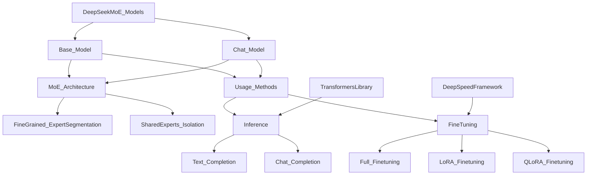
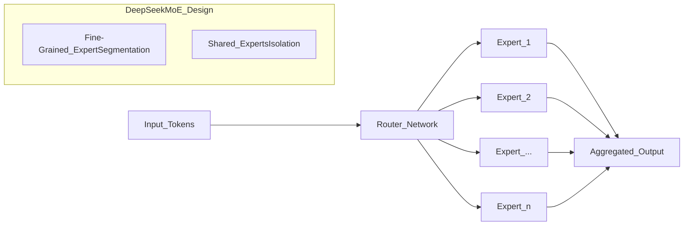
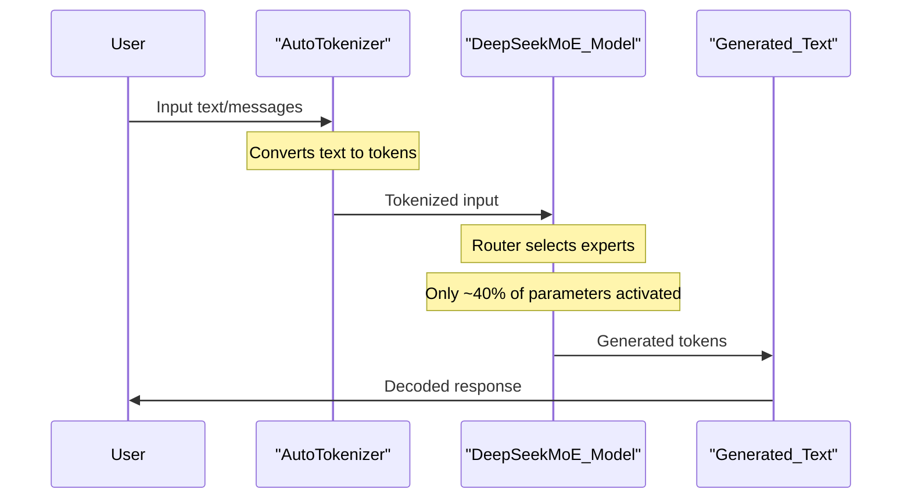
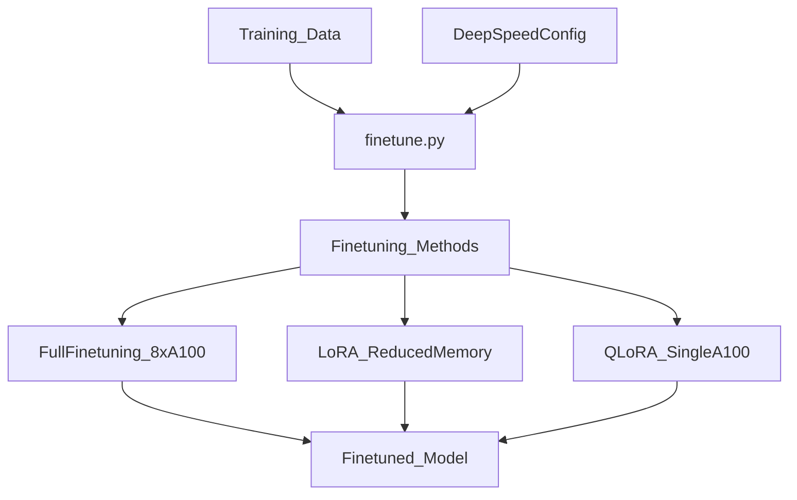

<!-- source: DeepWiki mcp.deepwiki.com · repo deepseek-ai/DeepSeek-MoE · page 1 Overview · fetched 2026-10-30 -->

# Overview

Relevant source files

The following files were used as context for generating this wiki page:

- [DeepSeekMoE.pdf](DeepSeekMoE.pdf)
- [README.md](README.md)

## Purpose and Scope

This document provides an introduction to the DeepSeek-MoE repository, which contains implementation and usage details for the DeepSeekMoE 16B language models. It covers the core features, architecture, and key capabilities of the models. For detailed information about the model architecture, see [Model Architecture](#2), and for specific usage patterns, see [Model Usage](#3).

## What is DeepSeekMoE?

DeepSeekMoE 16B is a Mixture-of-Experts (MoE) language model with 16.4 billion total parameters. It represents an efficient approach to large language model design, achieving comparable performance to dense models with significantly reduced computational requirements. The repository provides both base and chat variants of the model.

**Key characteristics:**
- Employs a novel MoE architecture with fine-grained expert segmentation and shared experts isolation
- Trained on 2 trillion English and 2 trillion Chinese tokens
- Requires only ~40% of the computation used by comparable dense models
- Can be deployed on a single GPU with 40GB memory without quantization
- Supports both inference and fine-tuning workflows

Sources: [README.md:61-67]()

## Model Variants

The repository provides two primary model variants:

| Model               | Purpose                                     | Hugging Face Model ID              |
|---------------------|---------------------------------------------|-----------------------------------|
| DeepSeekMoE 16B Base| General text completion and generation      | deepseek-ai/deepseek-moe-16b-base |
| DeepSeekMoE 16B Chat| Optimized for conversational interactions   | deepseek-ai/deepseek-moe-16b-chat |

Both models support a context length of 4096 tokens and can be loaded using the Hugging Face Transformers library.

Sources: [README.md:107-111]()

## System Architecture Overview

The following diagram illustrates the key components of the DeepSeek-MoE system:

Sources: [README.md:61-67](), [README.md:113-122](), [README.md:180-195]()

## MoE Architecture Core Concepts

The key innovation in DeepSeekMoE is its efficient Mixture-of-Experts architecture, which allows the model to achieve strong performance while activating only about 40% of its parameters during inference.

In the MoE architecture:
1. Input tokens are processed by a router network
2. The router dynamically selects which expert networks to activate for each token
3. Only a subset of experts is activated for any given input, ensuring computational efficiency
4. Outputs from selected experts are aggregated to produce the final result

Sources: [README.md:63-66]()

## Usage Methods

DeepSeek-MoE supports two primary usage patterns:

### Inference

The models can be used for inference directly with the Hugging Face Transformers library:

1. **Text Completion** with the base model - for general-purpose text generation
2. **Chat Completion** with the chat model - optimized for conversational interactions

Sources: [README.md:122-177]()

### Fine-tuning

The repository provides support for fine-tuning the models on downstream tasks using three approaches:

1. **Full Fine-tuning** - Updates all model parameters using DeepSpeed ZeRO-3
2. **LoRA Fine-tuning** - Parameter-efficient fine-tuning using DeepSpeed ZeRO-2
3. **QLoRA Fine-tuning** - Quantized fine-tuning for memory efficiency

Sources: [README.md:180-264]()

## Performance

DeepSeekMoE 16B achieves comparable performance to models like DeepSeek 7B and LLaMA2 7B while using only about 40% of the computational resources:

- **Base model**: Performs similarly to DeepSeek 7B and LLaMA2 7B on various benchmarks 
- **Chat model**: Achieves comparable or better performance than DeepSeek 7B Chat and LLaMA2 7B SFT

The model's efficiency comes from its MoE architecture, which activates only a subset of its total parameters for any given input.

Sources: [README.md:69-100]()

## Hardware Requirements

- **Inference**: Can be deployed on a single GPU with 40GB of memory without quantization
- **Full Fine-tuning**: Requires 8x A100 40GB GPUs with DeepSpeed ZeRO-3
- **LoRA Fine-tuning**: Requires reduced memory footprint with DeepSpeed ZeRO-2
- **QLoRA Fine-tuning**: Can run on a single A100 80GB GPU with 4/8-bit quantization

Sources: [README.md:66](), [README.md:194-264]()

## Licensing

The DeepSeek-MoE repository has a dual licensing structure:

- **Code**: Licensed under the MIT License
- **Model weights**: Subject to the DeepSeek Model License

The models support commercial use under the terms of the license.

Sources: [README.md:39-44](), [README.md:266-268]()

---

