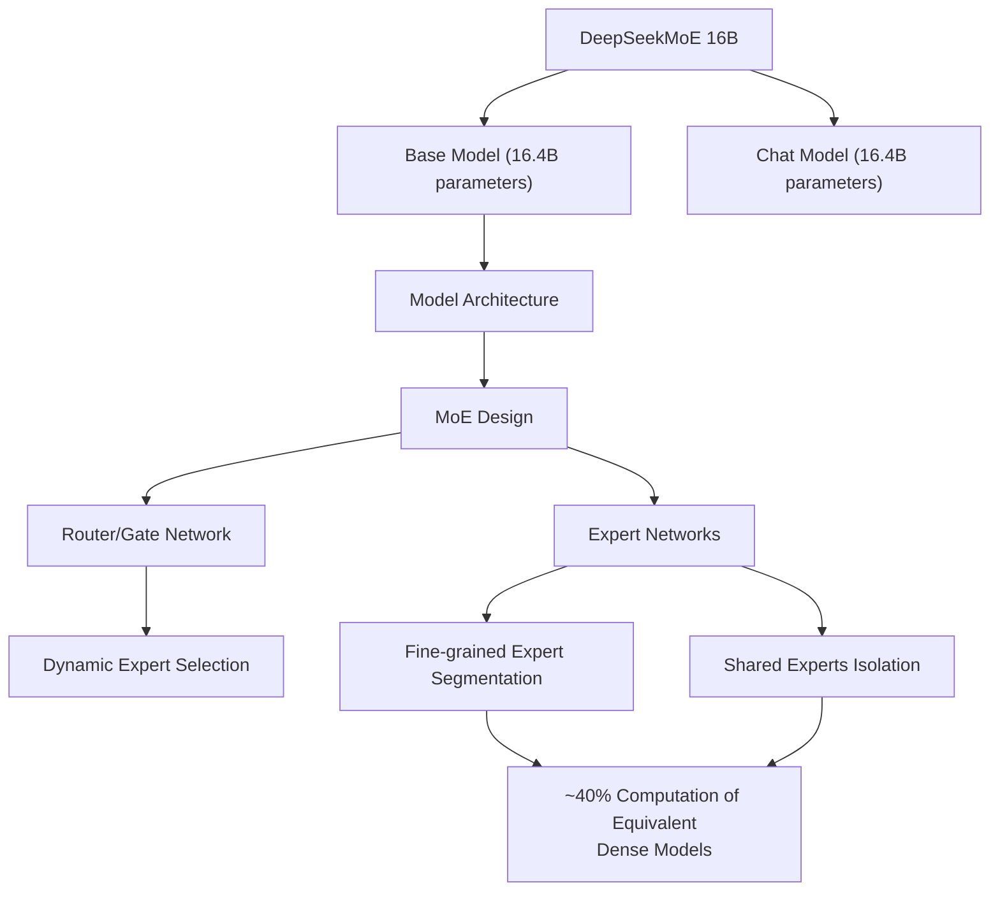
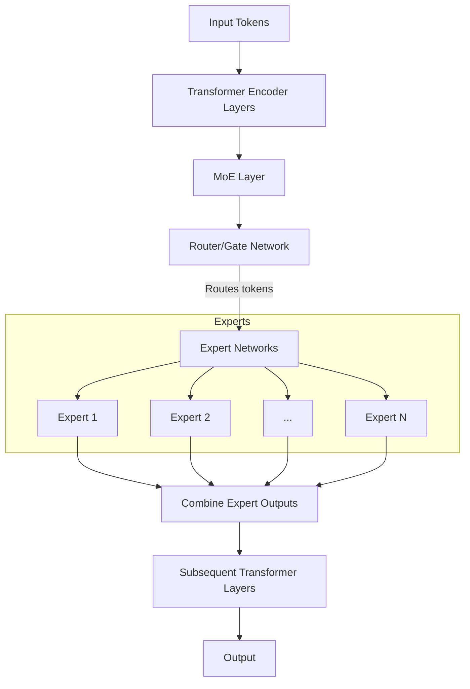
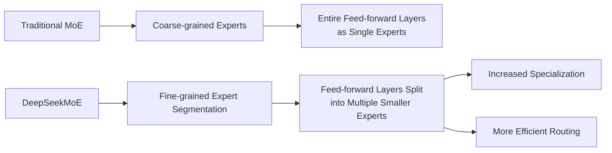
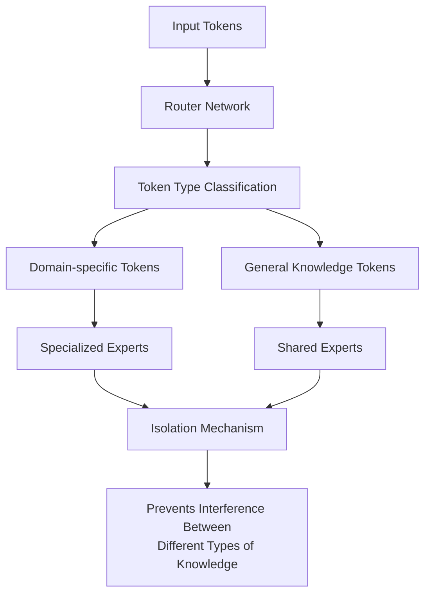
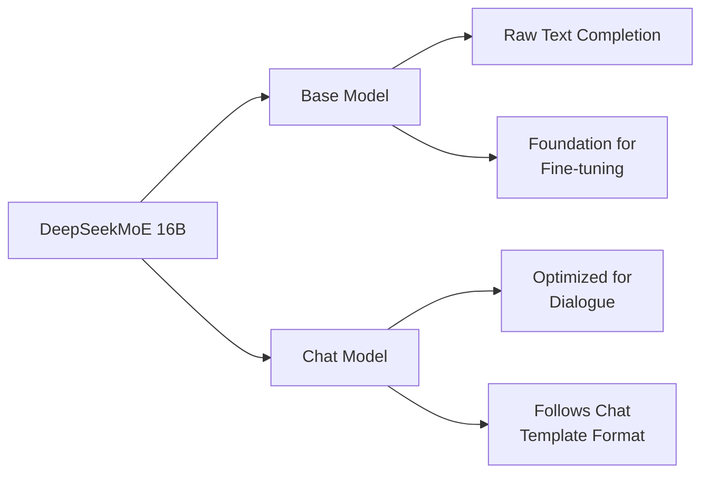
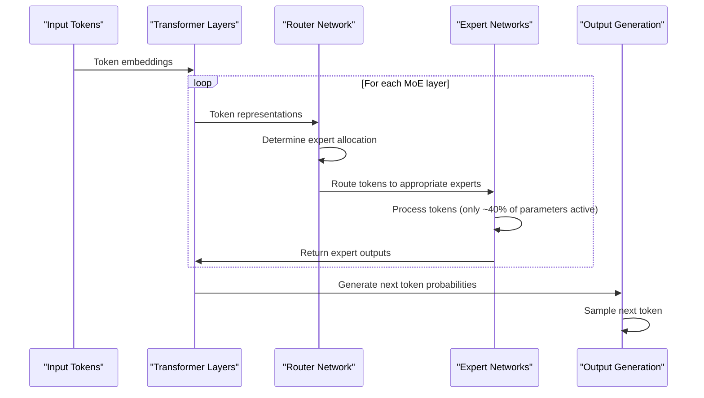

<!-- source: DeepWiki mcp.deepwiki.com · repo deepseek-ai/DeepSeek-MoE · page 2 Model Architecture · fetched 2026-10-30 -->

# Model Architecture

Relevant source files

The following files were used as context for generating this wiki page:

- [DeepSeekMoE.pdf](DeepSeekMoE.pdf)
- [README.md](README.md)

## Purpose and Scope

This document provides a detailed technical explanation of the DeepSeekMoE 16B model's architecture. It covers the underlying Mixture of Experts (MoE) design, the innovative approaches used for expert segmentation and isolation, and how these architectural decisions impact the model's efficiency and performance. For information about how to use the model for inference, see [Model Usage](#3), and for fine-tuning approaches, see [Fine-tuning](#4).

## Overview of DeepSeekMoE 16B

DeepSeekMoE 16B is a Mixture-of-Experts language model with 16.4 billion total parameters. The architecture employs an innovative MoE design that enables the model to achieve comparable performance to dense models with significantly reduced computational requirements. During inference, the model activates only about 40% of its parameters, making it computationally equivalent to a ~6.6B dense model while delivering performance on par with models like DeepSeek 7B and LLaMA2 7B.

Sources: [README.md:63-66]()

## Mixture of Experts Architecture

The DeepSeekMoE model implements a Mixture-of-Experts architecture, which is fundamentally different from traditional dense transformer models. In an MoE architecture, instead of activating all parameters for every input token, the model dynamically routes each token to a subset of specialized neural network modules called "experts."

Sources: [README.md:63-66]()

### Router Network

The router (or gate) network is a critical component of the MoE architecture. It analyzes each input token and determines which expert(s) should process it. This dynamic routing mechanism is what allows the model to:

1. Activate only a subset of parameters for each token
2. Enable specialization of experts for different types of inputs
3. Achieve computational efficiency by processing each token with only the most relevant parameters

Sources: [README.md:63-66]()

## Key Architectural Innovations

DeepSeekMoE introduces two principal innovations in its MoE architecture:

### 1. Fine-grained Expert Segmentation

Fine-grained expert segmentation involves breaking down the traditional monolithic experts into smaller, more specialized units. This approach allows for more precise routing of computation and enhances the ability of experts to specialize in specific types of language processing tasks.

Sources: [README.md:64]()

### 2. Shared Experts Isolation

Shared experts isolation is a technique that prevents interference between different types of knowledge processing. By isolating shared experts from specialized ones, the model can maintain clearer boundaries between general knowledge and domain-specific expertise, leading to improved performance on specialized tasks without compromising general capabilities.

Sources: [README.md:64]()

## Model Variants

DeepSeekMoE is available in two variants, both sharing the same underlying architecture but with different usage orientations:

1. **Base Model**: Designed for general text completion tasks and as a foundation for fine-tuning on specific domains
2. **Chat Model**: Optimized for dialogue interactions, following a specific chat template format

Both variants maintain the computational efficiency of the MoE architecture, requiring only about 40% of the computations compared to equivalent dense models.

Sources: [README.md:63-66](), [README.md:110-111]()

## Efficiency Characteristics

DeepSeekMoE's architectural innovations result in significant efficiency gains:

| Metric | DeepSeekMoE 16B | Comparable Dense Models |
|--------|-----------------|-------------------------|
| Total Parameters | 16.4B | 7B (DeepSeek, LLaMA2) |
| Active Parameters (per token) | ~6.6B (~40%) | 7B (100%) |
| Memory Requirements | 40GB | 40GB+ |
| Computational Requirements | ~40% of dense models | 100% |
| Performance | Comparable to 7B dense models | Baseline |

This efficiency allows the model to run on a single GPU with 40GB of memory without requiring quantization, making it more accessible for research and applications.

Sources: [README.md:63-66](), [README.md:81-85](), [README.md:95-100]()

## Training Details

DeepSeekMoE 16B was trained from scratch on a diverse corpus of 2 trillion tokens, evenly split between English and Chinese languages. This balanced training data helps the model develop strong capabilities in both languages and across a wide range of domains.

Sources: [README.md:65]()

## Hardware Requirements

The DeepSeekMoE architecture's efficiency allows for deployment on more modest hardware compared to models with similar capabilities:

- Can be deployed on a single GPU with 40GB memory
- No quantization required for base deployment
- For fine-tuning, different hardware configurations are recommended based on the approach:
  - Full fine-tuning: 8x A100 40G GPUs (using DeepSpeed ZeRO-3)
  - LoRA fine-tuning: Reduced memory footprint (using DeepSpeed ZeRO-2)
  - QLoRA fine-tuning: Single A100 80G GPU (using 4/8-bit quantization)

Sources: [README.md:66](), [README.md:193-226](), [README.md:230-264]()

## Inference Process

The inference process in DeepSeekMoE follows this general flow:

During inference, each token is dynamically routed to the most appropriate experts by the router network, activating only about 40% of the total parameters for any given input.

Sources: [README.md:63-66](), [README.md:122-176]()

---

