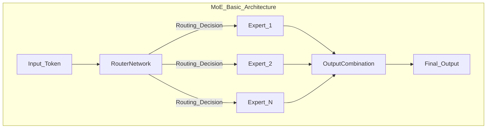
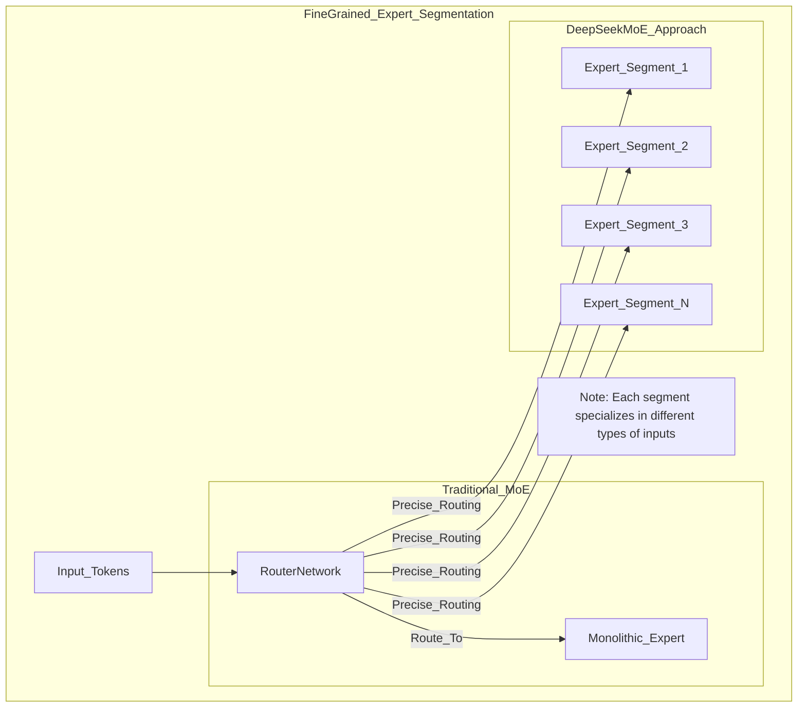
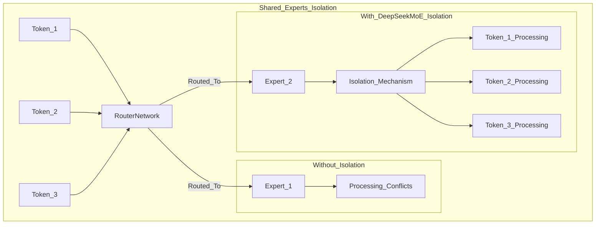
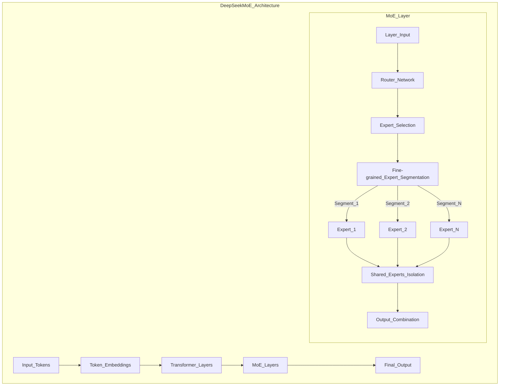
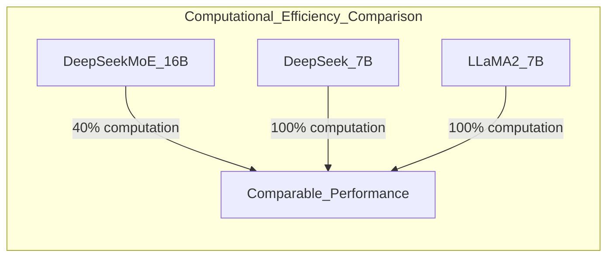

<!-- source: DeepWiki mcp.deepwiki.com · repo deepseek-ai/DeepSeek-MoE · page 2.1 Mixture of Experts Design · fetched 2026-10-30 -->

# Mixture of Experts Design

Relevant source files

The following files were used as context for generating this wiki page:

- [DeepSeekMoE.pdf](DeepSeekMoE.pdf)
- [README.md](README.md)

This document explains the Mixture of Experts (MoE) architecture implemented in the DeepSeekMoE 16B model, focusing on its two principal innovations: fine-grained expert segmentation and shared experts isolation. For information about using DeepSeekMoE models for inference, see [Model Usage](#3). For details on fine-tuning these models, see [Fine-tuning](#4).

## Core MoE Concept

Mixture of Experts is a neural network architecture where only a subset of the model's parameters (the "experts") are activated for each input token. This selective activation is controlled by a router network that determines which experts should process each input, resulting in significant computational efficiency.

Sources: [README.md:62-66]()

## DeepSeekMoE Architecture Innovations

DeepSeekMoE implements an innovative MoE architecture that enables the model to achieve high performance with significantly reduced computational requirements. The 16.4B parameter model only activates approximately 40% of its parameters during inference.

### Fine-grained Expert Segmentation

Unlike traditional MoE designs where experts are treated as monolithic units, DeepSeekMoE implements a more granular approach by segmenting experts into smaller specialized components.

This fine-grained segmentation allows for:
- More targeted specialization of experts
- Better parameter utilization
- More precise routing decisions
- Improved model performance through specialized handling of different input patterns

Sources: [README.md:63-64]()

### Shared Experts Isolation

When multiple input tokens are routed to the same expert, potential conflicts can arise that impact processing efficiency. DeepSeekMoE implements a mechanism to isolate shared experts, enabling more efficient parallel processing.

Shared experts isolation provides:
- Reduced processing conflicts when multiple tokens use the same expert
- More efficient parallel computation
- Better utilization of expert capacity

Sources: [README.md:63-64]()

## Combined MoE Architecture

The complete DeepSeekMoE architecture combines both innovations to create a highly efficient model.

Sources: [README.md:62-66]()

## Computational Efficiency

The DeepSeekMoE architecture achieves remarkable computational efficiency:

| Model | Total Parameters | Activated Parameters | Relative Computation |
|-------|------------------|----------------------|----------------------|
| DeepSeekMoE 16B | 16.4B | ~6.56B (40%) | ~40% |
| DeepSeek 7B | 7B | 7B (100%) | 100% |
| LLaMA2 7B | 7B | 7B (100%) | 100% |

This efficiency enables DeepSeekMoE 16B to:
- Run on a single GPU with 40GB memory without quantization
- Achieve performance comparable to much larger dense models
- Provide similar capabilities to models that require 2.5x more computation

Sources: [README.md:62-66](), [README.md:75-76]()

## Performance Characteristics

Despite using only about 40% of the computation required by comparable dense models, DeepSeekMoE 16B achieves:

- Performance comparable to DeepSeek 7B on internal benchmarks
- Performance comparable to LLaMA2 7B on Open LLM Leaderboard
- In many cases, outperforms LLaMA2 7B despite using only 39.6% of the computation

Sources: [README.md:69-91]()

## DeepSeekMoE Chat Variant

The chat-focused variant of DeepSeekMoE 16B maintains the same MoE architecture and efficiency benefits while being fine-tuned for conversational tasks. With approximately 40% of the computation required by dense models, it achieves comparable or better performance than DeepSeek 7B Chat and LLaMA2 7B SFT on conversation-specific benchmarks.

Sources: [README.md:93-100]()

## Related Pages

- For details on the differences between base and chat models, see [Base vs Chat Models](#2.2)
- For information about using the models for inference, see [Model Usage](#3)
- For guidance on fine-tuning these models, see [Fine-tuning](#4)
- For detailed evaluation results, see [Performance and Evaluation](#5)

---

