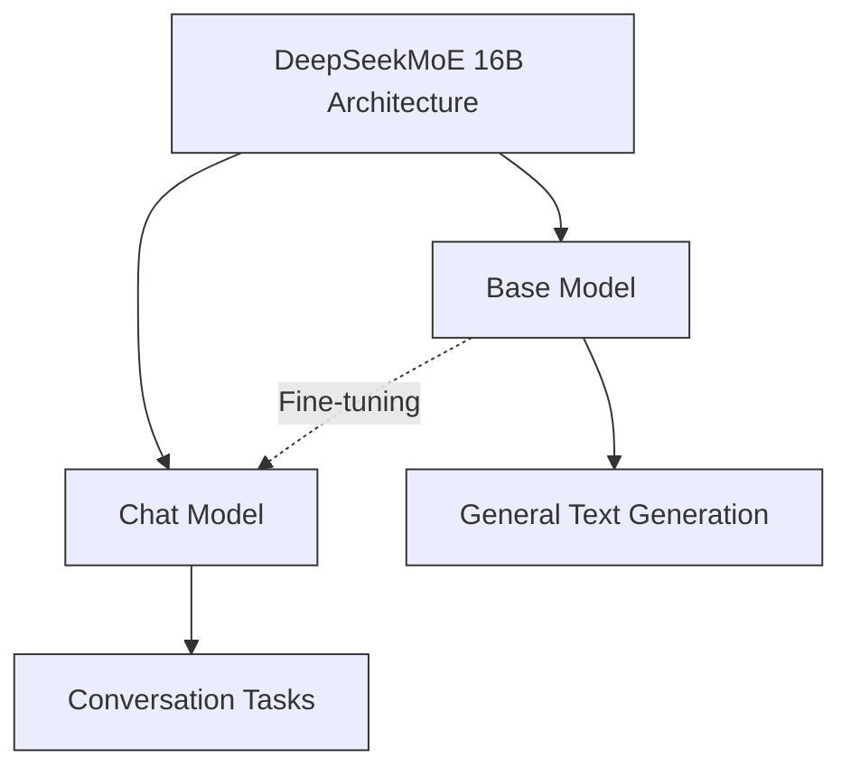
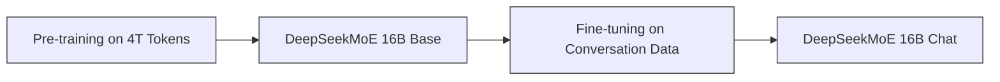
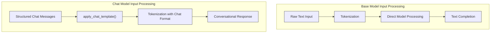

<!-- source: DeepWiki mcp.deepwiki.com · repo deepseek-ai/DeepSeek-MoE · page 2.2 Base vs Chat Models · fetched 2026-10-30 -->

# Base vs Chat Models

<details>
<summary>Relevant source files</summary>

The following files were used as context for generating this wiki page:

- [DeepSeekMoE.pdf](DeepSeekMoE.pdf)
- [README.md](README.md)

</details>


This page explains the key differences between the DeepSeekMoE 16B Base and DeepSeekMoE 16B Chat models, their specific capabilities, use cases, and how to interact with each variant. For information about the Mixture of Experts architecture used in both models, see [Mixture of Experts Design](#2.1).

## Model Overview

DeepSeekMoE is available in two primary variants:

1. **DeepSeekMoE 16B Base**: The foundation model trained on a diverse corpus of text, designed for general text completion tasks.
2. **DeepSeekMoE 16B Chat**: A fine-tuned version of the base model, specifically optimized for conversational interactions.

Both models share the same MoE architecture with 16.4B total parameters, but only activate approximately 40% of these parameters during inference, providing efficient computation comparable to dense models with fewer parameters.



Sources: [README.md:62-66]()

## Architectural Similarities

Both the Base and Chat versions share the same fundamental architecture:

- 16.4B total parameters
- MoE design with fine-grained expert segmentation
- Shared experts isolation technique
- Trained on 2T English and 2T Chinese tokens
- Both activate only ~40% of parameters during inference
- 4096 sequence length support
- Both models can run on a single GPU with 40GB memory without quantization

Sources: [README.md:62-66](), [README.md:102-111]()

## Key Differences

### Training Approach



Sources: [README.md:62-66]()

### Input Format and Processing

The primary difference in using these models lies in how inputs are formatted and processed:



Sources: [README.md:126-166]()

### Performance Characteristics

The two models are evaluated on different benchmarks reflecting their intended use cases:

- **Base Model**: Evaluated on general language understanding benchmarks (Open LLM Leaderboard)
- **Chat Model**: Evaluated on conversation-specific benchmarks

While both models achieve similar computational efficiency (activating only ~40% of parameters), they show different strengths in their respective domains.

Sources: [README.md:70-100]()

## Usage Examples

### Base Model Usage

The Base model is designed for general text completion tasks, where you provide a text prompt and the model continues it:

```python
import torch
from transformers import AutoTokenizer, AutoModelForCausalLM, GenerationConfig

model_name = "deepseek-ai/deepseek-moe-16b-base"
tokenizer = AutoTokenizer.from_pretrained(model_name)
model = AutoModelForCausalLM.from_pretrained(model_name, torch_dtype=torch.bfloat16, device_map="auto")
model.generation_config = GenerationConfig.from_pretrained(model_name)
model.generation_config.pad_token_id = model.generation_config.eos_token_id

text = "An attention function can be described as mapping a query and a set of key-value pairs to an output, where the query, keys, values, and output are all vectors. The output is"
inputs = tokenizer(text, return_tensors="pt")
outputs = model.generate(**inputs.to(model.device), max_new_tokens=100)

result = tokenizer.decode(outputs[0], skip_special_tokens=True)
print(result)
```

Sources: [README.md:126-144]()

### Chat Model Usage

The Chat model is specifically designed for conversation tasks and requires inputs to be formatted as structured chat messages:

```python
import torch
from transformers import AutoTokenizer, AutoModelForCausalLM, GenerationConfig

model_name = "deepseek-ai/deepseek-moe-16b-chat"
tokenizer = AutoTokenizer.from_pretrained(model_name)
model = AutoModelForCausalLM.from_pretrained(model_name, torch_dtype=torch.bfloat16, device_map="auto")
model.generation_config = GenerationConfig.from_pretrained(model_name)
model.generation_config.pad_token_id = model.generation_config.eos_token_id

messages = [
    {"role": "user", "content": "Who are you?"}
]
input_tensor = tokenizer.apply_chat_template(messages, add_generation_prompt=True, return_tensors="pt")
outputs = model.generate(input_tensor.to(model.device), max_new_tokens=100)

result = tokenizer.decode(outputs[0][input_tensor.shape[1]:], skip_special_tokens=True)
print(result)
```

Alternatively, you can directly format the chat template manually:

```
User: {messages[0]['content']}

---

