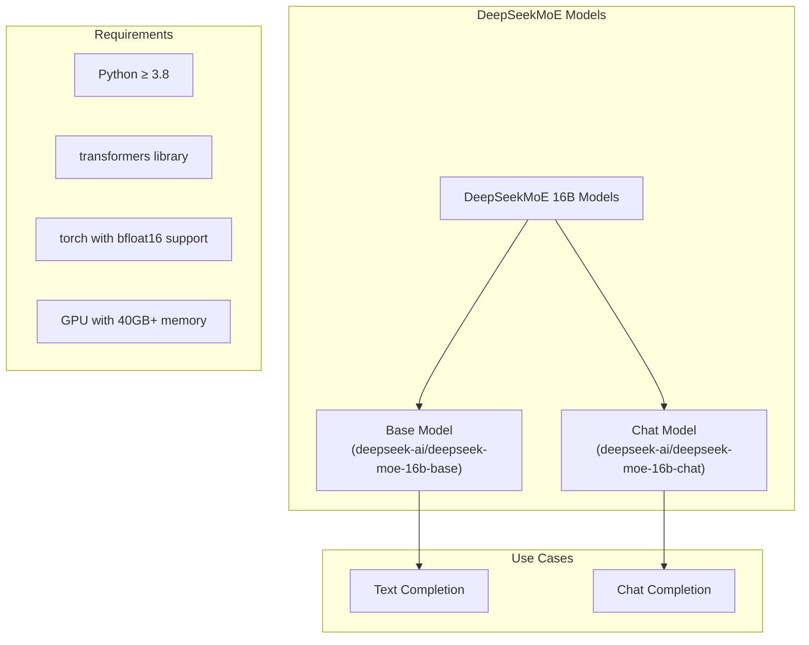
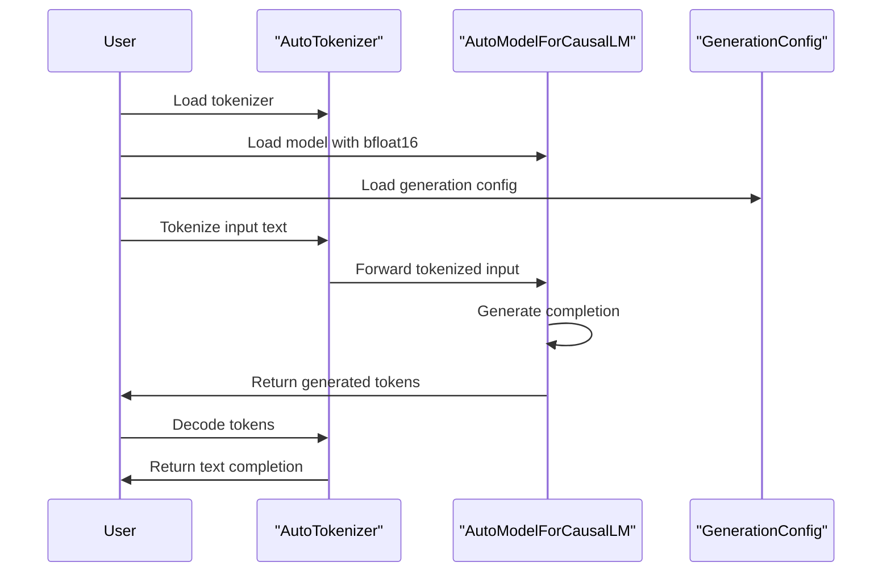
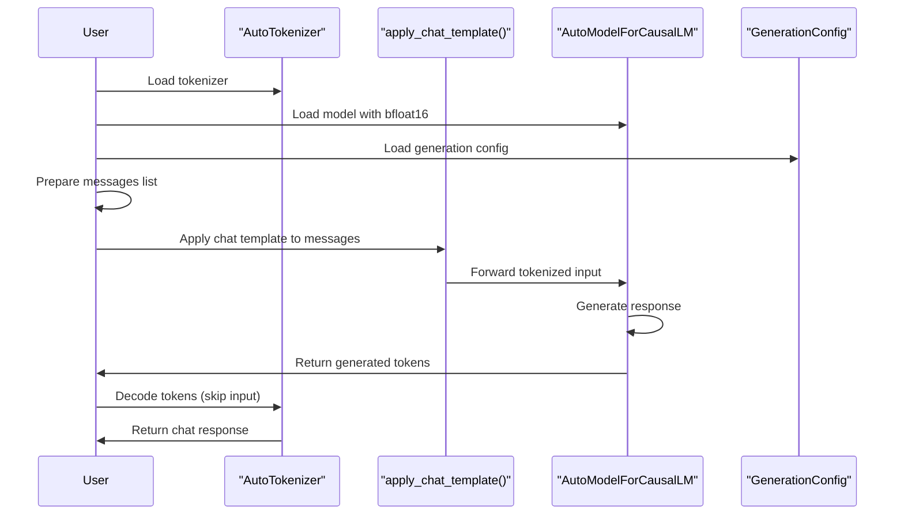

<!-- source: DeepWiki mcp.deepwiki.com · repo deepseek-ai/DeepSeek-MoE · page 3 Model Usage · fetched 2026-10-30 -->

# Model Usage

<details>
<summary>Relevant source files</summary>

The following files were used as context for generating this wiki page:

- [README.md](README.md)

</details>


This document provides detailed guidance on how to use the DeepSeekMoE 16B models for inference tasks. It covers basic usage patterns for both the base and chat models, focusing on text completion and chat interactions. For information about fine-tuning these models, please refer to the [Fine-tuning](#4) page.

## Setup and Installation

Before using the DeepSeekMoE models, you need to install the necessary dependencies in a Python environment (version 3.8 or higher).

```bash
pip install -r requirements.txt
```

The models can be loaded using Hugging Face's Transformers library. Both models are available for direct use from the Hugging Face Hub.

Sources: [README.md:114-120]()

## DeepSeekMoE Models Overview

The DeepSeekMoE repository provides two main model variants:

1. **DeepSeekMoE 16B Base**: Optimized for general text completion tasks
2. **DeepSeekMoE 16B Chat**: Fine-tuned specifically for conversational interactions

Both models feature a Mixture-of-Experts (MoE) architecture with 16.4B total parameters, though only about 40% of these parameters are activated during inference. This design allows the models to run on a single GPU with 40GB memory without quantization.



Sources: [README.md:61-67](), [README.md:108-111]()

## Text Completion with Base Model

The DeepSeekMoE 16B Base model is designed for general text completion tasks. Here's the typical workflow for using this model:



### Example Usage

The following code demonstrates how to use the DeepSeekMoE 16B Base model for text completion:

```python
import torch
from transformers import AutoTokenizer, AutoModelForCausalLM, GenerationConfig

model_name = "deepseek-ai/deepseek-moe-16b-base"
tokenizer = AutoTokenizer.from_pretrained(model_name)
model = AutoModelForCausalLM.from_pretrained(model_name, torch_dtype=torch.bfloat16, device_map="auto")
model.generation_config = GenerationConfig.from_pretrained(model_name)
model.generation_config.pad_token_id = model.generation_config.eos_token_id

text = "An attention function can be described as mapping a query and a set of key-value pairs to an output, where the query, keys, values, and output are all vectors. The output is"
inputs = tokenizer(text, return_tensors="pt")
outputs = model.generate(**inputs.to(model.device), max_new_tokens=100)

result = tokenizer.decode(outputs[0], skip_special_tokens=True)
print(result)
```

Sources: [README.md:126-144]()

## Chat Completion with Chat Model

The DeepSeekMoE 16B Chat model is specifically fine-tuned for conversational interactions. The usage flow is similar to the base model but includes formatting messages using a chat template.



### Example Usage

The following code demonstrates how to use the DeepSeekMoE 16B Chat model for conversations:

```python
import torch
from transformers import AutoTokenizer, AutoModelForCausalLM, GenerationConfig

model_name = "deepseek-ai/deepseek-moe-16b-chat"
tokenizer = AutoTokenizer.from_pretrained(model_name)
model = AutoModelForCausalLM.from_pretrained(model_name, torch_dtype=torch.bfloat16, device_map="auto")
model.generation_config = GenerationConfig.from_pretrained(model_name)
model.generation_config.pad_token_id = model.generation_config.eos_token_id

messages = [
    {"role": "user", "content": "Who are you?"}
]
input_tensor = tokenizer.apply_chat_template(messages, add_generation_prompt=True, return_tensors="pt")
outputs = model.generate(input_tensor.to(model.device), max_new_tokens=100)

result = tokenizer.decode(outputs[0][input_tensor.shape[1]:], skip_special_tokens=True)
print(result)
```

Sources: [README.md:148-166]()

### Chat Template Format

If you prefer to manually format your chat messages instead of using `apply_chat_template()`, you can follow this template:

```
User: {messages[0]['content']}

---

