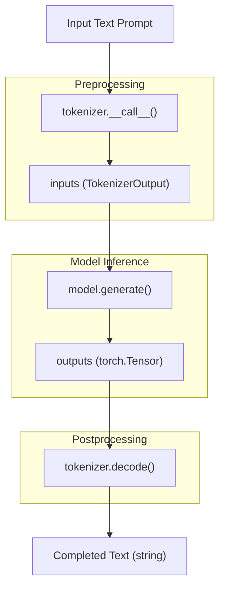
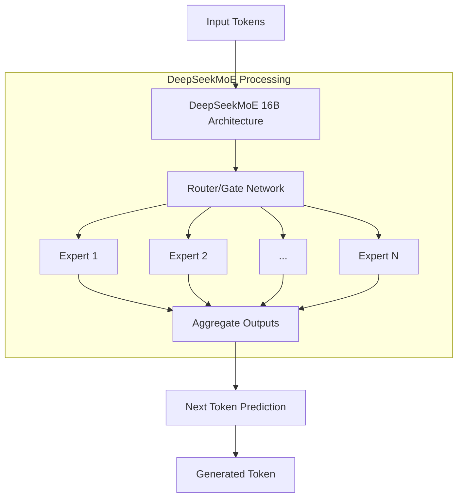
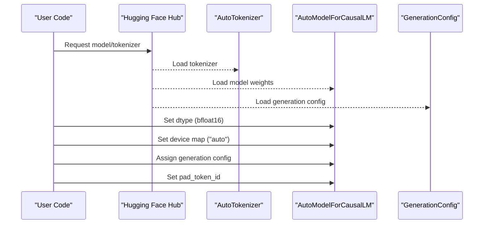
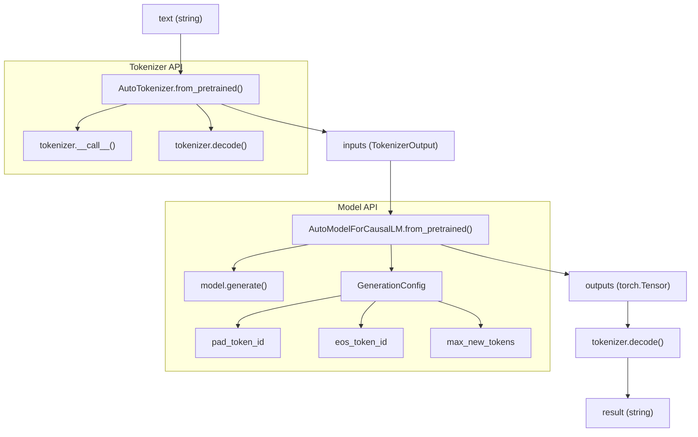

<!-- source: DeepWiki mcp.deepwiki.com · repo deepseek-ai/DeepSeek-MoE · page 3.1 Text Completion · fetched 2026-10-30 -->

# Text Completion

<details>
<summary>Relevant source files</summary>

The following files were used as context for generating this wiki page:

- [README.md](README.md)

</details>


## Purpose and Scope

This document explains how to use the DeepSeek-MoE 16B base model for text completion tasks. It covers model initialization, input processing, text generation workflow, and configuration options. For information about chat-based interactions, see [Chat Completion](#3.2).

## Overview of Text Completion

Text completion is the process where the model generates a coherent continuation of an input text prompt. DeepSeek-MoE processes the input through its Mixture of Experts architecture to predict the most likely sequence of tokens that should follow the provided context.

### Text Completion Workflow



Sources: [README.md:127-143]()

## MoE Architecture for Text Completion

DeepSeek-MoE utilizes a specialized Mixture of Experts architecture that routes input tokens to different experts based on their content, enabling efficient inference by only activating a subset of the model's parameters.



Sources: [README.md:63-65]()

## Implementation

### Model Initialization

To use the DeepSeek-MoE model for text completion, you need to:
1. Load the tokenizer using `AutoTokenizer`
2. Load the model using `AutoModelForCausalLM` 
3. Set appropriate generation configuration



Sources: [README.md:127-137]()

### Code Example

The following example demonstrates how to use the DeepSeek-MoE 16B base model for text completion:

```python
import torch
from transformers import AutoTokenizer, AutoModelForCausalLM, GenerationConfig

model_name = "deepseek-ai/deepseek-moe-16b-base"
tokenizer = AutoTokenizer.from_pretrained(model_name)
model = AutoModelForCausalLM.from_pretrained(model_name, torch_dtype=torch.bfloat16, device_map="auto")
model.generation_config = GenerationConfig.from_pretrained(model_name)
model.generation_config.pad_token_id = model.generation_config.eos_token_id

text = "An attention function can be described as mapping a query and a set of key-value pairs to an output, where the query, keys, values, and output are all vectors. The output is"
inputs = tokenizer(text, return_tensors="pt")
outputs = model.generate(**inputs.to(model.device), max_new_tokens=100)

result = tokenizer.decode(outputs[0], skip_special_tokens=True)
print(result)
```

Sources: [README.md:127-143]()

## System Components and Data Flow

The text completion system consists of several key components that work together to process input text and generate completions.



Sources: [README.md:127-143]()

## Generation Parameters

The `GenerationConfig` controls the text generation process. Key parameters include:

| Parameter | Description | Default/Example Value |
|-----------|-------------|---------------|
| max_new_tokens | Maximum number of tokens to generate | 100 (in example) |
| pad_token_id | Token ID used for padding | Set to eos_token_id |
| temperature | Controls randomness (higher = more random) | Model default |
| top_p | Nucleus sampling parameter | Model default |
| top_k | Top-k sampling parameter | Model default |
| repetition_penalty | Penalizes repetition | Model default |
| do_sample | Whether to use sampling | Model default |

Sources: [README.md:135-136]()

## Performance Characteristics

The DeepSeek-MoE 16B exhibits several important performance characteristics:

1. **Efficient Computation**: Uses only about 40% of computations compared to equivalent dense models
2. **Comparable Performance**: Achieves similar results to DeepSeek 7B and LLaMA2 7B models
3. **Memory Efficiency**: Can be deployed on a single GPU with 40GB of memory without quantization

The model achieves this efficiency through its MoE architecture with fine-grained expert segmentation and shared experts isolation.

Sources: [README.md:63-66]()

## Troubleshooting

Common issues and their solutions:

| Issue | Possible Cause | Solution |
|-------|---------------|----------|
| Out of memory error | Insufficient GPU memory | Reduce batch size or use quantization |
| Slow generation | Large max_new_tokens value | Reduce max_new_tokens or use a faster device |
| Special tokens in output | skip_special_tokens=False | Set skip_special_tokens=True in decode() |
| Model outputs unexpected text | Improper input formatting | Ensure input text follows expected format |

Sources: [README.md:65-66]()

## Additional Notes

- The base model is trained on 2T English and 2T Chinese tokens, making it suitable for both languages
- The model has a context length of 4096 tokens
- When using for inference, setting the appropriate data type (bfloat16) and device mapping can improve performance

Sources: [README.md:63-65]()

---

