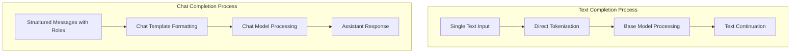
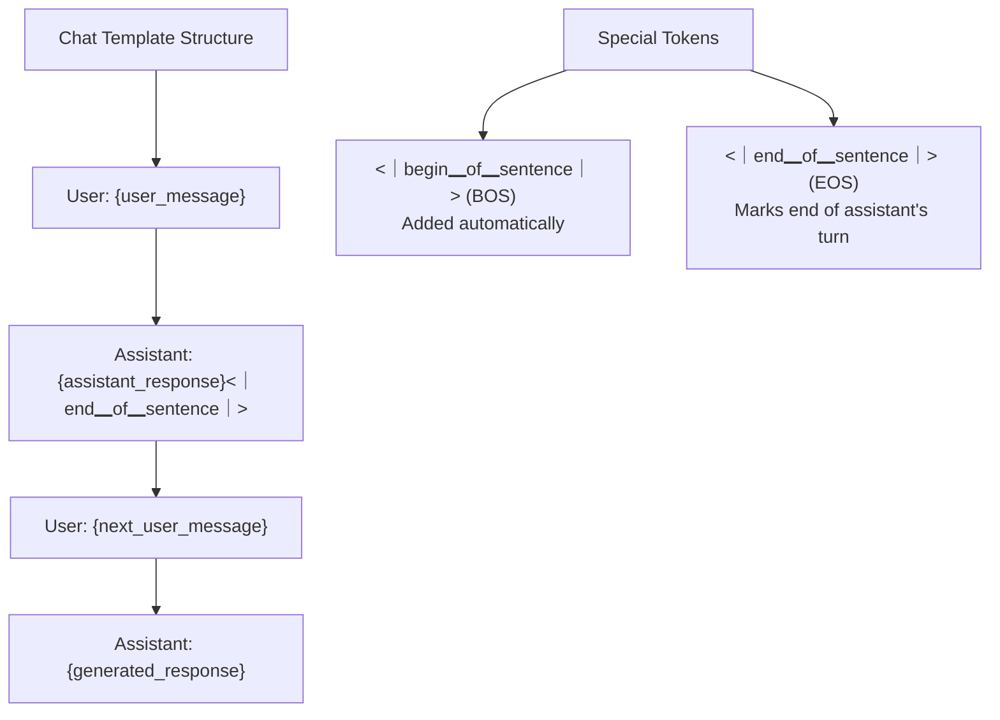
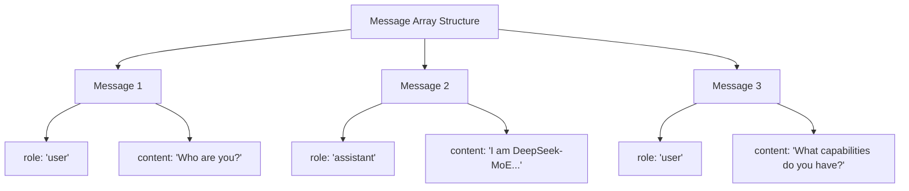
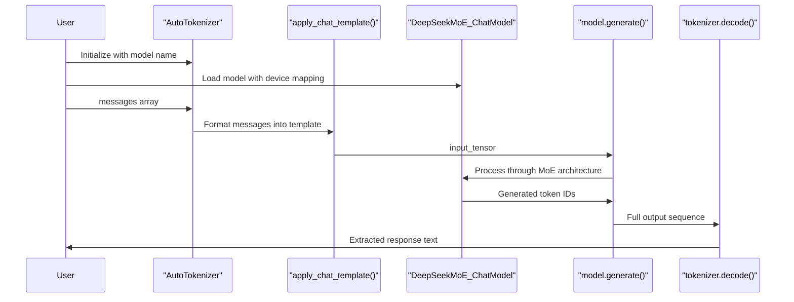
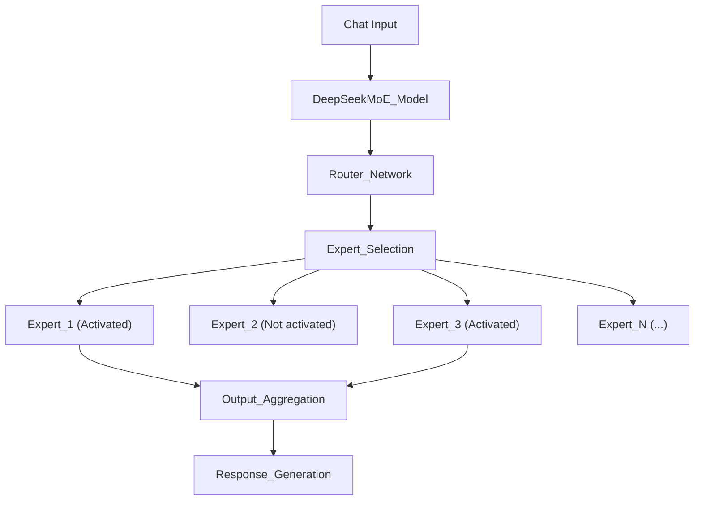

<!-- source: DeepWiki mcp.deepwiki.com · repo deepseek-ai/DeepSeek-MoE · page 3.2 Chat Completion · fetched 2026-10-30 -->

# Chat Completion

<details>
<summary>Relevant source files</summary>

The following files were used as context for generating this wiki page:

- [README.md](README.md)

</details>


This document explains how to use the DeepSeek-MoE 16B Chat model for conversational interactions. For information about text completion with the base model, see [Text Completion](#3.1).

## Introduction

The DeepSeek-MoE 16B Chat model is a specialized version of the base model that has been fine-tuned for dialogue-based interactions. Built on the same Mixture-of-Experts (MoE) architecture, it enables efficient conversational capabilities while activating only about 40% of its parameters during inference.

Sources: [README.md:61-66](), [README.md:93-96]()

## How Chat Completion Works

### Chat Completion vs Text Completion

Chat completion differs from text completion in how inputs are structured and processed:



Sources: [README.md:126-144](), [README.md:146-166]()

### Chat Template Format

The model uses a specific template to structure conversations:



Sources: [README.md:168-176]()

## Basic Usage

To use the DeepSeek-MoE 16B Chat model, follow this example:

```python
import torch
from transformers import AutoTokenizer, AutoModelForCausalLM, GenerationConfig

model_name = "deepseek-ai/deepseek-moe-16b-chat"
tokenizer = AutoTokenizer.from_pretrained(model_name)
model = AutoModelForCausalLM.from_pretrained(model_name, torch_dtype=torch.bfloat16, device_map="auto")
model.generation_config = GenerationConfig.from_pretrained(model_name)
model.generation_config.pad_token_id = model.generation_config.eos_token_id

messages = [
    {"role": "user", "content": "Who are you?"}
]
input_tensor = tokenizer.apply_chat_template(messages, add_generation_prompt=True, return_tensors="pt")
outputs = model.generate(input_tensor.to(model.device), max_new_tokens=100)

result = tokenizer.decode(outputs[0][input_tensor.shape[1]:], skip_special_tokens=True)
print(result)
```

Sources: [README.md:148-166]()

## Multi-turn Conversations

For multi-turn conversations, add more message objects to the messages array:



Example of structured conversation input:

```python
messages = [
    {"role": "user", "content": "Who are you?"},
    {"role": "assistant", "content": "I am DeepSeek-MoE, an assistant developed by DeepSeek AI."},
    {"role": "user", "content": "What capabilities do you have?"}
]
input_tensor = tokenizer.apply_chat_template(messages, add_generation_prompt=True, return_tensors="pt")
```

Sources: [README.md:148-166]()

## Implementation Details

### Data Flow in Chat Completion

The following diagram illustrates how data flows through the system during chat completion:



Sources: [README.md:148-166]()

### MoE Architecture in Chat Completion

The DeepSeek-MoE Chat model uses a Mixture-of-Experts architecture where only a subset of parameters are activated for any given input:



This selective activation enables the model to achieve efficiency while maintaining performance comparable to dense models with similar effective parameter counts.

Sources: [README.md:61-66](), [README.md:93-96]()

## Generation Parameters

Key parameters for controlling chat completion generation:

| Parameter | Description | Typical Values |
|-----------|-------------|----------------|
| `max_new_tokens` | Maximum number of tokens to generate | 100-2000 |
| `temperature` | Controls randomness (lower = more deterministic) | 0.1-1.0 |
| `top_p` | Nucleus sampling parameter | 0.7-0.9 |
| `top_k` | Top-k sampling parameter | 40-50 |
| `repetition_penalty` | Penalizes repeated tokens | 1.0-1.2 |

These can be set in the `model.generation_config` or passed directly to the `model.generate()` method.

Sources: [README.md:154-155]()

## Important Notes and Limitations

- The tokenizer automatically adds a beginning of sentence token (`<｜begin▁of▁sentence｜>`) by default with `add_special_tokens=True`
- This version of the model does not support system prompts, so they should not be included in your input
- The chat model has been evaluated against DeepSeek 7B Chat and LLaMA2 7B SFT (with the same fine-tuning settings and data) and achieves comparable or better performance
- The model can be deployed on a single GPU with 40GB of memory without requiring quantization

Sources: [README.md:177-179](), [README.md:93-100](), [README.md:66]()

## Performance

The DeepSeek-MoE 16B Chat model achieves comparable or better performance than DeepSeek 7B Chat and LLaMA2 7B SFT while using only about 40% of the computation. Evaluation results are shown in the README.md file, demonstrating strong performance across various benchmarks.

Sources: [README.md:93-100]()

---

