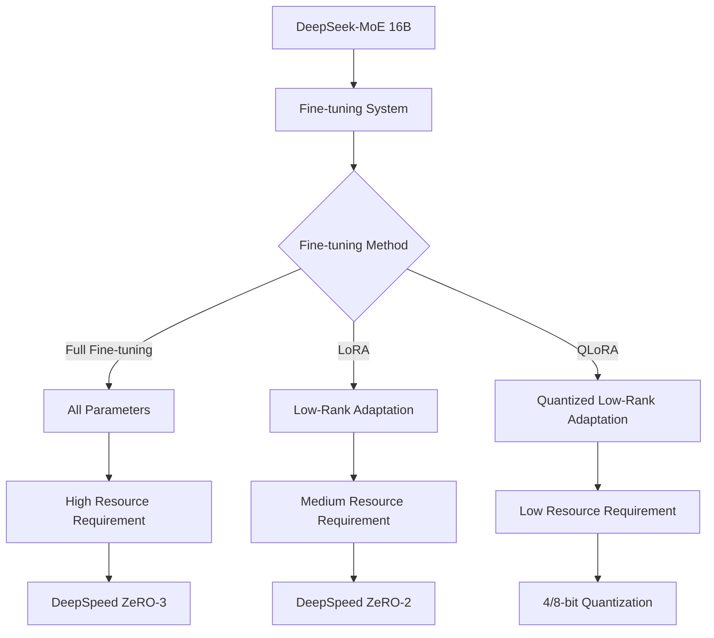
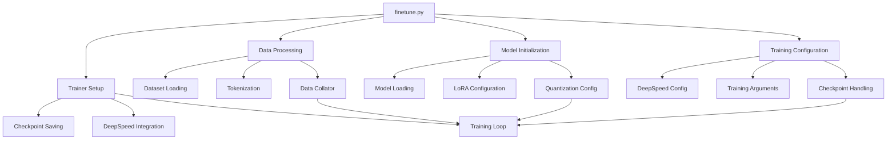
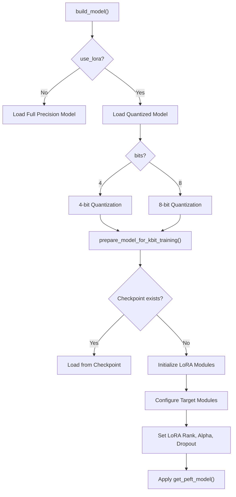
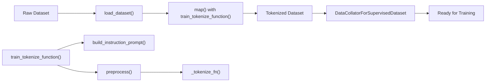
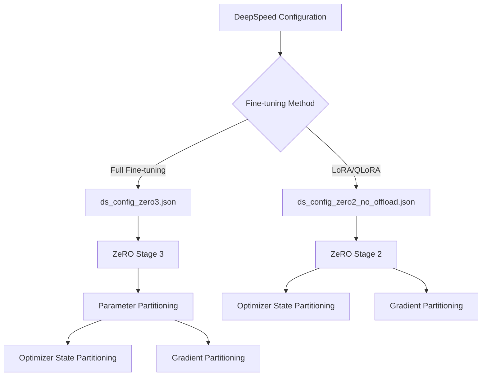
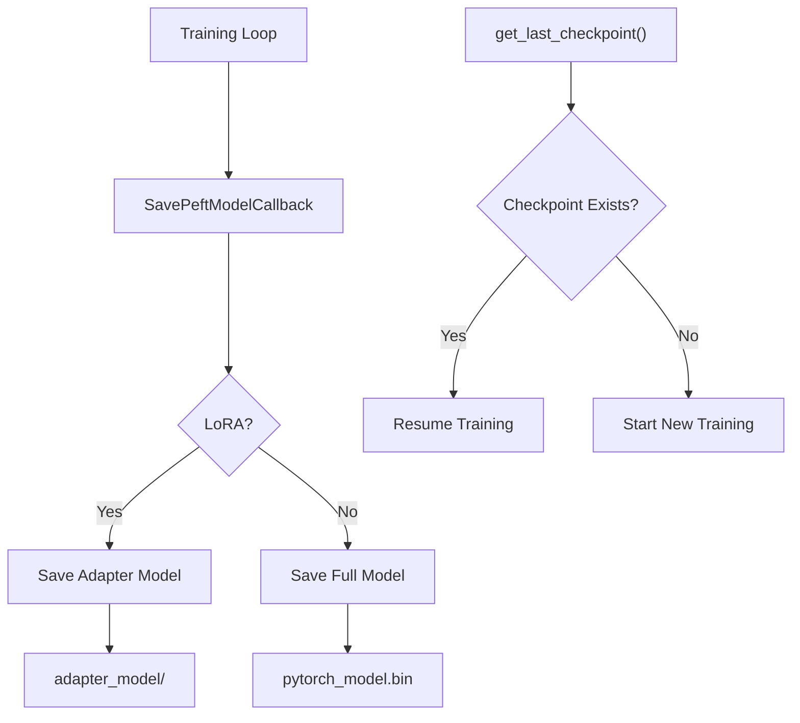

<!-- source: DeepWiki mcp.deepwiki.com · repo deepseek-ai/DeepSeek-MoE · page 4 Fine-tuning · fetched 2026-10-30 -->

# Fine-tuning

<details>
<summary>Relevant source files</summary>

The following files were used as context for generating this wiki page:

- [README.md](README.md)
- [finetune/finetune.py](finetune/finetune.py)

</details>


This document provides comprehensive guidance on fine-tuning the DeepSeek-MoE 16B model for downstream tasks. It covers the available fine-tuning methods, required configurations, and practical implementation steps. For general information about the model architecture, see [Model Architecture](#2).

## 1. Fine-tuning Overview

DeepSeek-MoE supports three main fine-tuning approaches, each with different resource requirements and performance characteristics:

1. **Full Fine-tuning**: Updates all model parameters, requiring significant computational resources
2. **LoRA Fine-tuning**: Low-Rank Adaptation that efficiently updates a small subset of parameters
3. **QLoRA Fine-tuning**: Quantized LoRA that further reduces memory requirements through model quantization



Sources: [README.md:180-198](), [finetune/finetune.py:250-320]()

## 2. Prerequisites

Before beginning the fine-tuning process, ensure you have:

1. Installed all required dependencies:
   ```bash
   pip install -r requirements.txt
   ```

2. Prepared your dataset in the correct format (see Data Preparation section)
3. Sufficient GPU resources based on your chosen fine-tuning method
4. DeepSpeed configured properly

Sources: [README.md:186-188]()

## 3. Fine-tuning Methods Comparison

Each fine-tuning method offers different trade-offs between computational requirements and model performance:

| Method | Description | Parameters Updated | Memory Requirement | Hardware Recommendation |
|--------|-------------|-------------------|-------------------|------------------------|
| Full Fine-tuning | Updates all model parameters | All 16.4B parameters | Very High | 8× A100 40GB GPUs |
| LoRA | Low-rank adaptations to specific layers | Only LoRA parameters | Medium | Multiple GPUs |
| QLoRA | Quantized LoRA with 4/8-bit precision | Only LoRA parameters | Low | Single A100 80GB GPU |

Sources: [README.md:199-264](), [finetune/finetune.py:31-52]()

## 4. Data Preparation

DeepSeek-MoE expects data in a specific format for fine-tuning:

### Data Format

The fine-tuning script expects data in the Parquet format with the following fields:
- `instruction`: The input prompt or instruction
- `output`: The desired completion or response

### Example Dataset Item

```
{
  "instruction": "Explain the concept of mixture of experts.",
  "output": "Mixture of Experts (MoE) is a neural network architecture..."
}
```

The script will automatically format this into the appropriate prompting structure:

```
You are an AI assistant, developed by DeepSeek Company. For politically sensitive questions, security and privacy issues, you will refuse to answer.
### Instruction:
Explain the concept of mixture of experts.
### Response:
Mixture of Experts (MoE) is a neural network architecture...
```

Sources: [README.md:190-192](), [finetune/finetune.py:115-180](), [finetune/finetune.py:23-29]()

## 5. Fine-tuning System Architecture

The DeepSeek-MoE fine-tuning system consists of several interconnected components:



Sources: [finetune/finetune.py:250-320]()

## 6. Implementation Details

### 6.1. Model Initialization

The model is initialized based on the specified fine-tuning method:



The function `build_model()` handles loading the pre-trained model and configuring it for fine-tuning based on the specified arguments.

Sources: [finetune/finetune.py:182-248]()

### 6.2. Data Processing Pipeline



The data processing pipeline transforms raw data into tokenized inputs suitable for model training.

Sources: [finetune/finetune.py:115-180](), [finetune/finetune.py:280-311]()

## 7. Configuration Options

### 7.1. Model Arguments

Key model configuration parameters include:

| Parameter | Description | Default |
|-----------|-------------|---------|
| `trainable` | Comma-separated list of modules to train | "q_proj,v_proj,k_proj,o_proj,gate_proj,down_proj,up_proj" |
| `lora_rank` | Rank for LoRA matrices | 8 |
| `lora_dropout` | Dropout rate for LoRA layers | 0.1 |
| `lora_alpha` | Scaling factor for LoRA | 32.0 |
| `use_lora` | Whether to use LoRA | False |
| `bits` | Quantization bits (4, 8, or 16) | 16 |
| `quant_type` | Quantization type for QLoRA | "nf4" |

Sources: [finetune/finetune.py:31-52]()

### 7.2. Training Arguments

DeepSeek-MoE uses HuggingFace's `TrainingArguments` with additional parameters:

| Parameter | Description |
|-----------|-------------|
| `model_max_length` | Maximum sequence length for training |
| `bf16` | Whether to use bfloat16 precision |
| `per_device_train_batch_size` | Batch size per GPU |
| `gradient_accumulation_steps` | Steps before parameter update |
| `learning_rate` | Learning rate for optimization |
| `warmup_steps` | Steps for learning rate warmup |
| `deepspeed` | Path to DeepSpeed configuration |

Sources: [finetune/finetune.py:59-67](), [README.md:199-264]()

## 8. DeepSpeed Integration

DeepSeek-MoE fine-tuning leverages DeepSpeed to optimize training performance:



The DeepSpeed configuration varies based on the fine-tuning method:
- Full fine-tuning uses ZeRO-3 for maximum memory efficiency
- LoRA/QLoRA uses ZeRO-2 which provides a good balance of performance and memory usage

Sources: [README.md:199-226](), [README.md:229-264]()

## 9. Fine-tuning Examples

### 9.1. Full Fine-tuning

For full model fine-tuning, the recommended configuration uses DeepSpeed ZeRO-3 on multiple GPUs:

```bash
deepspeed finetune.py \
    --model_name_or_path "deepseek-ai/deepseek-moe-16b-base" \
    --data_path "your_data_path" \
    --output_dir "your_output_path" \
    --num_train_epochs 3 \
    --model_max_length 1024 \
    --per_device_train_batch_size 16 \
    --per_device_eval_batch_size 1 \
    --gradient_accumulation_steps 4 \
    --learning_rate 2e-5 \
    --warmup_steps 10 \
    --deepspeed "configs/ds_config_zero3.json" \
    --bf16 True \
    --use_lora False
```

This configuration requires 8 A100 40GB GPUs or equivalent hardware.

Sources: [README.md:199-226]()

### 9.2. QLoRA Fine-tuning

For resource-efficient fine-tuning, QLoRA provides a good balance of performance and hardware requirements:

```bash
deepspeed finetune.py \
    --model_name_or_path "deepseek-ai/deepseek-moe-16b-base" \
    --data_path "your_data_path" \
    --output_dir "your_output_path" \
    --num_train_epochs 3 \
    --model_max_length 1024 \
    --per_device_train_batch_size 16 \
    --gradient_accumulation_steps 4 \
    --learning_rate 2e-5 \
    --deepspeed "configs/ds_config_zero2_no_offload.json" \
    --bf16 True \
    --use_lora True \
    --bits 4 \
    --lora_r 64 \
    --lora_alpha 16 \
    --quant_type nf4
```

This configuration can run on a single A100 80GB GPU.

Sources: [README.md:229-264]()

## 10. Checkpoint Management

The fine-tuning system automatically handles checkpoint saving and resuming:



- For LoRA/QLoRA fine-tuning, only the adapter weights are saved
- For full fine-tuning, the entire model is saved
- Training automatically resumes from the latest checkpoint if interrupted

Sources: [finetune/finetune.py:69-91](), [finetune/finetune.py:92-104]()

## 11. Best Practices

For optimal fine-tuning results with DeepSeek-MoE:

1. **Method Selection**:
   - Use full fine-tuning when maximum performance is required and sufficient hardware is available
   - Use LoRA for efficient fine-tuning with moderate hardware
   - Use QLoRA for resource-constrained scenarios where a single GPU is available

2. **Hyperparameter Recommendations**:
   - Learning rate: 1e-5 to 3e-5
   - Batch size: As large as memory allows
   - LoRA rank: 8-64 (higher for more capacity)
   - Gradient accumulation: 4-8 steps for effective larger batch sizes

3. **Data Preparation**:
   - Format data with clear instruction/output pairs
   - Include diverse examples for better generalization
   - Balance the dataset to prevent bias

Sources: [README.md:199-264](), [finetune/finetune.py:250-320]()

## 12. Conclusion

The DeepSeek-MoE fine-tuning system offers flexible options for adapting the 16B parameter model to specific tasks. By choosing the appropriate fine-tuning method based on available resources and performance requirements, users can effectively customize the model while maintaining the benefits of its Mixture-of-Experts architecture.

For advanced model usage after fine-tuning, see [Model Usage](#3).

Sources: [README.md:180-198]()

---

