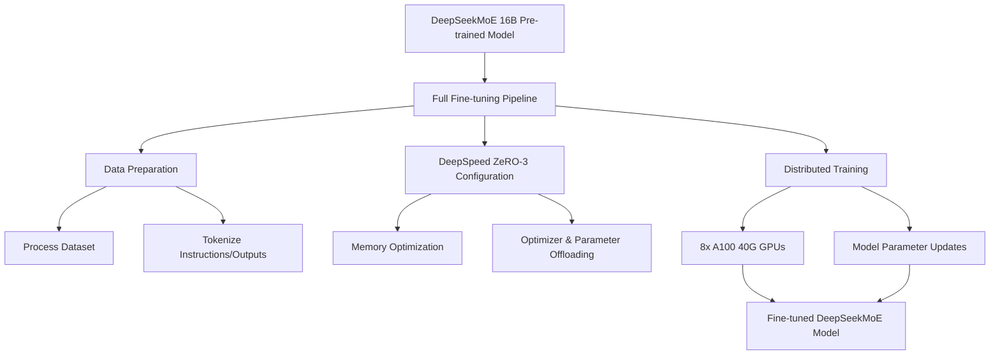
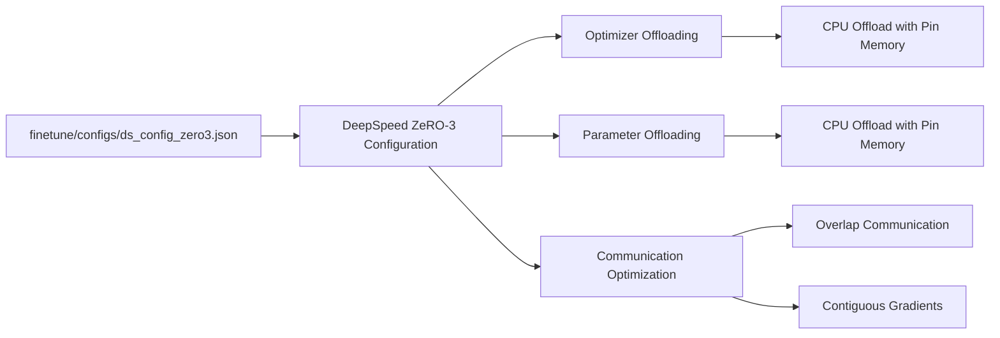
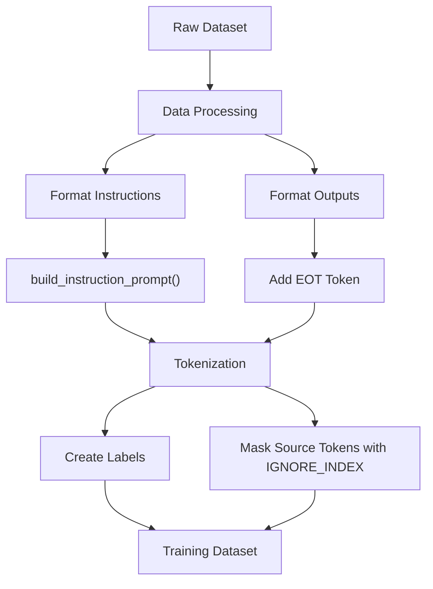
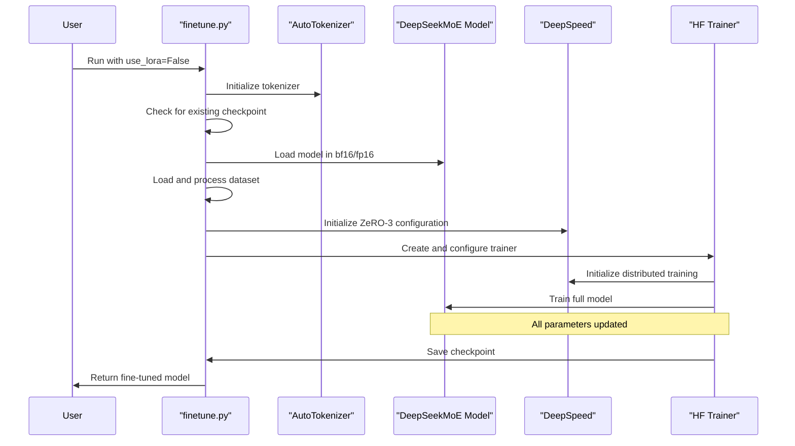
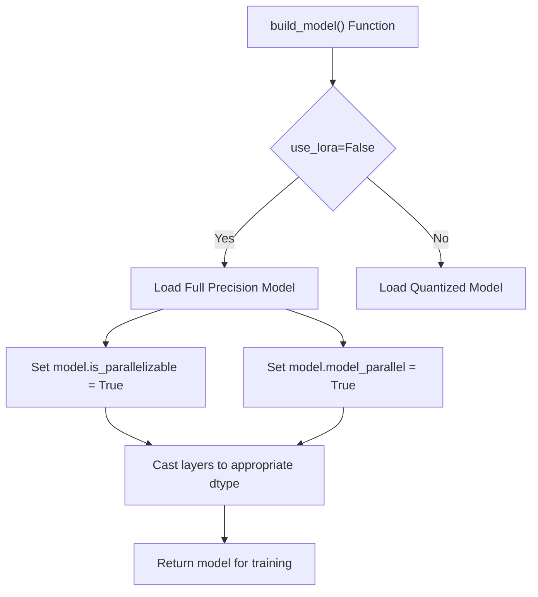

<!-- source: DeepWiki mcp.deepwiki.com · repo deepseek-ai/DeepSeek-MoE · page 4.1 Full Fine-tuning · fetched 2026-10-30 -->

# Full Fine-tuning

<details>
<summary>Relevant source files</summary>

The following files were used as context for generating this wiki page:

- [README.md](README.md)
- [finetune/configs/ds_config_zero3.json](finetune/configs/ds_config_zero3.json)
- [finetune/finetune.py](finetune/finetune.py)

</details>


This document explains how to perform full fine-tuning on DeepSeek-MoE 16B models. Full fine-tuning involves updating all parameters of the model during the training process. For parameter-efficient fine-tuning approaches, see [LoRA Fine-tuning](#4.2) or [QLoRA Fine-tuning](#4.3).

## Overview

Full fine-tuning adapts the entire DeepSeek-MoE model to downstream tasks by updating all 16.4B parameters. This approach typically provides the best performance but requires significant computational resources. DeepSeek-MoE uses DeepSpeed ZeRO-3 optimization to make full fine-tuning feasible on distributed hardware.



Sources: [README.md:194-227](), [finetune/finetune.py:183-248]()

## Requirements

### Hardware Requirements

Full fine-tuning of DeepSeek-MoE 16B requires significant computational resources:

- **GPUs**: 8x NVIDIA A100 40GB GPUs (minimum)
- **Memory**: 320GB total GPU memory
- **Storage**: Sufficient space for model checkpoints (~33GB per save)

### Software Requirements

The following software is needed for full fine-tuning:

```
- Python >= 3.8
- PyTorch
- Transformers
- DeepSpeed
- Datasets
```

Sources: [README.md:113-120](), [finetune/finetune.py:1-15]()

## DeepSpeed ZeRO-3 Configuration

DeepSeek-MoE uses DeepSpeed ZeRO-3 for distributed training optimization. The configuration includes:



Sources: [finetune/configs/ds_config_zero3.json:24-43]()

Key ZeRO-3 configuration parameters:

| Parameter | Value | Purpose |
|-----------|-------|---------|
| `stage` | 3 | Enables ZeRO stage 3 optimization |
| `offload_optimizer` | CPU with pin memory | Moves optimizer states to CPU |
| `offload_param` | CPU with pin memory | Moves parameters to CPU when not needed |
| `overlap_comm` | true | Overlaps communication with computation |
| `contiguous_gradients` | true | Reduces memory fragmentation |
| `stage3_gather_16bit_weights_on_model_save` | true | Consolidates weights for saving |

Sources: [finetune/configs/ds_config_zero3.json:1-51]()

## Fine-tuning Process

### Data Preparation

The fine-tuning script expects data in the format similar to the [Open-Platypus dataset](https://huggingface.co/datasets/garage-bAInd/Open-Platypus) with the following fields:

- `instruction`: The input prompt/instruction
- `output`: The expected model output



Sources: [finetune/finetune.py:23-180]()

### Training Execution Flow

When you run full fine-tuning, the following process occurs:



Sources: [finetune/finetune.py:250-322]()

## Running Full Fine-tuning

### Command Line Usage

To run full fine-tuning, use the script provided in the repository:

```bash
cd finetune
deepspeed finetune.py \
    --model_name_or_path <model_path> \
    --data_path <data_path> \
    --output_dir <output_path> \
    --num_train_epochs 3 \
    --model_max_length 1024 \
    --per_device_train_batch_size 16 \
    --gradient_accumulation_steps 4 \
    --learning_rate 2e-5 \
    --warmup_steps 10 \
    --lr_scheduler_type "cosine" \
    --gradient_checkpointing True \
    --deepspeed configs/ds_config_zero3.json \
    --bf16 True \
    --use_lora False
```

The key flag for full fine-tuning is `--use_lora False`, which tells the script to update all model parameters.

Sources: [README.md:199-226](), [finetune/finetune.py:250-322]()

### Important Training Parameters

| Parameter | Description | Recommended Value |
|-----------|-------------|------------------|
| `model_max_length` | Maximum sequence length | 1024-4096 |
| `per_device_train_batch_size` | Batch size per GPU | 8-16 |
| `gradient_accumulation_steps` | Steps before optimizer update | 4-8 |
| `learning_rate` | Training learning rate | 1e-5 to 5e-5 |
| `warmup_steps` | Learning rate warmup steps | 10-100 |
| `gradient_checkpointing` | Memory optimization | True |
| `bf16` | Use BF16 precision | True (if supported) |

Sources: [finetune/finetune.py:31-67](), [README.md:199-226]()

## Technical Implementation Details

### Model Initialization

For full fine-tuning, the model is loaded in full precision (bf16 or fp16) without quantization:



Sources: [finetune/finetune.py:182-248]()

### DeepSpeed Integration

The integration between the Hugging Face Trainer and DeepSpeed is handled through:

1. DeepSpeed configuration file ([finetune/configs/ds_config_zero3.json]())
2. The `--deepspeed` flag in the command line arguments
3. Automatic parameter handling through the Trainer API

For full fine-tuning, the code uses specific model saving logic when `use_lora=False`:

```python
if not model_args.use_lora:
    safe_save_model_for_hf_trainer(trainer=trainer, output_dir=training_args.output_dir)
```

Sources: [finetune/finetune.py:317-319]()

## Best Practices

### Hyperparameter Recommendations

- For most downstream tasks, 3-5 epochs is typically sufficient
- Start with a learning rate of 2e-5 and adjust based on task complexity
- Use gradient checkpointing to reduce memory usage
- Leverage BF16 precision if your hardware supports it
- Adjust batch size and gradient accumulation based on available GPU memory

### Memory Optimization

- Enable gradient checkpointing to reduce memory footprint
- Use DeepSpeed ZeRO-3 with parameter and optimizer offloading
- Consider reducing sequence length if possible for your task
- Monitor GPU memory usage and adjust batch sizes accordingly

Sources: [README.md:199-226](), [finetune/configs/ds_config_zero3.json:24-43]()

## Checkpoint Management

DeepSeek-MoE's fine-tuning script includes automatic checkpoint management:

- Checkpoints are saved at regular intervals specified by `--save_steps`
- Training can be resumed from the last checkpoint by providing the same `--output_dir`
- The `get_last_checkpoint` function automatically detects and loads the most recent checkpoint

Sources: [finetune/finetune.py:69-104](), [finetune/finetune.py:278-279]()

## Comparing with Parameter-Efficient Methods

| Aspect | Full Fine-tuning | LoRA | QLoRA |
|--------|------------------|------|-------|
| Parameters Updated | All 16.4B parameters | Only LoRA adapters | Only LoRA adapters |
| GPU Requirements | 8x A100 40GB | Reduced (ZeRO-2) | Single A100 80GB |
| Performance | Typically best performance | Good performance, smaller file size | Good performance with quantization |
| Use Case | When maximum performance is needed | When moderate resources are available | When limited resources are available |

Sources: [README.md:194-227]()

---

