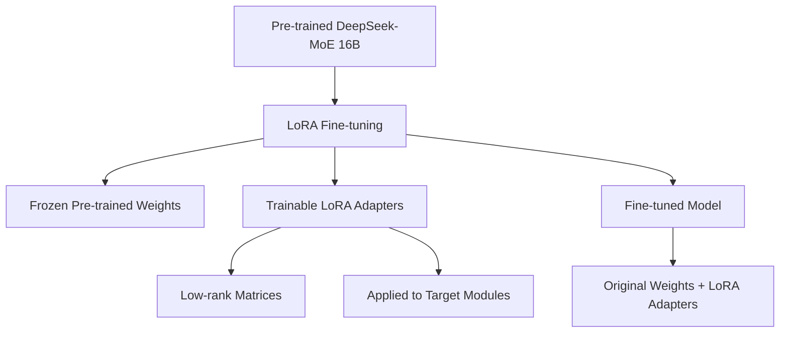
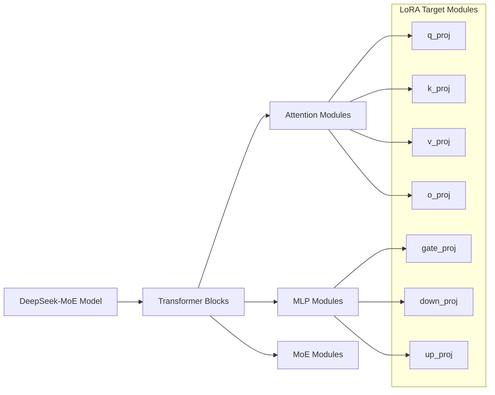
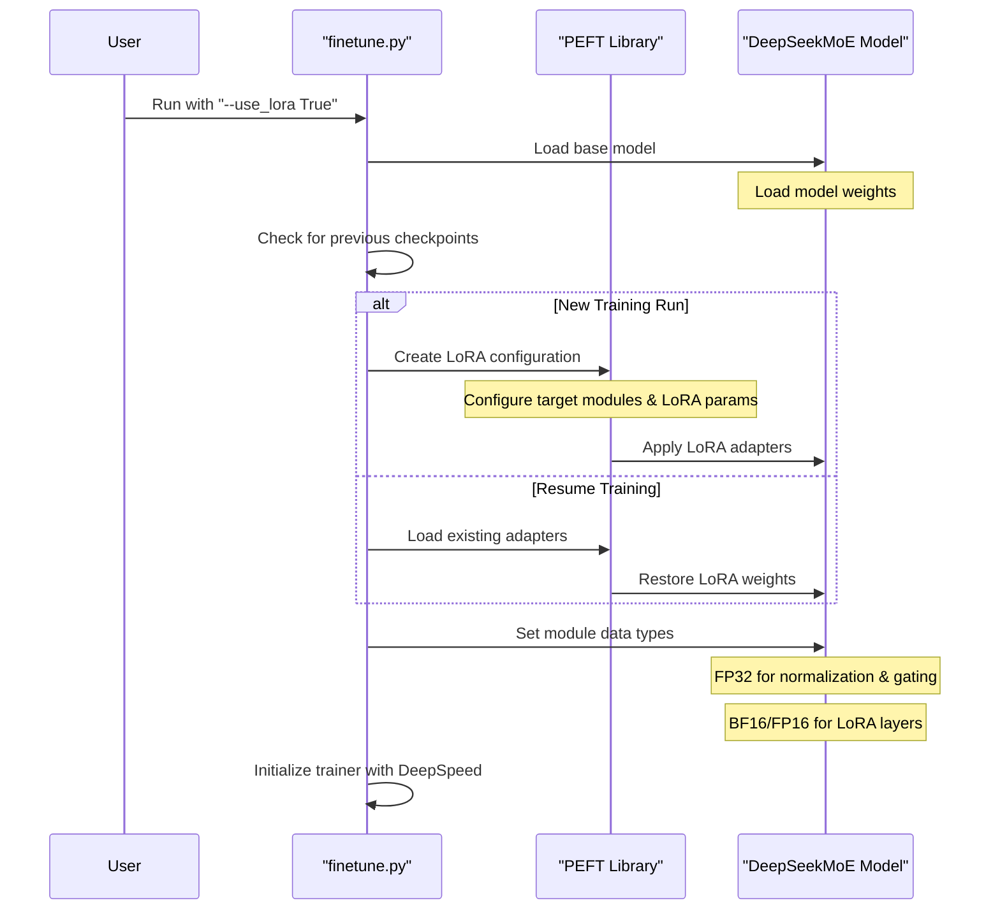
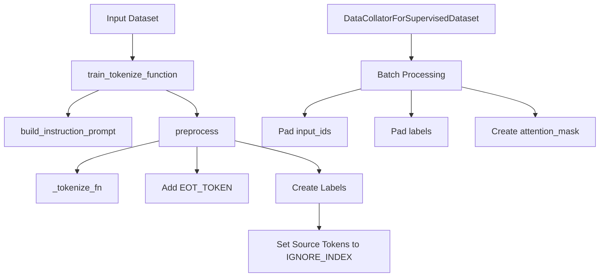
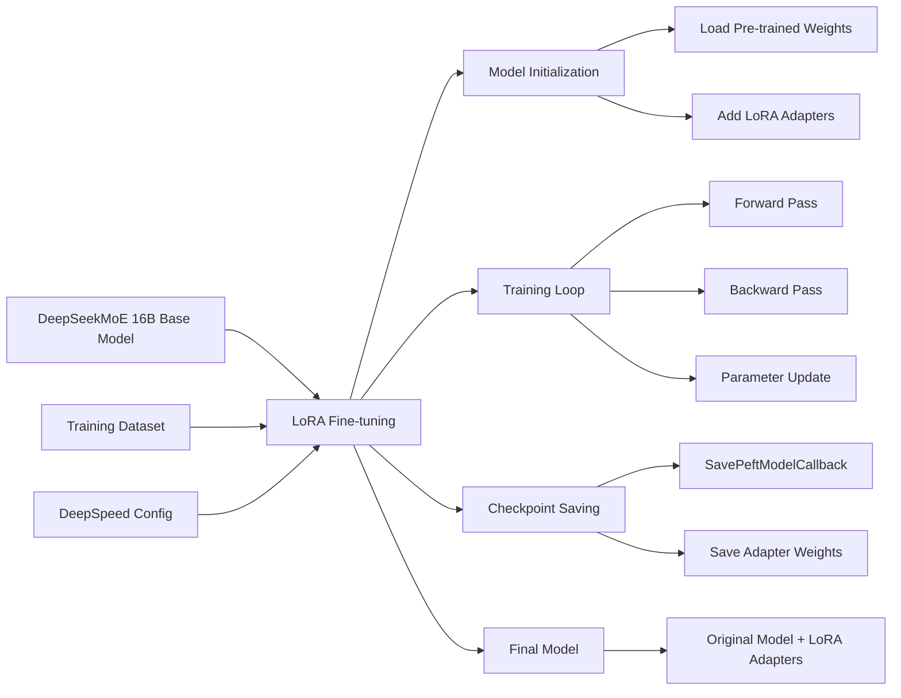

<!-- source: DeepWiki mcp.deepwiki.com · repo deepseek-ai/DeepSeek-MoE · page 4.2 LoRA Fine-tuning · fetched 2026-10-30 -->

# LoRA Fine-tuning

<details>
<summary>Relevant source files</summary>

The following files were used as context for generating this wiki page:

- [README.md](README.md)
- [finetune/configs/ds_config_zero2_no_offload.json](finetune/configs/ds_config_zero2_no_offload.json)
- [finetune/finetune.py](finetune/finetune.py)

</details>


This document provides comprehensive guidance on fine-tuning DeepSeek-MoE models using Low-Rank Adaptation (LoRA) technique. LoRA offers a parameter-efficient alternative to full fine-tuning, allowing you to adapt the DeepSeek-MoE 16B model to downstream tasks with significantly reduced memory requirements. For full fine-tuning, see [Full Fine-tuning](#4.1), and for quantized LoRA approach, see [QLoRA Fine-tuning](#4.3).

## Introduction to LoRA

LoRA (Low-Rank Adaptation) is a parameter-efficient fine-tuning technique that freezes the pre-trained model weights and injects trainable rank decomposition matrices into each layer of the Transformer architecture. This approach significantly reduces the number of trainable parameters while maintaining model quality.

### Key Benefits of LoRA for DeepSeek-MoE

- **Memory Efficiency**: Requires significantly less GPU memory than full fine-tuning
- **Training Speed**: Faster training due to fewer parameters being updated
- **Storage Efficiency**: The resulting fine-tuned model is much smaller, as only the LoRA adapters need to be stored



Sources: [finetune/finetune.py:33-36](), [README.md:227-230]()

## LoRA Configuration in DeepSeek-MoE

DeepSeek-MoE implements LoRA using the PEFT (Parameter-Efficient Fine-Tuning) library. The implementation focuses on applying LoRA to specific attention and MLP modules within the model.

### Key LoRA Parameters

| Parameter | Default Value | Description |
|-----------|---------------|-------------|
| `lora_rank` | 8 | Rank of the low-rank decomposition matrices |
| `lora_alpha` | 32.0 | Scaling factor for the LoRA adapters |
| `lora_dropout` | 0.1 | Dropout probability for LoRA layers |
| `trainable` | "q_proj,v_proj,k_proj,o_proj,gate_proj,down_proj,up_proj" | Target modules to apply LoRA |
| `modules_to_save` | "embed_tokens,lm_head" | Modules to fully fine-tune alongside LoRA |

Sources: [finetune/finetune.py:33-37]()

### Target Modules Architecture



Sources: [finetune/finetune.py:33](), [finetune/finetune.py:222-235]()

## Implementation Details

The LoRA fine-tuning implementation integrates with DeepSpeed's ZeRO-2 optimization to further reduce memory requirements.

### LoRA Initialization Process



Sources: [finetune/finetune.py:182-248](), [finetune/finetune.py:215-236]()

### DeepSpeed ZeRO-2 Integration

DeepSeek-MoE uses DeepSpeed ZeRO-2 for LoRA fine-tuning with the following key configurations:

- Uses BFloat16 precision by default
- Implements gradient accumulation for larger effective batch sizes
- Employs gradient checkpointing for additional memory savings
- No model offloading to CPU to maintain training speed

Sources: [finetune/configs/ds_config_zero2_no_offload.json:1-22]()

## Data Processing for Fine-tuning



Sources: [finetune/finetune.py:139-180](), [finetune/finetune.py:153-171]()

## How to Use LoRA Fine-tuning

### Command Line Example

To fine-tune DeepSeek-MoE with LoRA, use the following command:

```bash
DATA_PATH="<your_data_path>"
OUTPUT_PATH="<your_output_path>"
MODEL_PATH="<your_model_path>"

cd finetune
deepspeed finetune.py \
    --model_name_or_path $MODEL_PATH \
    --data_path $DATA_PATH \
    --output_dir $OUTPUT_PATH \
    --num_train_epochs 3 \
    --model_max_length 1024 \
    --per_device_train_batch_size 16 \
    --per_device_eval_batch_size 1 \
    --gradient_accumulation_steps 4 \
    --evaluation_strategy "no" \
    --save_strategy "steps" \
    --save_steps 100 \
    --save_total_limit 100 \
    --learning_rate 2e-5 \
    --warmup_steps 10 \
    --logging_steps 1 \
    --lr_scheduler_type "cosine" \
    --gradient_checkpointing True \
    --report_to "tensorboard" \
    --deepspeed configs/ds_config_zero2_no_offload.json \
    --bf16 True \
    --use_lora True \
    --lora_r 64 \
    --lora_alpha 16
```

Sources: [README.md:231-264]()

### Required Data Format

The fine-tuning script expects a dataset in the following format:

1. Data should be in Parquet format
2. Each record should have `instruction` and `output` fields
3. The script will automatically format these into instruction-response pairs

Example data record:
```json
{
  "instruction": "Explain the concept of mixture of experts in language models.",
  "output": "Mixture of Experts (MoE) is an architectural approach for language models where..."
}
```

Sources: [finetune/finetune.py:173-180](), [README.md:190-192]()

## LoRA Fine-tuning Pipeline



Sources: [finetune/finetune.py:313-319](), [finetune/finetune.py:69-91]()

## Hardware Requirements

LoRA fine-tuning requires significantly less GPU memory compared to full fine-tuning. With the provided configuration:

- You can fine-tune on systems with less powerful GPUs than required for full fine-tuning
- The DeepSpeed ZeRO-2 configuration works well on multi-GPU setups
- For a single A100 GPU with 40GB memory, you can fine-tune with a batch size of 16 and sequence length of 1024

Sources: [README.md:231-264]()

## Comparison with Other Fine-tuning Methods

| Method | Memory Usage | Training Speed | Adaptability | Hardware Requirements |
|--------|--------------|----------------|--------------|------------------------|
| Full Fine-tuning | Highest | Slowest | Best | 8x A100 40GB GPUs |
| LoRA | Medium | Fast | Good | Multi-GPU or Single A100 80GB GPU |
| QLoRA | Lowest | Medium | Good | Single A100 80GB GPU |

Sources: [README.md:181-264]()

## Post-Training Usage

After fine-tuning with LoRA, the adapters can be loaded and used for inference:

```python
from peft import PeftModel
from transformers import AutoModelForCausalLM, AutoTokenizer

# Load the base model
base_model = AutoModelForCausalLM.from_pretrained(
    "deepseek-ai/deepseek-moe-16b-base",
    torch_dtype=torch.bfloat16,
    device_map="auto"
)

# Load the LoRA adapters
model = PeftModel.from_pretrained(base_model, "path/to/lora/adapters")

# Load tokenizer
tokenizer = AutoTokenizer.from_pretrained("deepseek-ai/deepseek-moe-16b-base")

# Now use for inference as usual
```

This approach allows you to keep multiple different LoRA adapters for different tasks while using the same base model.

Sources: [finetune/finetune.py:216-219]()

---

