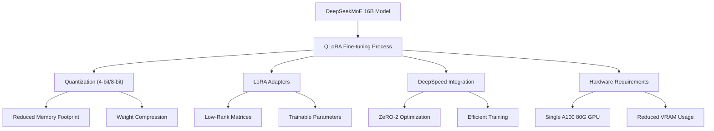
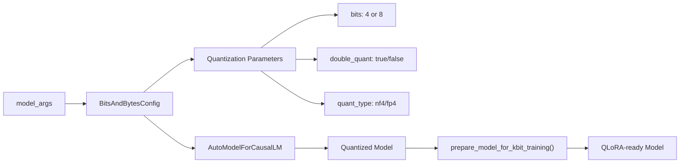
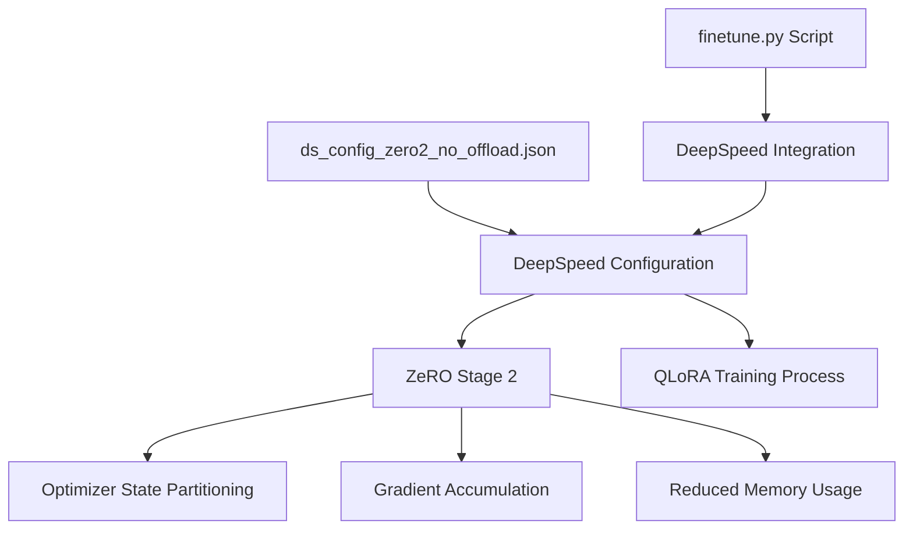
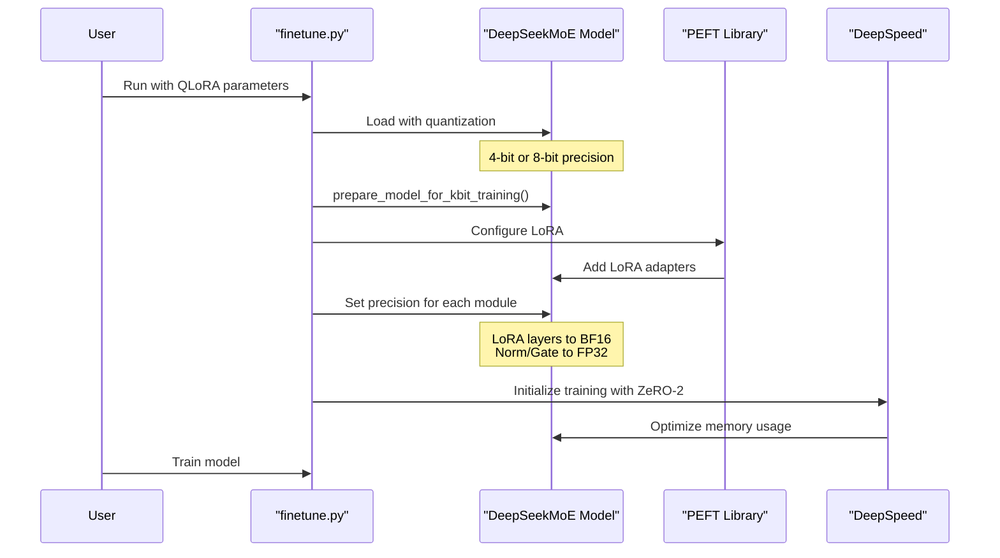
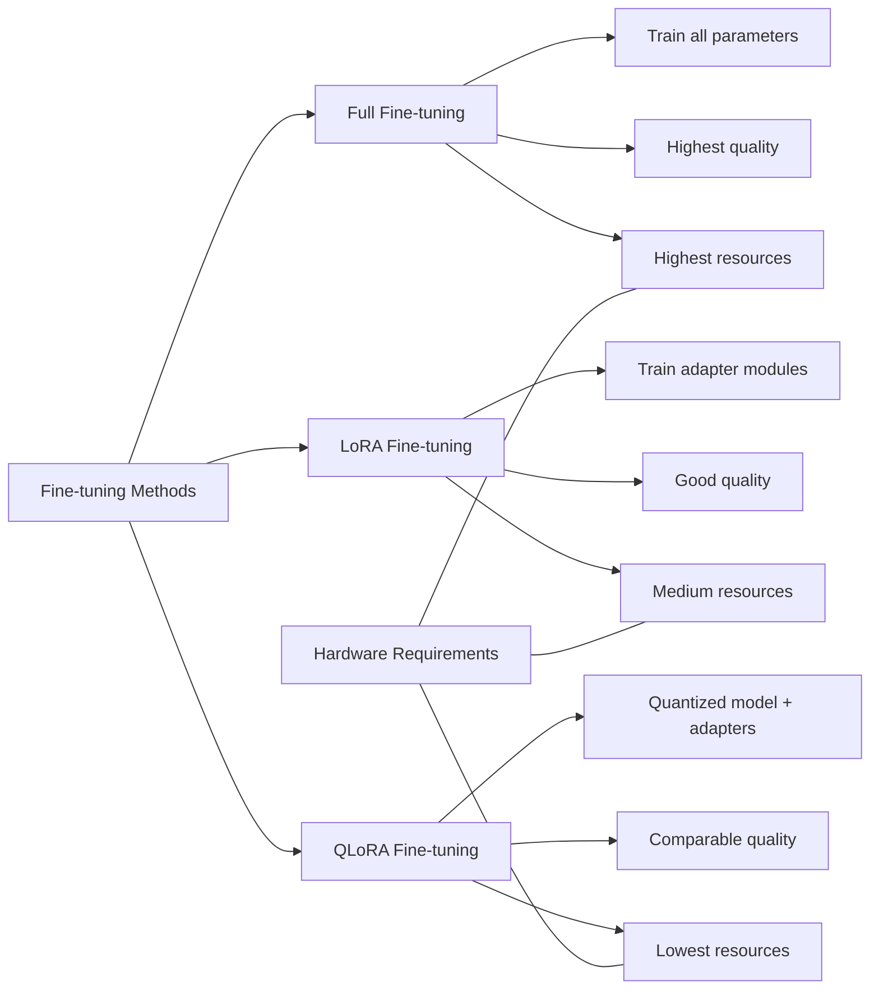

<!-- source: DeepWiki mcp.deepwiki.com · repo deepseek-ai/DeepSeek-MoE · page 4.3 QLoRA Fine-tuning · fetched 2026-10-30 -->

# QLoRA Fine-tuning

<details>
<summary>Relevant source files</summary>

The following files were used as context for generating this wiki page:

- [README.md](README.md)
- [finetune/configs/ds_config_zero2_no_offload.json](finetune/configs/ds_config_zero2_no_offload.json)
- [finetune/finetune.py](finetune/finetune.py)

</details>


This document provides a comprehensive guide to using Quantized Low-Rank Adaptation (QLoRA) fine-tuning with DeepSeek-MoE models. QLoRA combines quantization techniques with the LoRA approach to enable memory-efficient fine-tuning of large language models on limited hardware resources. For information about standard LoRA fine-tuning, see [LoRA Fine-tuning](#4.2).

## 1. Overview of QLoRA

QLoRA is a parameter-efficient fine-tuning technique that enables fine-tuning of large language models with significantly reduced memory requirements compared to full fine-tuning or standard LoRA. It works by:

1. Quantizing the base model weights to 4-bit or 8-bit precision
2. Adding trainable low-rank adapter matrices to key layers
3. Keeping the gradient computation and optimizer states in half-precision (BF16/FP16)

This approach allows DeepSeek-MoE 16B to be fine-tuned on a single GPU, whereas full fine-tuning would require multiple high-memory GPUs.



Sources: [README.md:229-264](), [finetune/finetune.py:181-248]()

## 2. Technical Components

### 2.1 Quantization Configuration

QLoRA in DeepSeek-MoE uses the Bits and Bytes library for 4-bit or 8-bit quantization of model weights. The implementation allows for:

- 4-bit or 8-bit quantization (configurable via the `bits` parameter)
- Double quantization to further compress memory usage
- Different quantization types (nf4, fp4)



Sources: [finetune/finetune.py:185-197](), [finetune/finetune.py:212-213]()

### 2.2 LoRA Configuration

The LoRA component of QLoRA allows for efficient fine-tuning by adding small trainable rank decomposition matrices to specific layers of the frozen model:

| Parameter | Description | Default |
|-----------|-------------|---------|
| `lora_rank` | Rank of the low-rank matrices | 64 |
| `lora_alpha` | Scaling factor for the LoRA adapters | 16 |
| `lora_dropout` | Dropout probability for LoRA layers | 0.1 |
| `target_modules` | Model components to apply LoRA to | q_proj,v_proj,k_proj,o_proj,gate_proj,down_proj,up_proj |
| `modules_to_save` | Additional modules to fully fine-tune | embed_tokens,lm_head |

The repository configures LoRA using PEFT (Parameter-Efficient Fine-Tuning) library's `LoraConfig` object, which specifies which layers to adapt and the dimensions of the low-rank matrices.

Sources: [finetune/finetune.py:221-236](), [README.md:258-262]()

### 2.3 Integration with DeepSpeed

DeepSeek-MoE uses DeepSpeed with ZeRO-2 optimization for QLoRA fine-tuning, which:

- Partitions optimizer states across GPUs
- Reduces memory usage for large models
- Enables efficient training on limited hardware



Sources: [finetune/configs/ds_config_zero2_no_offload.json:1-22](), [README.md:255]()

## 3. QLoRA Fine-tuning Process

### 3.1 Model Preparation

The QLoRA fine-tuning process in DeepSeek-MoE follows these key steps:

1. Load the pre-trained DeepSeekMoE model with quantization
2. Prepare the model for k-bit training
3. Add LoRA adapters to target modules
4. Configure precision settings for different module types



Sources: [finetune/finetune.py:182-248](), [finetune/finetune.py:313-319]()

### 3.2 Data Processing for Fine-tuning

DeepSeek-MoE provides a structured approach to prepare training data for QLoRA fine-tuning:

1. Load datasets using Hugging Face's dataset library
2. Tokenize and format instruction-output pairs
3. Apply templates for instruction-response format
4. Create attention masks and labels for training

The fine-tuning process uses a specific instruction template format that includes prompts and responses.

Sources: [finetune/finetune.py:139-180](), [finetune/finetune.py:281-299]()

### 3.3 Running QLoRA Fine-tuning

To fine-tune the DeepSeekMoE model using QLoRA, you can use the provided script with specific parameters:

```bash
DATA_PATH="<your_data_path>"
OUTPUT_PATH="<your_output_path>"
MODEL_PATH="<your_model_path>"

cd finetune
deepspeed finetune.py \
    --model_name_or_path $MODEL_PATH \
    --data_path $DATA_PATH \
    --output_dir $OUTPUT_PATH \
    --num_train_epochs 3 \
    --model_max_length 1024 \
    --per_device_train_batch_size 16 \
    --per_device_eval_batch_size 1 \
    --gradient_accumulation_steps 4 \
    --evaluation_strategy "no" \
    --save_strategy "steps" \
    --save_steps 100 \
    --save_total_limit 100 \
    --learning_rate 2e-5 \
    --warmup_steps 10 \
    --logging_steps 1 \
    --lr_scheduler_type "cosine" \
    --gradient_checkpointing True \
    --report_to "tensorboard" \
    --deepspeed configs/ds_config_zero2_no_offload.json \
    --bf16 True \
    --use_lora True \
    --bits 4 \
    --max_grad_norm 0.3 \
    --double_quant \
    --lora_r 64 \
    --lora_alpha 16 \
    --quant_type nf4
```

The key QLoRA-specific parameters include:
- `--use_lora True`: Enable LoRA fine-tuning
- `--bits 4`: Use 4-bit quantization (can also be 8)
- `--double_quant`: Enable double quantization for further memory saving
- `--lora_r 64`: Set LoRA rank to 64
- `--lora_alpha 16`: Set LoRA scaling factor to 16
- `--quant_type nf4`: Use 4-bit normal float quantization

Sources: [README.md:229-264](), [finetune/finetune.py:250-322]()

## 4. Memory Efficiency and Hardware Requirements

QLoRA significantly reduces the memory requirements for fine-tuning the DeepSeekMoE model:

| Fine-tuning Method | Memory Usage | Hardware Requirements |
|--------------------|--------------|----------------------|
| Full Fine-tuning   | Highest      | 8x A100 40G GPUs     |
| LoRA               | Medium       | Multiple GPUs        |
| QLoRA              | Lowest       | Single A100 80G GPU  |

The memory efficiency comes from:
1. Quantized base model weights (4-bit/8-bit)
2. Training only a small set of adapter parameters
3. DeepSpeed ZeRO-2 optimization
4. Gradient checkpointing

With these optimizations, researchers can fine-tune the 16.4B parameter DeepSeekMoE model on consumer-grade hardware.

Sources: [README.md:193-227](), [README.md:229-264](), [finetune/finetune.py:212-213]()

## 5. Saving and Loading Fine-tuned Models

The QLoRA fine-tuning process includes specific functionality for handling checkpoints:

1. The `SavePeftModelCallback` handles saving the LoRA adapters during training
2. Checkpoints are saved at specified intervals (configured by `save_steps`)
3. Fine-tuned models can be resumed from checkpoints

When training is complete, only the adapter weights are saved, which are much smaller than the full model weights.

Sources: [finetune/finetune.py:69-91](), [finetune/finetune.py:314-316]()

## 6. Performance Considerations

When using QLoRA fine-tuning, consider the following to optimize performance:

1. **Quantization precision**: 4-bit provides more memory savings but may sacrifice some quality; 8-bit uses more memory but retains more model quality
2. **LoRA rank**: Higher ranks (e.g., 64) may capture more complex adaptations but require more memory
3. **Batch size**: Adjust based on available memory and convergence needs
4. **Learning rate**: QLoRA typically works well with learning rates around 2e-5
5. **Target modules**: Select which model components to apply LoRA to based on task requirements

The DeepSeek-MoE implementation allows configuration of these parameters to balance memory usage and model quality.

Sources: [finetune/finetune.py:32-52](), [README.md:229-264]()

## 7. Comparison with Other Fine-tuning Methods

QLoRA offers a middle ground between performance and resource requirements:



Sources: [README.md:193-227](), [README.md:229-264]()

## 8. Conclusion

QLoRA fine-tuning provides an efficient method to adapt the DeepSeekMoE 16B model to specific tasks with minimal hardware requirements. By combining quantization techniques with Low-Rank Adaptation, it enables fine-tuning of large MoE models on a single GPU, making it accessible to a broader range of researchers and practitioners.

The implementation in DeepSeek-MoE leverages DeepSpeed optimization and the PEFT library to provide a streamlined workflow for QLoRA fine-tuning, with configurable parameters to balance memory usage and model quality.

Sources: [README.md:229-264](), [finetune/finetune.py:181-248]()

---

