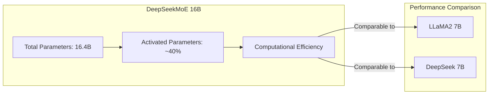
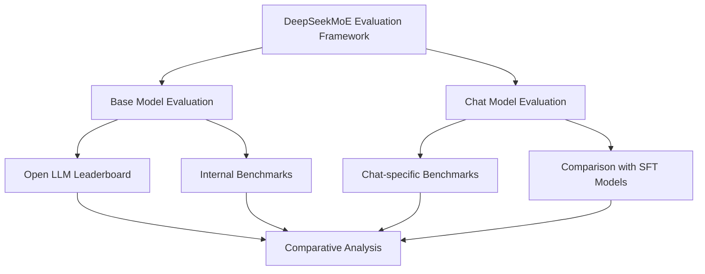
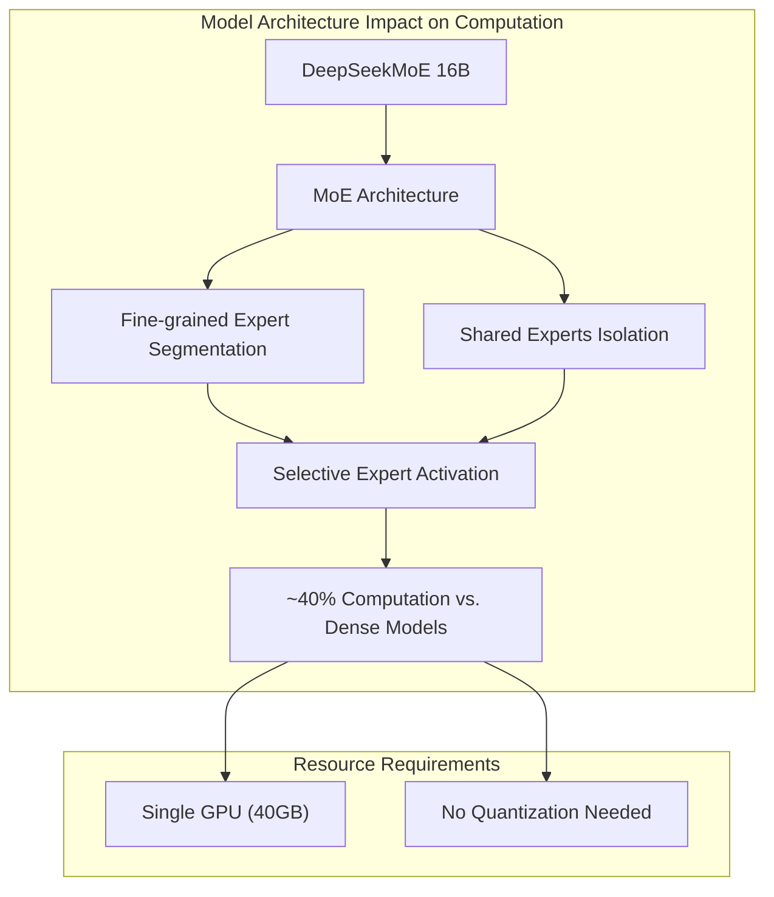

<!-- source: DeepWiki mcp.deepwiki.com · repo deepseek-ai/DeepSeek-MoE · page 5 Performance and Evaluation · fetched 2026-10-30 -->

# Performance and Evaluation

<details>
<summary>Relevant source files</summary>

The following files were used as context for generating this wiki page:

- [README.md](README.md)
- [images/evaluation_deepseekmoe16b_base_1.jpg](images/evaluation_deepseekmoe16b_base_1.jpg)
- [images/evaluation_deepseekmoe16b_base_2.jpg](images/evaluation_deepseekmoe16b_base_2.jpg)

</details>


This document provides a comprehensive overview of the performance characteristics and evaluation results of the DeepSeekMoE 16B models. It covers benchmark methodologies, comparative performance analysis against other language models, and key efficiency metrics. For details about specific model benchmarks, see [Base Model Benchmarks](#5.1) and [Chat Model Evaluation](#5.2).

## Overview of Performance Characteristics

DeepSeekMoE 16B is a Mixture-of-Experts (MoE) language model with 16.4B total parameters. Its key performance characteristic is achieving comparable capabilities to dense models like DeepSeek 7B and LLaMA2 7B while only activating approximately 40% of its parameters during inference. This efficiency is achieved through the model's innovative MoE architecture, which employs fine-grained expert segmentation and shared experts isolation.



Sources: [README.md:63-66]()

## Evaluation Framework

The DeepSeekMoE models underwent rigorous evaluation using a combination of established benchmarks and internal testing methodologies. The evaluation approach differs slightly between the base and chat models to appropriately assess their respective use cases.



Sources: [README.md:69-100]()

## Base Model Performance

The DeepSeekMoE 16B Base model was evaluated against various open-source models with similar computational requirements. The benchmark results demonstrate that:

1. It consistently outperforms models with a similar number of activated parameters
2. It achieves comparable performance with LLaMA2 7B, which has approximately 2.5 times the activated parameters
3. With only 40.5% of computations, it achieves comparable performance with DeepSeek 7B
4. With only 39.6% of computations, it outperforms LLaMA2 7B on the majority of benchmarks

The evaluation was conducted using the Open LLM Leaderboard and several internal benchmarks covering various language understanding and generation tasks.

| Comparison | Activated Parameters Ratio | Performance Result |
|------------|----------------------------|-------------------|
| vs. Similar MoE models | 1:1 | Consistently outperforms |
| vs. LLaMA2 7B | 1:2.5 | Comparable performance |
| vs. DeepSeek 7B | 40.5% computation | Comparable performance |
| vs. LLaMA2 7B | 39.6% computation | Better on most benchmarks |

Sources: [README.md:71-91]()

## Chat Model Performance

The DeepSeekMoE 16B Chat model was evaluated against DeepSeek 7B Chat and LLaMA2 7B SFT models. All compared models followed the same fine-tuning setting and data for fair comparison.

The evaluation results show that with only about 40% of computations, DeepSeekMoE 16B Chat achieves comparable or better performance than both DeepSeek 7B Chat and LLaMA2 7B SFT across a variety of chat-oriented benchmarks.

Sources: [README.md:93-100]()

## Computational Efficiency Analysis

One of the key strengths of the DeepSeekMoE architecture is its computational efficiency. The diagram below illustrates how the mixture-of-experts approach allows for significant reduction in computational requirements while maintaining comparable performance to dense models.



The model selectively activates only a subset of experts for any given input, leading to approximately 40% of the computational load compared to dense models of similar capability. This efficiency allows the model to run on a single GPU with 40GB of memory without requiring quantization.

Sources: [README.md:63-66](), [README.md:93-100]()

## Comparative Benchmarks Visualization

The relationship between computational efficiency and model performance is visualized below, showing how DeepSeekMoE 16B positions relative to other language models in terms of performance-to-computation ratio.

```mermaid
quadrantChart
    title "Performance vs. Computation Trade-off"
    x-axis "Computational Load" --> "Higher"
    y-axis "Model Performance" --> "Better"
    
    quadrant-1 "High Performance, Low Computation"
    quadrant-2 "High Performance, High Computation"
    quadrant-3 "Low Performance, Low Computation"
    quadrant-4 "Low Performance, High Computation"
    
    "DeepSeekMoE-16B": [0.4, 0.75]
    "LLaMA2-7B": [1.0, 0.73]
    "DeepSeek-7B": [1.0, 0.74]
    "Similar-MoE-Models": [0.4, 0.6]
```

This chart represents a conceptual visualization of the performance-to-computation trade-off, illustrating DeepSeekMoE 16B's favorable position in achieving high performance with lower computational requirements compared to dense models like LLaMA2 7B and DeepSeek 7B.

Sources: [README.md:71-100]()

## Hardware Requirements for Evaluation

DeepSeekMoE 16B models are designed for efficient deployment, requiring only a single GPU with 40GB of memory for inference without quantization. This makes the model accessible for both research and commercial applications with moderate hardware requirements.

For fine-tuning, hardware requirements vary based on the chosen method:
- Full fine-tuning: Requires 8x A100 40G GPUs with DeepSpeed ZeRO-3
- LoRA fine-tuning: Reduced memory footprint using DeepSpeed ZeRO-2
- QLoRA fine-tuning: Can be done on a single A100 80G GPU with 4/8-bit quantization

Sources: [README.md:66](), [README.md:180-199](), [README.md:229-264]()

## Summary of Key Performance Attributes

- **Total Parameters**: 16.4B
- **Activated Parameters**: ~40% of total (during inference)
- **Training Data**: 2T English tokens + 2T Chinese tokens
- **Performance Level**: Comparable to DeepSeek 7B and LLaMA2 7B
- **Memory Requirement**: Single GPU with 40GB memory (without quantization)
- **Computation Efficiency**: ~40% of equivalent dense models

The performance characteristics of DeepSeekMoE 16B demonstrate the effectiveness of its MoE architecture in achieving computational efficiency while maintaining high-quality language model capabilities.

Sources: [README.md:63-66](), [README.md:71-100]()

---

