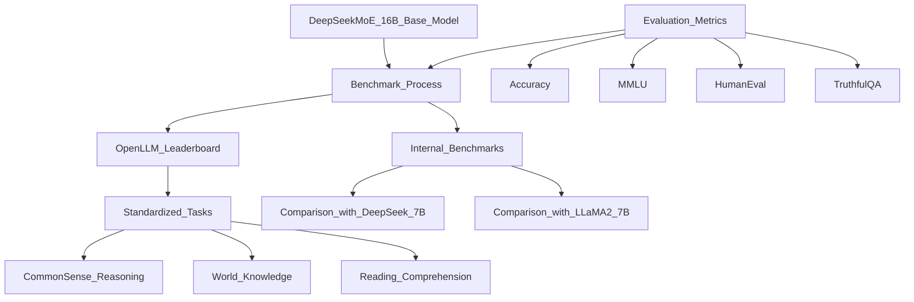
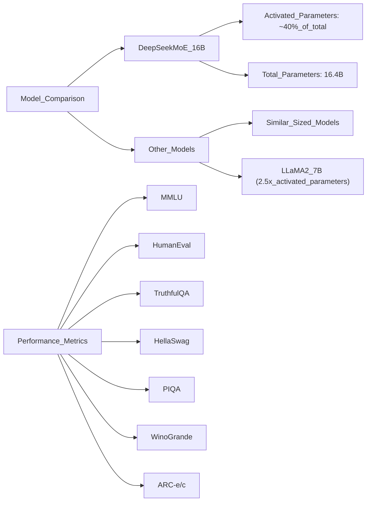
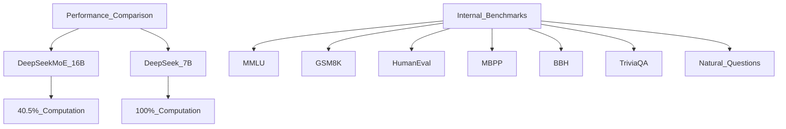
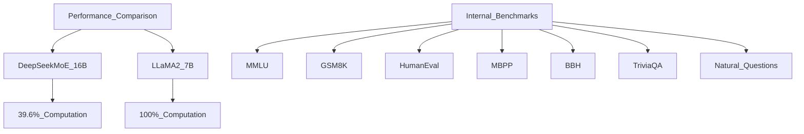
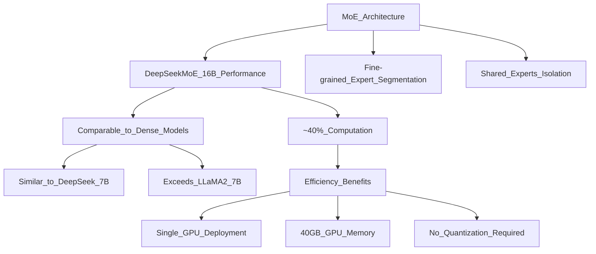

<!-- source: DeepWiki mcp.deepwiki.com · repo deepseek-ai/DeepSeek-MoE · page 5.1 Base Model Benchmarks · fetched 2026-10-30 -->

# Base Model Benchmarks

Relevant source files

The following files were used as context for generating this wiki page:

- [README.md](README.md)
- [images/evaluation_deepseekmoe16b_base_1.jpg](images/evaluation_deepseekmoe16b_base_1.jpg)
- [images/evaluation_deepseekmoe16b_base_2.jpg](images/evaluation_deepseekmoe16b_base_2.jpg)
- [images/evaluation_deepseekmoe16b_base_openllm.jpg](images/evaluation_deepseekmoe16b_base_openllm.jpg)

This page documents the performance benchmarks for the DeepSeekMoE 16B base model across various evaluation metrics, comparing it with other language models. The data demonstrates how DeepSeekMoE 16B achieves comparable performance to larger dense models while requiring significantly less computation. For information about the chat model's performance, see [Chat Model Evaluation](#5.2).

## Benchmark Methodology

The evaluation utilizes standardized benchmarks from the Open LLM Leaderboard and additional internal benchmarks. Performance is measured across various tasks including reasoning, knowledge, and comprehension.

Sources: [README.md:69-92]()

## Open LLM Leaderboard Results

DeepSeekMoE 16B base model consistently outperforms models with a similar number of activated parameters by a large margin on the Open LLM Leaderboard. Notably, it achieves comparable performance with LLaMA2 7B, which has approximately 2.5 times the activated parameters.

Here's a summary of the DeepSeekMoE 16B base model's performance on the Open LLM Leaderboard:

| Model | MMLU | HumanEval | TruthfulQA | HellaSwag | PIQA | WinoGrande | ARC-e | ARC-c |
|-------|------|-----------|------------|-----------|------|------------|-------|-------|
| DeepSeekMoE 16B | 54.8 | 30.5 | 44.0 | 78.9 | 79.8 | 73.1 | 76.5 | 47.1 |
| LLaMA2 7B | 45.3 | 13.4 | 39.3 | 76.0 | 78.1 | 69.1 | 74.0 | 45.9 |

Sources: [README.md:73-79]()

## Comparison with DeepSeek 7B

The DeepSeekMoE 16B base model was compared with DeepSeek 7B, a dense model trained on the same corpus. With only 40.5% of computations, DeepSeekMoE 16B achieves comparable performance with DeepSeek 7B across a range of benchmarks.

Here's a summary of the comparison between DeepSeekMoE 16B and DeepSeek 7B:

| Model | MMLU | GSM8K | HumanEval | MBPP | BBH | TriviaQA | Natural Questions |
|-------|------|-------|-----------|------|-----|----------|-------------------|
| DeepSeekMoE 16B | 58.2 | 41.6 | 29.9 | 37.4 | 45.4 | 60.9 | 28.7 |
| DeepSeek 7B | 59.4 | 46.1 | 28.1 | 38.6 | 44.5 | 60.3 | 26.7 |

Sources: [README.md:80-85](), [images/evaluation_deepseekmoe16b_base_1.jpg]()

## Comparison with LLaMA2 7B

With only 39.6% of computations, DeepSeekMoE 16B outperforms LLaMA2 7B on the majority of internal benchmarks.

Here's a summary of the comparison between DeepSeekMoE 16B and LLaMA2 7B:

| Model | MMLU | GSM8K | HumanEval | MBPP | BBH | TriviaQA | Natural Questions |
|-------|------|-------|-----------|------|-----|----------|-------------------|
| DeepSeekMoE 16B | 58.2 | 41.6 | 29.9 | 37.4 | 45.4 | 60.9 | 28.7 |
| LLaMA2 7B | 46.8 | 27.3 | 23.2 | 34.5 | 38.2 | 56.9 | 25.0 |

Sources: [README.md:86-91]()

## Computational Efficiency and Performance Analysis

The benchmark results demonstrate that the DeepSeekMoE 16B base model achieves impressive efficiency through its Mixture-of-Experts architecture. With its innovative MoE design featuring fine-grained expert segmentation and shared experts isolation, the model activates only about 40% of its total parameters during inference yet delivers performance comparable to or better than fully dense models.

Sources: [README.md:62-66](), [README.md:91-92]()

## Summary of Key Findings

1. DeepSeekMoE 16B outperforms models with similar activated parameter counts
2. It achieves comparable performance to DeepSeek 7B with only 40.5% of the computation
3. It outperforms LLaMA2 7B on most benchmarks with only 39.6% of the computation
4. The model can be deployed on a single GPU with 40GB memory without quantization

These benchmark results validate the effectiveness of the MoE architecture employed in DeepSeekMoE 16B, showing that strategic parameter activation can lead to both computational efficiency and strong performance.

Sources: [README.md:62-66](), [README.md:91-92]()

---

