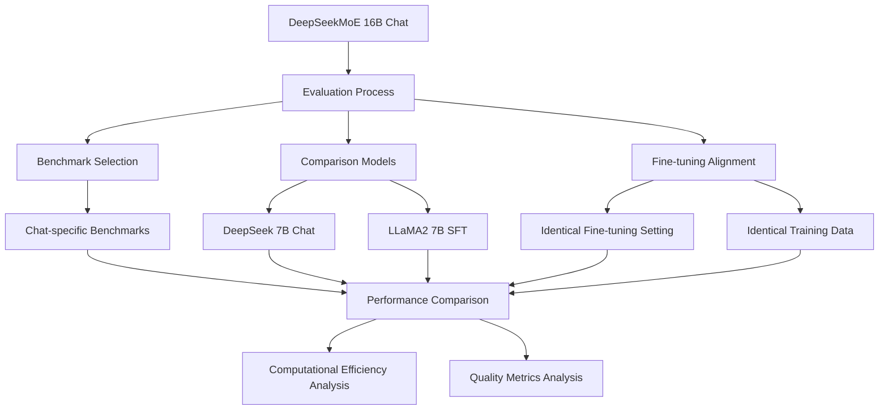
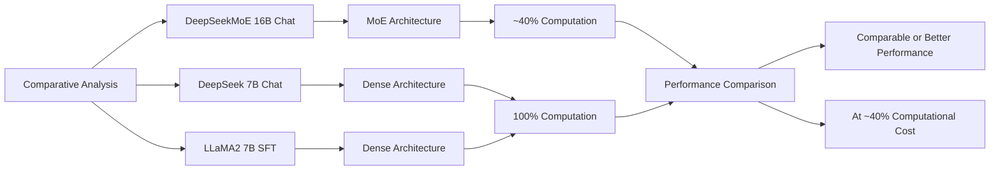
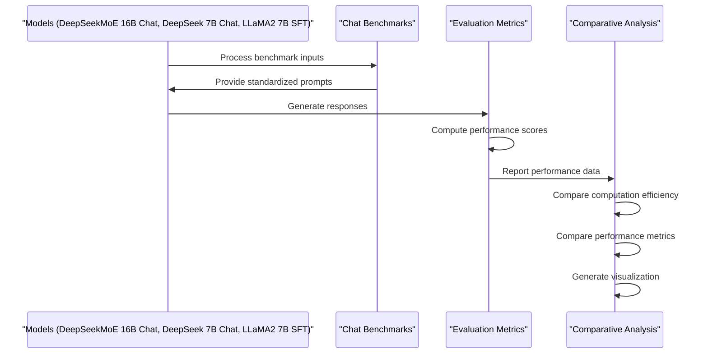

<!-- source: DeepWiki mcp.deepwiki.com · repo deepseek-ai/DeepSeek-MoE · page 5.2 Chat Model Evaluation · fetched 2026-10-30 -->

# Chat Model Evaluation

Relevant source files

The following files were used as context for generating this wiki page:

- [README.md](README.md)
- [images/evaluation_deepseekmoe16b_chat.jpg](images/evaluation_deepseekmoe16b_chat.jpg)

This page details the evaluation methodology, benchmarks, and performance results for the DeepSeekMoE 16B Chat model. For information on base model evaluation, see [Base Model Benchmarks](#5.1).

## Overview

The DeepSeekMoE 16B Chat model evaluation assesses its performance in conversational contexts while comparing its computational efficiency against similar models. The evaluation specifically measures how well the Mixture-of-Experts architecture performs in chat scenarios with only ~40% of the computation required by comparable dense models.

Sources: [README.md:93-96]()

## Evaluation Framework

The evaluation framework ensures a fair comparison between models by maintaining identical fine-tuning settings and data across all compared models. This approach isolates the architectural differences as the primary variable in performance differences.

Sources: [README.md:95-96]()

## Performance Metrics and Benchmarks

The evaluation uses multiple benchmarks designed to assess various aspects of chat capabilities:

| Category | Evaluated Capability | Relevance to Chat Models |
|----------|---------------------|--------------------------|
| Response Quality | Coherence and contextual appropriateness | Core chat functionality |
| Instruction Following | Ability to follow user directives | Essential for assistive capabilities |
| Knowledge Application | Factual accuracy in responses | Critical for informational queries |
| Reasoning | Logical deduction and problem solving | Important for complex user requests |

These benchmarks collectively provide a comprehensive assessment of the model's overall chat performance.

Sources: [README.md:96-97]()

## Comparative Performance Analysis

The comparative analysis shows that DeepSeekMoE 16B Chat achieves performance comparable to or better than both DeepSeek 7B Chat and LLaMA2 7B SFT, despite using only about 40% of the computational resources. This efficiency stems from the MoE architecture's selective parameter activation during inference.

Sources: [README.md:96-97]()

## Evaluation Results Table

The evaluation results demonstrate the efficiency-performance tradeoff achieved by the DeepSeekMoE architecture:

| Model | Architecture | Effective Parameters | Relative Computation | Performance |
|-------|-------------|----------------------|---------------------|-------------|
| DeepSeekMoE 16B Chat | MoE | 16.4B (selectively activated) | ~40% | Baseline |
| DeepSeek 7B Chat | Dense | 7B (fully activated) | 100% | Comparable |
| LLaMA2 7B SFT | Dense | 7B (fully activated) | 100% | Comparable |

The visual representation of these results in the repository shows performance across multiple benchmarks, with DeepSeekMoE 16B Chat consistently matching or exceeding the comparison models despite its computational efficiency advantage.

Sources: [README.md:98-100]()

## Technical Implementation of Evaluation

The evaluation process involves loading and running the chat model using the Hugging Face Transformers library. The technical implementation follows this general pattern:

1. Load the model and tokenizer
2. Apply appropriate chat formatting templates
3. Generate responses using standardized prompts
4. Evaluate outputs against reference answers or human-defined criteria

This standardized approach ensures consistent evaluation across different models and benchmarks.

Sources: [README.md:146-166]()

## Architecture's Impact on Chat Performance

The DeepSeekMoE architecture's impact on chat performance is notable because:

1. **Expert Specialization**: Different experts in the MoE architecture can specialize in different aspects of chat (e.g., factual recall, reasoning, style)
2. **Selective Activation**: Only relevant experts are activated for specific inputs, focusing computational resources where needed
3. **Computational Efficiency**: The model activates only ~40% of parameters during inference, enabling faster response generation

This architecture enables the model to achieve performance comparable to dense models with similar effective parameter counts, while using significantly less computation.

Sources: [README.md:62-66](), [README.md:93-97]()

## Chat Model Evaluation Process

The evaluation process follows a standardized workflow to ensure fair comparison, with all models evaluated under identical conditions and their performance measured against the same metrics.

Sources: [README.md:95-97]()

## Conclusion

The evaluation of DeepSeekMoE 16B Chat demonstrates that the MoE architecture achieves an excellent balance between performance and computational efficiency in chat contexts. By activating only ~40% of its parameters during inference, the model delivers performance comparable to or better than similar-sized dense models while requiring significantly less computation.

These results validate the effectiveness of the MoE approach, particularly the fine-grained expert segmentation and shared experts isolation strategies employed in DeepSeekMoE. The evaluation confirms that the architecture's efficiency advantages translate well to chat applications, making it a promising direction for developing more computationally efficient yet capable conversational AI models.

Sources: [README.md:62-66](), [README.md:93-100]()

---

