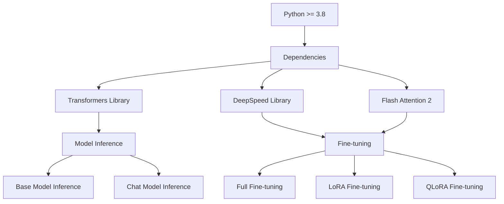
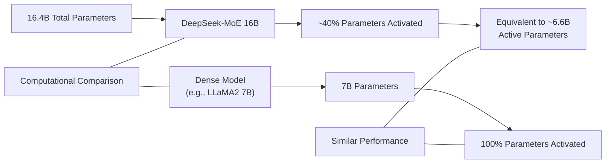
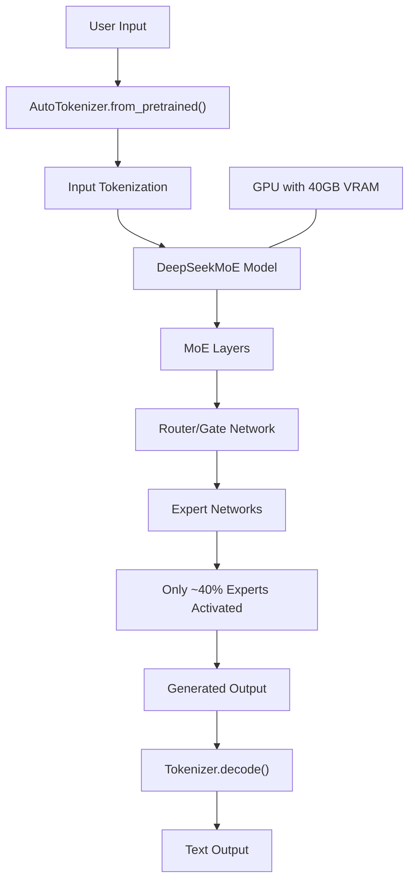
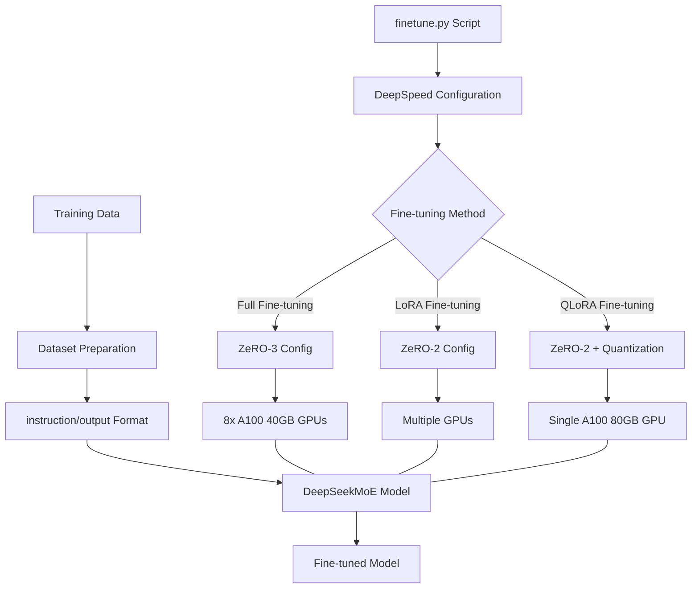
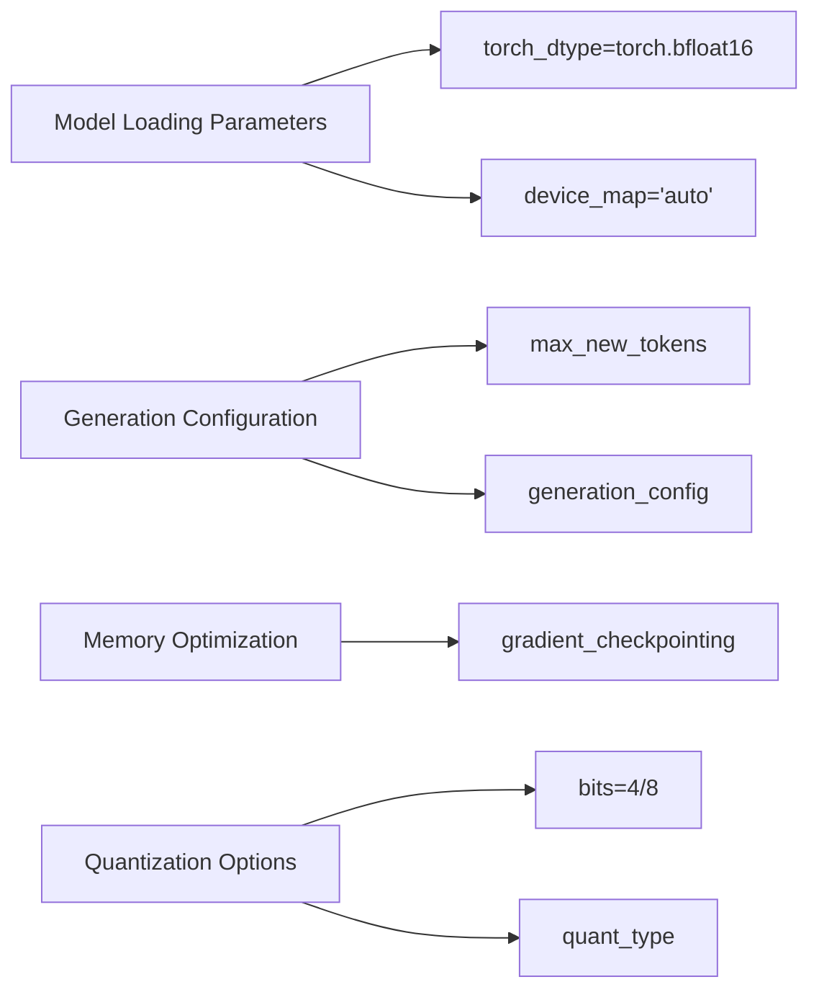
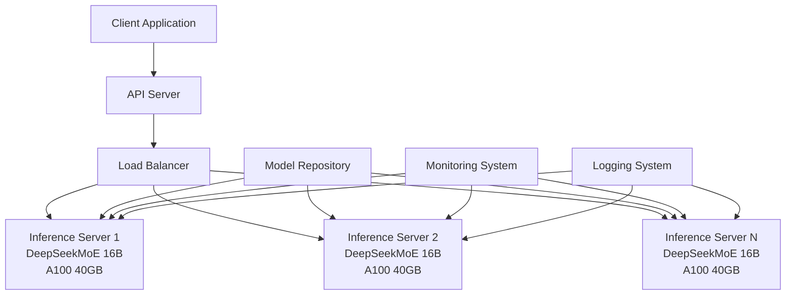

<!-- source: DeepWiki mcp.deepwiki.com · repo deepseek-ai/DeepSeek-MoE · page 6 Deployment Requirements · fetched 2026-10-30 -->

# Deployment Requirements

<details>
<summary>Relevant source files</summary>

The following files were used as context for generating this wiki page:

- [DeepSeekMoE.pdf](DeepSeekMoE.pdf)
- [README.md](README.md)

</details>


This page outlines the hardware and software requirements for deploying DeepSeek-MoE models. It covers both inference and fine-tuning scenarios, providing guidance on resource allocation for optimal performance. For information about model architecture details, see [Model Architecture](#2), and for details on how to use the models, see [Model Usage](#3).

## Hardware Requirements

DeepSeek-MoE models are designed to be more efficient than comparable dense models, requiring fewer computational resources while maintaining similar performance.

### Inference Hardware

For inference, DeepSeek-MoE 16B models can be deployed on a single GPU with 40GB of memory without requiring quantization, making them accessible to a wider range of hardware configurations than many other models of similar capability.

| Deployment Type | Minimum Hardware | Recommended Hardware |
|-----------------|------------------|----------------------|
| Inference (Base/Chat) | Single GPU with 40GB VRAM | NVIDIA A100 40GB |
| Inference with Quantization | Single GPU with 16-24GB VRAM | NVIDIA RTX 4090/A10 |

Sources: [README.md:66-66]()

### Fine-tuning Hardware

Hardware requirements vary significantly based on the fine-tuning approach:

| Fine-tuning Method | Hardware Requirements | DeepSpeed Configuration |
|--------------------|------------------------|-------------------------|
| Full Fine-tuning | 8x A100 40GB GPUs | ZeRO-3 |
| LoRA Fine-tuning | Multiple GPUs (reduced memory footprint) | ZeRO-2 |
| QLoRA Fine-tuning | Single A100 80GB GPU | ZeRO-2 with 4/8-bit quantization |

Sources: [README.md:224-226](), [README.md:235-236](), [README.md:255-264]()

## Software Requirements

### Basic Requirements

```
Python >= 3.8
Dependencies from requirements.txt
```

### Software Stack



Sources: [README.md:116-119](), [README.md:184-188](), [README.md:196-196]()

## Memory and Computational Efficiency

DeepSeek-MoE achieves significant memory and computational efficiency through its Mixture of Experts architecture. The model uses only about 40% of the computation compared to dense models with similar performance.

### Memory Footprint Comparison



Sources: [README.md:63-66](), [README.md:81-81](), [README.md:87-87]()

## Deployment Scenarios

### Inference Deployment

The diagram below shows the system components and flow for deploying DeepSeek-MoE for inference:



Sources: [README.md:127-144](), [README.md:148-166]()

### Fine-tuning Deployment

The following diagram illustrates the components and data flow for fine-tuning the DeepSeek-MoE model:



Sources: [README.md:183-226](), [README.md:230-264]()

## Configuration Options

### Inference Configuration

The transformation from code configuration to deployment requires setting the appropriate parameters for model loading and generation:



Sources: [README.md:132-137](), [README.md:154-156]()

### DeepSpeed Configuration Files

The repository provides specific DeepSpeed configuration files for different fine-tuning scenarios:

1. **ZeRO-3 Configuration** (`configs/ds_config_zero3.json`) - For full fine-tuning
2. **ZeRO-2 Configuration** (`configs/ds_config_zero2_no_offload.json`) - For LoRA and QLoRA

These configuration files specify parameters like:
- ZeRO optimization stage
- Offload parameters
- Communication optimization
- Batch size handling

Sources: [README.md:224-224](), [README.md:255-255]()

## GPU Memory Requirements Analysis

### Base Memory Footprint

The table below shows the approximate memory requirements for different deployment scenarios:

| Deployment Scenario | Model Size | Activated Parameters | Approximate VRAM Required |
|---------------------|------------|----------------------|---------------------------|
| Inference (Base/Chat) | 16.4B | ~6.6B | 40GB |
| Inference with 8-bit Quantization | 16.4B | ~6.6B | 20GB |
| Inference with 4-bit Quantization | 16.4B | ~6.6B | 10GB |
| Full Fine-tuning | 16.4B | 16.4B | 320GB (distributed) |
| LoRA Fine-tuning | 16.4B + LoRA params | ~6.6B + LoRA params | 80-120GB (distributed) |
| QLoRA Fine-tuning | 4/8-bit quantized + LoRA params | Quantized + LoRA params | 80GB |

Sources: [README.md:63-66](), [README.md:224-264]()

## Performance Characteristics

The MoE architecture of DeepSeek-MoE models results in specific performance characteristics that should be considered when planning deployment:

1. **Throughput vs Latency**: The activation of only ~40% of parameters generally leads to faster inference compared to dense models of similar quality, but routing overhead can impact latency for very small batch sizes.

2. **Batch Size Considerations**: Optimal performance is typically achieved with appropriate batch sizing to amortize the routing overhead.

3. **Computational Efficiency**: Approximately 40% of the computation required by comparable dense models, which translates to higher throughput on the same hardware.

Sources: [README.md:65-65](), [README.md:81-81](), [README.md:87-87]()

## Recommended Deployment Architecture

For production deployments, the following architecture is recommended:



Sources: [README.md:63-67](), [README.md:124-166]()

## Conclusion

DeepSeek-MoE 16B models offer a balance of performance and efficiency, with deployment requirements that are more accessible than many models of comparable quality. The MoE architecture enables deployment on a single GPU with 40GB memory for inference, while providing various options for fine-tuning depending on available hardware resources.

When planning deployment, consider:
- Hardware configuration based on use case (inference vs. fine-tuning)
- Software dependencies and configurations
- Memory optimization techniques (gradient checkpointing, quantization, LoRA)
- Performance characteristics specific to MoE architecture

Sources: [README.md:63-67](), [README.md:116-226](), [README.md:230-264]()

---

