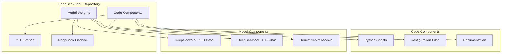
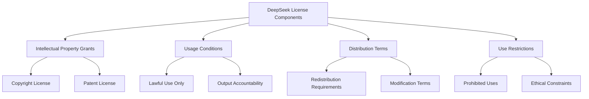
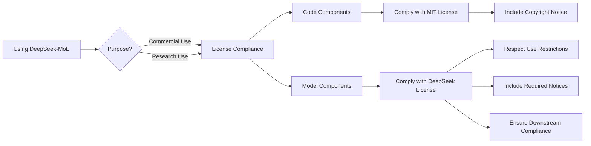

<!-- source: DeepWiki mcp.deepwiki.com · repo deepseek-ai/DeepSeek-MoE · page 7 Licensing · fetched 2026-10-30 -->

# Licensing

Relevant source files

The following files were used as context for generating this wiki page:

- [LICENSE-CODE](LICENSE-CODE)
- [LICENSE-MODEL](LICENSE-MODEL)
- [README.md](README.md)

## Purpose and Scope

This document outlines the licensing terms that govern the DeepSeek-MoE repository, explaining the dual licensing approach applied to the codebase and model weights. It clarifies what each license covers, the permissions granted, and the restrictions imposed to ensure proper usage of the DeepSeek-MoE models and associated code.

Sources: [README.md:265-269]()

## Licensing Structure

The DeepSeek-MoE repository employs a dual licensing approach:

1. **Code License**: MIT License - Applied to all software, scripts, and documentation in the repository
2. **Model License**: DeepSeek License - Applied to model weights, checkpoints, and derivative models

This dual structure allows for open-source development while ensuring responsible use of the model weights.

Sources: [README.md:39-44](), [LICENSE-CODE:1-21](), [LICENSE-MODEL:1-92]()

## Code License (MIT)

The MIT License applies to all software code and documentation in the repository. This is a permissive license that places minimal restrictions on reuse.

### Key Provisions

| Permission | Description |
|------------|-------------|
| Use | Free to use the software for any purpose |
| Modify | Can modify the code |
| Distribute | Can distribute original or modified code |
| Sublicense | Can incorporate into proprietary software |
| Commercial Use | Can use commercially |

### Conditions

- The copyright notice and permission notice must be included in all copies or substantial portions of the software
- The software is provided "as is" without warranty of any kind

The full MIT License text can be found in the [LICENSE-CODE]() file in the repository.

Sources: [LICENSE-CODE:1-21](), [README.md:265-269]()

## Model License (DeepSeek License)

The DeepSeek License applies to the model weights, checkpoints, and any derivatives of the model. It is a custom license designed to balance open access with responsible use.

### Key Concepts in the License

Sources: [LICENSE-MODEL:20-31](), [LICENSE-MODEL:33-40]()

### Intellectual Property Rights

The DeepSeek License grants:

1. **Copyright License**: A perpetual, worldwide, non-exclusive, royalty-free license to reproduce, prepare, publicly display, publicly perform, sublicense, and distribute the model and derivatives
2. **Patent License**: A perpetual, worldwide, non-exclusive, royalty-free patent license for any patent claims licensable by DeepSeek that are necessarily infringed by its contribution

Sources: [LICENSE-MODEL:33-40]()

### Conditions of Usage, Distribution and Redistribution

When distributing or redistributing the model or derivatives:

1. Use-based restrictions must be included in any legal agreement governing use/distribution
2. License terms must be provided to recipients
3. Modified files must carry notices of changes
4. All copyright, patent, trademark, and attribution notices must be retained
5. You may add your own copyright statement and additional license terms, provided they respect the original use restrictions

Sources: [LICENSE-MODEL:42-53]()

### Use Restrictions

The DeepSeek License prohibits using the model or derivatives for:

- Violating applicable laws or regulations
- Military use
- Exploiting or harming minors
- Generating verifiably false information to harm others
- Generating inappropriate content subject to regulatory requirements
- Generating personal identifiable information without authorization
- Defaming, disparaging, or harassing others
- Fully automated decision-making that adversely impacts legal rights
- Discriminating against individuals or groups
- Exploiting vulnerabilities of specific groups

The complete list of restrictions is in Attachment A of the [LICENSE-MODEL]() file.

Sources: [LICENSE-MODEL:75-91]()

## Commercial Usage

DeepSeek-MoE supports commercial use, as explicitly stated in the README.md. However, commercial use must still comply with:

1. For code: The terms of the MIT License
2. For models: The terms of the DeepSeek License, including all use restrictions

The DeepSeek License allows you to:
- Host the model for third-party remote access (e.g., as a service)
- Charge fees for support, warranty, or indemnity
- Use the models in commercial applications

But you must still respect all use restrictions and other conditions of the license.

Sources: [README.md:103-104](), [LICENSE-MODEL:44-52]()

## License Compliance Checklist

When using DeepSeek-MoE, ensure you:

1. **For code usage**:
   - Include the MIT License copyright notice in copies
   - Understand the "as is" warranty disclaimer

2. **For model usage**:
   - Review and comply with all use restrictions
   - Include the DeepSeek License with any distribution
   - Ensure downstream users are aware of and comply with restrictions
   - Take responsibility for generated outputs and their usage

3. **For commercial applications**:
   - Comply with both licenses according to which components you're using
   - Ensure your specific commercial use does not violate any use restrictions

Sources: [README.md:265-269](), [LICENSE-CODE:1-21](), [LICENSE-MODEL:42-53]()