# Page: Overview

# Overview

<details>
<summary>Relevant source files</summary>

The following files were used as context for generating this wiki page:

- [DeepSeekMoE.pdf](DeepSeekMoE.pdf)
- [README.md](README.md)

</details>


## Purpose and Scope

This document provides an introduction to the DeepSeek-MoE repository, which contains implementation and usage details for the DeepSeekMoE 16B language models. It covers the core features, architecture, and key capabilities of the models. For detailed information about the model architecture, see [Model Architecture](#2), and for specific usage patterns, see [Model Usage](#3).

## What is DeepSeekMoE?

DeepSeekMoE 16B is a Mixture-of-Experts (MoE) language model with 16.4 billion total parameters. It represents an efficient approach to large language model design, achieving comparable performance to dense models with significantly reduced computational requirements. The repository provides both base and chat variants of the model.

**Key characteristics:**
- Employs a novel MoE architecture with fine-grained expert segmentation and shared experts isolation
- Trained on 2 trillion English and 2 trillion Chinese tokens
- Requires only ~40% of the computation used by comparable dense models
- Can be deployed on a single GPU with 40GB memory without quantization
- Supports both inference and fine-tuning workflows

Sources: [README.md:61-67]()

## Model Variants

The repository provides two primary model variants:

| Model               | Purpose                                     | Hugging Face Model ID              |
|---------------------|---------------------------------------------|-----------------------------------|
| DeepSeekMoE 16B Base| General text completion and generation      | deepseek-ai/deepseek-moe-16b-base |
| DeepSeekMoE 16B Chat| Optimized for conversational interactions   | deepseek-ai/deepseek-moe-16b-chat |

Both models support a context length of 4096 tokens and can be loaded using the Hugging Face Transformers library.

Sources: [README.md:107-111]()

## System Architecture Overview

The following diagram illustrates the key components of the DeepSeek-MoE system:

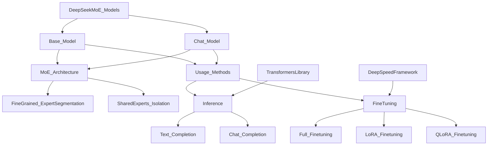

Sources: [README.md:61-67](), [README.md:113-122](), [README.md:180-195]()

## MoE Architecture Core Concepts

The key innovation in DeepSeekMoE is its efficient Mixture-of-Experts architecture, which allows the model to achieve strong performance while activating only about 40% of its parameters during inference.

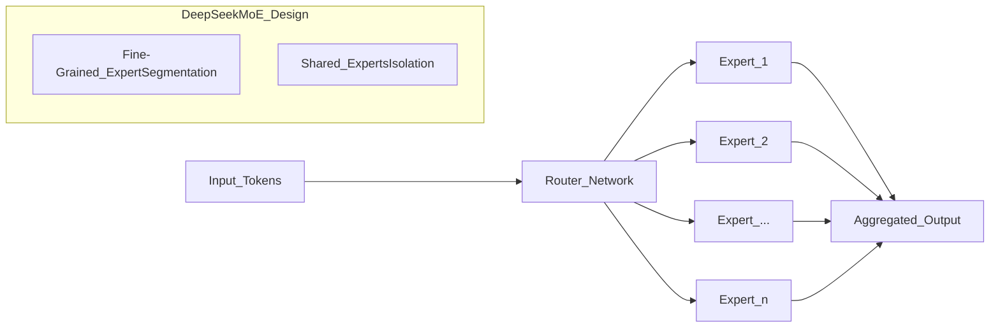

In the MoE architecture:
1. Input tokens are processed by a router network
2. The router dynamically selects which expert networks to activate for each token
3. Only a subset of experts is activated for any given input, ensuring computational efficiency
4. Outputs from selected experts are aggregated to produce the final result

Sources: [README.md:63-66]()

## Usage Methods

DeepSeek-MoE supports two primary usage patterns:

### Inference

The models can be used for inference directly with the Hugging Face Transformers library:

1. **Text Completion** with the base model - for general-purpose text generation
2. **Chat Completion** with the chat model - optimized for conversational interactions

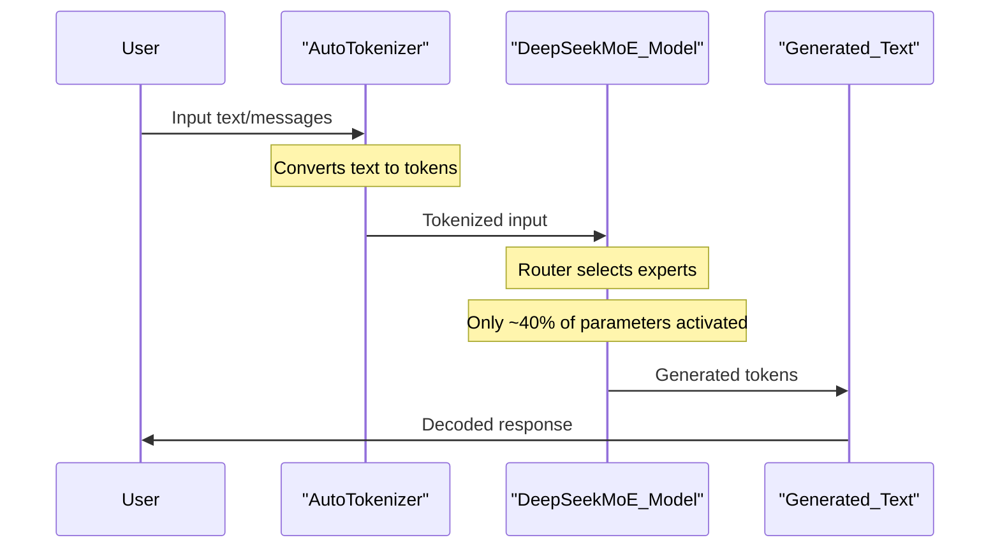

Sources: [README.md:122-177]()

### Fine-tuning

The repository provides support for fine-tuning the models on downstream tasks using three approaches:

1. **Full Fine-tuning** - Updates all model parameters using DeepSpeed ZeRO-3
2. **LoRA Fine-tuning** - Parameter-efficient fine-tuning using DeepSpeed ZeRO-2
3. **QLoRA Fine-tuning** - Quantized fine-tuning for memory efficiency

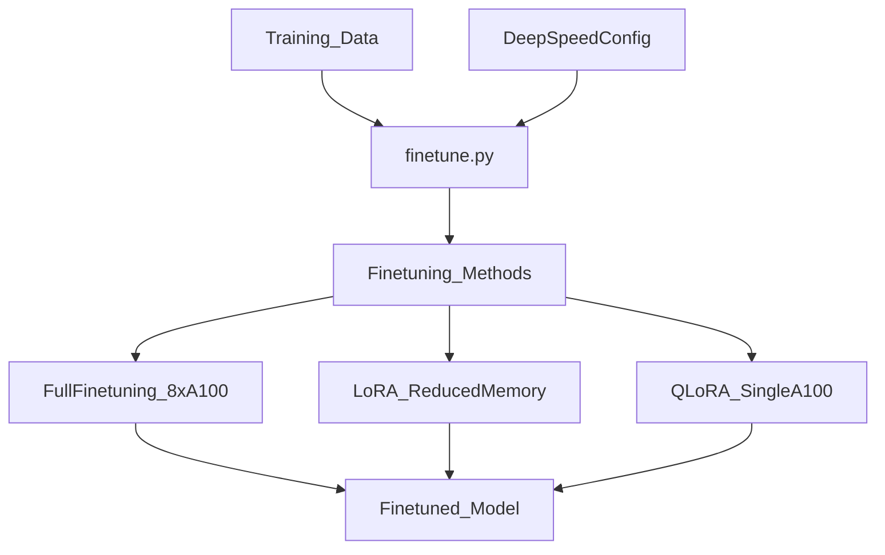

Sources: [README.md:180-264]()

## Performance

DeepSeekMoE 16B achieves comparable performance to models like DeepSeek 7B and LLaMA2 7B while using only about 40% of the computational resources:

- **Base model**: Performs similarly to DeepSeek 7B and LLaMA2 7B on various benchmarks 
- **Chat model**: Achieves comparable or better performance than DeepSeek 7B Chat and LLaMA2 7B SFT

The model's efficiency comes from its MoE architecture, which activates only a subset of its total parameters for any given input.

Sources: [README.md:69-100]()

## Hardware Requirements

- **Inference**: Can be deployed on a single GPU with 40GB of memory without quantization
- **Full Fine-tuning**: Requires 8x A100 40GB GPUs with DeepSpeed ZeRO-3
- **LoRA Fine-tuning**: Requires reduced memory footprint with DeepSpeed ZeRO-2
- **QLoRA Fine-tuning**: Can run on a single A100 80GB GPU with 4/8-bit quantization

Sources: [README.md:66](), [README.md:194-264]()

## Licensing

The DeepSeek-MoE repository has a dual licensing structure:

- **Code**: Licensed under the MIT License
- **Model weights**: Subject to the DeepSeek Model License

The models support commercial use under the terms of the license.

Sources: [README.md:39-44](), [README.md:266-268]()

---

# Page: Model Architecture

# Model Architecture

<details>
<summary>Relevant source files</summary>

The following files were used as context for generating this wiki page:

- [DeepSeekMoE.pdf](DeepSeekMoE.pdf)
- [README.md](README.md)

</details>


## Purpose and Scope

This document provides a detailed technical explanation of the DeepSeekMoE 16B model's architecture. It covers the underlying Mixture of Experts (MoE) design, the innovative approaches used for expert segmentation and isolation, and how these architectural decisions impact the model's efficiency and performance. For information about how to use the model for inference, see [Model Usage](#3), and for fine-tuning approaches, see [Fine-tuning](#4).

## Overview of DeepSeekMoE 16B

DeepSeekMoE 16B is a Mixture-of-Experts language model with 16.4 billion total parameters. The architecture employs an innovative MoE design that enables the model to achieve comparable performance to dense models with significantly reduced computational requirements. During inference, the model activates only about 40% of its parameters, making it computationally equivalent to a ~6.6B dense model while delivering performance on par with models like DeepSeek 7B and LLaMA2 7B.

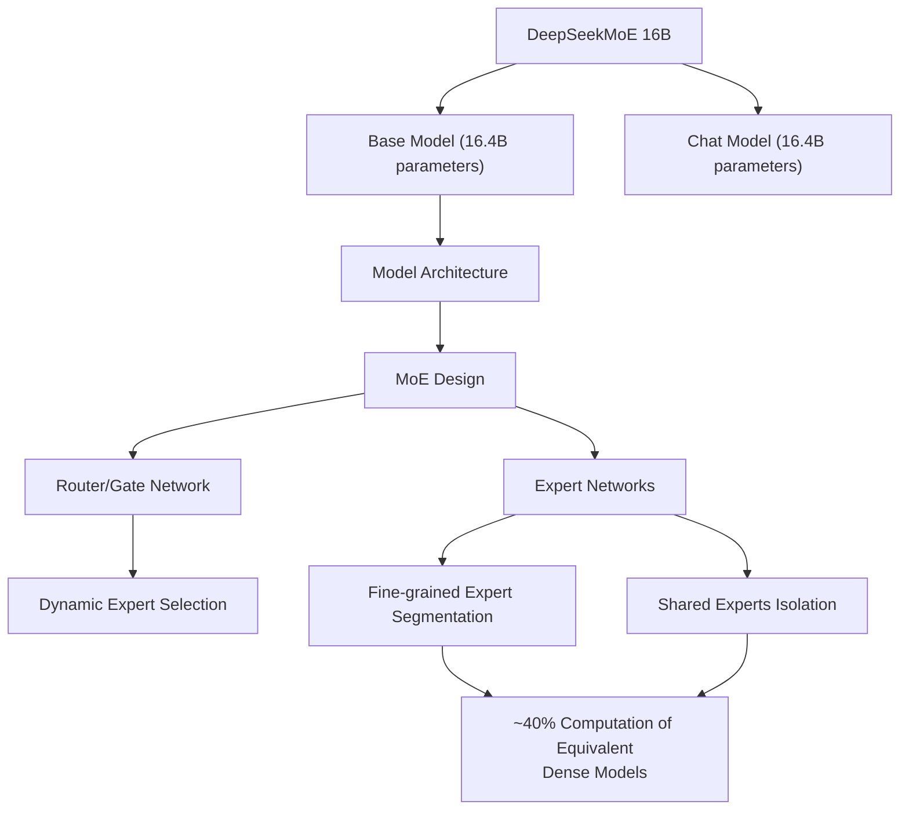

Sources: [README.md:63-66]()

## Mixture of Experts Architecture

The DeepSeekMoE model implements a Mixture-of-Experts architecture, which is fundamentally different from traditional dense transformer models. In an MoE architecture, instead of activating all parameters for every input token, the model dynamically routes each token to a subset of specialized neural network modules called "experts."

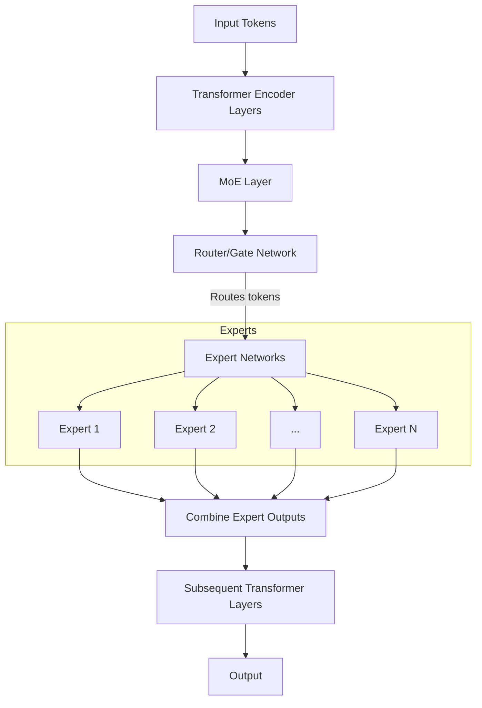

Sources: [README.md:63-66]()

### Router Network

The router (or gate) network is a critical component of the MoE architecture. It analyzes each input token and determines which expert(s) should process it. This dynamic routing mechanism is what allows the model to:

1. Activate only a subset of parameters for each token
2. Enable specialization of experts for different types of inputs
3. Achieve computational efficiency by processing each token with only the most relevant parameters

Sources: [README.md:63-66]()

## Key Architectural Innovations

DeepSeekMoE introduces two principal innovations in its MoE architecture:

### 1. Fine-grained Expert Segmentation

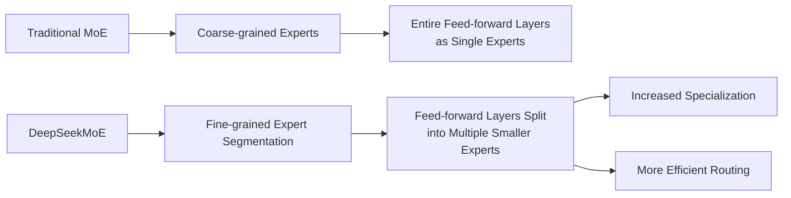

Fine-grained expert segmentation involves breaking down the traditional monolithic experts into smaller, more specialized units. This approach allows for more precise routing of computation and enhances the ability of experts to specialize in specific types of language processing tasks.

Sources: [README.md:64]()

### 2. Shared Experts Isolation

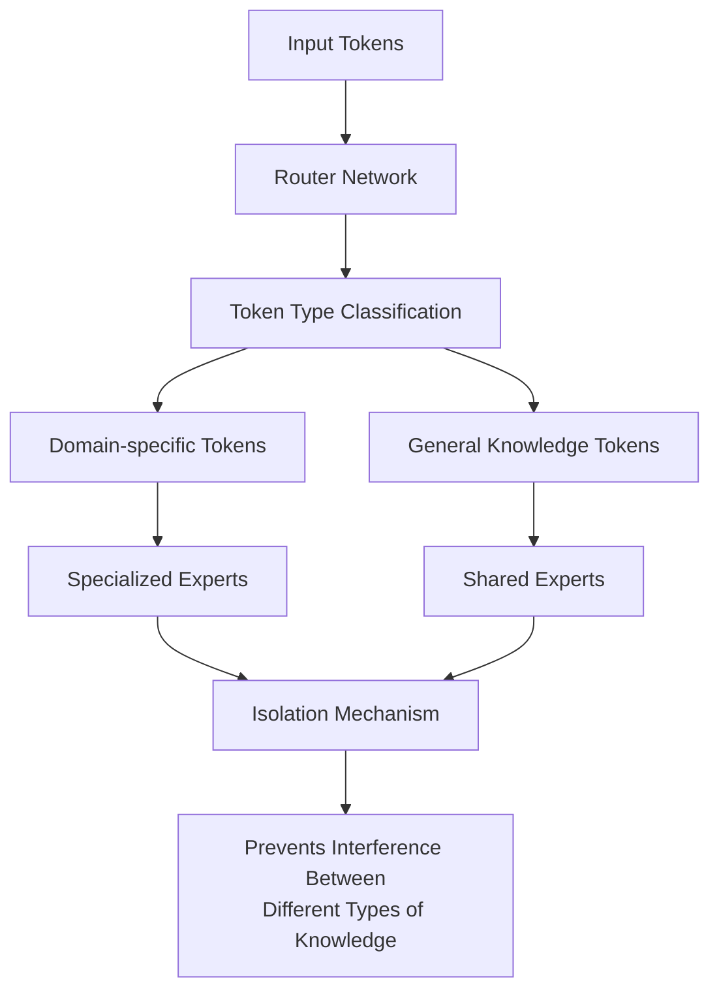

Shared experts isolation is a technique that prevents interference between different types of knowledge processing. By isolating shared experts from specialized ones, the model can maintain clearer boundaries between general knowledge and domain-specific expertise, leading to improved performance on specialized tasks without compromising general capabilities.

Sources: [README.md:64]()

## Model Variants

DeepSeekMoE is available in two variants, both sharing the same underlying architecture but with different usage orientations:

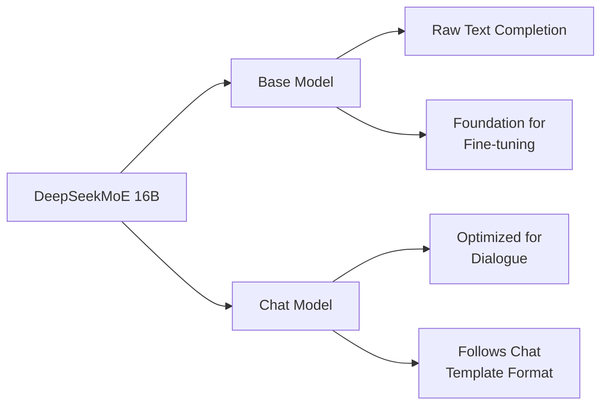

1. **Base Model**: Designed for general text completion tasks and as a foundation for fine-tuning on specific domains
2. **Chat Model**: Optimized for dialogue interactions, following a specific chat template format

Both variants maintain the computational efficiency of the MoE architecture, requiring only about 40% of the computations compared to equivalent dense models.

Sources: [README.md:63-66](), [README.md:110-111]()

## Efficiency Characteristics

DeepSeekMoE's architectural innovations result in significant efficiency gains:

| Metric | DeepSeekMoE 16B | Comparable Dense Models |
|--------|-----------------|-------------------------|
| Total Parameters | 16.4B | 7B (DeepSeek, LLaMA2) |
| Active Parameters (per token) | ~6.6B (~40%) | 7B (100%) |
| Memory Requirements | 40GB | 40GB+ |
| Computational Requirements | ~40% of dense models | 100% |
| Performance | Comparable to 7B dense models | Baseline |

This efficiency allows the model to run on a single GPU with 40GB of memory without requiring quantization, making it more accessible for research and applications.

Sources: [README.md:63-66](), [README.md:81-85](), [README.md:95-100]()

## Training Details

DeepSeekMoE 16B was trained from scratch on a diverse corpus of 2 trillion tokens, evenly split between English and Chinese languages. This balanced training data helps the model develop strong capabilities in both languages and across a wide range of domains.

Sources: [README.md:65]()

## Hardware Requirements

The DeepSeekMoE architecture's efficiency allows for deployment on more modest hardware compared to models with similar capabilities:

- Can be deployed on a single GPU with 40GB memory
- No quantization required for base deployment
- For fine-tuning, different hardware configurations are recommended based on the approach:
  - Full fine-tuning: 8x A100 40G GPUs (using DeepSpeed ZeRO-3)
  - LoRA fine-tuning: Reduced memory footprint (using DeepSpeed ZeRO-2)
  - QLoRA fine-tuning: Single A100 80G GPU (using 4/8-bit quantization)

Sources: [README.md:66](), [README.md:193-226](), [README.md:230-264]()

## Inference Process

The inference process in DeepSeekMoE follows this general flow:

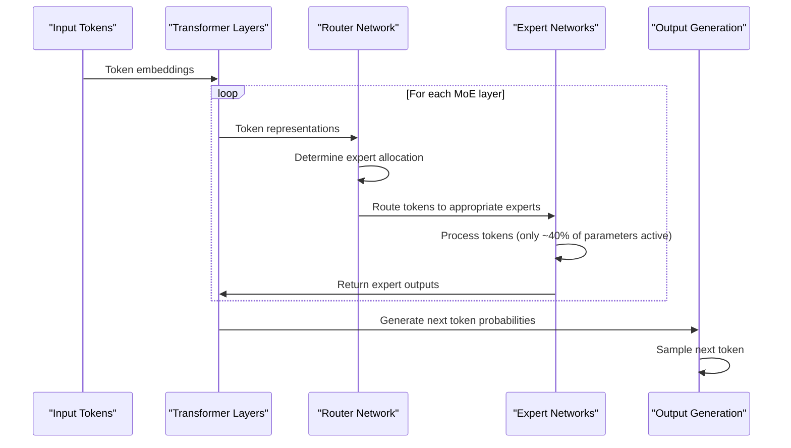

During inference, each token is dynamically routed to the most appropriate experts by the router network, activating only about 40% of the total parameters for any given input.

Sources: [README.md:63-66](), [README.md:122-176]()

---

# Page: Mixture of Experts Design

# Mixture of Experts Design

<details>
<summary>Relevant source files</summary>

The following files were used as context for generating this wiki page:

- [DeepSeekMoE.pdf](DeepSeekMoE.pdf)
- [README.md](README.md)

</details>


This document explains the Mixture of Experts (MoE) architecture implemented in the DeepSeekMoE 16B model, focusing on its two principal innovations: fine-grained expert segmentation and shared experts isolation. For information about using DeepSeekMoE models for inference, see [Model Usage](#3). For details on fine-tuning these models, see [Fine-tuning](#4).

## Core MoE Concept

Mixture of Experts is a neural network architecture where only a subset of the model's parameters (the "experts") are activated for each input token. This selective activation is controlled by a router network that determines which experts should process each input, resulting in significant computational efficiency.

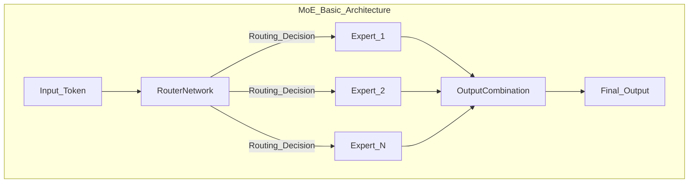

Sources: [README.md:62-66]()

## DeepSeekMoE Architecture Innovations

DeepSeekMoE implements an innovative MoE architecture that enables the model to achieve high performance with significantly reduced computational requirements. The 16.4B parameter model only activates approximately 40% of its parameters during inference.

### Fine-grained Expert Segmentation

Unlike traditional MoE designs where experts are treated as monolithic units, DeepSeekMoE implements a more granular approach by segmenting experts into smaller specialized components.

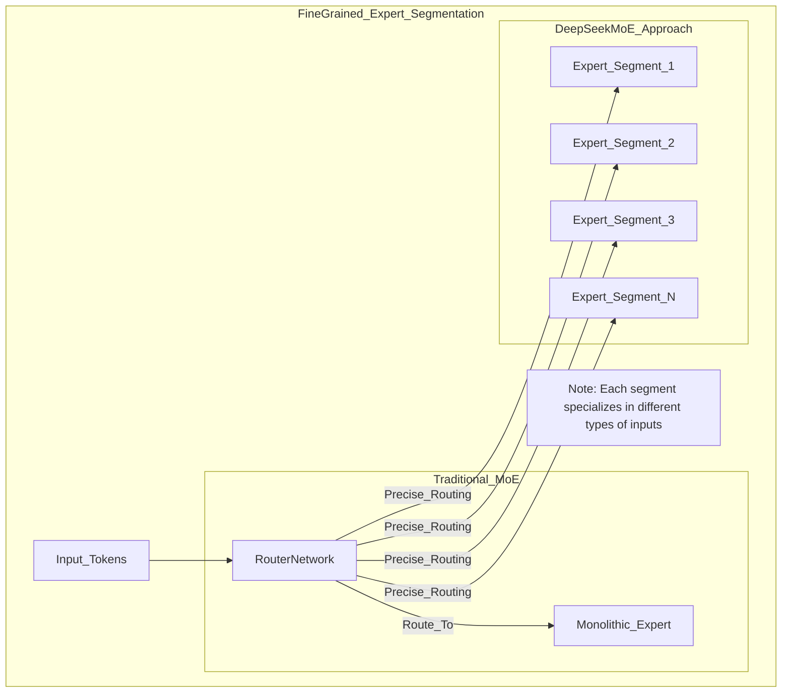

This fine-grained segmentation allows for:
- More targeted specialization of experts
- Better parameter utilization
- More precise routing decisions
- Improved model performance through specialized handling of different input patterns

Sources: [README.md:63-64]()

### Shared Experts Isolation

When multiple input tokens are routed to the same expert, potential conflicts can arise that impact processing efficiency. DeepSeekMoE implements a mechanism to isolate shared experts, enabling more efficient parallel processing.

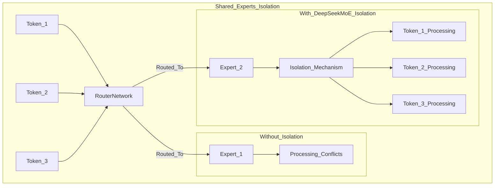

Shared experts isolation provides:
- Reduced processing conflicts when multiple tokens use the same expert
- More efficient parallel computation
- Better utilization of expert capacity

Sources: [README.md:63-64]()

## Combined MoE Architecture

The complete DeepSeekMoE architecture combines both innovations to create a highly efficient model.

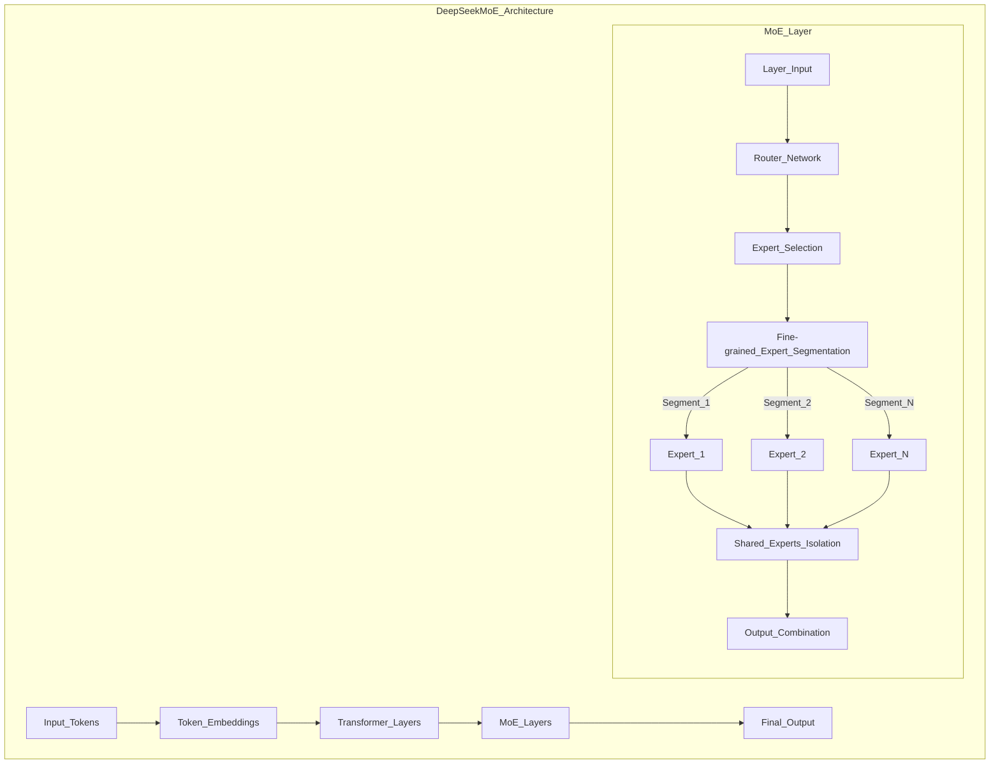

Sources: [README.md:62-66]()

## Computational Efficiency

The DeepSeekMoE architecture achieves remarkable computational efficiency:

| Model | Total Parameters | Activated Parameters | Relative Computation |
|-------|------------------|----------------------|----------------------|
| DeepSeekMoE 16B | 16.4B | ~6.56B (40%) | ~40% |
| DeepSeek 7B | 7B | 7B (100%) | 100% |
| LLaMA2 7B | 7B | 7B (100%) | 100% |

This efficiency enables DeepSeekMoE 16B to:
- Run on a single GPU with 40GB memory without quantization
- Achieve performance comparable to much larger dense models
- Provide similar capabilities to models that require 2.5x more computation

Sources: [README.md:62-66](), [README.md:75-76]()

## Performance Characteristics

Despite using only about 40% of the computation required by comparable dense models, DeepSeekMoE 16B achieves:

- Performance comparable to DeepSeek 7B on internal benchmarks
- Performance comparable to LLaMA2 7B on Open LLM Leaderboard
- In many cases, outperforms LLaMA2 7B despite using only 39.6% of the computation

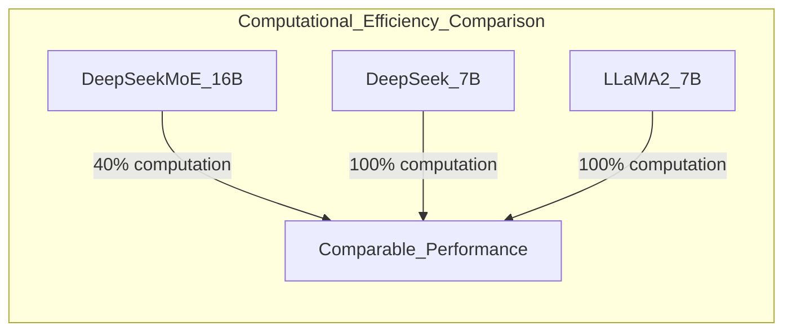

Sources: [README.md:69-91]()

## DeepSeekMoE Chat Variant

The chat-focused variant of DeepSeekMoE 16B maintains the same MoE architecture and efficiency benefits while being fine-tuned for conversational tasks. With approximately 40% of the computation required by dense models, it achieves comparable or better performance than DeepSeek 7B Chat and LLaMA2 7B SFT on conversation-specific benchmarks.

Sources: [README.md:93-100]()

## Related Pages

- For details on the differences between base and chat models, see [Base vs Chat Models](#2.2)
- For information about using the models for inference, see [Model Usage](#3)
- For guidance on fine-tuning these models, see [Fine-tuning](#4)
- For detailed evaluation results, see [Performance and Evaluation](#5)

---

# Page: Base vs Chat Models

# Base vs Chat Models

<details>
<summary>Relevant source files</summary>

The following files were used as context for generating this wiki page:

- [DeepSeekMoE.pdf](DeepSeekMoE.pdf)
- [README.md](README.md)

</details>


This page explains the key differences between the DeepSeekMoE 16B Base and DeepSeekMoE 16B Chat models, their specific capabilities, use cases, and how to interact with each variant. For information about the Mixture of Experts architecture used in both models, see [Mixture of Experts Design](#2.1).

## Model Overview

DeepSeekMoE is available in two primary variants:

1. **DeepSeekMoE 16B Base**: The foundation model trained on a diverse corpus of text, designed for general text completion tasks.
2. **DeepSeekMoE 16B Chat**: A fine-tuned version of the base model, specifically optimized for conversational interactions.

Both models share the same MoE architecture with 16.4B total parameters, but only activate approximately 40% of these parameters during inference, providing efficient computation comparable to dense models with fewer parameters.

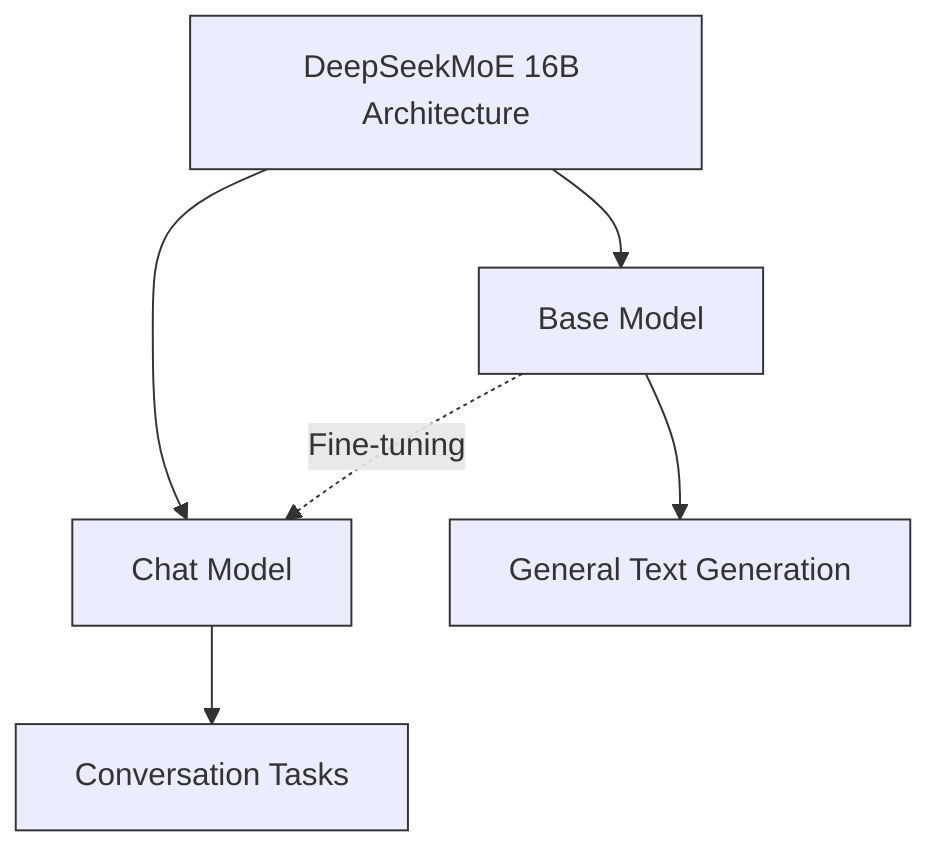

Sources: [README.md:62-66]()

## Architectural Similarities

Both the Base and Chat versions share the same fundamental architecture:

- 16.4B total parameters
- MoE design with fine-grained expert segmentation
- Shared experts isolation technique
- Trained on 2T English and 2T Chinese tokens
- Both activate only ~40% of parameters during inference
- 4096 sequence length support
- Both models can run on a single GPU with 40GB memory without quantization

Sources: [README.md:62-66](), [README.md:102-111]()

## Key Differences

### Training Approach


Sources: [README.md:62-66]()

### Input Format and Processing

The primary difference in using these models lies in how inputs are formatted and processed:


Sources: [README.md:126-166]()

### Performance Characteristics

The two models are evaluated on different benchmarks reflecting their intended use cases:

- **Base Model**: Evaluated on general language understanding benchmarks (Open LLM Leaderboard)
- **Chat Model**: Evaluated on conversation-specific benchmarks

While both models achieve similar computational efficiency (activating only ~40% of parameters), they show different strengths in their respective domains.

Sources: [README.md:70-100]()

## Usage Examples

### Base Model Usage

The Base model is designed for general text completion tasks, where you provide a text prompt and the model continues it:

```python
import torch
from transformers import AutoTokenizer, AutoModelForCausalLM, GenerationConfig

model_name = "deepseek-ai/deepseek-moe-16b-base"
tokenizer = AutoTokenizer.from_pretrained(model_name)
model = AutoModelForCausalLM.from_pretrained(model_name, torch_dtype=torch.bfloat16, device_map="auto")
model.generation_config = GenerationConfig.from_pretrained(model_name)
model.generation_config.pad_token_id = model.generation_config.eos_token_id

text = "An attention function can be described as mapping a query and a set of key-value pairs to an output, where the query, keys, values, and output are all vectors. The output is"
inputs = tokenizer(text, return_tensors="pt")
outputs = model.generate(**inputs.to(model.device), max_new_tokens=100)

result = tokenizer.decode(outputs[0], skip_special_tokens=True)
print(result)
```

Sources: [README.md:126-144]()

### Chat Model Usage

The Chat model is specifically designed for conversation tasks and requires inputs to be formatted as structured chat messages:

```python
import torch
from transformers import AutoTokenizer, AutoModelForCausalLM, GenerationConfig

model_name = "deepseek-ai/deepseek-moe-16b-chat"
tokenizer = AutoTokenizer.from_pretrained(model_name)
model = AutoModelForCausalLM.from_pretrained(model_name, torch_dtype=torch.bfloat16, device_map="auto")
model.generation_config = GenerationConfig.from_pretrained(model_name)
model.generation_config.pad_token_id = model.generation_config.eos_token_id

messages = [
    {"role": "user", "content": "Who are you?"}
]
input_tensor = tokenizer.apply_chat_template(messages, add_generation_prompt=True, return_tensors="pt")
outputs = model.generate(input_tensor.to(model.device), max_new_tokens=100)

result = tokenizer.decode(outputs[0][input_tensor.shape[1]:], skip_special_tokens=True)
print(result)
```

Alternatively, you can directly format the chat template manually:

```
User: {messages[0]['content']}

---

# Page: Model Usage

# Model Usage

<details>
<summary>Relevant source files</summary>

The following files were used as context for generating this wiki page:

- [README.md](README.md)

</details>


This document provides detailed guidance on how to use the DeepSeekMoE 16B models for inference tasks. It covers basic usage patterns for both the base and chat models, focusing on text completion and chat interactions. For information about fine-tuning these models, please refer to the [Fine-tuning](#4) page.

## Setup and Installation

Before using the DeepSeekMoE models, you need to install the necessary dependencies in a Python environment (version 3.8 or higher).

```bash
pip install -r requirements.txt
```

The models can be loaded using Hugging Face's Transformers library. Both models are available for direct use from the Hugging Face Hub.

Sources: [README.md:114-120]()

## DeepSeekMoE Models Overview

The DeepSeekMoE repository provides two main model variants:

1. **DeepSeekMoE 16B Base**: Optimized for general text completion tasks
2. **DeepSeekMoE 16B Chat**: Fine-tuned specifically for conversational interactions

Both models feature a Mixture-of-Experts (MoE) architecture with 16.4B total parameters, though only about 40% of these parameters are activated during inference. This design allows the models to run on a single GPU with 40GB memory without quantization.

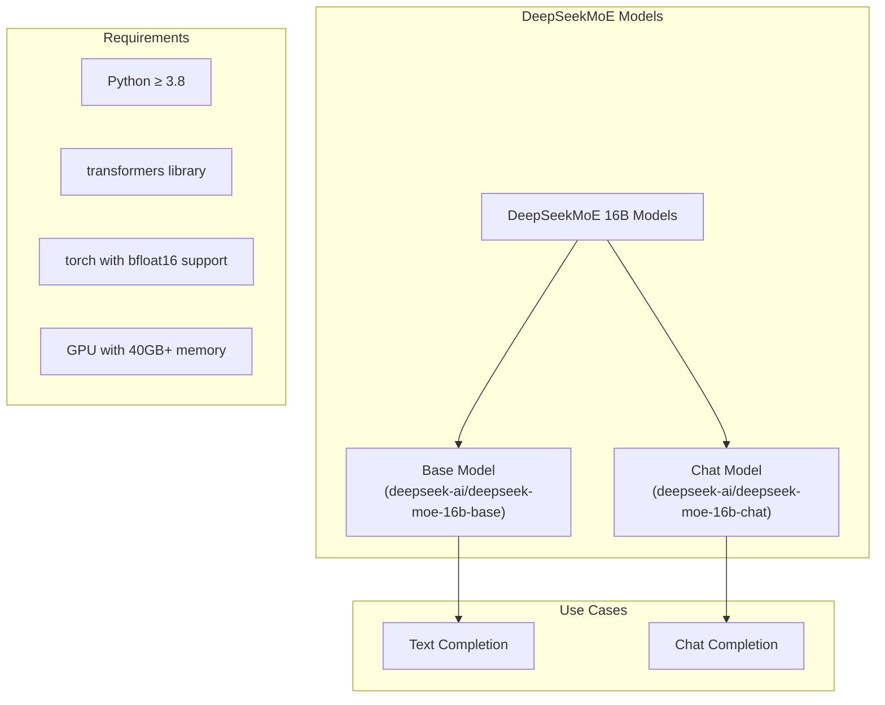

Sources: [README.md:61-67](), [README.md:108-111]()

## Text Completion with Base Model

The DeepSeekMoE 16B Base model is designed for general text completion tasks. Here's the typical workflow for using this model:

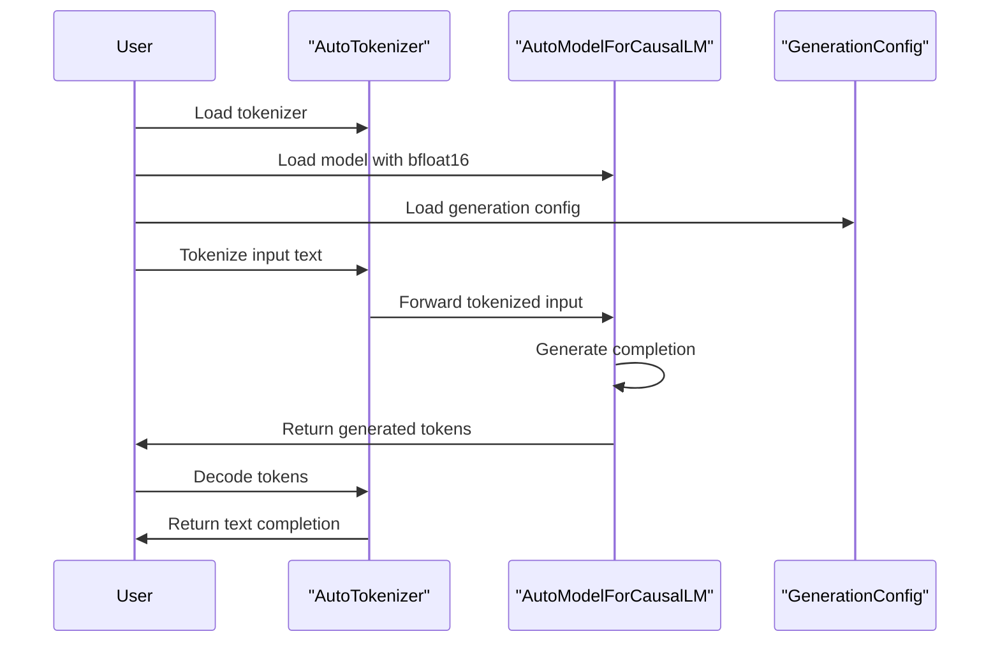

### Example Usage

The following code demonstrates how to use the DeepSeekMoE 16B Base model for text completion:

```python
import torch
from transformers import AutoTokenizer, AutoModelForCausalLM, GenerationConfig

model_name = "deepseek-ai/deepseek-moe-16b-base"
tokenizer = AutoTokenizer.from_pretrained(model_name)
model = AutoModelForCausalLM.from_pretrained(model_name, torch_dtype=torch.bfloat16, device_map="auto")
model.generation_config = GenerationConfig.from_pretrained(model_name)
model.generation_config.pad_token_id = model.generation_config.eos_token_id

text = "An attention function can be described as mapping a query and a set of key-value pairs to an output, where the query, keys, values, and output are all vectors. The output is"
inputs = tokenizer(text, return_tensors="pt")
outputs = model.generate(**inputs.to(model.device), max_new_tokens=100)

result = tokenizer.decode(outputs[0], skip_special_tokens=True)
print(result)
```

Sources: [README.md:126-144]()

## Chat Completion with Chat Model

The DeepSeekMoE 16B Chat model is specifically fine-tuned for conversational interactions. The usage flow is similar to the base model but includes formatting messages using a chat template.

```mermaid
sequenceDiagram
    participant User
    participant Tokenizer as "AutoTokenizer"
    participant ChatTemplate as "apply_chat_template()"
    participant Model as "AutoModelForCausalLM"
    participant GenConfig as "GenerationConfig"
    
    User->>Tokenizer: Load tokenizer
    User->>Model: Load model with bfloat16
    User->>GenConfig: Load generation config
    User->>User: Prepare messages list
    User->>ChatTemplate: Apply chat template to messages
    ChatTemplate->>Model: Forward tokenized input
    Model->>Model: Generate response
    Model->>User: Return generated tokens
    User->>Tokenizer: Decode tokens (skip input)
    Tokenizer->>User: Return chat response
```

### Example Usage

The following code demonstrates how to use the DeepSeekMoE 16B Chat model for conversations:

```python
import torch
from transformers import AutoTokenizer, AutoModelForCausalLM, GenerationConfig

model_name = "deepseek-ai/deepseek-moe-16b-chat"
tokenizer = AutoTokenizer.from_pretrained(model_name)
model = AutoModelForCausalLM.from_pretrained(model_name, torch_dtype=torch.bfloat16, device_map="auto")
model.generation_config = GenerationConfig.from_pretrained(model_name)
model.generation_config.pad_token_id = model.generation_config.eos_token_id

messages = [
    {"role": "user", "content": "Who are you?"}
]
input_tensor = tokenizer.apply_chat_template(messages, add_generation_prompt=True, return_tensors="pt")
outputs = model.generate(input_tensor.to(model.device), max_new_tokens=100)

result = tokenizer.decode(outputs[0][input_tensor.shape[1]:], skip_special_tokens=True)
print(result)
```

Sources: [README.md:148-166]()

### Chat Template Format

If you prefer to manually format your chat messages instead of using `apply_chat_template()`, you can follow this template:

```
User: {messages[0]['content']}

---

# Page: Text Completion

# Text Completion

<details>
<summary>Relevant source files</summary>

The following files were used as context for generating this wiki page:

- [README.md](README.md)

</details>


## Purpose and Scope

This document explains how to use the DeepSeek-MoE 16B base model for text completion tasks. It covers model initialization, input processing, text generation workflow, and configuration options. For information about chat-based interactions, see [Chat Completion](#3.2).

## Overview of Text Completion

Text completion is the process where the model generates a coherent continuation of an input text prompt. DeepSeek-MoE processes the input through its Mixture of Experts architecture to predict the most likely sequence of tokens that should follow the provided context.

### Text Completion Workflow

```mermaid
flowchart TD
    A["Input Text Prompt"] --> B["tokenizer.__call__()"]
    B --> C["inputs (TokenizerOutput)"]
    C --> D["model.generate()"]
    D --> E["outputs (torch.Tensor)"]
    E --> F["tokenizer.decode()"]
    F --> G["Completed Text (string)"]
    
    subgraph "Preprocessing"
    B
    C
    end
    
    subgraph "Model Inference"
    D
    E
    end
    
    subgraph "Postprocessing"
    F
    end
```

Sources: [README.md:127-143]()

## MoE Architecture for Text Completion

DeepSeek-MoE utilizes a specialized Mixture of Experts architecture that routes input tokens to different experts based on their content, enabling efficient inference by only activating a subset of the model's parameters.

```mermaid
graph TD
    A["Input Tokens"] --> B["DeepSeekMoE 16B Architecture"]
    
    subgraph "DeepSeekMoE Processing"
    B --> C["Router/Gate Network"]
    C --> D1["Expert 1"]
    C --> D2["Expert 2"]
    C --> D3["..."]
    C --> D4["Expert N"]
    D1 --> E["Aggregate Outputs"]
    D2 --> E
    D3 --> E
    D4 --> E
    end
    
    E --> F["Next Token Prediction"]
    F --> G["Generated Token"]
```

Sources: [README.md:63-65]()

## Implementation

### Model Initialization

To use the DeepSeek-MoE model for text completion, you need to:
1. Load the tokenizer using `AutoTokenizer`
2. Load the model using `AutoModelForCausalLM` 
3. Set appropriate generation configuration

```mermaid
sequenceDiagram
    participant User as "User Code"
    participant HF as "Hugging Face Hub"
    participant Tokenizer as "AutoTokenizer"
    participant Model as "AutoModelForCausalLM"
    participant GenConfig as "GenerationConfig"
    
    User->>HF: Request model/tokenizer
    HF-->>Tokenizer: Load tokenizer
    HF-->>Model: Load model weights
    HF-->>GenConfig: Load generation config
    User->>Model: Set dtype (bfloat16)
    User->>Model: Set device map ("auto")
    User->>Model: Assign generation config
    User->>Model: Set pad_token_id
```

Sources: [README.md:127-137]()

### Code Example

The following example demonstrates how to use the DeepSeek-MoE 16B base model for text completion:

```python
import torch
from transformers import AutoTokenizer, AutoModelForCausalLM, GenerationConfig

model_name = "deepseek-ai/deepseek-moe-16b-base"
tokenizer = AutoTokenizer.from_pretrained(model_name)
model = AutoModelForCausalLM.from_pretrained(model_name, torch_dtype=torch.bfloat16, device_map="auto")
model.generation_config = GenerationConfig.from_pretrained(model_name)
model.generation_config.pad_token_id = model.generation_config.eos_token_id

text = "An attention function can be described as mapping a query and a set of key-value pairs to an output, where the query, keys, values, and output are all vectors. The output is"
inputs = tokenizer(text, return_tensors="pt")
outputs = model.generate(**inputs.to(model.device), max_new_tokens=100)

result = tokenizer.decode(outputs[0], skip_special_tokens=True)
print(result)
```

Sources: [README.md:127-143]()

## System Components and Data Flow

The text completion system consists of several key components that work together to process input text and generate completions.

```mermaid
graph TD
    A["text (string)"] --> B["AutoTokenizer.from_pretrained()"]
    B --> C["inputs (TokenizerOutput)"]
    C --> D["AutoModelForCausalLM.from_pretrained()"]
    D --> E["outputs (torch.Tensor)"]
    E --> F["tokenizer.decode()"]
    F --> G["result (string)"]
    
    subgraph "Tokenizer API"
    B --> B1["tokenizer.__call__()"]
    B --> B2["tokenizer.decode()"]
    end
    
    subgraph "Model API"
    D --> D1["model.generate()"]
    D --> D2["GenerationConfig"]
    D2 --> D3["pad_token_id"]
    D2 --> D4["eos_token_id"]
    D2 --> D5["max_new_tokens"]
    end
```

Sources: [README.md:127-143]()

## Generation Parameters

The `GenerationConfig` controls the text generation process. Key parameters include:

| Parameter | Description | Default/Example Value |
|-----------|-------------|---------------|
| max_new_tokens | Maximum number of tokens to generate | 100 (in example) |
| pad_token_id | Token ID used for padding | Set to eos_token_id |
| temperature | Controls randomness (higher = more random) | Model default |
| top_p | Nucleus sampling parameter | Model default |
| top_k | Top-k sampling parameter | Model default |
| repetition_penalty | Penalizes repetition | Model default |
| do_sample | Whether to use sampling | Model default |

Sources: [README.md:135-136]()

## Performance Characteristics

The DeepSeek-MoE 16B exhibits several important performance characteristics:

1. **Efficient Computation**: Uses only about 40% of computations compared to equivalent dense models
2. **Comparable Performance**: Achieves similar results to DeepSeek 7B and LLaMA2 7B models
3. **Memory Efficiency**: Can be deployed on a single GPU with 40GB of memory without quantization

The model achieves this efficiency through its MoE architecture with fine-grained expert segmentation and shared experts isolation.

Sources: [README.md:63-66]()

## Troubleshooting

Common issues and their solutions:

| Issue | Possible Cause | Solution |
|-------|---------------|----------|
| Out of memory error | Insufficient GPU memory | Reduce batch size or use quantization |
| Slow generation | Large max_new_tokens value | Reduce max_new_tokens or use a faster device |
| Special tokens in output | skip_special_tokens=False | Set skip_special_tokens=True in decode() |
| Model outputs unexpected text | Improper input formatting | Ensure input text follows expected format |

Sources: [README.md:65-66]()

## Additional Notes

- The base model is trained on 2T English and 2T Chinese tokens, making it suitable for both languages
- The model has a context length of 4096 tokens
- When using for inference, setting the appropriate data type (bfloat16) and device mapping can improve performance

Sources: [README.md:63-65]()

---

# Page: Chat Completion

# Chat Completion

<details>
<summary>Relevant source files</summary>

The following files were used as context for generating this wiki page:

- [README.md](README.md)

</details>


This document explains how to use the DeepSeek-MoE 16B Chat model for conversational interactions. For information about text completion with the base model, see [Text Completion](#3.1).

## Introduction

The DeepSeek-MoE 16B Chat model is a specialized version of the base model that has been fine-tuned for dialogue-based interactions. Built on the same Mixture-of-Experts (MoE) architecture, it enables efficient conversational capabilities while activating only about 40% of its parameters during inference.

Sources: [README.md:61-66](), [README.md:93-96]()

## How Chat Completion Works

### Chat Completion vs Text Completion

Chat completion differs from text completion in how inputs are structured and processed:

```mermaid
graph TD
    subgraph "Text Completion Process"
        TC1["Single Text Input"] --> TC2["Direct Tokenization"]
        TC2 --> TC3["Base Model Processing"]
        TC3 --> TC4["Text Continuation"]
    end
    
    subgraph "Chat Completion Process"
        CC1["Structured Messages with Roles"] --> CC2["Chat Template Formatting"]
        CC2 --> CC3["Chat Model Processing"]
        CC3 --> CC4["Assistant Response"]
    end
```

Sources: [README.md:126-144](), [README.md:146-166]()

### Chat Template Format

The model uses a specific template to structure conversations:

```mermaid
graph TD
    A["Chat Template Structure"] --> B["User: {user_message}"]
    B --> C["Assistant: {assistant_response}<｜end▁of▁sentence｜>"]
    C --> D["User: {next_user_message}"]
    D --> E["Assistant: {generated_response}"]
    
    F["Special Tokens"] --> G["<｜begin▁of▁sentence｜> (BOS)\nAdded automatically"]
    F --> H["<｜end▁of▁sentence｜> (EOS)\nMarks end of assistant's turn"]
```

Sources: [README.md:168-176]()

## Basic Usage

To use the DeepSeek-MoE 16B Chat model, follow this example:

```python
import torch
from transformers import AutoTokenizer, AutoModelForCausalLM, GenerationConfig

model_name = "deepseek-ai/deepseek-moe-16b-chat"
tokenizer = AutoTokenizer.from_pretrained(model_name)
model = AutoModelForCausalLM.from_pretrained(model_name, torch_dtype=torch.bfloat16, device_map="auto")
model.generation_config = GenerationConfig.from_pretrained(model_name)
model.generation_config.pad_token_id = model.generation_config.eos_token_id

messages = [
    {"role": "user", "content": "Who are you?"}
]
input_tensor = tokenizer.apply_chat_template(messages, add_generation_prompt=True, return_tensors="pt")
outputs = model.generate(input_tensor.to(model.device), max_new_tokens=100)

result = tokenizer.decode(outputs[0][input_tensor.shape[1]:], skip_special_tokens=True)
print(result)
```

Sources: [README.md:148-166]()

## Multi-turn Conversations

For multi-turn conversations, add more message objects to the messages array:

```mermaid
graph TD
    A["Message Array Structure"] --> B["Message 1"]
    A --> C["Message 2"]
    A --> D["Message 3"]
    
    B --> B1["role: 'user'"]
    B --> B2["content: 'Who are you?'"]
    
    C --> C1["role: 'assistant'"]
    C --> C2["content: 'I am DeepSeek-MoE...'"]
    
    D --> D1["role: 'user'"]
    D --> D2["content: 'What capabilities do you have?'"]
```

Example of structured conversation input:

```python
messages = [
    {"role": "user", "content": "Who are you?"},
    {"role": "assistant", "content": "I am DeepSeek-MoE, an assistant developed by DeepSeek AI."},
    {"role": "user", "content": "What capabilities do you have?"}
]
input_tensor = tokenizer.apply_chat_template(messages, add_generation_prompt=True, return_tensors="pt")
```

Sources: [README.md:148-166]()

## Implementation Details

### Data Flow in Chat Completion

The following diagram illustrates how data flows through the system during chat completion:

```mermaid
sequenceDiagram
    participant User
    participant Tokenizer as "AutoTokenizer"
    participant ChatTemplate as "apply_chat_template()"
    participant Model as "DeepSeekMoE_ChatModel"
    participant Generate as "model.generate()"
    participant Decoder as "tokenizer.decode()"
    
    User->>Tokenizer: Initialize with model name
    User->>Model: Load model with device mapping
    User->>Tokenizer: messages array
    Tokenizer->>ChatTemplate: Format messages into template
    ChatTemplate->>Generate: input_tensor
    Generate->>Model: Process through MoE architecture
    Model->>Generate: Generated token IDs
    Generate->>Decoder: Full output sequence
    Decoder->>User: Extracted response text
```

Sources: [README.md:148-166]()

### MoE Architecture in Chat Completion

The DeepSeek-MoE Chat model uses a Mixture-of-Experts architecture where only a subset of parameters are activated for any given input:

```mermaid
graph TD
    A["Chat Input"] --> B["DeepSeekMoE_Model"]
    B --> C["Router_Network"]
    C --> D["Expert_Selection"]
    D --> E1["Expert_1 (Activated)"]
    D --> E2["Expert_2 (Not activated)"]
    D --> E3["Expert_3 (Activated)"]
    D --> E4["Expert_N (...)"]
    E1 & E3 --> F["Output_Aggregation"]
    F --> G["Response_Generation"]
```

This selective activation enables the model to achieve efficiency while maintaining performance comparable to dense models with similar effective parameter counts.

Sources: [README.md:61-66](), [README.md:93-96]()

## Generation Parameters

Key parameters for controlling chat completion generation:

| Parameter | Description | Typical Values |
|-----------|-------------|----------------|
| `max_new_tokens` | Maximum number of tokens to generate | 100-2000 |
| `temperature` | Controls randomness (lower = more deterministic) | 0.1-1.0 |
| `top_p` | Nucleus sampling parameter | 0.7-0.9 |
| `top_k` | Top-k sampling parameter | 40-50 |
| `repetition_penalty` | Penalizes repeated tokens | 1.0-1.2 |

These can be set in the `model.generation_config` or passed directly to the `model.generate()` method.

Sources: [README.md:154-155]()

## Important Notes and Limitations

- The tokenizer automatically adds a beginning of sentence token (`<｜begin▁of▁sentence｜>`) by default with `add_special_tokens=True`
- This version of the model does not support system prompts, so they should not be included in your input
- The chat model has been evaluated against DeepSeek 7B Chat and LLaMA2 7B SFT (with the same fine-tuning settings and data) and achieves comparable or better performance
- The model can be deployed on a single GPU with 40GB of memory without requiring quantization

Sources: [README.md:177-179](), [README.md:93-100](), [README.md:66]()

## Performance

The DeepSeek-MoE 16B Chat model achieves comparable or better performance than DeepSeek 7B Chat and LLaMA2 7B SFT while using only about 40% of the computation. Evaluation results are shown in the README.md file, demonstrating strong performance across various benchmarks.

Sources: [README.md:93-100]()

---

# Page: Fine-tuning

# Fine-tuning

<details>
<summary>Relevant source files</summary>

The following files were used as context for generating this wiki page:

- [README.md](README.md)
- [finetune/finetune.py](finetune/finetune.py)

</details>


This document provides comprehensive guidance on fine-tuning the DeepSeek-MoE 16B model for downstream tasks. It covers the available fine-tuning methods, required configurations, and practical implementation steps. For general information about the model architecture, see [Model Architecture](#2).

## 1. Fine-tuning Overview

DeepSeek-MoE supports three main fine-tuning approaches, each with different resource requirements and performance characteristics:

1. **Full Fine-tuning**: Updates all model parameters, requiring significant computational resources
2. **LoRA Fine-tuning**: Low-Rank Adaptation that efficiently updates a small subset of parameters
3. **QLoRA Fine-tuning**: Quantized LoRA that further reduces memory requirements through model quantization

```mermaid
flowchart TD
    A["DeepSeek-MoE 16B"] --> B["Fine-tuning System"]
    B --> C{"Fine-tuning Method"}
    
    C -->|"Full Fine-tuning"| D["All Parameters"]
    C -->|"LoRA"| E["Low-Rank Adaptation"]
    C -->|"QLoRA"| F["Quantized Low-Rank Adaptation"]
    
    D --> G["High Resource Requirement"]
    E --> H["Medium Resource Requirement"]
    F --> I["Low Resource Requirement"]
    
    G --> J["DeepSpeed ZeRO-3"]
    H --> K["DeepSpeed ZeRO-2"]
    I --> L["4/8-bit Quantization"]
```

Sources: [README.md:180-198](), [finetune/finetune.py:250-320]()

## 2. Prerequisites

Before beginning the fine-tuning process, ensure you have:

1. Installed all required dependencies:
   ```bash
   pip install -r requirements.txt
   ```

2. Prepared your dataset in the correct format (see Data Preparation section)
3. Sufficient GPU resources based on your chosen fine-tuning method
4. DeepSpeed configured properly

Sources: [README.md:186-188]()

## 3. Fine-tuning Methods Comparison

Each fine-tuning method offers different trade-offs between computational requirements and model performance:

| Method | Description | Parameters Updated | Memory Requirement | Hardware Recommendation |
|--------|-------------|-------------------|-------------------|------------------------|
| Full Fine-tuning | Updates all model parameters | All 16.4B parameters | Very High | 8× A100 40GB GPUs |
| LoRA | Low-rank adaptations to specific layers | Only LoRA parameters | Medium | Multiple GPUs |
| QLoRA | Quantized LoRA with 4/8-bit precision | Only LoRA parameters | Low | Single A100 80GB GPU |

Sources: [README.md:199-264](), [finetune/finetune.py:31-52]()

## 4. Data Preparation

DeepSeek-MoE expects data in a specific format for fine-tuning:

### Data Format

The fine-tuning script expects data in the Parquet format with the following fields:
- `instruction`: The input prompt or instruction
- `output`: The desired completion or response

### Example Dataset Item

```
{
  "instruction": "Explain the concept of mixture of experts.",
  "output": "Mixture of Experts (MoE) is a neural network architecture..."
}
```

The script will automatically format this into the appropriate prompting structure:

```
You are an AI assistant, developed by DeepSeek Company. For politically sensitive questions, security and privacy issues, you will refuse to answer.
### Instruction:
Explain the concept of mixture of experts.
### Response:
Mixture of Experts (MoE) is a neural network architecture...
```

Sources: [README.md:190-192](), [finetune/finetune.py:115-180](), [finetune/finetune.py:23-29]()

## 5. Fine-tuning System Architecture

The DeepSeek-MoE fine-tuning system consists of several interconnected components:

```mermaid
flowchart TB
    A["finetune.py"] --> B["Data Processing"]
    A --> C["Model Initialization"]
    A --> D["Training Configuration"]
    A --> E["Trainer Setup"]
    
    B --> B1["Dataset Loading"]
    B --> B2["Tokenization"]
    B --> B3["Data Collator"]
    
    C --> C1["Model Loading"]
    C --> C2["LoRA Configuration"]
    C --> C3["Quantization Config"]
    
    D --> D1["DeepSpeed Config"]
    D --> D2["Training Arguments"]
    D --> D3["Checkpoint Handling"]
    
    E --> E1["DeepSpeed Integration"]
    E --> E2["Training Loop"]
    E --> E3["Checkpoint Saving"]
    
    B3 --> E2
    C3 --> E2
    D3 --> E2
```

Sources: [finetune/finetune.py:250-320]()

## 6. Implementation Details

### 6.1. Model Initialization

The model is initialized based on the specified fine-tuning method:

```mermaid
flowchart TD
    A["build_model()"] --> B{"use_lora?"}
    
    B -->|"No"| C["Load Full Precision Model"]
    B -->|"Yes"| D["Load Quantized Model"]
    
    D --> E{"bits?"}
    E -->|"4"| F["4-bit Quantization"]
    E -->|"8"| G["8-bit Quantization"]
    
    F & G --> H["prepare_model_for_kbit_training()"]
    H --> I{"Checkpoint exists?"}
    
    I -->|"Yes"| J["Load from Checkpoint"]
    I -->|"No"| K["Initialize LoRA Modules"]
    
    K --> L["Configure Target Modules"]
    L --> M["Set LoRA Rank, Alpha, Dropout"]
    M --> N["Apply get_peft_model()"]
```

The function `build_model()` handles loading the pre-trained model and configuring it for fine-tuning based on the specified arguments.

Sources: [finetune/finetune.py:182-248]()

### 6.2. Data Processing Pipeline

```mermaid
flowchart LR
    A["Raw Dataset"] --> B["load_dataset()"]
    B --> C["map() with train_tokenize_function()"]
    C --> D["Tokenized Dataset"]
    D --> E["DataCollatorForSupervisedDataset"]
    E --> F["Ready for Training"]
    
    G["train_tokenize_function()"] --> H["build_instruction_prompt()"]
    G --> I["preprocess()"]
    I --> J["_tokenize_fn()"]
```

The data processing pipeline transforms raw data into tokenized inputs suitable for model training.

Sources: [finetune/finetune.py:115-180](), [finetune/finetune.py:280-311]()

## 7. Configuration Options

### 7.1. Model Arguments

Key model configuration parameters include:

| Parameter | Description | Default |
|-----------|-------------|---------|
| `trainable` | Comma-separated list of modules to train | "q_proj,v_proj,k_proj,o_proj,gate_proj,down_proj,up_proj" |
| `lora_rank` | Rank for LoRA matrices | 8 |
| `lora_dropout` | Dropout rate for LoRA layers | 0.1 |
| `lora_alpha` | Scaling factor for LoRA | 32.0 |
| `use_lora` | Whether to use LoRA | False |
| `bits` | Quantization bits (4, 8, or 16) | 16 |
| `quant_type` | Quantization type for QLoRA | "nf4" |

Sources: [finetune/finetune.py:31-52]()

### 7.2. Training Arguments

DeepSeek-MoE uses HuggingFace's `TrainingArguments` with additional parameters:

| Parameter | Description |
|-----------|-------------|
| `model_max_length` | Maximum sequence length for training |
| `bf16` | Whether to use bfloat16 precision |
| `per_device_train_batch_size` | Batch size per GPU |
| `gradient_accumulation_steps` | Steps before parameter update |
| `learning_rate` | Learning rate for optimization |
| `warmup_steps` | Steps for learning rate warmup |
| `deepspeed` | Path to DeepSpeed configuration |

Sources: [finetune/finetune.py:59-67](), [README.md:199-264]()

## 8. DeepSpeed Integration

DeepSeek-MoE fine-tuning leverages DeepSpeed to optimize training performance:

```mermaid
flowchart TD
    A["DeepSpeed Configuration"] --> B{"Fine-tuning Method"}
    
    B -->|"Full Fine-tuning"| C["ds_config_zero3.json"]
    B -->|"LoRA/QLoRA"| D["ds_config_zero2_no_offload.json"]
    
    C --> E["ZeRO Stage 3"]
    E --> F["Parameter Partitioning"]
    F --> G["Optimizer State Partitioning"]
    F --> H["Gradient Partitioning"]
    
    D --> I["ZeRO Stage 2"]
    I --> J["Optimizer State Partitioning"]
    I --> K["Gradient Partitioning"]
```

The DeepSpeed configuration varies based on the fine-tuning method:
- Full fine-tuning uses ZeRO-3 for maximum memory efficiency
- LoRA/QLoRA uses ZeRO-2 which provides a good balance of performance and memory usage

Sources: [README.md:199-226](), [README.md:229-264]()

## 9. Fine-tuning Examples

### 9.1. Full Fine-tuning

For full model fine-tuning, the recommended configuration uses DeepSpeed ZeRO-3 on multiple GPUs:

```bash
deepspeed finetune.py \
    --model_name_or_path "deepseek-ai/deepseek-moe-16b-base" \
    --data_path "your_data_path" \
    --output_dir "your_output_path" \
    --num_train_epochs 3 \
    --model_max_length 1024 \
    --per_device_train_batch_size 16 \
    --per_device_eval_batch_size 1 \
    --gradient_accumulation_steps 4 \
    --learning_rate 2e-5 \
    --warmup_steps 10 \
    --deepspeed "configs/ds_config_zero3.json" \
    --bf16 True \
    --use_lora False
```

This configuration requires 8 A100 40GB GPUs or equivalent hardware.

Sources: [README.md:199-226]()

### 9.2. QLoRA Fine-tuning

For resource-efficient fine-tuning, QLoRA provides a good balance of performance and hardware requirements:

```bash
deepspeed finetune.py \
    --model_name_or_path "deepseek-ai/deepseek-moe-16b-base" \
    --data_path "your_data_path" \
    --output_dir "your_output_path" \
    --num_train_epochs 3 \
    --model_max_length 1024 \
    --per_device_train_batch_size 16 \
    --gradient_accumulation_steps 4 \
    --learning_rate 2e-5 \
    --deepspeed "configs/ds_config_zero2_no_offload.json" \
    --bf16 True \
    --use_lora True \
    --bits 4 \
    --lora_r 64 \
    --lora_alpha 16 \
    --quant_type nf4
```

This configuration can run on a single A100 80GB GPU.

Sources: [README.md:229-264]()

## 10. Checkpoint Management

The fine-tuning system automatically handles checkpoint saving and resuming:

```mermaid
flowchart TD
    A["Training Loop"] --> B["SavePeftModelCallback"]
    B --> C{"LoRA?"}
    
    C -->|"Yes"| D["Save Adapter Model"]
    C -->|"No"| E["Save Full Model"]
    
    F["get_last_checkpoint()"] --> G{"Checkpoint Exists?"}
    G -->|"Yes"| H["Resume Training"]
    G -->|"No"| I["Start New Training"]
    
    D --> J["adapter_model/"]
    E --> K["pytorch_model.bin"]
```

- For LoRA/QLoRA fine-tuning, only the adapter weights are saved
- For full fine-tuning, the entire model is saved
- Training automatically resumes from the latest checkpoint if interrupted

Sources: [finetune/finetune.py:69-91](), [finetune/finetune.py:92-104]()

## 11. Best Practices

For optimal fine-tuning results with DeepSeek-MoE:

1. **Method Selection**:
   - Use full fine-tuning when maximum performance is required and sufficient hardware is available
   - Use LoRA for efficient fine-tuning with moderate hardware
   - Use QLoRA for resource-constrained scenarios where a single GPU is available

2. **Hyperparameter Recommendations**:
   - Learning rate: 1e-5 to 3e-5
   - Batch size: As large as memory allows
   - LoRA rank: 8-64 (higher for more capacity)
   - Gradient accumulation: 4-8 steps for effective larger batch sizes

3. **Data Preparation**:
   - Format data with clear instruction/output pairs
   - Include diverse examples for better generalization
   - Balance the dataset to prevent bias

Sources: [README.md:199-264](), [finetune/finetune.py:250-320]()

## 12. Conclusion

The DeepSeek-MoE fine-tuning system offers flexible options for adapting the 16B parameter model to specific tasks. By choosing the appropriate fine-tuning method based on available resources and performance requirements, users can effectively customize the model while maintaining the benefits of its Mixture-of-Experts architecture.

For advanced model usage after fine-tuning, see [Model Usage](#3).

Sources: [README.md:180-198]()

---

# Page: Full Fine-tuning

# Full Fine-tuning

<details>
<summary>Relevant source files</summary>

The following files were used as context for generating this wiki page:

- [README.md](README.md)
- [finetune/configs/ds_config_zero3.json](finetune/configs/ds_config_zero3.json)
- [finetune/finetune.py](finetune/finetune.py)

</details>


This document explains how to perform full fine-tuning on DeepSeek-MoE 16B models. Full fine-tuning involves updating all parameters of the model during the training process. For parameter-efficient fine-tuning approaches, see [LoRA Fine-tuning](#4.2) or [QLoRA Fine-tuning](#4.3).

## Overview

Full fine-tuning adapts the entire DeepSeek-MoE model to downstream tasks by updating all 16.4B parameters. This approach typically provides the best performance but requires significant computational resources. DeepSeek-MoE uses DeepSpeed ZeRO-3 optimization to make full fine-tuning feasible on distributed hardware.

```mermaid
flowchart TB
    A["DeepSeekMoE 16B Pre-trained Model"] --> B["Full Fine-tuning Pipeline"]
    B --> C["Data Preparation"]
    B --> D["DeepSpeed ZeRO-3 Configuration"]
    B --> E["Distributed Training"]
    
    C --> F["Process Dataset"]
    C --> G["Tokenize Instructions/Outputs"]
    
    D --> H["Memory Optimization"]
    D --> I["Optimizer & Parameter Offloading"]
    
    E --> J["8x A100 40G GPUs"]
    E --> K["Model Parameter Updates"]
    
    J --> L["Fine-tuned DeepSeekMoE Model"]
    K --> L
```

Sources: [README.md:194-227](), [finetune/finetune.py:183-248]()

## Requirements

### Hardware Requirements

Full fine-tuning of DeepSeek-MoE 16B requires significant computational resources:

- **GPUs**: 8x NVIDIA A100 40GB GPUs (minimum)
- **Memory**: 320GB total GPU memory
- **Storage**: Sufficient space for model checkpoints (~33GB per save)

### Software Requirements

The following software is needed for full fine-tuning:

```
- Python >= 3.8
- PyTorch
- Transformers
- DeepSpeed
- Datasets
```

Sources: [README.md:113-120](), [finetune/finetune.py:1-15]()

## DeepSpeed ZeRO-3 Configuration

DeepSeek-MoE uses DeepSpeed ZeRO-3 for distributed training optimization. The configuration includes:

```mermaid
flowchart LR
    A["DeepSpeed ZeRO-3 Configuration"] --> B["Optimizer Offloading"]
    A --> C["Parameter Offloading"]
    A --> D["Communication Optimization"]
    
    B --> B1["CPU Offload with Pin Memory"]
    C --> C1["CPU Offload with Pin Memory"]
    D --> D1["Overlap Communication"]
    D --> D2["Contiguous Gradients"]
    
    E["finetune/configs/ds_config_zero3.json"] --> A
```

Sources: [finetune/configs/ds_config_zero3.json:24-43]()

Key ZeRO-3 configuration parameters:

| Parameter | Value | Purpose |
|-----------|-------|---------|
| `stage` | 3 | Enables ZeRO stage 3 optimization |
| `offload_optimizer` | CPU with pin memory | Moves optimizer states to CPU |
| `offload_param` | CPU with pin memory | Moves parameters to CPU when not needed |
| `overlap_comm` | true | Overlaps communication with computation |
| `contiguous_gradients` | true | Reduces memory fragmentation |
| `stage3_gather_16bit_weights_on_model_save` | true | Consolidates weights for saving |

Sources: [finetune/configs/ds_config_zero3.json:1-51]()

## Fine-tuning Process

### Data Preparation

The fine-tuning script expects data in the format similar to the [Open-Platypus dataset](https://huggingface.co/datasets/garage-bAInd/Open-Platypus) with the following fields:

- `instruction`: The input prompt/instruction
- `output`: The expected model output

```mermaid
flowchart TD
    A["Raw Dataset"] --> B["Data Processing"]
    B --> C["Format Instructions"]
    B --> D["Format Outputs"]
    
    C --> E["build_instruction_prompt()"]
    D --> F["Add EOT Token"]
    
    E --> G["Tokenization"]
    F --> G
    
    G --> H["Create Labels"]
    G --> I["Mask Source Tokens with IGNORE_INDEX"]
    
    H --> J["Training Dataset"]
    I --> J
```

Sources: [finetune/finetune.py:23-180]()

### Training Execution Flow

When you run full fine-tuning, the following process occurs:

```mermaid
sequenceDiagram
    participant User
    participant Script as "finetune.py"
    participant Tokenizer as "AutoTokenizer"
    participant Model as "DeepSeekMoE Model"
    participant DS as "DeepSpeed"
    participant Trainer as "HF Trainer"
    
    User->>Script: Run with use_lora=False
    Script->>Tokenizer: Initialize tokenizer
    Script->>Script: Check for existing checkpoint
    Script->>Model: Load model in bf16/fp16
    Script->>Script: Load and process dataset
    Script->>DS: Initialize ZeRO-3 configuration
    Script->>Trainer: Create and configure trainer
    Trainer->>DS: Initialize distributed training
    Trainer->>Model: Train full model
    Note over Trainer,Model: All parameters updated
    Trainer->>Script: Save checkpoint
    Script->>User: Return fine-tuned model
```

Sources: [finetune/finetune.py:250-322]()

## Running Full Fine-tuning

### Command Line Usage

To run full fine-tuning, use the script provided in the repository:

```bash
cd finetune
deepspeed finetune.py \
    --model_name_or_path <model_path> \
    --data_path <data_path> \
    --output_dir <output_path> \
    --num_train_epochs 3 \
    --model_max_length 1024 \
    --per_device_train_batch_size 16 \
    --gradient_accumulation_steps 4 \
    --learning_rate 2e-5 \
    --warmup_steps 10 \
    --lr_scheduler_type "cosine" \
    --gradient_checkpointing True \
    --deepspeed configs/ds_config_zero3.json \
    --bf16 True \
    --use_lora False
```

The key flag for full fine-tuning is `--use_lora False`, which tells the script to update all model parameters.

Sources: [README.md:199-226](), [finetune/finetune.py:250-322]()

### Important Training Parameters

| Parameter | Description | Recommended Value |
|-----------|-------------|------------------|
| `model_max_length` | Maximum sequence length | 1024-4096 |
| `per_device_train_batch_size` | Batch size per GPU | 8-16 |
| `gradient_accumulation_steps` | Steps before optimizer update | 4-8 |
| `learning_rate` | Training learning rate | 1e-5 to 5e-5 |
| `warmup_steps` | Learning rate warmup steps | 10-100 |
| `gradient_checkpointing` | Memory optimization | True |
| `bf16` | Use BF16 precision | True (if supported) |

Sources: [finetune/finetune.py:31-67](), [README.md:199-226]()

## Technical Implementation Details

### Model Initialization

For full fine-tuning, the model is loaded in full precision (bf16 or fp16) without quantization:

```mermaid
flowchart TB
    A["build_model() Function"] --> B{"use_lora=False"}
    B -->|Yes| C["Load Full Precision Model"]
    B -->|No| D["Load Quantized Model"]
    
    C --> E["Set model.is_parallelizable = True"]
    C --> F["Set model.model_parallel = True"]
    
    E --> G["Cast layers to appropriate dtype"]
    F --> G
    
    G --> H["Return model for training"]
```

Sources: [finetune/finetune.py:182-248]()

### DeepSpeed Integration

The integration between the Hugging Face Trainer and DeepSpeed is handled through:

1. DeepSpeed configuration file ([finetune/configs/ds_config_zero3.json]())
2. The `--deepspeed` flag in the command line arguments
3. Automatic parameter handling through the Trainer API

For full fine-tuning, the code uses specific model saving logic when `use_lora=False`:

```python
if not model_args.use_lora:
    safe_save_model_for_hf_trainer(trainer=trainer, output_dir=training_args.output_dir)
```

Sources: [finetune/finetune.py:317-319]()

## Best Practices

### Hyperparameter Recommendations

- For most downstream tasks, 3-5 epochs is typically sufficient
- Start with a learning rate of 2e-5 and adjust based on task complexity
- Use gradient checkpointing to reduce memory usage
- Leverage BF16 precision if your hardware supports it
- Adjust batch size and gradient accumulation based on available GPU memory

### Memory Optimization

- Enable gradient checkpointing to reduce memory footprint
- Use DeepSpeed ZeRO-3 with parameter and optimizer offloading
- Consider reducing sequence length if possible for your task
- Monitor GPU memory usage and adjust batch sizes accordingly

Sources: [README.md:199-226](), [finetune/configs/ds_config_zero3.json:24-43]()

## Checkpoint Management

DeepSeek-MoE's fine-tuning script includes automatic checkpoint management:

- Checkpoints are saved at regular intervals specified by `--save_steps`
- Training can be resumed from the last checkpoint by providing the same `--output_dir`
- The `get_last_checkpoint` function automatically detects and loads the most recent checkpoint

Sources: [finetune/finetune.py:69-104](), [finetune/finetune.py:278-279]()

## Comparing with Parameter-Efficient Methods

| Aspect | Full Fine-tuning | LoRA | QLoRA |
|--------|------------------|------|-------|
| Parameters Updated | All 16.4B parameters | Only LoRA adapters | Only LoRA adapters |
| GPU Requirements | 8x A100 40GB | Reduced (ZeRO-2) | Single A100 80GB |
| Performance | Typically best performance | Good performance, smaller file size | Good performance with quantization |
| Use Case | When maximum performance is needed | When moderate resources are available | When limited resources are available |

Sources: [README.md:194-227]()

---

# Page: LoRA Fine-tuning

# LoRA Fine-tuning

<details>
<summary>Relevant source files</summary>

The following files were used as context for generating this wiki page:

- [README.md](README.md)
- [finetune/configs/ds_config_zero2_no_offload.json](finetune/configs/ds_config_zero2_no_offload.json)
- [finetune/finetune.py](finetune/finetune.py)

</details>


This document provides comprehensive guidance on fine-tuning DeepSeek-MoE models using Low-Rank Adaptation (LoRA) technique. LoRA offers a parameter-efficient alternative to full fine-tuning, allowing you to adapt the DeepSeek-MoE 16B model to downstream tasks with significantly reduced memory requirements. For full fine-tuning, see [Full Fine-tuning](#4.1), and for quantized LoRA approach, see [QLoRA Fine-tuning](#4.3).

## Introduction to LoRA

LoRA (Low-Rank Adaptation) is a parameter-efficient fine-tuning technique that freezes the pre-trained model weights and injects trainable rank decomposition matrices into each layer of the Transformer architecture. This approach significantly reduces the number of trainable parameters while maintaining model quality.

### Key Benefits of LoRA for DeepSeek-MoE

- **Memory Efficiency**: Requires significantly less GPU memory than full fine-tuning
- **Training Speed**: Faster training due to fewer parameters being updated
- **Storage Efficiency**: The resulting fine-tuned model is much smaller, as only the LoRA adapters need to be stored

```mermaid
flowchart TD
    A["Pre-trained DeepSeek-MoE 16B"] --> B["LoRA Fine-tuning"]
    B --> C["Frozen Pre-trained Weights"]
    B --> D["Trainable LoRA Adapters"]
    D --> D1["Low-rank Matrices"]
    D --> D2["Applied to Target Modules"]
    B --> E["Fine-tuned Model"]
    E --> F["Original Weights + LoRA Adapters"]
    
    classDef default stroke-width:1px;
```

Sources: [finetune/finetune.py:33-36](), [README.md:227-230]()

## LoRA Configuration in DeepSeek-MoE

DeepSeek-MoE implements LoRA using the PEFT (Parameter-Efficient Fine-Tuning) library. The implementation focuses on applying LoRA to specific attention and MLP modules within the model.

### Key LoRA Parameters

| Parameter | Default Value | Description |
|-----------|---------------|-------------|
| `lora_rank` | 8 | Rank of the low-rank decomposition matrices |
| `lora_alpha` | 32.0 | Scaling factor for the LoRA adapters |
| `lora_dropout` | 0.1 | Dropout probability for LoRA layers |
| `trainable` | "q_proj,v_proj,k_proj,o_proj,gate_proj,down_proj,up_proj" | Target modules to apply LoRA |
| `modules_to_save` | "embed_tokens,lm_head" | Modules to fully fine-tune alongside LoRA |

Sources: [finetune/finetune.py:33-37]()

### Target Modules Architecture

```mermaid
flowchart LR
    A["DeepSeek-MoE Model"] --> B["Transformer Blocks"]
    B --> C["Attention Modules"]
    B --> D["MLP Modules"]
    B --> E["MoE Modules"]
    
    C --> C1["q_proj"]
    C --> C2["k_proj"]
    C --> C3["v_proj"]
    C --> C4["o_proj"]
    
    D --> D1["gate_proj"]
    D --> D2["down_proj"]
    D --> D3["up_proj"]
    
    subgraph "LoRA Target Modules"
        C1
        C2
        C3
        C4
        D1
        D2
        D3
    end
```

Sources: [finetune/finetune.py:33](), [finetune/finetune.py:222-235]()

## Implementation Details

The LoRA fine-tuning implementation integrates with DeepSpeed's ZeRO-2 optimization to further reduce memory requirements.

### LoRA Initialization Process

```mermaid
sequenceDiagram
    participant User
    participant FT as "finetune.py"
    participant PEFT as "PEFT Library"
    participant Model as "DeepSeekMoE Model"
    
    User->>FT: Run with "--use_lora True"
    FT->>Model: Load base model
    Note over Model: Load model weights
    FT->>FT: Check for previous checkpoints
    
    alt New Training Run
        FT->>PEFT: Create LoRA configuration
        Note over PEFT: Configure target modules & LoRA params
        PEFT->>Model: Apply LoRA adapters
    else Resume Training
        FT->>PEFT: Load existing adapters
        PEFT->>Model: Restore LoRA weights
    end
    
    FT->>Model: Set module data types
    Note over Model: FP32 for normalization & gating
    Note over Model: BF16/FP16 for LoRA layers
    
    FT->>FT: Initialize trainer with DeepSpeed
```

Sources: [finetune/finetune.py:182-248](), [finetune/finetune.py:215-236]()

### DeepSpeed ZeRO-2 Integration

DeepSeek-MoE uses DeepSpeed ZeRO-2 for LoRA fine-tuning with the following key configurations:

- Uses BFloat16 precision by default
- Implements gradient accumulation for larger effective batch sizes
- Employs gradient checkpointing for additional memory savings
- No model offloading to CPU to maintain training speed

Sources: [finetune/configs/ds_config_zero2_no_offload.json:1-22]()

## Data Processing for Fine-tuning

```mermaid
flowchart TD
    A["Input Dataset"] --> B["train_tokenize_function"]
    B --> C["build_instruction_prompt"]
    B --> D["preprocess"]
    D --> E["_tokenize_fn"]
    D --> F["Add EOT_TOKEN"]
    D --> G["Create Labels"]
    G --> H["Set Source Tokens to IGNORE_INDEX"]
    I["DataCollatorForSupervisedDataset"] --> J["Batch Processing"]
    J --> K["Pad input_ids"]
    J --> L["Pad labels"]
    J --> M["Create attention_mask"]
```

Sources: [finetune/finetune.py:139-180](), [finetune/finetune.py:153-171]()

## How to Use LoRA Fine-tuning

### Command Line Example

To fine-tune DeepSeek-MoE with LoRA, use the following command:

```bash
DATA_PATH="<your_data_path>"
OUTPUT_PATH="<your_output_path>"
MODEL_PATH="<your_model_path>"

cd finetune
deepspeed finetune.py \
    --model_name_or_path $MODEL_PATH \
    --data_path $DATA_PATH \
    --output_dir $OUTPUT_PATH \
    --num_train_epochs 3 \
    --model_max_length 1024 \
    --per_device_train_batch_size 16 \
    --per_device_eval_batch_size 1 \
    --gradient_accumulation_steps 4 \
    --evaluation_strategy "no" \
    --save_strategy "steps" \
    --save_steps 100 \
    --save_total_limit 100 \
    --learning_rate 2e-5 \
    --warmup_steps 10 \
    --logging_steps 1 \
    --lr_scheduler_type "cosine" \
    --gradient_checkpointing True \
    --report_to "tensorboard" \
    --deepspeed configs/ds_config_zero2_no_offload.json \
    --bf16 True \
    --use_lora True \
    --lora_r 64 \
    --lora_alpha 16
```

Sources: [README.md:231-264]()

### Required Data Format

The fine-tuning script expects a dataset in the following format:

1. Data should be in Parquet format
2. Each record should have `instruction` and `output` fields
3. The script will automatically format these into instruction-response pairs

Example data record:
```json
{
  "instruction": "Explain the concept of mixture of experts in language models.",
  "output": "Mixture of Experts (MoE) is an architectural approach for language models where..."
}
```

Sources: [finetune/finetune.py:173-180](), [README.md:190-192]()

## LoRA Fine-tuning Pipeline

```mermaid
flowchart LR
    A["DeepSeekMoE 16B Base Model"] --> B["LoRA Fine-tuning"]
    C["Training Dataset"] --> B
    D["DeepSpeed Config"] --> B
    
    B --> E["Model Initialization"]
    E --> E1["Load Pre-trained Weights"]
    E --> E2["Add LoRA Adapters"]
    
    B --> F["Training Loop"]
    F --> F1["Forward Pass"]
    F --> F2["Backward Pass"]
    F --> F3["Parameter Update"]
    
    B --> G["Checkpoint Saving"]
    G --> G1["SavePeftModelCallback"]
    G --> G2["Save Adapter Weights"]
    
    B --> H["Final Model"]
    H --> H1["Original Model + LoRA Adapters"]
```

Sources: [finetune/finetune.py:313-319](), [finetune/finetune.py:69-91]()

## Hardware Requirements

LoRA fine-tuning requires significantly less GPU memory compared to full fine-tuning. With the provided configuration:

- You can fine-tune on systems with less powerful GPUs than required for full fine-tuning
- The DeepSpeed ZeRO-2 configuration works well on multi-GPU setups
- For a single A100 GPU with 40GB memory, you can fine-tune with a batch size of 16 and sequence length of 1024

Sources: [README.md:231-264]()

## Comparison with Other Fine-tuning Methods

| Method | Memory Usage | Training Speed | Adaptability | Hardware Requirements |
|--------|--------------|----------------|--------------|------------------------|
| Full Fine-tuning | Highest | Slowest | Best | 8x A100 40GB GPUs |
| LoRA | Medium | Fast | Good | Multi-GPU or Single A100 80GB GPU |
| QLoRA | Lowest | Medium | Good | Single A100 80GB GPU |

Sources: [README.md:181-264]()

## Post-Training Usage

After fine-tuning with LoRA, the adapters can be loaded and used for inference:

```python
from peft import PeftModel
from transformers import AutoModelForCausalLM, AutoTokenizer

# Load the base model
base_model = AutoModelForCausalLM.from_pretrained(
    "deepseek-ai/deepseek-moe-16b-base",
    torch_dtype=torch.bfloat16,
    device_map="auto"
)

# Load the LoRA adapters
model = PeftModel.from_pretrained(base_model, "path/to/lora/adapters")

# Load tokenizer
tokenizer = AutoTokenizer.from_pretrained("deepseek-ai/deepseek-moe-16b-base")

# Now use for inference as usual
```

This approach allows you to keep multiple different LoRA adapters for different tasks while using the same base model.

Sources: [finetune/finetune.py:216-219]()

---

# Page: QLoRA Fine-tuning

# QLoRA Fine-tuning

<details>
<summary>Relevant source files</summary>

The following files were used as context for generating this wiki page:

- [README.md](README.md)
- [finetune/configs/ds_config_zero2_no_offload.json](finetune/configs/ds_config_zero2_no_offload.json)
- [finetune/finetune.py](finetune/finetune.py)

</details>


This document provides a comprehensive guide to using Quantized Low-Rank Adaptation (QLoRA) fine-tuning with DeepSeek-MoE models. QLoRA combines quantization techniques with the LoRA approach to enable memory-efficient fine-tuning of large language models on limited hardware resources. For information about standard LoRA fine-tuning, see [LoRA Fine-tuning](#4.2).

## 1. Overview of QLoRA

QLoRA is a parameter-efficient fine-tuning technique that enables fine-tuning of large language models with significantly reduced memory requirements compared to full fine-tuning or standard LoRA. It works by:

1. Quantizing the base model weights to 4-bit or 8-bit precision
2. Adding trainable low-rank adapter matrices to key layers
3. Keeping the gradient computation and optimizer states in half-precision (BF16/FP16)

This approach allows DeepSeek-MoE 16B to be fine-tuned on a single GPU, whereas full fine-tuning would require multiple high-memory GPUs.

```mermaid
flowchart TD
    A["DeepSeekMoE 16B Model"] --> B["QLoRA Fine-tuning Process"]
    B --> C["Quantization (4-bit/8-bit)"]
    B --> D["LoRA Adapters"]
    B --> E["DeepSpeed Integration"]
    
    C --> C1["Reduced Memory Footprint"]
    C --> C2["Weight Compression"]
    
    D --> D1["Low-Rank Matrices"]
    D --> D2["Trainable Parameters"]
    
    E --> E1["ZeRO-2 Optimization"]
    E --> E2["Efficient Training"]
    
    F["Hardware Requirements"] --> F1["Single A100 80G GPU"]
    F --> F2["Reduced VRAM Usage"]
    
    B --> F
```

Sources: [README.md:229-264](), [finetune/finetune.py:181-248]()

## 2. Technical Components

### 2.1 Quantization Configuration

QLoRA in DeepSeek-MoE uses the Bits and Bytes library for 4-bit or 8-bit quantization of model weights. The implementation allows for:

- 4-bit or 8-bit quantization (configurable via the `bits` parameter)
- Double quantization to further compress memory usage
- Different quantization types (nf4, fp4)

```mermaid
flowchart LR
    A["BitsAndBytesConfig"] --> B["Quantization Parameters"]
    B --> C["bits: 4 or 8"]
    B --> D["double_quant: true/false"]
    B --> E["quant_type: nf4/fp4"]
    
    F["model_args"] --> A
    
    A --> G["AutoModelForCausalLM"]
    G --> H["Quantized Model"]
    
    H --> I["prepare_model_for_kbit_training()"]
    I --> J["QLoRA-ready Model"]
```

Sources: [finetune/finetune.py:185-197](), [finetune/finetune.py:212-213]()

### 2.2 LoRA Configuration

The LoRA component of QLoRA allows for efficient fine-tuning by adding small trainable rank decomposition matrices to specific layers of the frozen model:

| Parameter | Description | Default |
|-----------|-------------|---------|
| `lora_rank` | Rank of the low-rank matrices | 64 |
| `lora_alpha` | Scaling factor for the LoRA adapters | 16 |
| `lora_dropout` | Dropout probability for LoRA layers | 0.1 |
| `target_modules` | Model components to apply LoRA to | q_proj,v_proj,k_proj,o_proj,gate_proj,down_proj,up_proj |
| `modules_to_save` | Additional modules to fully fine-tune | embed_tokens,lm_head |

The repository configures LoRA using PEFT (Parameter-Efficient Fine-Tuning) library's `LoraConfig` object, which specifies which layers to adapt and the dimensions of the low-rank matrices.

Sources: [finetune/finetune.py:221-236](), [README.md:258-262]()

### 2.3 Integration with DeepSpeed

DeepSeek-MoE uses DeepSpeed with ZeRO-2 optimization for QLoRA fine-tuning, which:

- Partitions optimizer states across GPUs
- Reduces memory usage for large models
- Enables efficient training on limited hardware

```mermaid
flowchart TD
    A["DeepSpeed Configuration"] --> B["ZeRO Stage 2"]
    B --> C["Optimizer State Partitioning"]
    B --> D["Gradient Accumulation"]
    B --> E["Reduced Memory Usage"]
    
    F["ds_config_zero2_no_offload.json"] --> A
    
    G["finetune.py Script"] --> H["DeepSpeed Integration"]
    H --> A
    
    A --> I["QLoRA Training Process"]
```

Sources: [finetune/configs/ds_config_zero2_no_offload.json:1-22](), [README.md:255]()

## 3. QLoRA Fine-tuning Process

### 3.1 Model Preparation

The QLoRA fine-tuning process in DeepSeek-MoE follows these key steps:

1. Load the pre-trained DeepSeekMoE model with quantization
2. Prepare the model for k-bit training
3. Add LoRA adapters to target modules
4. Configure precision settings for different module types

```mermaid
sequenceDiagram
    participant User
    participant Finetune as "finetune.py"
    participant Model as "DeepSeekMoE Model"
    participant PEFT as "PEFT Library"
    participant DS as "DeepSpeed"
    
    User->>Finetune: Run with QLoRA parameters
    Finetune->>Model: Load with quantization
    Note over Model: 4-bit or 8-bit precision
    
    Finetune->>Model: prepare_model_for_kbit_training()
    
    Finetune->>PEFT: Configure LoRA
    PEFT->>Model: Add LoRA adapters
    
    Finetune->>Model: Set precision for each module
    Note over Model: LoRA layers to BF16<br>Norm/Gate to FP32
    
    Finetune->>DS: Initialize training with ZeRO-2
    DS->>Model: Optimize memory usage
    
    User->>Finetune: Train model
```

Sources: [finetune/finetune.py:182-248](), [finetune/finetune.py:313-319]()

### 3.2 Data Processing for Fine-tuning

DeepSeek-MoE provides a structured approach to prepare training data for QLoRA fine-tuning:

1. Load datasets using Hugging Face's dataset library
2. Tokenize and format instruction-output pairs
3. Apply templates for instruction-response format
4. Create attention masks and labels for training

The fine-tuning process uses a specific instruction template format that includes prompts and responses.

Sources: [finetune/finetune.py:139-180](), [finetune/finetune.py:281-299]()

### 3.3 Running QLoRA Fine-tuning

To fine-tune the DeepSeekMoE model using QLoRA, you can use the provided script with specific parameters:

```bash
DATA_PATH="<your_data_path>"
OUTPUT_PATH="<your_output_path>"
MODEL_PATH="<your_model_path>"

cd finetune
deepspeed finetune.py \
    --model_name_or_path $MODEL_PATH \
    --data_path $DATA_PATH \
    --output_dir $OUTPUT_PATH \
    --num_train_epochs 3 \
    --model_max_length 1024 \
    --per_device_train_batch_size 16 \
    --per_device_eval_batch_size 1 \
    --gradient_accumulation_steps 4 \
    --evaluation_strategy "no" \
    --save_strategy "steps" \
    --save_steps 100 \
    --save_total_limit 100 \
    --learning_rate 2e-5 \
    --warmup_steps 10 \
    --logging_steps 1 \
    --lr_scheduler_type "cosine" \
    --gradient_checkpointing True \
    --report_to "tensorboard" \
    --deepspeed configs/ds_config_zero2_no_offload.json \
    --bf16 True \
    --use_lora True \
    --bits 4 \
    --max_grad_norm 0.3 \
    --double_quant \
    --lora_r 64 \
    --lora_alpha 16 \
    --quant_type nf4
```

The key QLoRA-specific parameters include:
- `--use_lora True`: Enable LoRA fine-tuning
- `--bits 4`: Use 4-bit quantization (can also be 8)
- `--double_quant`: Enable double quantization for further memory saving
- `--lora_r 64`: Set LoRA rank to 64
- `--lora_alpha 16`: Set LoRA scaling factor to 16
- `--quant_type nf4`: Use 4-bit normal float quantization

Sources: [README.md:229-264](), [finetune/finetune.py:250-322]()

## 4. Memory Efficiency and Hardware Requirements

QLoRA significantly reduces the memory requirements for fine-tuning the DeepSeekMoE model:

| Fine-tuning Method | Memory Usage | Hardware Requirements |
|--------------------|--------------|----------------------|
| Full Fine-tuning   | Highest      | 8x A100 40G GPUs     |
| LoRA               | Medium       | Multiple GPUs        |
| QLoRA              | Lowest       | Single A100 80G GPU  |

The memory efficiency comes from:
1. Quantized base model weights (4-bit/8-bit)
2. Training only a small set of adapter parameters
3. DeepSpeed ZeRO-2 optimization
4. Gradient checkpointing

With these optimizations, researchers can fine-tune the 16.4B parameter DeepSeekMoE model on consumer-grade hardware.

Sources: [README.md:193-227](), [README.md:229-264](), [finetune/finetune.py:212-213]()

## 5. Saving and Loading Fine-tuned Models

The QLoRA fine-tuning process includes specific functionality for handling checkpoints:

1. The `SavePeftModelCallback` handles saving the LoRA adapters during training
2. Checkpoints are saved at specified intervals (configured by `save_steps`)
3. Fine-tuned models can be resumed from checkpoints

When training is complete, only the adapter weights are saved, which are much smaller than the full model weights.

Sources: [finetune/finetune.py:69-91](), [finetune/finetune.py:314-316]()

## 6. Performance Considerations

When using QLoRA fine-tuning, consider the following to optimize performance:

1. **Quantization precision**: 4-bit provides more memory savings but may sacrifice some quality; 8-bit uses more memory but retains more model quality
2. **LoRA rank**: Higher ranks (e.g., 64) may capture more complex adaptations but require more memory
3. **Batch size**: Adjust based on available memory and convergence needs
4. **Learning rate**: QLoRA typically works well with learning rates around 2e-5
5. **Target modules**: Select which model components to apply LoRA to based on task requirements

The DeepSeek-MoE implementation allows configuration of these parameters to balance memory usage and model quality.

Sources: [finetune/finetune.py:32-52](), [README.md:229-264]()

## 7. Comparison with Other Fine-tuning Methods

QLoRA offers a middle ground between performance and resource requirements:

```mermaid
flowchart LR
    A["Fine-tuning Methods"] --> B["Full Fine-tuning"]
    A --> C["LoRA Fine-tuning"]
    A --> D["QLoRA Fine-tuning"]
    
    B --> B1["Train all parameters"]
    B --> B2["Highest quality"]
    B --> B3["Highest resources"]
    
    C --> C1["Train adapter modules"]
    C --> C2["Good quality"]
    C --> C3["Medium resources"]
    
    D --> D1["Quantized model + adapters"]
    D --> D2["Comparable quality"]
    D --> D3["Lowest resources"]
    
    E["Hardware Requirements"] --- B3
    E --- C3
    E --- D3
```

Sources: [README.md:193-227](), [README.md:229-264]()

## 8. Conclusion

QLoRA fine-tuning provides an efficient method to adapt the DeepSeekMoE 16B model to specific tasks with minimal hardware requirements. By combining quantization techniques with Low-Rank Adaptation, it enables fine-tuning of large MoE models on a single GPU, making it accessible to a broader range of researchers and practitioners.

The implementation in DeepSeek-MoE leverages DeepSpeed optimization and the PEFT library to provide a streamlined workflow for QLoRA fine-tuning, with configurable parameters to balance memory usage and model quality.

Sources: [README.md:229-264](), [finetune/finetune.py:181-248]()

---

# Page: Performance and Evaluation

# Performance and Evaluation

<details>
<summary>Relevant source files</summary>

The following files were used as context for generating this wiki page:

- [README.md](README.md)
- [images/evaluation_deepseekmoe16b_base_1.jpg](images/evaluation_deepseekmoe16b_base_1.jpg)
- [images/evaluation_deepseekmoe16b_base_2.jpg](images/evaluation_deepseekmoe16b_base_2.jpg)

</details>


This document provides a comprehensive overview of the performance characteristics and evaluation results of the DeepSeekMoE 16B models. It covers benchmark methodologies, comparative performance analysis against other language models, and key efficiency metrics. For details about specific model benchmarks, see [Base Model Benchmarks](#5.1) and [Chat Model Evaluation](#5.2).

## Overview of Performance Characteristics

DeepSeekMoE 16B is a Mixture-of-Experts (MoE) language model with 16.4B total parameters. Its key performance characteristic is achieving comparable capabilities to dense models like DeepSeek 7B and LLaMA2 7B while only activating approximately 40% of its parameters during inference. This efficiency is achieved through the model's innovative MoE architecture, which employs fine-grained expert segmentation and shared experts isolation.

```mermaid
flowchart LR
    subgraph "DeepSeekMoE 16B"
        A["Total Parameters: 16.4B"] --> B["Activated Parameters: ~40%"]
        B --> C["Computational Efficiency"]
    end
    
    subgraph "Performance Comparison"
        D["LLaMA2 7B"]
        E["DeepSeek 7B"]
    end
    
    C -->|"Comparable to"| D
    C -->|"Comparable to"| E
```

Sources: [README.md:63-66]()

## Evaluation Framework

The DeepSeekMoE models underwent rigorous evaluation using a combination of established benchmarks and internal testing methodologies. The evaluation approach differs slightly between the base and chat models to appropriately assess their respective use cases.

```mermaid
graph TD
    A["DeepSeekMoE Evaluation Framework"] --> B["Base Model Evaluation"]
    A --> C["Chat Model Evaluation"]
    
    B --> D["Open LLM Leaderboard"]
    B --> E["Internal Benchmarks"]
    
    C --> F["Chat-specific Benchmarks"]
    C --> G["Comparison with SFT Models"]
    
    D --> H["Comparative Analysis"]
    E --> H
    F --> H
    G --> H
```

Sources: [README.md:69-100]()

## Base Model Performance

The DeepSeekMoE 16B Base model was evaluated against various open-source models with similar computational requirements. The benchmark results demonstrate that:

1. It consistently outperforms models with a similar number of activated parameters
2. It achieves comparable performance with LLaMA2 7B, which has approximately 2.5 times the activated parameters
3. With only 40.5% of computations, it achieves comparable performance with DeepSeek 7B
4. With only 39.6% of computations, it outperforms LLaMA2 7B on the majority of benchmarks

The evaluation was conducted using the Open LLM Leaderboard and several internal benchmarks covering various language understanding and generation tasks.

| Comparison | Activated Parameters Ratio | Performance Result |
|------------|----------------------------|-------------------|
| vs. Similar MoE models | 1:1 | Consistently outperforms |
| vs. LLaMA2 7B | 1:2.5 | Comparable performance |
| vs. DeepSeek 7B | 40.5% computation | Comparable performance |
| vs. LLaMA2 7B | 39.6% computation | Better on most benchmarks |

Sources: [README.md:71-91]()

## Chat Model Performance

The DeepSeekMoE 16B Chat model was evaluated against DeepSeek 7B Chat and LLaMA2 7B SFT models. All compared models followed the same fine-tuning setting and data for fair comparison.

The evaluation results show that with only about 40% of computations, DeepSeekMoE 16B Chat achieves comparable or better performance than both DeepSeek 7B Chat and LLaMA2 7B SFT across a variety of chat-oriented benchmarks.

Sources: [README.md:93-100]()

## Computational Efficiency Analysis

One of the key strengths of the DeepSeekMoE architecture is its computational efficiency. The diagram below illustrates how the mixture-of-experts approach allows for significant reduction in computational requirements while maintaining comparable performance to dense models.

```mermaid
graph TD
    subgraph "Model Architecture Impact on Computation"
        A["DeepSeekMoE 16B"] --> B["MoE Architecture"]
        B --> C["Fine-grained Expert Segmentation"]
        B --> D["Shared Experts Isolation"]
        
        C & D --> E["Selective Expert Activation"]
        E --> F["~40% Computation vs. Dense Models"]
    end
    
    subgraph "Resource Requirements"
        G["Single GPU (40GB)"]
        H["No Quantization Needed"]
    end
    
    F --> G
    F --> H
```

The model selectively activates only a subset of experts for any given input, leading to approximately 40% of the computational load compared to dense models of similar capability. This efficiency allows the model to run on a single GPU with 40GB of memory without requiring quantization.

Sources: [README.md:63-66](), [README.md:93-100]()

## Comparative Benchmarks Visualization

The relationship between computational efficiency and model performance is visualized below, showing how DeepSeekMoE 16B positions relative to other language models in terms of performance-to-computation ratio.

```mermaid
quadrantChart
    title "Performance vs. Computation Trade-off"
    x-axis "Computational Load" --> "Higher"
    y-axis "Model Performance" --> "Better"
    
    quadrant-1 "High Performance, Low Computation"
    quadrant-2 "High Performance, High Computation"
    quadrant-3 "Low Performance, Low Computation"
    quadrant-4 "Low Performance, High Computation"
    
    "DeepSeekMoE-16B": [0.4, 0.75]
    "LLaMA2-7B": [1.0, 0.73]
    "DeepSeek-7B": [1.0, 0.74]
    "Similar-MoE-Models": [0.4, 0.6]
```

This chart represents a conceptual visualization of the performance-to-computation trade-off, illustrating DeepSeekMoE 16B's favorable position in achieving high performance with lower computational requirements compared to dense models like LLaMA2 7B and DeepSeek 7B.

Sources: [README.md:71-100]()

## Hardware Requirements for Evaluation

DeepSeekMoE 16B models are designed for efficient deployment, requiring only a single GPU with 40GB of memory for inference without quantization. This makes the model accessible for both research and commercial applications with moderate hardware requirements.

For fine-tuning, hardware requirements vary based on the chosen method:
- Full fine-tuning: Requires 8x A100 40G GPUs with DeepSpeed ZeRO-3
- LoRA fine-tuning: Reduced memory footprint using DeepSpeed ZeRO-2
- QLoRA fine-tuning: Can be done on a single A100 80G GPU with 4/8-bit quantization

Sources: [README.md:66](), [README.md:180-199](), [README.md:229-264]()

## Summary of Key Performance Attributes

- **Total Parameters**: 16.4B
- **Activated Parameters**: ~40% of total (during inference)
- **Training Data**: 2T English tokens + 2T Chinese tokens
- **Performance Level**: Comparable to DeepSeek 7B and LLaMA2 7B
- **Memory Requirement**: Single GPU with 40GB memory (without quantization)
- **Computation Efficiency**: ~40% of equivalent dense models

The performance characteristics of DeepSeekMoE 16B demonstrate the effectiveness of its MoE architecture in achieving computational efficiency while maintaining high-quality language model capabilities.

Sources: [README.md:63-66](), [README.md:71-100]()

---

# Page: Base Model Benchmarks

# Base Model Benchmarks

<details>
<summary>Relevant source files</summary>

The following files were used as context for generating this wiki page:

- [README.md](README.md)
- [images/evaluation_deepseekmoe16b_base_1.jpg](images/evaluation_deepseekmoe16b_base_1.jpg)
- [images/evaluation_deepseekmoe16b_base_2.jpg](images/evaluation_deepseekmoe16b_base_2.jpg)
- [images/evaluation_deepseekmoe16b_base_openllm.jpg](images/evaluation_deepseekmoe16b_base_openllm.jpg)

</details>


This page documents the performance benchmarks for the DeepSeekMoE 16B base model across various evaluation metrics, comparing it with other language models. The data demonstrates how DeepSeekMoE 16B achieves comparable performance to larger dense models while requiring significantly less computation. For information about the chat model's performance, see [Chat Model Evaluation](#5.2).

## Benchmark Methodology

The evaluation utilizes standardized benchmarks from the Open LLM Leaderboard and additional internal benchmarks. Performance is measured across various tasks including reasoning, knowledge, and comprehension.

```mermaid
flowchart TD
    A["DeepSeekMoE_16B_Base_Model"] --> B["Benchmark_Process"]
    B --> C["OpenLLM_Leaderboard"]
    B --> D["Internal_Benchmarks"]
    
    C --> E["Standardized_Tasks"]
    E --> E1["CommonSense_Reasoning"]
    E --> E2["World_Knowledge"]
    E --> E3["Reading_Comprehension"]
    
    D --> F["Comparison_with_DeepSeek_7B"]
    D --> G["Comparison_with_LLaMA2_7B"]
    
    H["Evaluation_Metrics"] --> B
    H --> H1["Accuracy"]
    H --> H2["MMLU"]
    H --> H3["HumanEval"]
    H --> H4["TruthfulQA"]
```

Sources: [README.md:69-92]()

## Open LLM Leaderboard Results

DeepSeekMoE 16B base model consistently outperforms models with a similar number of activated parameters by a large margin on the Open LLM Leaderboard. Notably, it achieves comparable performance with LLaMA2 7B, which has approximately 2.5 times the activated parameters.

```mermaid
flowchart LR
    A["Model_Comparison"] --> B["DeepSeekMoE_16B"]
    A --> C["Other_Models"]
    
    B --> D["Activated_Parameters: ~40%_of_total"]
    B --> E["Total_Parameters: 16.4B"]
    
    C --> F["Similar_Sized_Models"]
    C --> G["LLaMA2_7B (2.5x_activated_parameters)"]
    
    H["Performance_Metrics"] --> I["MMLU"]
    H --> J["HumanEval"]
    H --> K["TruthfulQA"]
    H --> L["HellaSwag"]
    H --> M["PIQA"]
    H --> N["WinoGrande"]
    H --> O["ARC-e/c"]
```

Here's a summary of the DeepSeekMoE 16B base model's performance on the Open LLM Leaderboard:

| Model | MMLU | HumanEval | TruthfulQA | HellaSwag | PIQA | WinoGrande | ARC-e | ARC-c |
|-------|------|-----------|------------|-----------|------|------------|-------|-------|
| DeepSeekMoE 16B | 54.8 | 30.5 | 44.0 | 78.9 | 79.8 | 73.1 | 76.5 | 47.1 |
| LLaMA2 7B | 45.3 | 13.4 | 39.3 | 76.0 | 78.1 | 69.1 | 74.0 | 45.9 |

Sources: [README.md:73-79]()

## Comparison with DeepSeek 7B

The DeepSeekMoE 16B base model was compared with DeepSeek 7B, a dense model trained on the same corpus. With only 40.5% of computations, DeepSeekMoE 16B achieves comparable performance with DeepSeek 7B across a range of benchmarks.

```mermaid
flowchart TB
    A["Performance_Comparison"] --> B["DeepSeekMoE_16B"]
    A --> C["DeepSeek_7B"]
    
    B --> D["40.5%_Computation"]
    C --> E["100%_Computation"]
    
    F["Internal_Benchmarks"] --> G["MMLU"]
    F --> H["GSM8K"]
    F --> I["HumanEval"]
    F --> J["MBPP"]
    F --> K["BBH"]
    F --> L["TriviaQA"]
    F --> M["Natural_Questions"]
```

Here's a summary of the comparison between DeepSeekMoE 16B and DeepSeek 7B:

| Model | MMLU | GSM8K | HumanEval | MBPP | BBH | TriviaQA | Natural Questions |
|-------|------|-------|-----------|------|-----|----------|-------------------|
| DeepSeekMoE 16B | 58.2 | 41.6 | 29.9 | 37.4 | 45.4 | 60.9 | 28.7 |
| DeepSeek 7B | 59.4 | 46.1 | 28.1 | 38.6 | 44.5 | 60.3 | 26.7 |

Sources: [README.md:80-85](), [images/evaluation_deepseekmoe16b_base_1.jpg]()

## Comparison with LLaMA2 7B

With only 39.6% of computations, DeepSeekMoE 16B outperforms LLaMA2 7B on the majority of internal benchmarks.

```mermaid
flowchart TB
    A["Performance_Comparison"] --> B["DeepSeekMoE_16B"]
    A --> C["LLaMA2_7B"]
    
    B --> D["39.6%_Computation"]
    C --> E["100%_Computation"]
    
    F["Internal_Benchmarks"] --> G["MMLU"]
    F --> H["GSM8K"]
    F --> I["HumanEval"]
    F --> J["MBPP"]
    F --> K["BBH"]
    F --> L["TriviaQA"]
    F --> M["Natural_Questions"]
```

Here's a summary of the comparison between DeepSeekMoE 16B and LLaMA2 7B:

| Model | MMLU | GSM8K | HumanEval | MBPP | BBH | TriviaQA | Natural Questions |
|-------|------|-------|-----------|------|-----|----------|-------------------|
| DeepSeekMoE 16B | 58.2 | 41.6 | 29.9 | 37.4 | 45.4 | 60.9 | 28.7 |
| LLaMA2 7B | 46.8 | 27.3 | 23.2 | 34.5 | 38.2 | 56.9 | 25.0 |

Sources: [README.md:86-91]()

## Computational Efficiency and Performance Analysis

The benchmark results demonstrate that the DeepSeekMoE 16B base model achieves impressive efficiency through its Mixture-of-Experts architecture. With its innovative MoE design featuring fine-grained expert segmentation and shared experts isolation, the model activates only about 40% of its total parameters during inference yet delivers performance comparable to or better than fully dense models.

```mermaid
graph TD
    A["DeepSeekMoE_16B_Performance"] --> B["Comparable_to_Dense_Models"]
    A --> C["~40%_Computation"]
    
    B --> D["Similar_to_DeepSeek_7B"]
    B --> E["Exceeds_LLaMA2_7B"]
    
    C --> F["Efficiency_Benefits"]
    F --> G["Single_GPU_Deployment"]
    F --> H["40GB_GPU_Memory"]
    F --> I["No_Quantization_Required"]
    
    J["MoE_Architecture"] --> A
    J --> K["Fine-grained_Expert_Segmentation"]
    J --> L["Shared_Experts_Isolation"]
```

Sources: [README.md:62-66](), [README.md:91-92]()

## Summary of Key Findings

1. DeepSeekMoE 16B outperforms models with similar activated parameter counts
2. It achieves comparable performance to DeepSeek 7B with only 40.5% of the computation
3. It outperforms LLaMA2 7B on most benchmarks with only 39.6% of the computation
4. The model can be deployed on a single GPU with 40GB memory without quantization

These benchmark results validate the effectiveness of the MoE architecture employed in DeepSeekMoE 16B, showing that strategic parameter activation can lead to both computational efficiency and strong performance.

Sources: [README.md:62-66](), [README.md:91-92]()

---

# Page: Chat Model Evaluation

# Chat Model Evaluation

<details>
<summary>Relevant source files</summary>

The following files were used as context for generating this wiki page:

- [README.md](README.md)
- [images/evaluation_deepseekmoe16b_chat.jpg](images/evaluation_deepseekmoe16b_chat.jpg)

</details>


This page details the evaluation methodology, benchmarks, and performance results for the DeepSeekMoE 16B Chat model. For information on base model evaluation, see [Base Model Benchmarks](#5.1).

## Overview

The DeepSeekMoE 16B Chat model evaluation assesses its performance in conversational contexts while comparing its computational efficiency against similar models. The evaluation specifically measures how well the Mixture-of-Experts architecture performs in chat scenarios with only ~40% of the computation required by comparable dense models.

Sources: [README.md:93-96]()

## Evaluation Framework

```mermaid
flowchart TD
    A["DeepSeekMoE 16B Chat"] --> B["Evaluation Process"]
    B --> C["Benchmark Selection"]
    B --> D["Comparison Models"]
    B --> E["Fine-tuning Alignment"]
    
    C --> F["Chat-specific Benchmarks"]
    
    D --> G["DeepSeek 7B Chat"]
    D --> H["LLaMA2 7B SFT"]
    
    E --> I["Identical Fine-tuning Setting"]
    E --> J["Identical Training Data"]
    
    F & G & H & I & J --> K["Performance Comparison"]
    
    K --> L["Computational Efficiency Analysis"]
    K --> M["Quality Metrics Analysis"]
```

The evaluation framework ensures a fair comparison between models by maintaining identical fine-tuning settings and data across all compared models. This approach isolates the architectural differences as the primary variable in performance differences.

Sources: [README.md:95-96]()

## Performance Metrics and Benchmarks

The evaluation uses multiple benchmarks designed to assess various aspects of chat capabilities:

| Category | Evaluated Capability | Relevance to Chat Models |
|----------|---------------------|--------------------------|
| Response Quality | Coherence and contextual appropriateness | Core chat functionality |
| Instruction Following | Ability to follow user directives | Essential for assistive capabilities |
| Knowledge Application | Factual accuracy in responses | Critical for informational queries |
| Reasoning | Logical deduction and problem solving | Important for complex user requests |

These benchmarks collectively provide a comprehensive assessment of the model's overall chat performance.

Sources: [README.md:96-97]()

## Comparative Performance Analysis

```mermaid
flowchart LR
    A["Comparative Analysis"] --> B["DeepSeekMoE 16B Chat"]
    A --> C["DeepSeek 7B Chat"]
    A --> D["LLaMA2 7B SFT"]
    
    B --> E["MoE Architecture"]
    C --> F["Dense Architecture"]
    D --> G["Dense Architecture"]
    
    E --> H["~40% Computation"]
    F & G --> I["100% Computation"]
    
    H & I --> J["Performance Comparison"]
    
    J --> K["Comparable or Better Performance"]
    J --> L["At ~40% Computational Cost"]
```

The comparative analysis shows that DeepSeekMoE 16B Chat achieves performance comparable to or better than both DeepSeek 7B Chat and LLaMA2 7B SFT, despite using only about 40% of the computational resources. This efficiency stems from the MoE architecture's selective parameter activation during inference.

Sources: [README.md:96-97]()

## Evaluation Results Table

The evaluation results demonstrate the efficiency-performance tradeoff achieved by the DeepSeekMoE architecture:

| Model | Architecture | Effective Parameters | Relative Computation | Performance |
|-------|-------------|----------------------|---------------------|-------------|
| DeepSeekMoE 16B Chat | MoE | 16.4B (selectively activated) | ~40% | Baseline |
| DeepSeek 7B Chat | Dense | 7B (fully activated) | 100% | Comparable |
| LLaMA2 7B SFT | Dense | 7B (fully activated) | 100% | Comparable |

The visual representation of these results in the repository shows performance across multiple benchmarks, with DeepSeekMoE 16B Chat consistently matching or exceeding the comparison models despite its computational efficiency advantage.

Sources: [README.md:98-100]()

## Technical Implementation of Evaluation

The evaluation process involves loading and running the chat model using the Hugging Face Transformers library. The technical implementation follows this general pattern:

1. Load the model and tokenizer
2. Apply appropriate chat formatting templates
3. Generate responses using standardized prompts
4. Evaluate outputs against reference answers or human-defined criteria

This standardized approach ensures consistent evaluation across different models and benchmarks.

Sources: [README.md:146-166]()

## Architecture's Impact on Chat Performance

The DeepSeekMoE architecture's impact on chat performance is notable because:

1. **Expert Specialization**: Different experts in the MoE architecture can specialize in different aspects of chat (e.g., factual recall, reasoning, style)
2. **Selective Activation**: Only relevant experts are activated for specific inputs, focusing computational resources where needed
3. **Computational Efficiency**: The model activates only ~40% of parameters during inference, enabling faster response generation

This architecture enables the model to achieve performance comparable to dense models with similar effective parameter counts, while using significantly less computation.

Sources: [README.md:62-66](), [README.md:93-97]()

## Chat Model Evaluation Process

```mermaid
sequenceDiagram
    participant Models as "Models (DeepSeekMoE 16B Chat, DeepSeek 7B Chat, LLaMA2 7B SFT)"
    participant Benchmark as "Chat Benchmarks"
    participant Metrics as "Evaluation Metrics"
    participant Analysis as "Comparative Analysis"
    
    Models->>Benchmark: Process benchmark inputs
    Benchmark->>Models: Provide standardized prompts
    Models->>Metrics: Generate responses
    Metrics->>Metrics: Compute performance scores
    Metrics->>Analysis: Report performance data
    Analysis->>Analysis: Compare computation efficiency
    Analysis->>Analysis: Compare performance metrics
    Analysis->>Analysis: Generate visualization
```

The evaluation process follows a standardized workflow to ensure fair comparison, with all models evaluated under identical conditions and their performance measured against the same metrics.

Sources: [README.md:95-97]()

## Conclusion

The evaluation of DeepSeekMoE 16B Chat demonstrates that the MoE architecture achieves an excellent balance between performance and computational efficiency in chat contexts. By activating only ~40% of its parameters during inference, the model delivers performance comparable to or better than similar-sized dense models while requiring significantly less computation.

These results validate the effectiveness of the MoE approach, particularly the fine-grained expert segmentation and shared experts isolation strategies employed in DeepSeekMoE. The evaluation confirms that the architecture's efficiency advantages translate well to chat applications, making it a promising direction for developing more computationally efficient yet capable conversational AI models.

Sources: [README.md:62-66](), [README.md:93-100]()

---

# Page: Deployment Requirements

# Deployment Requirements

<details>
<summary>Relevant source files</summary>

The following files were used as context for generating this wiki page:

- [DeepSeekMoE.pdf](DeepSeekMoE.pdf)
- [README.md](README.md)

</details>


This page outlines the hardware and software requirements for deploying DeepSeek-MoE models. It covers both inference and fine-tuning scenarios, providing guidance on resource allocation for optimal performance. For information about model architecture details, see [Model Architecture](#2), and for details on how to use the models, see [Model Usage](#3).

## Hardware Requirements

DeepSeek-MoE models are designed to be more efficient than comparable dense models, requiring fewer computational resources while maintaining similar performance.

### Inference Hardware

For inference, DeepSeek-MoE 16B models can be deployed on a single GPU with 40GB of memory without requiring quantization, making them accessible to a wider range of hardware configurations than many other models of similar capability.

| Deployment Type | Minimum Hardware | Recommended Hardware |
|-----------------|------------------|----------------------|
| Inference (Base/Chat) | Single GPU with 40GB VRAM | NVIDIA A100 40GB |
| Inference with Quantization | Single GPU with 16-24GB VRAM | NVIDIA RTX 4090/A10 |

Sources: [README.md:66-66]()

### Fine-tuning Hardware

Hardware requirements vary significantly based on the fine-tuning approach:

| Fine-tuning Method | Hardware Requirements | DeepSpeed Configuration |
|--------------------|------------------------|-------------------------|
| Full Fine-tuning | 8x A100 40GB GPUs | ZeRO-3 |
| LoRA Fine-tuning | Multiple GPUs (reduced memory footprint) | ZeRO-2 |
| QLoRA Fine-tuning | Single A100 80GB GPU | ZeRO-2 with 4/8-bit quantization |

Sources: [README.md:224-226](), [README.md:235-236](), [README.md:255-264]()

## Software Requirements

### Basic Requirements

```
Python >= 3.8
Dependencies from requirements.txt
```

### Software Stack

```mermaid
flowchart TD
    A["Python >= 3.8"] --> B["Dependencies"]
    B --> C["Transformers Library"]
    B --> D["DeepSpeed Library"]
    B --> E["Flash Attention 2"]
    
    C --> F["Model Inference"]
    D --> G["Fine-tuning"]
    E --> G
    
    F --> H["Base Model Inference"]
    F --> I["Chat Model Inference"]
    
    G --> J["Full Fine-tuning"]
    G --> K["LoRA Fine-tuning"]
    G --> L["QLoRA Fine-tuning"]
```

Sources: [README.md:116-119](), [README.md:184-188](), [README.md:196-196]()

## Memory and Computational Efficiency

DeepSeek-MoE achieves significant memory and computational efficiency through its Mixture of Experts architecture. The model uses only about 40% of the computation compared to dense models with similar performance.

### Memory Footprint Comparison

```mermaid
graph LR
    A["16.4B Total Parameters"] --> B["DeepSeek-MoE 16B"]
    B --> C["~40% Parameters Activated"]
    C --> D["Equivalent to ~6.6B\nActive Parameters"]
    
    E["Dense Model\n(e.g., LLaMA2 7B)"] --> F["7B Parameters"]
    F --> G["100% Parameters Activated"]
    
    H["Computational Comparison"] --- B
    H --- E
    
    I["Similar Performance"] --- D
    I --- G
```

Sources: [README.md:63-66](), [README.md:81-81](), [README.md:87-87]()

## Deployment Scenarios

### Inference Deployment

The diagram below shows the system components and flow for deploying DeepSeek-MoE for inference:

```mermaid
graph TD
    A["User Input"] --> B["AutoTokenizer.from_pretrained()"]
    B --> C["Input Tokenization"]
    C --> D["DeepSeekMoE Model"]
    
    D --> E["MoE Layers"]
    E --> F["Router/Gate Network"]
    F --> G["Expert Networks"]
    G --> H["Only ~40% Experts Activated"]
    
    H --> I["Generated Output"]
    I --> J["Tokenizer.decode()"]
    J --> K["Text Output"]
    
    L["GPU with 40GB VRAM"] --- D
```

Sources: [README.md:127-144](), [README.md:148-166]()

### Fine-tuning Deployment

The following diagram illustrates the components and data flow for fine-tuning the DeepSeek-MoE model:

```mermaid
flowchart TD
    A["finetune.py Script"] --> B["DeepSpeed Configuration"]
    B --> C{"Fine-tuning Method"}
    
    C -->|"Full Fine-tuning"| D["ZeRO-3 Config"]
    C -->|"LoRA Fine-tuning"| E["ZeRO-2 Config"]
    C -->|"QLoRA Fine-tuning"| F["ZeRO-2 + Quantization"]
    
    D --> G["8x A100 40GB GPUs"]
    E --> H["Multiple GPUs"]
    F --> I["Single A100 80GB GPU"]
    
    J["Training Data"] --> K["Dataset Preparation"]
    K --> L["instruction/output Format"]
    
    L --> M["DeepSeekMoE Model"]
    G & H & I --- M
    
    M --> N["Fine-tuned Model"]
```

Sources: [README.md:183-226](), [README.md:230-264]()

## Configuration Options

### Inference Configuration

The transformation from code configuration to deployment requires setting the appropriate parameters for model loading and generation:

```mermaid
graph LR
    A["Model Loading Parameters"] --> B["torch_dtype=torch.bfloat16"]
    A --> C["device_map='auto'"]
    
    D["Generation Configuration"] --> E["max_new_tokens"]
    D --> F["generation_config"]
    
    G["Memory Optimization"] --> H["gradient_checkpointing"]
    
    I["Quantization Options"] --> J["bits=4/8"]
    I --> K["quant_type"]
```

Sources: [README.md:132-137](), [README.md:154-156]()

### DeepSpeed Configuration Files

The repository provides specific DeepSpeed configuration files for different fine-tuning scenarios:

1. **ZeRO-3 Configuration** (`configs/ds_config_zero3.json`) - For full fine-tuning
2. **ZeRO-2 Configuration** (`configs/ds_config_zero2_no_offload.json`) - For LoRA and QLoRA

These configuration files specify parameters like:
- ZeRO optimization stage
- Offload parameters
- Communication optimization
- Batch size handling

Sources: [README.md:224-224](), [README.md:255-255]()

## GPU Memory Requirements Analysis

### Base Memory Footprint

The table below shows the approximate memory requirements for different deployment scenarios:

| Deployment Scenario | Model Size | Activated Parameters | Approximate VRAM Required |
|---------------------|------------|----------------------|---------------------------|
| Inference (Base/Chat) | 16.4B | ~6.6B | 40GB |
| Inference with 8-bit Quantization | 16.4B | ~6.6B | 20GB |
| Inference with 4-bit Quantization | 16.4B | ~6.6B | 10GB |
| Full Fine-tuning | 16.4B | 16.4B | 320GB (distributed) |
| LoRA Fine-tuning | 16.4B + LoRA params | ~6.6B + LoRA params | 80-120GB (distributed) |
| QLoRA Fine-tuning | 4/8-bit quantized + LoRA params | Quantized + LoRA params | 80GB |

Sources: [README.md:63-66](), [README.md:224-264]()

## Performance Characteristics

The MoE architecture of DeepSeek-MoE models results in specific performance characteristics that should be considered when planning deployment:

1. **Throughput vs Latency**: The activation of only ~40% of parameters generally leads to faster inference compared to dense models of similar quality, but routing overhead can impact latency for very small batch sizes.

2. **Batch Size Considerations**: Optimal performance is typically achieved with appropriate batch sizing to amortize the routing overhead.

3. **Computational Efficiency**: Approximately 40% of the computation required by comparable dense models, which translates to higher throughput on the same hardware.

Sources: [README.md:65-65](), [README.md:81-81](), [README.md:87-87]()

## Recommended Deployment Architecture

For production deployments, the following architecture is recommended:

```mermaid
flowchart TB
    A["Client Application"] --> B["API Server"]
    B --> C["Load Balancer"]
    
    C --> D["Inference Server 1\nDeepSeekMoE 16B\nA100 40GB"]
    C --> E["Inference Server 2\nDeepSeekMoE 16B\nA100 40GB"]
    C --> F["Inference Server N\nDeepSeekMoE 16B\nA100 40GB"]
    
    G["Model Repository"] --> D & E & F
    
    H["Monitoring System"] --> D & E & F
    I["Logging System"] --> D & E & F
```

Sources: [README.md:63-67](), [README.md:124-166]()

## Conclusion

DeepSeek-MoE 16B models offer a balance of performance and efficiency, with deployment requirements that are more accessible than many models of comparable quality. The MoE architecture enables deployment on a single GPU with 40GB memory for inference, while providing various options for fine-tuning depending on available hardware resources.

When planning deployment, consider:
- Hardware configuration based on use case (inference vs. fine-tuning)
- Software dependencies and configurations
- Memory optimization techniques (gradient checkpointing, quantization, LoRA)
- Performance characteristics specific to MoE architecture

Sources: [README.md:63-67](), [README.md:116-226](), [README.md:230-264]()

---

# Page: Licensing

# Licensing

<details>
<summary>Relevant source files</summary>

The following files were used as context for generating this wiki page:

- [LICENSE-CODE](LICENSE-CODE)
- [LICENSE-MODEL](LICENSE-MODEL)
- [README.md](README.md)

</details>


## Purpose and Scope

This document outlines the licensing terms that govern the DeepSeek-MoE repository, explaining the dual licensing approach applied to the codebase and model weights. It clarifies what each license covers, the permissions granted, and the restrictions imposed to ensure proper usage of the DeepSeek-MoE models and associated code.

Sources: [README.md:265-269]()

## Licensing Structure

The DeepSeek-MoE repository employs a dual licensing approach:

1. **Code License**: MIT License - Applied to all software, scripts, and documentation in the repository
2. **Model License**: DeepSeek License - Applied to model weights, checkpoints, and derivative models

This dual structure allows for open-source development while ensuring responsible use of the model weights.

```mermaid
graph TD
    subgraph "DeepSeek-MoE Repository"
        A["Code Components"] --> B["MIT License"]
        C["Model Weights"] --> D["DeepSeek License"]
    end
    
    subgraph "Code Components"
        A1["Python Scripts"]
        A2["Configuration Files"]
        A3["Documentation"]
    end
    
    subgraph "Model Components"
        C1["DeepSeekMoE 16B Base"]
        C2["DeepSeekMoE 16B Chat"]
        C3["Derivatives of Models"]
    end
    
    A --> A1
    A --> A2
    A --> A3
    
    C --> C1
    C --> C2
    C --> C3
```

Sources: [README.md:39-44](), [LICENSE-CODE:1-21](), [LICENSE-MODEL:1-92]()

## Code License (MIT)

The MIT License applies to all software code and documentation in the repository. This is a permissive license that places minimal restrictions on reuse.

### Key Provisions

| Permission | Description |
|------------|-------------|
| Use | Free to use the software for any purpose |
| Modify | Can modify the code |
| Distribute | Can distribute original or modified code |
| Sublicense | Can incorporate into proprietary software |
| Commercial Use | Can use commercially |

### Conditions

- The copyright notice and permission notice must be included in all copies or substantial portions of the software
- The software is provided "as is" without warranty of any kind

The full MIT License text can be found in the [LICENSE-CODE]() file in the repository.

Sources: [LICENSE-CODE:1-21](), [README.md:265-269]()

## Model License (DeepSeek License)

The DeepSeek License applies to the model weights, checkpoints, and any derivatives of the model. It is a custom license designed to balance open access with responsible use.

### Key Concepts in the License

```mermaid
flowchart TD
    A["DeepSeek License Components"]
    A --> B["Intellectual Property Grants"]
    A --> C["Usage Conditions"]
    A --> D["Distribution Terms"]
    A --> E["Use Restrictions"]
    
    B --> B1["Copyright License"]
    B --> B2["Patent License"]
    
    C --> C1["Lawful Use Only"]
    C --> C2["Output Accountability"]
    
    D --> D1["Redistribution Requirements"]
    D --> D2["Modification Terms"]
    
    E --> E1["Prohibited Uses"]
    E --> E2["Ethical Constraints"]
```

Sources: [LICENSE-MODEL:20-31](), [LICENSE-MODEL:33-40]()

### Intellectual Property Rights

The DeepSeek License grants:

1. **Copyright License**: A perpetual, worldwide, non-exclusive, royalty-free license to reproduce, prepare, publicly display, publicly perform, sublicense, and distribute the model and derivatives
2. **Patent License**: A perpetual, worldwide, non-exclusive, royalty-free patent license for any patent claims licensable by DeepSeek that are necessarily infringed by its contribution

Sources: [LICENSE-MODEL:33-40]()

### Conditions of Usage, Distribution and Redistribution

When distributing or redistributing the model or derivatives:

1. Use-based restrictions must be included in any legal agreement governing use/distribution
2. License terms must be provided to recipients
3. Modified files must carry notices of changes
4. All copyright, patent, trademark, and attribution notices must be retained
5. You may add your own copyright statement and additional license terms, provided they respect the original use restrictions

Sources: [LICENSE-MODEL:42-53]()

### Use Restrictions

The DeepSeek License prohibits using the model or derivatives for:

- Violating applicable laws or regulations
- Military use
- Exploiting or harming minors
- Generating verifiably false information to harm others
- Generating inappropriate content subject to regulatory requirements
- Generating personal identifiable information without authorization
- Defaming, disparaging, or harassing others
- Fully automated decision-making that adversely impacts legal rights
- Discriminating against individuals or groups
- Exploiting vulnerabilities of specific groups

The complete list of restrictions is in Attachment A of the [LICENSE-MODEL]() file.

Sources: [LICENSE-MODEL:75-91]()

## Commercial Usage

DeepSeek-MoE supports commercial use, as explicitly stated in the README.md. However, commercial use must still comply with:

1. For code: The terms of the MIT License
2. For models: The terms of the DeepSeek License, including all use restrictions

The DeepSeek License allows you to:
- Host the model for third-party remote access (e.g., as a service)
- Charge fees for support, warranty, or indemnity
- Use the models in commercial applications

But you must still respect all use restrictions and other conditions of the license.

```mermaid
flowchart LR
    A["Using DeepSeek-MoE"] --> B{"Purpose?"}
    B -->|"Commercial Use"| C["License Compliance"]
    B -->|"Research Use"| C
    
    C --> D["Code Components"]
    C --> E["Model Components"]
    
    D --> F["Comply with MIT License"]
    E --> G["Comply with DeepSeek License"]
    
    G --> H["Respect Use Restrictions"]
    G --> I["Include Required Notices"]
    G --> J["Ensure Downstream Compliance"]
    
    F --> K["Include Copyright Notice"]
```

Sources: [README.md:103-104](), [LICENSE-MODEL:44-52]()

## License Compliance Checklist

When using DeepSeek-MoE, ensure you:

1. **For code usage**:
   - Include the MIT License copyright notice in copies
   - Understand the "as is" warranty disclaimer

2. **For model usage**:
   - Review and comply with all use restrictions
   - Include the DeepSeek License with any distribution
   - Ensure downstream users are aware of and comply with restrictions
   - Take responsibility for generated outputs and their usage

3. **For commercial applications**:
   - Comply with both licenses according to which components you're using
   - Ensure your specific commercial use does not violate any use restrictions

Sources: [README.md:265-269](), [LICENSE-CODE:1-21](), [LICENSE-MODEL:42-53]()