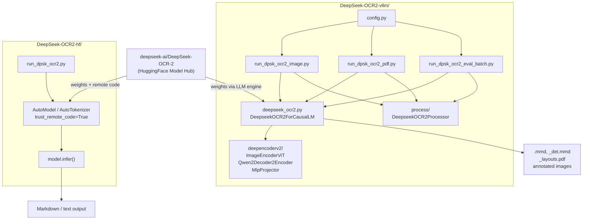
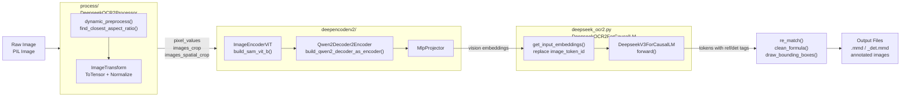

<!-- source: DeepWiki mcp.deepwiki.com · repo deepseek-ai/DeepSeek-OCR-2 · page 1 Overview · fetched 2026-10-30 -->

# Overview

<details>
<summary>Relevant source files</summary>

The following files were used as context for generating this wiki page:

- [DeepSeek_OCR2_paper.pdf](DeepSeek_OCR2_paper.pdf)
- [README.md](README.md)

</details>


This page introduces DeepSeek-OCR-2, its core architectural concept, primary capabilities, and the top-level structure of the repository. For installation steps, see [Getting Started](#2). For detailed documentation of either inference backend, see [Inference Backends](#3). For the internal model architecture, see [Core Architecture](#4).

---

## What is DeepSeek-OCR-2?

DeepSeek-OCR-2 is a multimodal OCR model built on the concept of **Visual Causal Flow** — an approach to visual encoding that processes image regions in a sequential, causally-dependent manner rather than treating all patches as independent tokens. The model converts document images into structured text output, primarily Markdown.

The model is published as `deepseek-ai/DeepSeek-OCR-2` on HuggingFace Hub and supports two primary task modes controlled by the prompt:

| Task | Prompt | Output |
|---|---|---|
| Document to Markdown (with layout) | `<image>\n<|grounding|>Convert the document to markdown.` | Markdown with bounding-box grounding tags |
| Free OCR (text only, no layout) | `<image>\nFree OCR.` | Plain extracted text |

See [README.md:135-138]() for the canonical prompt definitions.

---

## Visual Causal Flow

The "Visual Causal Flow" concept, described in the paper `DeepSeek_OCR2_paper.pdf`, drives the vision encoder design. Rather than encoding all image patches in parallel, the model uses a **Qwen2 decoder operating as an encoder** with learnable query embeddings. This hybrid causal/non-causal attention mechanism allows image tokens to attend to each other in a structured sequence, producing richer contextual visual features than purely parallel ViT encoding.

This is implemented in the `deepencoderv2/` package within the vLLM path. The key components are `ImageEncoderViT` (a SAM-ViT-B backbone) followed by `Qwen2Decoder2Encoder`. For full details, see [Vision Encoders](#5).

---

## Core Capabilities

- **Dynamic resolution**: A single image is split into 0–6 local tiles at 768×768 pixels plus one global thumbnail at 1024×1024 pixels, producing between 256 and 1,120 visual tokens total. The tile count is determined per image based on aspect ratio.
- **Grounding output**: The document-to-markdown prompt causes the model to emit `<|ref|>...<|/ref|>` and `<|det|>...<|/det|>` tags that encode bounding box coordinates alongside text.
- **Structured document output**: Tables (using `<td>`, `</td>`, `<tr>`, `</tr>` tokens), formulas, and headings are preserved in the Markdown output.

For a full explanation of the dynamic resolution system, see [Dynamic Resolution System](#6). For special tokens, see [Special Tokens](#7.1).

---

## Repository Structure

The repository contains two independent inference paths and one shared model package, all pointing to the same HuggingFace checkpoint.

**Repository layout:**

```
DeepSeek-OCR-2/
├── DeepSeek-OCR2-vllm/          # High-throughput vLLM path
│   ├── config.py                # Central configuration
│   ├── run_dpsk_ocr2_image.py   # Single image, async streaming
│   ├── run_dpsk_ocr2_pdf.py     # PDF batch processing
│   ├── run_dpsk_ocr2_eval_batch.py  # OmniDocBench evaluation
│   ├── deepseek_ocr2.py         # DeepseekOCR2ForCausalLM (vLLM plugin)
│   ├── process/                 # DeepseekOCR2Processor
│   └── deepencoderv2/           # Vision encoder package
│
├── DeepSeek-OCR2-hf/            # HuggingFace Transformers path
│   └── run_dpsk_ocr2.py         # Script entrypoint
│
├── requirements.txt
├── README.md
└── DeepSeek_OCR2_paper.pdf
```

Sources: [README.md:55-129]()

---

## High-Level System Architecture

The following diagram maps the two inference paths to the code entities that implement them.

**Diagram: Repository-Level Component Map**



Sources: [README.md:86-129]()

---

## Inference Backends

Two independent inference backends are provided. They share the same model checkpoint but differ significantly in deployment complexity and throughput.

| Property | Transformers (`DeepSeek-OCR2-hf/`) | vLLM (`DeepSeek-OCR2-vllm/`) |
|---|---|---|
| Primary class | `AutoModel` (remote code) | `DeepseekOCR2ForCausalLM` |
| Engine | HuggingFace `transformers` | vLLM `AsyncLLMEngine` / `LLM` |
| Invocation | `model.infer(...)` | `run_dpsk_ocr2_*.py` scripts |
| Concurrency | Single-request | `MAX_CONCURRENCY` slots, `NUM_WORKERS` CPU threads |
| PDF support | No | Yes (`run_dpsk_ocr2_pdf.py`) |
| Bounding box annotation | Yes | Yes |
| Benchmark eval | No | Yes (`run_dpsk_ocr2_eval_batch.py`) |
| Flash Attention | Required (`flash_attention_2`) | Optional |

For the Transformers path, see [Transformers Inference](#3.1). For the vLLM path, see [vLLM Inference](#3.2).

---

## End-to-End Inference Flow

**Diagram: Image to Text — Key Code Entities**



Sources: [README.md:86-138]()

---

## Dynamic Resolution Summary

The default resolution mode is documented in [README.md:131-133]():

- **Local tiles**: 0–6 crops at 768×768 pixels → 0–864 visual tokens (144 per tile)
- **Global thumbnail**: 1 view at 1024×1024 pixels → 256 visual tokens
- **Total token budget**: 256 + (N × 144), where N ∈ [0, 6]

The tiling count N is chosen per image based on aspect ratio matching. Configuration parameters `MIN_CROPS`, `MAX_CROPS`, `CROP_MODE`, `BASE_SIZE`, and `IMAGE_SIZE` in `config.py` control this budget. For a full explanation, see [Dynamic Resolution System](#6).

---

## Key Configuration Parameters

All vLLM-path configuration lives in a single file. The table below summarizes the most important parameters.

| Parameter | Default | Purpose |
|---|---|---|
| `MODEL_PATH` | `deepseek-ai/DeepSeek-OCR-2` | HuggingFace model identifier |
| `BASE_SIZE` | `1024` | Global thumbnail resolution |
| `IMAGE_SIZE` | `768` | Local tile resolution |
| `CROP_MODE` | `True` | Enable/disable local tiling |
| `MIN_CROPS` | `2` | Minimum number of tiles |
| `MAX_CROPS` | `6` | Maximum number of tiles |
| `MAX_CONCURRENCY` | `100` | Concurrent GPU inference slots |
| `NUM_WORKERS` | `64` | CPU preprocessing threads |
| `SKIP_REPEAT` | — | Skip already-processed outputs |

For full parameter documentation, see [vLLM Configuration](#3.2.1).

Sources: [README.md:64-138]()

---

