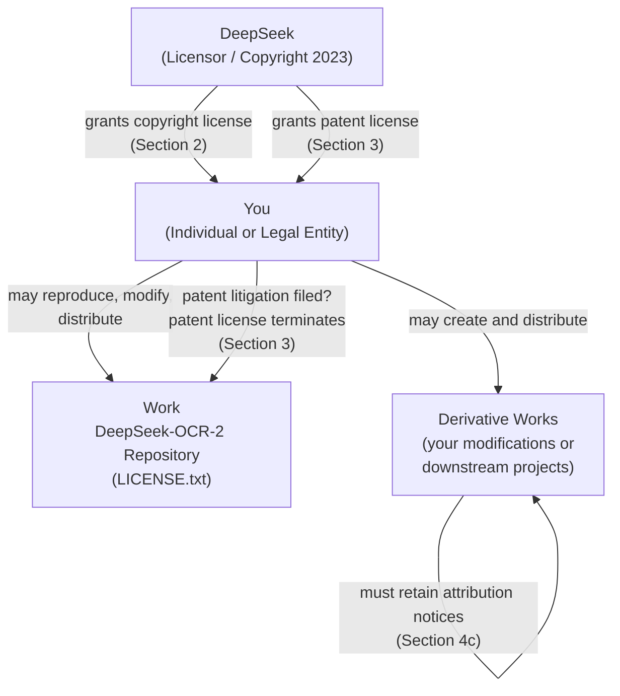
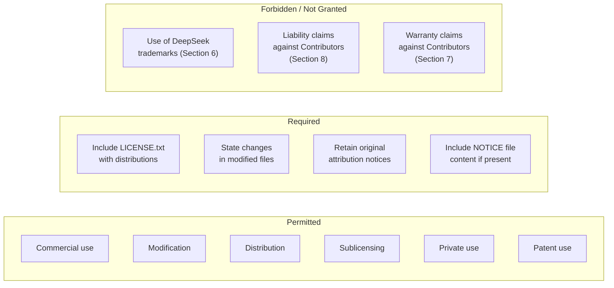

<!-- source: DeepWiki mcp.deepwiki.com · repo deepseek-ai/DeepSeek-OCR-2 · page 10 License and Legal · fetched 2026-10-30 -->

# License and Legal

<details>
<summary>Relevant source files</summary>

The following files were used as context for generating this wiki page:

- [LICENSE.txt](LICENSE.txt)

</details>


This page covers the licensing terms under which DeepSeek-OCR-2 is distributed. It applies to all source code, configuration files, model integration code, and documentation contained in the repository, including both the `DeepSeek-OCR2-vllm/` and `DeepSeek-OCR2-hf/` inference paths described in pages [3.1](#3.1) and [3.2](#3.2). It does not cover third-party dependencies (such as vLLM, PyTorch, or Transformers), which carry their own licenses.

---

## License

DeepSeek-OCR-2 is released under the **Apache License, Version 2.0** by DeepSeek (copyright 2023).

The full license text is located at [LICENSE.txt:1-202]().

---

## Summary of Key Provisions

The table below summarizes the core terms. All items are drawn directly from [LICENSE.txt:1-202]().

| Provision | Description |
|---|---|
| **Copyright grant** | Perpetual, worldwide, non-exclusive, royalty-free license to reproduce, prepare derivative works, publicly display, perform, sublicense, and distribute the Work. |
| **Patent grant** | Perpetual, royalty-free patent license covering claims necessarily infringed by a Contributor's contributions. Terminates if you initiate patent litigation against the Work. |
| **Redistribution** | Allowed in Source or Object form with or without modifications, subject to the four conditions listed below. |
| **Trademark** | No permission to use DeepSeek trade names, trademarks, or product names, except as required for reasonable attribution. |
| **Warranty** | Work is provided **"AS IS"**, without warranties of any kind (title, non-infringement, merchantability, fitness for purpose). |
| **Liability** | No Contributor is liable for any direct, indirect, special, incidental, or consequential damages arising from use of the Work. |
| **Contributions** | Any Contribution submitted to the Licensor is, by default, under the same Apache 2.0 terms unless explicitly stated otherwise. |

---

## Redistribution Requirements

When redistributing the Work or Derivative Works, all four of the following conditions must be met ([LICENSE.txt:90-129]()):

```
(a) Include a copy of this License with the distribution.
(b) Modified files must carry prominent notices stating they were changed.
(c) Retain all copyright, patent, trademark, and attribution notices
    from the Source form of the Work in any Derivative Works you distribute.
(d) If a NOTICE file exists, include its attribution notices in at least
    one of: a NOTICE file, the documentation, or a display generated
    by the Derivative Works.
```

---

## Patent License Termination

The patent license granted under Section 3 of the Apache License ([LICENSE.txt:75-88]()) is **automatically terminated** if you institute patent litigation — including a cross-claim or counterclaim — alleging that the Work or any Contribution within it constitutes patent infringement.

---

## License Flow Diagram

The following diagram maps the Apache 2.0 provisions to the parties and actions relevant to this repository.

**Apache 2.0 License Provisions and Parties**



Sources: [LICENSE.txt:67-88](), [LICENSE.txt:90-129]()

---

## Permissions and Obligations Reference

**Permissions and Obligations Reference (Apache 2.0)**



Sources: [LICENSE.txt:67-176]()

---

## Full License Text

The complete, authoritative license text is in [LICENSE.txt:1-202](). The boilerplate copyright notice, as it appears at the end of that file, reads:

> Copyright (c) 2023 DeepSeek
>
> Licensed under the Apache License, Version 2.0 (the "License"); you may not use this file except in compliance with the License. You may obtain a copy of the License at http://www.apache.org/licenses/LICENSE-2.0
>
> Unless required by applicable law or agreed to in writing, software distributed under the License is distributed on an "AS IS" BASIS, WITHOUT WARRANTIES OR CONDITIONS OF ANY KIND, either express or implied. See the License for the specific language governing permissions and limitations under the License.

[LICENSE.txt:190-202]()

---

## Notes on Third-Party Components

The repository integrates several third-party libraries. Their licenses are independent of Apache 2.0 and must be reviewed separately before redistribution:

| Component | Where Used | License (check upstream) |
|---|---|---|
| vLLM | `DeepSeek-OCR2-vllm/` inference path | Apache 2.0 |
| HuggingFace Transformers | `DeepSeek-OCR2-hf/` inference path | Apache 2.0 |
| PyTorch | Both inference paths | BSD-style |
| flash-attn | Transformers path (`_attn_implementation`) | BSD 3-Clause |
| Qwen2 model code | `DeepSeek-OCR2-vllm/deepencoderv2/` | Apache 2.0 |

> **Note:** The model weights distributed via `deepseek-ai/DeepSeek-OCR-2` on HuggingFace Hub may carry additional or separate terms. Review the model card on HuggingFace for any model-specific usage restrictions before deploying in production.

Sources: [LICENSE.txt:139-142]()